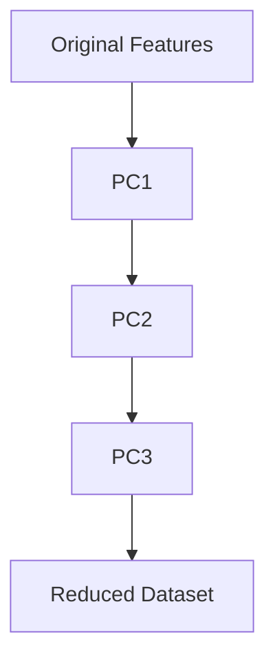

# 27. Principal Component Analysis (PCA)

> Learn how Principal Component Analysis (PCA) transforms high-dimensional datasets into a smaller set of informative features, enabling efficient visualization, noise reduction, and improved Machine Learning performance.

---

## 🎯 Learning Objectives

After completing this chapter, you will be able to:

- Understand the purpose of Principal Component Analysis (PCA)
- Learn how PCA performs feature extraction
- Understand principal components and explained variance
- Visualize high-dimensional data using PCA
- Apply PCA using Scikit-Learn
- Identify enterprise applications of PCA

---

## 📖 Overview

As datasets grow in size and complexity, many features become redundant or highly correlated.

**Principal Component Analysis (PCA)** is one of the most widely used **linear dimensionality reduction** techniques for transforming high-dimensional data into a lower-dimensional representation while preserving as much information as possible.

Instead of selecting existing features, PCA creates new features called **Principal Components**, which capture the maximum variance present in the original dataset.

PCA is widely used for visualization, feature engineering, noise reduction, and improving the efficiency of Machine Learning models.

---

## 🧠 Core Concepts

PCA transforms correlated features into a smaller set of uncorrelated components.

The primary objectives are to:

- Reduce dimensionality
- Preserve maximum variance
- Remove redundant information
- Improve computational efficiency
- Enable visualization

Each principal component is a linear combination of the original features.

---

## 🏗️ PCA Workflow


---

# 📘 What is PCA?

Principal Component Analysis (PCA) is a **feature extraction** technique that transforms a dataset into a new coordinate system.

The new axes, called **Principal Components (PCs)**, are ordered according to the amount of variance they explain.

- PC1 captures the highest variance.
- PC2 captures the next highest variance.
- Each subsequent component explains progressively less variance.

These components are mutually orthogonal (uncorrelated).

---

## Characteristics

- Linear dimensionality reduction
- Feature extraction technique
- Creates uncorrelated features
- Preserves maximum variance
- Widely used before clustering and classification

---

# 📊 Principal Components

A **Principal Component** is a new feature formed by combining the original variables.

Each component captures a different amount of information contained within the dataset.

Characteristics:

- Linear combination of original features
- Ordered by explained variance
- Orthogonal to one another
- Reduce redundancy between features

---

## 🏗️ Principal Components



---

# 📈 Explained Variance

Not every principal component contributes equally.

The **Explained Variance Ratio** measures how much information each component preserves.

For example:

| Component | Explained Variance |
|-----------|--------------------|
| PC1 | 52% |
| PC2 | 28% |
| PC3 | 12% |
| Remaining Components | 8% |

Using only PC1 and PC2 preserves approximately **80%** of the original information.

---

## Choosing the Number of Components

The number of principal components is typically selected based on:

- Cumulative explained variance
- Visualization requirements
- Model performance
- Computational efficiency

A common practice is to retain enough components to explain **90–95%** of the total variance.

---

# 📘 PCA Transformation

Instead of working with many correlated variables:

```
Age
Income
Credit Score
Annual Spending
Savings
...
```

↓

PCA

↓

```
PC1
PC2
PC3
```

The transformed dataset is smaller while retaining most of the useful information.

---

## 📊 Feature Selection vs PCA

| Feature Selection | PCA |
|-------------------|-----|
| Keeps original features | Creates new features |
| Easier to interpret | Lower interpretability |
| Removes unnecessary features | Combines information from all features |
| Original meaning preserved | Original meaning transformed |

---

## 🌍 Real-World Applications

PCA is widely used across industries.

| Industry | Example Application |
|----------|---------------------|
| Healthcare | Medical Image Analysis |
| Finance | Risk Modeling |
| Retail | Customer Analytics |
| Cybersecurity | Threat Detection |
| Manufacturing | Sensor Data Compression |
| Computer Vision | Face Recognition |
| Bioinformatics | Gene Expression Analysis |
| NLP | Embedding Visualization |

---

## 🏢 Case Study

### Customer Analytics

A retail company stores over 300 customer attributes.

Many variables are strongly correlated.

↓

Standardization

↓

PCA

↓

10 Principal Components

↓

Customer Segmentation

The reduced feature space improves clustering speed while preserving the majority of customer behavior patterns.

---

## 💻 Implementation Example

=== "Basic PCA"

```python title="pca.py"
from sklearn.decomposition import PCA

pca = PCA(n_components=2)

X_reduced = pca.fit_transform(X)
```

=== "Explained Variance"

```python title="explained_variance.py"
from sklearn.decomposition import PCA

pca = PCA()

pca.fit(X)

print(pca.explained_variance_ratio_)
```

=== "Pipeline"

```python title="pca_pipeline.py"
from sklearn.pipeline import Pipeline
from sklearn.preprocessing import StandardScaler
from sklearn.decomposition import PCA

pipeline = Pipeline([
    ("scaler", StandardScaler()),
    ("pca", PCA(n_components=5))
])

X_transformed = pipeline.fit_transform(X)
```

---

## 🏢 Enterprise Perspective

PCA is commonly integrated into Machine Learning pipelines before clustering, anomaly detection, and predictive modeling.

Typical enterprise use cases include:

- Customer segmentation
- Fraud detection
- Sensor analytics
- Image processing
- Recommendation systems
- Feature engineering
- Data visualization

Although PCA improves computational efficiency, organizations should balance dimensionality reduction with model interpretability, as principal components do not have direct business meaning.

---

!!! tip "Production Insight"

    PCA should generally be applied **after feature scaling**, since variables with larger numerical ranges can dominate the principal components.

    In production systems, PCA is often combined with feature engineering pipelines to reduce computational cost while maintaining predictive performance.

---

## 💡 Best Practices

- Standardize numerical features before applying PCA.
- Select the number of components using explained variance.
- Evaluate model performance before and after PCA.
- Use PCA primarily for numerical features.
- Combine PCA with visualization and clustering when appropriate.

---

## ⚠️ Common Mistakes

- Applying PCA without feature scaling.
- Keeping too few principal components and losing important information.
- Assuming principal components have direct business interpretation.
- Applying PCA to categorical features without preprocessing.
- Using PCA when interpretability is more important than dimensionality reduction.

---

## 📌 Key Takeaways

- PCA is a linear feature extraction technique.
- It transforms correlated features into uncorrelated principal components.
- Principal components are ordered by explained variance.
- PCA improves computational efficiency and visualization.
- It is widely used for clustering, feature engineering, anomaly detection, and exploratory data analysis.
- Standardization is an essential preprocessing step before applying PCA.

---

## 📚 Further Reading

The next chapter explores **t-SNE and UMAP**, two powerful nonlinear dimensionality reduction techniques designed for high-quality visualization of complex, high-dimensional datasets.

---

## ➡️ Next Chapter

*[28. t-SNE and UMAP](28-t-sne-and-umap.md)*