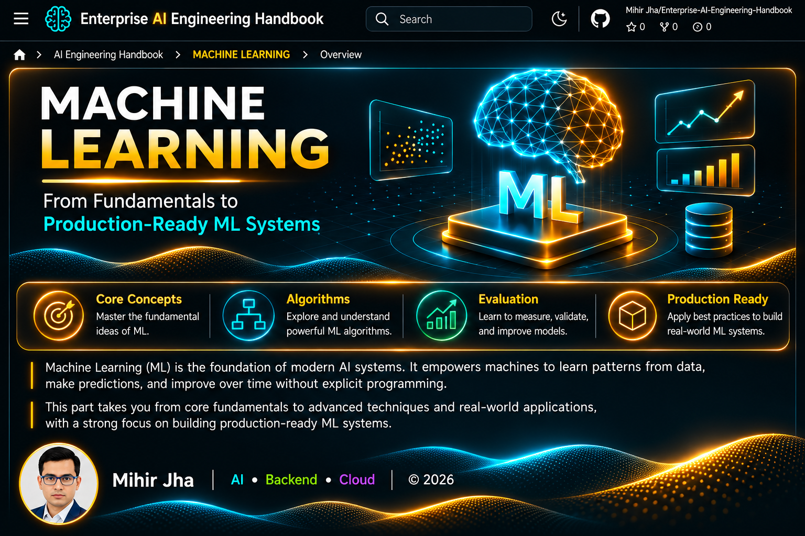

# Part I — Machine Learning

> Build a strong foundation in machine learning and understand how models are trained, evaluated, and applied in production systems.



## Overview

Machine Learning (ML) enables systems to learn patterns from data and use them to make predictions or support decisions.

This Part follows the journey from core concepts and algorithms to data preparation, feature engineering, model evaluation, and practical modelling pitfalls. It is designed for software engineers, backend developers, cloud engineers, and solution architects who want to connect machine learning concepts with real application and enterprise systems.

The learning progression is:

```text
ML foundations
     ↓
Regression and classification
     ↓
Data preparation and feature engineering
     ↓
Ensemble and unsupervised learning
     ↓
Model evaluation and validation
     ↓
Reliable modelling practices
```

## What you will learn

By completing these chapters, you will be able to:

- Explain the differences between AI, machine learning, and deep learning.
- Distinguish supervised and unsupervised learning problems.
- Understand common regression, classification, tree-based, and ensemble algorithms.
- Prepare data and engineer features for model training.
- Evaluate models using appropriate metrics and validation strategies.
- Recognise overfitting, underfitting, bias-variance trade-offs, and data leakage.
- Understand clustering and dimensionality reduction techniques.
- Connect model development practices to production ML systems.

## Learning path

Work through the chapters in sequence. The first group establishes the foundations; later chapters introduce algorithms, evaluation methods, and common modelling challenges.

| # | Chapter | Status |
|---:|---|:---:|
| 01 | [Introduction to Machine Learning](01-introduction-to-machine-learning.md) | ✅ |
| 02 | [Machine Learning Fundamentals](02-machine-learning-fundamentals.md) | ✅ |
| 03 | [Machine Learning Lifecycle](03-machine-learning-lifecycle.md) | ✅ |
| 04 | [Machine Learning in Practice](04-machine-learning-in-practice.md) | ✅ |
| 05 | [Machine Learning Ecosystem and Tools](05-machine-learning-ecosystem-and-tools.md) | ✅ |
| 06 | [Regression Fundamentals](06-regression-fundamentals.md) | ✅ |
| 07 | [Linear Regression](07-linear-regression.md) | ✅ |
| 08 | [Nonlinear Regression](08-nonlinear-regression.md) | ✅ |
| 09 | [Logistic Regression](09-logistic-regression.md) | ✅ |
| 10 | [Regression Model Training and Evaluation](10-training-and-evaluating-regression-models.md) | ✅ |
| 11 | [Classification Fundamentals](11-classification-fundamentals.md) | ✅ |
| 12 | [Decision Trees](12-decision-trees.md) | ✅ |
| 13 | [Regression Trees](13-regression-trees.md) | ✅ |
| 14 | [Support Vector Machines (SVM)](14-support-vector-machines.md) | ✅ |
| 15 | [K-Nearest Neighbors (K-NN)](15-k-nearest-neighbors.md) | ✅ |
| 16 | [Classification Model Evaluation](16-classification-model-evaluation.md) | ✅ |
| 17 | [Feature Scaling and Data Preparation](17-feature-scaling-and-data-preparation.md) | ✅ |
| 18 | [Bias-Variance Trade-off](18-bias-variance-tradeoff.md) | ✅ |
| 19 | [Ensemble Learning](19-ensemble-learning.md) | ✅ |
| 20 | [Building Production Classification Systems](20-building-production-classification-systems.md) | ✅ |
| 21 | [Unsupervised Learning Fundamentals](21-unsupervised-learning-fundamentals.md) | ✅ |
| 22 | [Clustering Fundamentals](22-clustering-fundamentals.md) | ✅ |
| 23 | [K-Means Clustering](23-k-means-clustering.md) | ✅ |
| 24 | [Density-Based Clustering](24-density-based-clustering.md) | ✅ |
| 25 | [Hierarchical Clustering](25-hierarchical-clustering.md) | ✅ |
| 26 | [Dimensionality Reduction Fundamentals](26-dimensionality-reduction-fundamentals.md) | ✅ |
| 27 | [Principal Component Analysis (PCA)](27-principal-component-analysis-pca.md) | ✅ |
| 28 | [t-SNE and UMAP](28-t-sne-and-umap.md) | ✅ |
| 29 | [Clustering for Feature Engineering](29-clustering-for-feature-engineering.md) | ✅ |
| 30 | [Building Production Unsupervised Learning Systems](30-building-production-unsupervised-learning-systems.md) | ✅ |
| 31 | [Model Evaluation Fundamentals](31-model-evaluation-fundamentals.md) | ✅ |
| 32 | [Classification Evaluation Metrics](32-classification-evaluation-metrics.md) | ✅ |
| 33 | [Regression Evaluation Metrics](33-regression-evaluation-metrics.md) | ✅ |
| 34 | [Unsupervised Learning Evaluation](34-unsupervised-learning-evaluation.md) | ✅ |
| 35 | [Cross-Validation and Model Validation](35-cross-validation-and-model-validation.md) | ✅ |
| 36 | [Regularization Techniques](36-regularization-techniques.md) | ✅ |
| 37 | [Data Leakage and Modeling Pitfalls](37-data-leakage-and-modeling-pitfalls.md) | ✅ |

## How the topics fit together

The chapters cover three connected areas of machine learning:

### 1. Learning algorithms

Understand how models learn from labelled and unlabelled data, including regression, classification, decision trees, support vector machines, nearest neighbours, ensemble methods, and clustering.

### 2. Data and model quality

Explore feature scaling, feature engineering, dimensionality reduction, evaluation metrics, cross-validation, and regularization. These techniques help determine whether a model has learned useful patterns and whether its performance is likely to generalise beyond the training data.

### 3. Production perspective

Connect model development to practical systems. The production-focused chapters introduce classification and unsupervised learning systems, while the final chapters address validation and modelling pitfalls such as data leakage.

## Enterprise perspective

Machine learning supports a wide range of business capabilities, including:

- Fraud detection and credit risk analysis
- Recommendation systems and customer churn prediction
- Predictive maintenance and demand forecasting
- Intelligent search and predictive analytics
- Medical diagnosis and cybersecurity applications

The appropriate algorithm depends on the problem, the available data, the cost of errors, and the operational constraints. Model quality is only one part of a successful ML solution; data quality, validation, deployment, and ongoing monitoring matter too.

## Start learning

Begin with [01. Introduction to Machine Learning](01-introduction-to-machine-learning.md), then follow the chapter sequence. Each topic builds on the foundations established earlier and moves toward more practical model development and evaluation.

---

> **Enterprise AI Engineering Handbook**
>
> *Building Production-Grade Enterprise AI Systems — One Chapter at a Time.*

---
