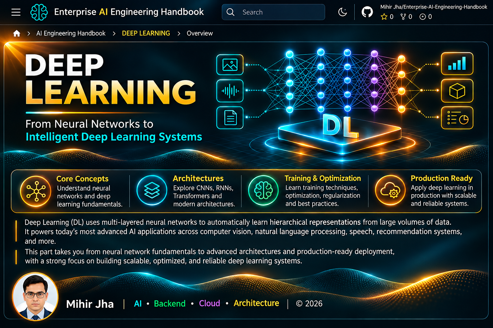
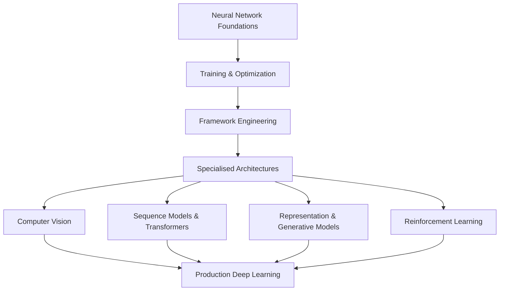

# Part II — Deep Learning

> Move from neural-network fundamentals to modern architectures and the engineering practices required to train, evaluate, deploy, and operate Deep Learning systems.

---

## 📖 Overview

Deep Learning is a branch of Machine Learning that uses multi-layer neural networks to learn representations from data. It powers applications ranging from image recognition and speech processing to recommendation systems and modern Generative AI.

This module follows the full engineering journey: mathematical foundations, network training, framework implementation, specialised architectures, generative learning, reinforcement learning, and production deployment. It combines the *why* behind the algorithms with the *how* of implementing them using TensorFlow, Keras, and PyTorch.

The goal is not simply to build a model that trains successfully. It is to understand the choices that make a model accurate, stable, efficient, and suitable for real-world use.

## 🎯 What You'll Learn

By the end of this module, you should be able to:

- Explain neurons, layers, weights, biases, network architectures, forward propagation, and backpropagation.
- Connect probability, activation functions, loss functions, and maximum likelihood estimation to model learning.
- Select optimizers, initialization strategies, learning-rate schedules, and regularization techniques.
- Build and train models with TensorFlow/Keras and PyTorch, including custom layers and training loops.
- Understand CNNs, residual networks, RNNs, LSTMs, GRUs, attention, and Transformer architectures.
- Compare approaches for computer vision, sequence modelling, representation learning, and generative tasks.
- Explain the foundations of reinforcement learning and Deep Q Networks.
- Understand GPU-based training, model evaluation, versioning, serving, and production monitoring.

---

## 🛣️ Recommended Learning Path

Follow the phases in order. The first phases establish how neural networks learn; later phases introduce architectures for different data types and finish with production concerns.

### 🧠 Phase 1 — Deep Learning Foundations

| Chapter | Status |
|---|:---:|
| [01. Introduction to Deep Learning](01-introduction-to-deep-learning.md) | ✅ |
| [02. Neural Network Fundamentals](02-neural-network-fundamentals.md) | ✅ |
| [03. Shallow & Deep Neural Networks](03-shallow-and-deep-neural-networks.md) | ✅ |
| [04. Linear & Logistic Regression for Deep Learning](04-linear-and-logistic-regression.md) | ✅ |
| [05. Activation Functions, Probabilities & Thresholding](05-activation-functions-probabilities-and-thresholding.md) | ✅ |
| [06. Loss Functions & Maximum Likelihood Estimation](06-loss-functions-and-maximum-likelihood.md) | ✅ |
| [07. Forward Propagation & Backpropagation](07-forward-and-backpropagation.md) | ✅ |

### ⚙️ Phase 2 — Training & Optimization

| Chapter | Status |
|---|:---:|
| [08. Gradient Descent & Mini-Batch Training](08-gradient-descent-and-mini-batch-training.md) | ✅ |
| [09. Weight Initialization & Gradient Stability](09-weight-initialization-and-gradient-stability.md) | ✅ |
| [10. Regularization & Generalization](10-regularization-and-generalization.md) | ✅ |
| [11. Advanced Optimization Techniques](11-advanced-optimization-techniques.md) | ✅ |
| [12. Hyperparameter Tuning & Training Strategies](12-hyperparameter-tuning-and-training-strategies.md) | ✅ |

### 🐍 Phase 3 — TensorFlow, Keras & PyTorch

| Chapter | Status |
|---|:---:|
| [13. TensorFlow & Keras Fundamentals](13-tensorflow-and-keras-fundamentals.md) | ✅ |
| [14. Keras Sequential & Functional API](14-keras-sequential-and-functional-api.md) | ✅ |
| [15. Custom Layers, Models & Training Loops](15-custom-layers-models-and-training-loops.md) | ✅ |
| [16. PyTorch Fundamentals & Tensors](16-pytorch-fundamentals-and-tensors.md) | ✅ |
| [17. PyTorch Autograd, Dataset & DataLoader](17-pytorch-autograd-dataset-and-dataloader.md) | ✅ |
| [18. Building Classification & Regression Models](18-building-classification-and-regression-models.md) | ✅ |

### 👁️ Phase 4 — Computer Vision & Vision Models

| Chapter | Status |
|---|:---:|
| [19. Convolutional Neural Networks (CNN)](19-convolutional-neural-networks.md) | ✅ |
| [20. CNN Architecture, Optimization & Training](20-cnn-architecture-optimization-and-training.md) | ✅ |
| [21. Transfer Learning & Fine-Tuning](21-transfer-learning-and-fine-tuning.md) | ✅ |
| [22. ResNet, Residual Connections & TorchVision Models](22-resnet-residual-connections-and-torchvision.md) | ✅ |
| [23. Vision Transformers (ViT) & CNN–ViT Hybrids](23-vision-transformers-and-cnn-vit-hybrids.md) | ✅ |

### 🔄 Phase 5 — Sequential Learning & Transformers

| Chapter | Status |
|---|:---:|
| [24. Recurrent Neural Networks (RNN)](24-recurrent-neural-networks.md) | ✅ |
| [25. LSTM & GRU](25-lstm-and-gru.md) | ✅ |
| [26. Attention Mechanism & Positional Encoding](26-attention-and-positional-encoding.md) | ✅ |
| [27. Transformer Architecture](27-transformer-architecture.md) | ✅ |
| [28. Transformer Applications](28-transformer-applications.md) | ✅ |

### 🎨 Phase 6 — Generative & Representation Learning

| Chapter | Status |
|---|:---:|
| [29. Autoencoders & Representation Learning](29-autoencoders-and-representation-learning.md) | ✅ |
| [30. Generative Adversarial Networks (GANs)](30-generative-adversarial-networks.md) | ✅ |
| [31. Diffusion Models](31-diffusion-models.md) | ✅ |

### 🎮 Phase 7 — Reinforcement Learning

| Chapter | Status |
|---|:---:|
| [32. Reinforcement Learning Fundamentals](32-reinforcement-learning-fundamentals.md) | ✅ |
| [33. Markov Decision Processes & Q-Learning](33-markov-decision-processes-and-q-learning.md) | ✅ |
| [34. Deep Reinforcement Learning & Deep Q Networks](34-deep-reinforcement-learning-and-dqn.md) | ✅ |

### 🏭 Phase 8 — Production Deep Learning

| Chapter | Status |
|---|:---:|
| [35. GPU-Accelerated Deep Learning](35-gpu-accelerated-deep-learning.md) | ✅ |
| [36. Deep Learning Training & Model Lifecycle](36-deep-learning-training-and-model-lifecycle.md) | ✅ |
| [37. Building Production Deep Learning Systems](37-building-production-deep-learning-systems.md) | ✅ |

---

## 🏢 Enterprise Perspective

Deep Learning is used across industries where systems need to interpret complex data, recognise patterns, or make predictions. Examples include:

- **Vision:** image classification, object detection, semantic segmentation, and medical image analysis.
- **Language and speech:** natural language processing, speech recognition, and intelligent document processing.
- **Decision support:** recommendation systems, fraud detection, predictive maintenance, and time-series forecasting.
- **Modern AI:** multimodal applications, foundation models, and Generative AI.
- **Autonomous systems:** perception and decision-making in dynamic environments.

The appropriate architecture depends on the data, task, constraints, and operating environment—not on which model is currently attracting the most attention.

## 🧩 Practical Engineering Focus

Where the topics allow, the module approaches implementation through both Keras and PyTorch. Pay attention to the engineering dimensions that matter beyond model definition:

- Model construction and tensor operations
- Data loading and preprocessing pipelines
- Training loops, loss functions, and optimizers
- Evaluation and model comparison
- GPU execution and resource use
- Model persistence, versioning, and serving

Framework APIs differ, but the underlying learning concepts remain connected. Understanding those concepts makes it easier to move between tools and choose the right implementation for a project.

## 🧭 Architecture Landscape

The chapters progress from general neural-network foundations to architectures designed for different learning problems. This is a conceptual map, not a strict lineage: CNNs, recurrent models, attention-based models, and generative approaches are related but solve different classes of problems.

---

> **Enterprise AI Engineering Handbook**
>
> *Building Production-Grade Enterprise AI Systems — One Chapter at a Time.*

---
