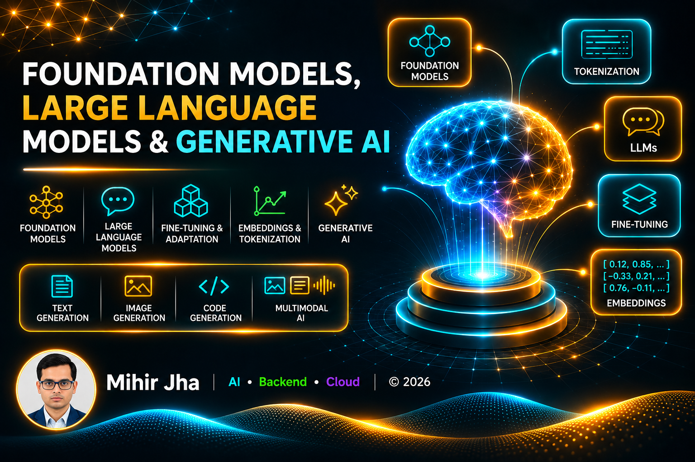
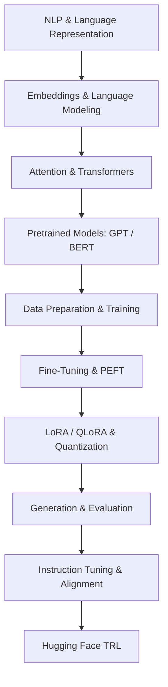

# Part III — Foundation Models, Large Language Models & Generative AI

> Understand how modern Foundation Models and Large Language Models evolved, how they are trained and adapted, and how model-centric techniques support production Generative AI systems.



---

## 📖 Overview

Foundation Models and Large Language Models (LLMs) are pretrained models that can be adapted to support many tasks, including language understanding, text generation, code, vision, and multimodal applications.

Building on the Deep Learning foundations in **Part II**, this module follows the progression from NLP and language representation to language modeling, attention, Transformers, and modern model families such as GPT and BERT. It then moves into practical LLM engineering with Hugging Face: preparing data, training workflows, fine-tuning, efficient adaptation, generation, evaluation, and alignment.

The focus is on understanding both the models and the engineering choices involved in adapting them for real-world use.

## 🎯 Learning Outcomes

By completing this module, you will be able to:

- Explain how NLP, embeddings, and language modeling led to modern LLMs.
- Describe attention, positional encoding, and Transformer architecture.
- Compare GPT and BERT model families and their typical use cases.
- Prepare datasets and use the Hugging Face ecosystem for model workflows.
- Explain fine-tuning, supervised fine-tuning (SFT), PEFT, LoRA, and QLoRA.
- Understand quantization and its trade-offs for model memory and inference.
- Compare decoding strategies and evaluate generated outputs.
- Explain instruction tuning, reward modeling, RLHF, PPO, and DPO.
- Connect model adaptation and alignment to downstream RAG, agent, and enterprise AI applications.

---

## 🛣️ Recommended Learning Path

Follow the phases in order. Each phase builds on the concepts and engineering practices introduced earlier.

### 🧠 Phase 1 — Generative AI & Language Foundations

| Chapter | Status |
|---|:---:|
| [01. Generative AI Fundamentals](01-generative-ai-fundamentals.md) | ✅ |
| [02. Language Understanding Fundamentals](02-language-understanding-fundamentals.md) | ✅ |
| [03. Word Embeddings](03-word-embeddings.md) | ✅ |
| [04. Language Modeling](04-language-modeling.md) | ✅ |

*Build the foundations: language representation, embeddings, and predicting language from context.*

### 🤖 Phase 2 — Transformers & Modern Language Models

| Chapter | Status |
|---|:---:|
| [05. Attention & Positional Encoding](05-attention-and-positional-encoding.md) | ✅ |
| [06. GPT & BERT Architecture](06-gpt-and-bert-architecture.md) | ✅ |

*Connect language modeling to attention and Transformer-based model architectures.*

### 🤗 Phase 3 — Hugging Face & LLM Engineering

| Chapter | Status |
|---|:---:|
| [07. Hugging Face & Transformers](07-huggingface-and-transformers.md) | ✅ |
| [08. LLM Data Preparation](08-llm-data-preparation.md) | ✅ |
| [09. Hugging Face Training Workflow](09-huggingface-training-workflow.md) | ✅ |

*Move from model concepts to datasets, tokenizers, training workflows, and model artifacts.*

### 🛠️ Phase 4 — Transformer Fine-Tuning

| Chapter | Status |
|---|:---:|
| [10. Transformer Fine-Tuning Fundamentals](10-transformer-fine-tuning-fundamentals.md) | ✅ |
| [11. Supervised Fine-Tuning (SFT)](11-supervised-fine-tuning-sft.md) | ✅ |
| [12. Parameter-Efficient Fine-Tuning](12-parameter-efficient-fine-tuning.md) | ✅ |
| [13. LoRA & QLoRA](13-lora-and-qlora.md) | ✅ |
| [14. Model Quantization](14-model-quantization.md) | ✅ |

*Explore ways to adapt pretrained models while managing compute, memory, and deployment constraints.*

### ⚡ Phase 5 — LLM Generation & Evaluation

| Chapter | Status |
|---|:---:|
| [15. LLM Generation Strategies](15-llm-generation-strategies.md) | ✅ |
| [16. LLM Evaluation](16-llm-evaluation.md) | ✅ |

*Understand decoding choices and how to assess model behavior and task-specific output quality.*

### 🎯 Phase 6 — Instruction Tuning & Alignment

| Chapter | Status |
|---|:---:|
| [17. Instruction Tuning](17-instruction-tuning.md) | ✅ |
| [18. Reward Modeling](18-reward-modeling.md) | ✅ |
| [19. LLMs as Policies](19-llms-as-policies.md) | ✅ |
| [20. Reinforcement Learning from Human Feedback](20-reinforcement-learning-from-human-feedback.md) | ✅ |
| [21. Proximal Policy Optimization (PPO)](21-proximal-policy-optimization-ppo.md) | ✅ |
| [22. Direct Preference Optimization (DPO)](22-direct-preference-optimization-dpo.md) | ✅ |

*Follow the progression from instruction-following data and preference signals to alignment methods. PPO and DPO are distinct approaches, not interchangeable steps in a single mandatory pipeline.*

### 🧰 Phase 7 — Hugging Face TRL & Alignment Engineering

| Chapter | Status |
|---|:---:|
| [23. Hugging Face TRL Workflow](23-huggingface-trl-workflow.md) | ✅ |

*Bring the alignment concepts together through practical tooling in the Hugging Face ecosystem.*

---

## 🧭 The Model Engineering Journey



## 🏢 Enterprise Perspective

In enterprise systems, a Foundation Model is one capability within a larger application—not the complete solution. Common use cases include:

- Enterprise assistants and copilots
- Document summarization and information extraction
- Semantic search and knowledge discovery
- Code and content generation
- Customer support and classification
- Multimodal applications

Production use also involves decisions about domain data, model adaptation, evaluation, deployment, monitoring, security, governance, scalability, and cost. Those concerns are explored further in the handbook's application and architecture modules.

## 🏗️ From Model Engineering to Application Engineering

This module focuses on understanding and adapting models. Later modules build the application capabilities around them:

```text
Part III — Foundation Models & LLMs
                ↓
Part IV — Prompt Engineering & RAG Fundamentals
                ↓
Part V — Advanced RAG
                ↓
Part VI — AI Agents
                ↓
Part VII — Agentic AI & Multi-Agent Systems
                ↓
Enterprise AI Architecture
```

The key transition is from **understanding and adapting models** to **engineering reliable applications and systems around them**. RAG, tool calling, agents, orchestration, and enterprise integration are covered in their respective modules rather than repeated here.

## 📌 Key Takeaways

- Modern LLMs build on NLP, language representation, language modeling, and Transformer architectures.
- GPT and BERT illustrate different approaches to using Transformer-based models.
- Hugging Face provides a practical ecosystem for working with pretrained models and training workflows.
- Fine-tuning adapts pretrained models; PEFT methods such as LoRA and QLoRA reduce adaptation costs.
- Quantization can reduce memory requirements, with trade-offs that should be evaluated.
- Decoding strategies influence generation behavior, while evaluation determines whether outputs meet task requirements.
- Instruction tuning and preference-based methods address how models follow instructions and align with human preferences.
- These techniques provide a model-engineering foundation for the RAG, agent, and enterprise application topics that follow.

## 🚀 Start Learning

Begin with [01. Generative AI Fundamentals](01-generative-ai-fundamentals.md).

---

> **Enterprise AI Engineering Handbook**
>
> *Building Production-Grade Enterprise AI Systems — One Chapter at a Time.*

---
