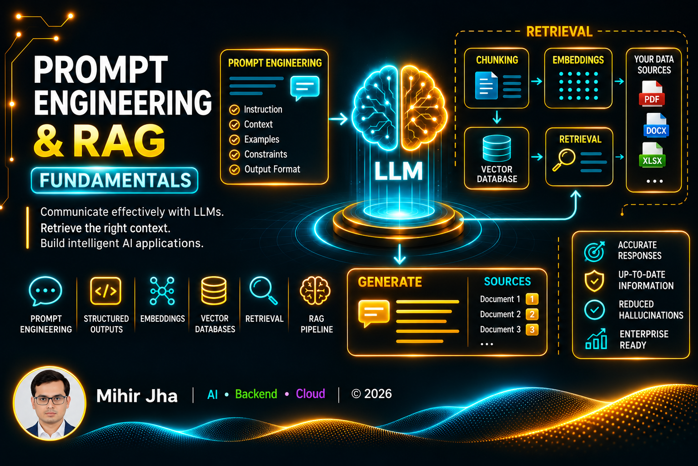
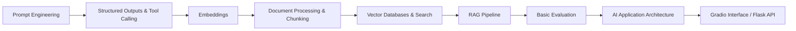

# Part IV — Prompt Engineering & RAG Fundamentals

> From writing effective prompts to building a foundational RAG application.

## Overview

Building an LLM application involves more than sending a prompt and displaying the response. Applications need clear instructions, predictable output formats, access to relevant information and a way to connect model capabilities to software.

This part develops those foundations step by step. It begins with prompt engineering and structured outputs, moves through embeddings, document processing and vector search, and brings these components together in a basic Retrieval-Augmented Generation (RAG) application.

The final chapters introduce two ways to expose an AI capability: an interactive interface with Gradio and a programmatic API with Flask.

Frameworks such as LangChain and LlamaIndex may appear in examples, but their architecture and dedicated implementation tracks are covered in **Part VIII — AI Engineering Frameworks & Tooling**. Advanced retrieval techniques are covered in **Part V — Advanced RAG**.

## What you'll learn

By completing this part, you will be able to:

- Design prompts using common prompting patterns.
- Work with structured model outputs and function/tool calling.
- Generate embeddings and understand semantic similarity.
- Process documents and choose practical chunking strategies.
- Understand vector databases and similarity search.
- Build and evaluate a foundational RAG pipeline.
- Recognise the main components of an enterprise LLM application.
- Expose an AI capability through a Gradio interface or Flask API.

## Learning path

## Chapter map

### 1. Prompt engineering and LLM interaction

| Chapter | Topic |
|---|---|
| 01 | [Introduction to Prompt Engineering](01-introduction-to-prompt-engineering.md) |
| 02 | [Prompt Engineering Fundamentals](02-prompt-engineering-fundamentals.md) |
| 03 | [Advanced Prompt Engineering](03-advanced-prompt-engineering.md) |
| 04 | [Prompt Design Patterns](04-prompt-design-patterns.md) |
| 05 | [Zero-shot, One-shot & Few-shot Prompting](05-zero-one-few-shot-prompting.md) |
| 06 | [Chain-of-Thought (CoT) Prompting](06-chain-of-thought-prompting.md) |
| 07 | [ReAct Prompting](07-react-prompting.md) |
| 08 | [Structured Outputs & Output Parsing](08-structured-outputs-and-output-parsing.md) |
| 09 | [Function Calling & Tool Calling](09-function-calling-and-tool-calling.md) |

### 2. Embeddings & Vector Search

| Chapter | Topic |
|---|---|
| 10 | [Embeddings in Practice](10-embeddings-in-practice.md) |
| 11 | [Document Processing & Vectorization](11-document-processing-and-vectorization.md) |
| 12 | [Document Chunking Strategies](12-document-chunking-strategies.md) |
| 13 | [Vector Database Fundamentals](13-vector-database-fundamentals.md) |
| 14 | [Similarity Search Techniques](14-similarity-search-techniques.md) |

### 3. RAG Fundamentals

| Chapter | Topic |
|---|---|
| 15 | [RAG Pipeline Components](15-rag-pipeline-components.md) |
| 16 | [Retrieval & Generation Pipeline](16-retrieval-and-generation-pipeline.md) |
| 17 | [Vector Databases in RAG](17-vector-databases-in-rag.md) |
| 18 | [Building Your First RAG Pipeline](18-building-your-first-rag-pipeline.md) |
| 19 | [RAG Evaluation Fundamentals](19-rag-evaluation-fundamentals.md) |

### 4. Enterprise AI Application & deployment

| Chapter | Topic |
|---|---|
| 20 | [Enterprise Generative AI Application Architecture](20-enterprise-generative-ai-application-architecture.md) |
| 21 | [Deploying AI Applications with Gradio](21-deploying-ai-applications-with-gradio.md) |
| 22 | [Deploying AI Applications with Flask](22-deploying-ai-applications-with-flask.md) |

## Where this part fits

Part IV establishes the building blocks for LLM applications and basic RAG. The next stages of the handbook build on these foundations:

- **Part V — Advanced RAG:** improves retrieval quality, context selection, evaluation and production RAG design.
- **Part VI — AI Agents:** explores individual agents, their tools, reasoning, memory and execution.
- **Part VII — Agentic AI & Multi-Agent Systems:** covers agent collaboration, orchestration and multi-agent architectures.
- **Part VIII — AI Engineering Frameworks & Tooling:** explores practical framework and protocol implementations.

## Start here

Begin with [01. Introduction to Prompt Engineering](01-introduction-to-prompt-engineering.md), then follow the chapter sequence. Each topic builds toward creating an LLM application that can retrieve relevant knowledge and expose its capabilities through an interface or API.

---

> **Enterprise AI Engineering Handbook**
>
> *Building Production-Grade Enterprise AI Systems — One Chapter at a Time.*

---
