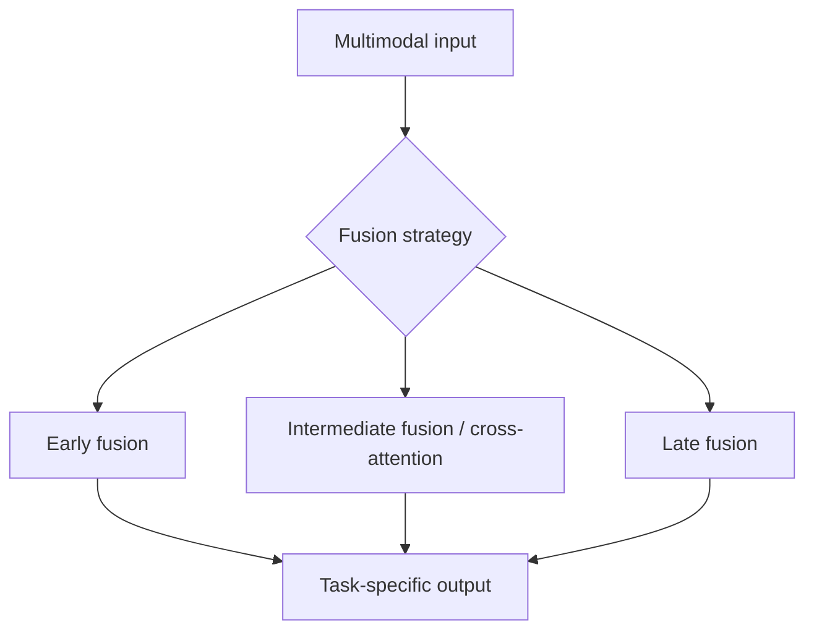
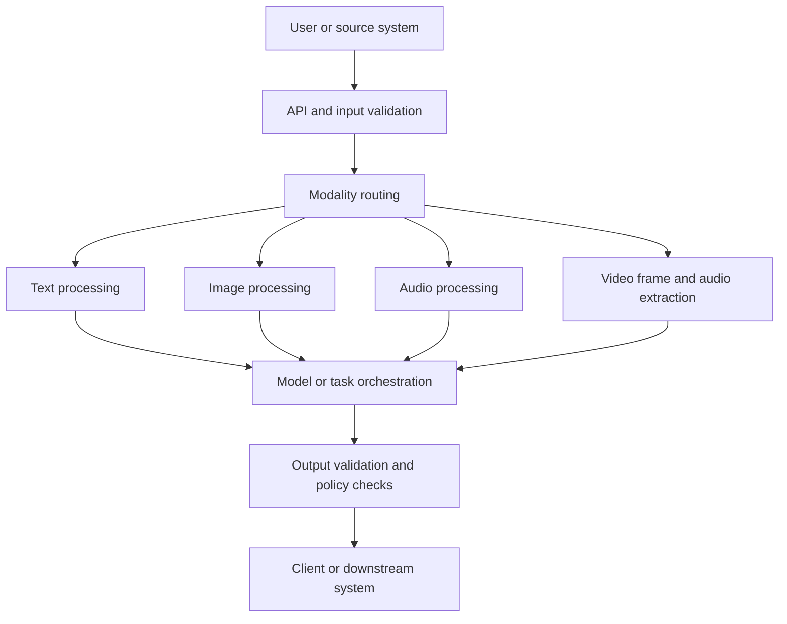

# Multimodal AI Fundamentals

> An introduction to multimodal AI systems that can work across text, images, audio, and video—and the architectural decisions behind building them reliably.

---

# 1. Overview

Most people experience AI through a chat box. They type a question and receive a response. But real-world information rarely arrives as text alone.

A customer may describe a problem and attach a screenshot. A support team may need to search a meeting recording. An online shopper may want to find a product using a photo rather than its name.

These are examples of **multimodal AI**: systems that process more than one type of information and use the relationships between them to complete a task.

Building such systems involves more than accepting different file formats. Each modality has its own structure, processing requirements, and failure modes. The architecture must determine how information is represented, combined, validated, and passed to the model.

This note establishes the foundations for the *Multimodal AI Engineering* section. Later notes explore speech, vision-language models, generative media, application orchestration, and governance. The dedicated [Multimodal RAG chapter](https://enterpriseai.handbook.mihirkjha.com/05-advanced-retrieval-augmented-generation/05-advanced-rag-architecture/05-multimodal-rag/) covers retrieval across modalities in more depth.

---

# 2. What Is a Modality?

A **modality** is a form of information. Common examples include:

- **Text** — documents, prompts, transcripts, and messages.
- **Images** — photographs, screenshots, charts, and diagrams.
- **Audio** — speech, meetings, calls, and environmental sounds.
- **Video** — sequences of frames, often combined with audio.

Structured sensor readings, spatial data, and other signals can also be modalities, depending on the use case.

Each type of data brings a different perspective. Text carries language; images provide visual evidence; audio carries speech and sound; video adds movement and time.

Consider a recorded customer-support call. The transcript tells us what the customer said. The audio may reveal pauses or tone. A screen recording may show the exact error that occurred. A multimodal system can combine these signals to build a more complete picture—provided the model and application are designed to use them together.

## Multimodal AI vs. multiple file formats

A system that extracts text from a PDF and sends it to a language model supports a document workflow, but it is not necessarily reasoning across modalities.

A system that examines a chart, reads its labels, and relates the visual trend to a user's question is doing more genuinely multimodal work.

**The important question is not how many formats a system accepts, but whether it can connect relevant information across them.**

## How multimodal AI evolved

Early AI systems were often designed for one kind of input or task. BERT, for example, became widely known for language tasks, while ResNet was used for image recognition. These systems could be effective within their domains, but connecting their outputs required additional application logic.

A notable step toward cross-modal learning was **CLIP (Contrastive Language–Image Pre-training)**, which learns representations that associate images with natural-language descriptions. This made it possible to retrieve images using text, or find text descriptions related to an image, when the model has learned the relevant concepts.

The field has continued moving toward models that can accept or reason across multiple modalities. The course transcript names IBM Granite Vision, Meta Llama vision-capable models, OpenAI GPT-4-class multimodal models, and Google's Gemini and Gemma families as examples. These are examples from the course material, not a claim that every model or version supports the same inputs or tasks. Always check the specific model's current capabilities, limitations, and deployment terms.

## Where multimodal AI is useful

The value comes from combining signals that would be incomplete on their own:

- **Virtual assistants:** interpret spoken requests alongside visual or screen context.
- **Healthcare:** help clinicians review medical images alongside relevant records; outputs must remain subject to clinical validation.
- **Education:** combine explanations, diagrams, audio, and interactive learning materials.
- **Autonomous systems:** combine camera feeds with audio or other sensor signals to understand changing surroundings.
- **Content creation:** generate or transform text, images, speech, and video.
- **Accessibility:** describe visual content, transcribe speech, or provide spoken versions of information.
- **Commerce:** let shoppers search by product image, ask questions about an item, or receive visual assistance.

These are application patterns, not guarantees of accuracy. High-stakes use cases need domain-specific evaluation and human oversight.

## Trends to watch

The course highlights several directions in the field: more unified models that handle multiple modalities, more processing on edge devices, self-supervised learning that reduces dependence on manually labelled data, personalization, and stronger emphasis on fairness, transparency, and responsible use.

Each direction has trade-offs. Edge inference can reduce network latency and limit data transfer, but device resources may constrain model size. Personalization can improve relevance, but it also increases the importance of consent, access control, and data-retention design.

---

# 3. How Multimodal AI Systems Work

A typical multimodal application has a few logical stages:


This is a conceptual flow, not a requirement to build seven separate services. A hosted multimodal model may handle several stages inside one API call. A custom system may expose them as independent components.

The architecture should follow the needs of the task, rather than adding components simply because they appear in a reference diagram.

## Core components

- **Input boundary** validates requests, file types, payload sizes, and access permissions.
- **Modality-specific processing** prepares text, images, audio, or video for the selected model.
- **Encoders or multimodal models** convert inputs into representations that can be processed.
- **Alignment and fusion** connect information across modalities when the task requires it.
- **Task layer** answers a question, classifies an input, retrieves candidates, or generates content.
- **Validation and observability** check outputs and record operational signals without retaining sensitive media unnecessarily.

---

# 4. Modality Encoders and Representations

An **encoder** converts input data into a representation that a model can process. Text encoders work with language, vision encoders with images, and audio encoders with sound or speech. Some models use sequences of learned tokens rather than a single vector.

The representation depends on the model and how it was trained. It should not be treated as a complete or perfect understanding of the original input.

## Separate encoders

One approach is to process each modality with a model designed for it. For example, a vision model extracts visual features while a text model processes a product description. The application or another model then combines the results.

## Shared embedding spaces

Some models are trained to place related text and images near each other in a shared embedding space. For example, an image of running shoes and the phrase “red running shoes” may produce representations that are close enough to support similarity search.


This pattern supports cross-modal search, but it has limits. Embeddings produced by unrelated models are not automatically comparable. Performance also depends on the training data and the kinds of images and language the model has learned to associate.

A shared embedding space is useful for finding related items. It does not, on its own, provide a complete RAG pipeline or guarantee that a generated answer is correct.

---

# 5. How Are Modalities Combined?

**Fusion** is the process of combining information from different modalities. The right approach depends on the task, the selected model, latency requirements, and how closely the inputs need to interact.

## Early fusion

Information from different modalities is combined near the beginning of the model pipeline. This can support rich interactions, but it requires a model architecture that can handle the combined representations.

## Late fusion

Each modality is processed separately, and the results are combined later. This can be easier to implement and lets teams reuse existing components. However, some detailed relationships between modalities may be lost.

## Intermediate fusion and cross-attention

Some systems combine information within intermediate model layers. Cross-attention is one mechanism that allows information from one modality to influence how another modality is interpreted.



There is no universally best fusion strategy. For an enterprise architect, the practical questions are:

- Does the task require deep interaction between modalities?
- Does the chosen model support that interaction?
- Can it meet the application's latency and cost targets?
- How will we evaluate whether the model connected the inputs correctly?

---

# 6. A Reference Enterprise Architecture

The following diagram separates the main responsibilities without assuming every stage must be deployed as its own service.



A production design should keep the following concerns explicit:

- **Input contracts:** supported formats, file sizes, duration limits, and expected output.
- **Model adapters:** provider-specific requests and responses should not leak throughout business logic.
- **Failure handling:** invalid inputs, timeouts, rate limits, and model failures need distinct outcomes.
- **Resource budgets:** frame extraction, image resolution, audio duration, model calls, and tokens can all affect cost.
- **Provenance:** retain source identifiers, timestamps, and model versions when they are needed for audit or debugging.
- **Privacy:** avoid logging raw images, audio, or video by default.

A hosted model may make the architecture look simple, but these application-level responsibilities do not disappear.

---

# 7. Example: A Small Modality-Routing Boundary

Before calling a model, an application can identify the requested modality and apply basic input checks. The following example illustrates that boundary; it does not perform image understanding, transcription, or video analysis.

```python
from enum import Enum


class Modality(str, Enum):
    TEXT = "text"
    IMAGE = "image"
    AUDIO = "audio"
    VIDEO = "video"


CONTENT_TYPES = {
    "text/plain": Modality.TEXT,
    "image/jpeg": Modality.IMAGE,
    "image/png": Modality.IMAGE,
    "audio/wav": Modality.AUDIO,
    "audio/mpeg": Modality.AUDIO,
    "video/mp4": Modality.VIDEO,
}


def validate_input(content_type: str, payload: bytes) -> Modality:
    if not payload:
        raise ValueError("Input payload must not be empty")

    max_size = 20 * 1024 * 1024
    if len(payload) > max_size:
        raise ValueError("Input exceeds the 20 MiB limit")

    try:
        return CONTENT_TYPES[content_type.lower()]
    except KeyError as exc:
        raise ValueError("Unsupported content type") from exc
```

This is a starting point, not a complete upload-security implementation. In production, do not trust the MIME type supplied by the caller alone. Inspect file signatures, enforce limits after decoding, apply authentication and authorization, and scan files according to your organization's security requirements.

The model adapter should then own provider-specific payload construction, timeouts, retries, and response normalization.

---

# 8. Challenges in Real Applications

The gap between a working demo and a dependable multimodal feature usually appears in the edge cases.

## Representation and alignment

Different modalities do not naturally share the same representation. A model trained on image-caption pairs may still struggle with unusual objects, domain-specific diagrams, or language that differs from its training data.

Even when a model accepts both text and images, it may answer from the text while overlooking the visual evidence—or describe the image without answering the actual question. Test the relationship between inputs, not just whether the model returns fluent text.

## Video and temporal context

A single frame can show what is present, but a sequence can show what happened. Sampling too few frames may miss a brief event. Ignoring timestamps can also lead to a misleading summary.

Video tasks may require frame selection, temporal context, audio extraction, and transcript alignment. These steps should be selected based on the question rather than applied indiscriminately.

## Latency and cost

A request may trigger OCR, speech transcription, frame extraction, embedding, retrieval, and generation. Track the cost and latency of individual stages so the team can see where time and money are being spent.

Do not process every modality just because the input contains it. Use the smallest pipeline that can answer the user's question reliably.

## Privacy and data quality

Blurry images, clipped audio, missing timestamps, and poor transcripts can degrade the result. Audio and video can also contain faces, voices, bystanders, confidential screens, and personal information.

Preserve metadata when it affects interpretation, minimize raw-data retention, and make access and retention rules explicit.

---

# 9. Enterprise Design Principles

A few principles help keep multimodal applications maintainable:

1. **Start with the task.** Define the user outcome before choosing models or modalities.
2. **Use explicit contracts.** Document supported inputs, limits, outputs, and error behavior.
3. **Keep model adapters replaceable.** Avoid coupling business logic to a single provider SDK.
4. **Evaluate each path separately.** Good image captioning does not guarantee good visual question answering.
5. **Validate generated results.** Check schemas, policy constraints, and consistency with available evidence.
6. **Plan for partial failure.** If transcription fails, return a clear error or partial result rather than implying the whole task succeeded.
7. **Measure cost and latency.** Include preprocessing and orchestration, not only model response time.
8. **Protect user data.** Log only what is needed for operations, evaluation, and audit.

A multimodal model can make a powerful capability available through one endpoint. It cannot replace sound application boundaries, access controls, observability, or evaluation.

---

# 10. Common Mistakes

- Assuming every model supports every modality or task.
- Treating video as a single image and discarding event order.
- Comparing embeddings from unrelated models without checking compatibility.
- Sending every frame or full-resolution image when it is not needed.
- Treating model-generated captions as unquestionable facts.
- Measuring only overall accuracy and ignoring weak individual processing paths.
- Logging sensitive media to diagnose problems that could be investigated with metadata.
- Coupling application logic directly to a provider-specific SDK.

---

# 11. Quick Revision

- **Modality:** a form of information, such as text, image, audio, or video.
- **Encoder:** converts input into a representation that a model can process.
- **Cross-modal alignment:** connects related information across modalities.
- **Fusion:** combines information early, in intermediate layers, or late in the pipeline.
- **Temporal context:** preserves the order and timing of events in audio or video.
- **Production readiness:** requires input contracts, security, evaluation, observability, and graceful failure handling.

## Interview Questions

1. What makes a system genuinely multimodal rather than simply able to accept multiple file formats?
2. How do early fusion and late fusion differ, and what trade-offs influence the choice?
3. Why might embeddings from two different models not be directly comparable?
4. Why does video require temporal context in addition to visual understanding?
5. How would you design an API boundary for a service accepting text, images, audio, and video?
6. How would you investigate a system that performs well on text queries but poorly on image-grounded questions?

---

# 12. Key Takeaways

Multimodal AI is an architectural capability, not a magic switch. The work lies in choosing appropriate model capabilities, preserving relationships between inputs, evaluating failure modes, and building operational controls around the model.

Start with the task rather than the number of modalities you can support. Add only the processing paths that improve the user outcome, measure them independently, and keep the design modular enough to evolve as models and requirements change.

---

# 13. References and Further Reading

- [Generative AI Fundamentals](https://enterpriseai.handbook.mihirkjha.com/03-generative-ai/01-generative-ai-fundamentals/)
- [Transformer Applications](https://enterpriseai.handbook.mihirkjha.com/02-deep-learning/28-transformer-applications/)
- [Enterprise Generative AI Application Architecture](https://enterpriseai.handbook.mihirkjha.com/04-retrieval-augmented-generation/20-enterprise-generative-ai-application-architecture/)
- [Context Selection and Context Engineering](https://enterpriseai.handbook.mihirkjha.com/05-advanced-retrieval-augmented-generation/06-production-rag-engineering/02-context-selection-and-context-engineering/)
- [Multimodal RAG](https://enterpriseai.handbook.mihirkjha.com/05-advanced-retrieval-augmented-generation/05-advanced-rag-architecture/05-multimodal-rag/)

---

# Next in This Section

[**02. Enterprise Speech AI: STT, TTS and Voice Pipelines**](02-enterprise-speech-ai-stt-tts-and-voice-pipelines.md) — how speech recognition, speech synthesis, and audio processing fit into voice-enabled AI applications.


> **Enterprise AI Engineering Handbook**

> *Building Production-Grade Enterprise AI Systems — One Chapter at a Time.*

