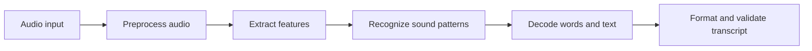
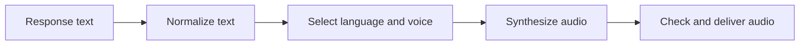

# Enterprise Speech AI: STT, TTS, and Voice Pipelines

> A voice interface is more than speech recognition followed by a language model. It is a pipeline that must preserve meaning, manage latency, protect audio data, and recover gracefully when recognition is uncertain.

Speech is one of the most natural ways for people to interact with software, but it is also a noisy and variable input channel. Accents, background sounds, domain-specific vocabulary, overlapping speakers, and the need for fast responses all affect the experience.

This note covers the core speech technologies and shows how they fit into enterprise applications: from transcribing a meeting to building an assistant that listens, reasons, and responds aloud.

# 1. The speech AI landscape

Three capabilities are related, but they solve different problems:

| Capability | Input | Output | Typical purpose |
|---|---|---|---|
| Speech-to-text (STT) / automatic speech recognition (ASR) | Audio | Text | Transcribe what was said |
| Speech understanding | Transcript or audio | Intent, entities, meaning, dialogue state | Decide what the speaker means or wants |
| Text-to-speech (TTS) | Text | Audio | Speak a response naturally |

Speaker-related capabilities are adjacent rather than interchangeable with ASR:

- **Speaker identification** estimates *who* is speaking.
- **Speaker diarization** determines *which speaker spoke when* in a recording.
- **Voice authentication** attempts to verify a claimed identity and requires careful security design.
- **Emotion or prosody analysis** estimates vocal characteristics; it should not be treated as a reliable diagnosis of a person's internal state.

A typical voice assistant combines speech recognition, language understanding or an LLM, application tools, and speech synthesis. A meeting assistant may instead emphasize transcription, speaker separation, summarization, and action-item extraction.

# 2. How speech recognition evolved

Speech recognition has moved from limited, hand-built systems toward neural models that learn representations from large audio datasets.

- **Template matching and rule-based systems** worked with constrained vocabularies and predictable patterns.
- **Statistical approaches**, including Hidden Markov Models (HMMs), improved recognition of more natural speech.
- **Deep neural networks** improved acoustic representation learning.
- **End-to-end models** learn a more direct mapping from audio to text, reducing the need to assemble every stage as a separate model.
- **Self-supervised learning and transformer-based approaches** can learn from large amounts of unlabelled audio and can support multilingual and context-aware systems.

Examples mentioned in the course material include OpenAI Whisper and Wav2Vec2. Cloud alternatives include Google Speech-to-Text and Azure Speech. Model quality, language coverage, deployment constraints, and licensing differ, so selection should be based on the target workload rather than brand recognition alone.

# 3. The STT pipeline

A useful conceptual pipeline is:



## Step 1: Capture and preprocess

Audio is captured from a microphone, uploaded file, call recording, or streaming source. Preprocessing may include:

- Converting to the sample rate and channel format expected by the model.
- Normalizing audio levels where appropriate.
- Reducing noise when it improves signal quality.
- Detecting voice activity so silence does not need to be processed unnecessarily.
- Splitting long recordings into manageable segments while preserving timestamps and context.

Preprocessing should not be treated as a magic accuracy fix. Aggressive filtering can remove useful speech cues, and poor segmentation can cut words or separate a phrase from its context.

## Step 2: Represent the audio

The raw waveform can be transformed into a representation that is easier for a model to process. Traditional pipelines often use spectrograms or Mel-frequency cepstral coefficients (MFCCs). Modern neural systems may learn useful audio representations directly from waveforms or other input features.

## Step 3: Recognize and decode

The model identifies patterns associated with phonetic units, characters, subwords, or tokens. A decoder produces a likely text sequence. Context can help resolve ambiguity, but context can also lead a system to produce a plausible phrase that was never spoken.

## Step 4: Post-process and validate

The system may restore punctuation, apply formatting, attach timestamps, and normalize domain terms. High-impact workflows should preserve the raw transcript and make corrections traceable. Do not silently rewrite uncertain words in legal, medical, or compliance records.

# 4. End-to-end recognition with Wav2Vec2

The course demonstrates the end-to-end approach using Wav2Vec2: load audio, prepare it for the model, run inference, and decode the output. The example below shows the inference boundary without assuming a particular model checkpoint or local audio path.

```python
from transformers import pipeline

# Select a checkpoint suited to your language and deployment constraints.
asr = pipeline(
    task="automatic-speech-recognition",
    model="facebook/wav2vec2-base-960h",
)

result = asr("meeting_clip.wav")
transcript = result["text"]

print(transcript)
```

This illustrates the basic call shape; an actual deployment should verify the checkpoint's supported languages, input requirements, and runtime dependencies. The example checkpoint is English-focused, so it is not an appropriate default for every multilingual workload. Whisper is another common option, especially when broad language support is required.

For a production implementation, keep model loading outside the request handler, validate uploaded files, enforce duration and size limits, and add timeouts and observability. For streaming speech, use a streaming-capable service or model rather than repeatedly submitting the entire growing recording.

# 5. From transcript to meaning

A transcript is not yet an understanding of the request. Text processing and speech understanding may involve:

- **Natural language processing (NLP):** analyzing sentence structure, grammar, context, and meaning.
- **Text classification:** assigning categories, such as spam detection, sentiment, topic, or moderation labels.
- **Information extraction:** identifying named entities, relationships, and key phrases, or summarizing unstructured text.
- **Intent detection:** identifying whether the speaker wants to book, search, cancel, summarize, or perform another action.
- **Context handling:** resolving references such as “move it to tomorrow.”
- **Dialogue management:** asking a clarification question when the request is incomplete or ambiguous.

These steps are related but distinct. Classification assigns a label; extraction pulls structured facts from the transcript; dialogue management determines what the application should do next.

In an enterprise assistant, the transcript should be passed through the same authorization and validation rules as typed input. A voice command must not bypass permissions simply because it arrived through audio.

# 6. Text-to-speech: giving an application a voice

Text-to-speech converts written text into audio. Modern neural TTS systems can produce natural-sounding voices with varied prosody and intonation, multiple voice options, and—in supported systems—different expressive styles.

A simple TTS path is:



Text normalization matters. Dates, abbreviations, currency, numbers, and technical terms may need to be rendered for speech rather than read character by character. Long responses may need sentence-level chunking so playback can begin before the entire response is synthesized.

The course introduces gTTS as a practical tool. One naming distinction is useful for implementation: **gTTS is a third-party Python library that interfaces with Google Translate's text-to-speech service; it is not the same product as the official Google Cloud Text-to-Speech API.** The example below demonstrates the library's basic usage:

```python
from gtts import gTTS

text = "Your meeting summary is ready."
audio = gTTS(text=text, lang="en")
audio.save("meeting-summary.mp3")
```

This is suitable for a small demonstration, not a complete production voice service. Check network and service requirements, supported languages, privacy implications, error handling, and latency before adopting a TTS provider. For sensitive enterprise text, confirm where text is processed and whether it may be retained by the service.

# 7. Putting STT, an LLM, and TTS together

A voice-enabled assistant often follows this path:


The language model is only one component. The surrounding application must handle session state, authentication, tool permissions, retries, and failure responses.

For a meeting assistant, the path can be different: audio is transcribed, speaker turns and timestamps are retained, and the transcript is passed to a summarization or action-item workflow. The course highlights a prototype pattern combining Whisper, Mixtral, and Google Text-to-Speech. The architecture can be adapted to other transcription, language-model, and speech-synthesis providers.

A practical application boundary might look like this:

```python
def handle_voice_request(audio_file, asr, assistant, tts):
    """Illustrative orchestration; add auth, limits, and error handling in production."""
    transcript_result = asr(audio_file)
    transcript = transcript_result["text"].strip()

    if not transcript:
        return {"status": "needs_input", "message": "I couldn't detect speech clearly."}

    # Apply the same policy and authorization checks used for typed requests.
    response_text = assistant.respond(transcript)
    audio_response = tts.synthesize(response_text)

    return {
        "transcript": transcript,
        "response_text": response_text,
        "audio": audio_response,
    }
```

The `asr`, `assistant`, and `tts` interfaces are placeholders, not drop-in SDK objects. Keeping them behind interfaces makes it easier to switch providers, test components independently, and add fallback behavior.

# 8. Latency, reliability, and enterprise controls

Voice experiences are sensitive to delay. Measure the complete interaction rather than just model inference time.

| Area | What to measure or control |
|---|---|
| Recognition quality | Word error rate (WER), critical-term accuracy, language-specific performance |
| Responsiveness | Time to first transcript, time to first audio, end-to-end latency |
| Audio quality | Clipping, silence detection, sample-rate errors, dropped chunks |
| Resilience | Timeout rate, retries, provider failures, fallback success |
| Security and privacy | Consent, retention, encryption, access control, deletion policy |
| User experience | Correction rate, clarification rate, interruption handling, user feedback |

Word error rate is useful for comparing transcripts against a reference, but it does not capture every business risk. In a banking or healthcare workflow, a single incorrect amount, medication, name, or negation may matter more than the overall transcript score. Evaluate critical terms and downstream task success separately.

Important failure modes include background noise, accent and speaker variation, low-resource languages, specialized vocabulary, code-switching, overlapping speakers, and poor contextual understanding. For real-time systems, streaming, voice activity detection, partial transcripts, and incremental TTS can reduce perceived latency, but they introduce additional state and synchronization concerns.

# 9. Applications and emerging directions

Speech AI is useful across several domains:

- **Accessibility:** captions for live events, speech output for users with visual impairments, and alternative ways to interact with software.
- **Healthcare:** clinical dictation and documentation, with strict review and privacy controls.
- **Education:** language practice, spoken tutoring, lecture transcription, and accessible learning material.
- **Customer service:** voice assistants, interactive voice response, and agent-assist summaries.
- **Business operations:** meeting transcription, searchable recordings, notes, and action-item extraction.
- **Legal settings:** transcription and court reporting, where traceability and human verification are especially important.
- **Content creation:** narration, audiobooks, and voice-enabled experiences.

Trends highlighted in the course include self-supervised learning, multilingual models, stronger contextual understanding, speaker personalization, and on-device processing. For TTS, the course also points toward more natural and expressive speech, better multilingual support, and closer integration with other modalities. Edge inference can reduce latency and keep some audio local, but device capability, model size, battery use, and update management become part of the design.

For hands-on practice, start with a short transcription task using Whisper or a suitable hosted STT service, then try a small TTS feature in an application. Learn basic audio processing and concepts from phonetics and phonology, test different languages and voice settings, and use listener feedback to identify awkward pronunciation or delivery. Evaluate providers against your actual language, privacy, latency, and cost requirements.

# 10. Design principles for production voice systems

1. **Treat transcripts as uncertain data.** Retain confidence or uncertainty signals when available and ask for clarification when needed.
2. **Protect the original evidence.** Keep source audio and transcript versions according to a clear retention policy; make corrections auditable.
3. **Apply the same access controls to voice and text.** Authentication and authorization belong in the application layer.
4. **Make high-impact actions confirmable.** Read back important amounts, dates, names, and irreversible actions before execution.
5. **Design for partial failure.** Recognition, LLM processing, and synthesis can fail independently; provide a useful text fallback.
6. **Evaluate across real users and environments.** Test accents, microphones, noise levels, domain vocabulary, languages, and accessibility needs.
7. **Minimize sensitive audio exposure.** Obtain appropriate consent, limit retention, and check vendor data handling before sending recordings to an external service.

# 11. Common mistakes

- Treating a transcript as a guaranteed verbatim record.
- Evaluating only average accuracy while ignoring critical words and downstream outcomes.
- Using a model without checking language coverage or input-format requirements.
- Sending sensitive audio to a provider without understanding its retention and processing terms.
- Generating one long audio response when users need interruption, streaming, or quick clarification.
- Assuming speaker recognition is a secure substitute for multi-factor authentication.
- Failing to provide a text alternative when speech recognition or playback does not work.

# 12. Quick revision and interview questions

**Quick revision**

- STT/ASR converts audio into text; TTS converts text into audio.
- Speech understanding interprets the transcript and manages intent and context.
- A recognition pipeline commonly includes preprocessing, feature representation, recognition/decoding, and post-processing.
- Wav2Vec2 and Whisper are examples of speech-recognition approaches; Google Speech-to-Text and Azure Speech are cloud options.
- Neural TTS can generate natural speech, but text normalization, voice selection, latency, and privacy still matter.
- Production voice systems need authorization, evaluation, observability, fallback paths, and retention controls.

**Interview questions**

1. How does speech-to-text differ from speech understanding?
2. Why can a fluent transcript still be wrong?
3. What are the main stages in an STT pipeline?
4. When might you choose a hosted speech service over a self-hosted model?
5. How would you reduce latency in a voice assistant without sacrificing reliability?
6. How would you evaluate transcription quality for medical or legal vocabulary?
7. What security risks arise when an assistant executes actions from spoken commands?
8. How would you design a meeting assistant that produces summaries and action items while preserving speaker attribution?

## References and further reading

- IBM course transcript: *RAG and AI Agents: Build Multimodal Generative AI Application* — sections on speech-to-text, speech processing, text-to-speech, and multimodal applications.
- [Hugging Face Transformers — Automatic Speech Recognition](https://huggingface.co/docs/transformers/tasks/asr)
- [OpenAI Whisper](https://github.com/openai/whisper)
- [Google Cloud Speech-to-Text](https://cloud.google.com/speech-to-text)
- [Azure AI Speech](https://learn.microsoft.com/azure/ai-services/speech-service/)

## Next in This Section

Continue with [**03. Vision-Language Models and Image Understanding**](03-vision-language-models-and-image-understanding.md), which explores image captioning, visual question answering, and connecting visual content with language.

> **Enterprise AI Engineering Handbook**
>
> *Building Production-Grade Enterprise AI Systems — One Chapter at a Time.*
