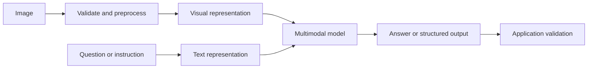
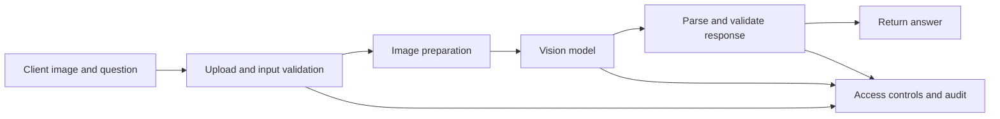

# 03. Vision-Language Models and Image Understanding

> A vision-language model connects visual input with a user's question. Building a reliable application means more than sending an image to a model: prepare the image correctly, make the task explicit, keep business facts grounded in trusted data, and validate the result.

This chapter explains how to build applications that interpret images, answer questions about visual content, and retrieve visually similar items. It covers image captioning, visual question answering (VQA), image transport, image embeddings, and practical application design. Provider-specific APIs change, so treat request examples as patterns and check the current documentation for the service you deploy.

# 1. What vision-language models do

A vision-language model (VLM) processes visual input together with language. Depending on its capabilities, it can describe an image, answer a question about it, extract visible text or fields, or use an image as context in a longer conversation.

| Task | Input | Typical result |
|---|---|---|
| Image captioning | Image | A concise description of the scene |
| Visual question answering (VQA) | Image + question | An answer focused on the question |
| Visual information extraction | Image | Text or structured fields from a label, form, or document |
| Image-grounded conversation | Image + conversation | Follow-up answers about the same image |
| Visual search | Image or image embedding | Similar images or catalogue records |

Captioning and VQA are related but not interchangeable. “Describe this photo” invites a broad description; “What colour is the jacket?” asks for a targeted answer. The same model may support both tasks, but prompt design and evaluation should match the task.

VLMs can miss small objects, misread text, confuse similar items, or confidently infer details that are not visible. Their responses are useful model outputs, not ground truth.

# 2. How image understanding works

The internal architecture varies by model family. At a high level, an image is prepared and represented by a vision component, while the question is represented as language. The model combines both inputs to generate a response.



Some systems use a visual encoder connected to a language model through learned projection or alignment layers. Others use more integrated multimodal architectures. Application developers do not need to reproduce that internal architecture, but they do need to understand the interface: supported image formats, image-size limits, message schema, response format, and model-specific limitations.

## Image preparation versus image understanding

Image preparation makes the input usable by the model or API. It may include:

- Validating file type, byte size, and dimensions.
- Converting the image to a supported format and correcting orientation.
- Resizing or compressing it without losing task-relevant detail.
- Passing an accepted image URL or encoding image bytes as Base64 when required.
- Keeping the original asset under the application's access and retention controls.

**Base64 is a transport encoding, not an image embedding.** It represents bytes as text-safe characters; it does not make an image searchable by meaning. An embedding is a numerical vector used for similarity comparison or retrieval.

# 3. Image captioning, VQA, and multimodal prompts

A good prompt tells the model what to do, what to inspect, and how to handle uncertainty. The IBM transcript demonstrates prompts that vary by use case—for example, a fashion consultant analysing an outfit, a nutrition assistant describing food, or a preliminary review of a workplace photograph.

For a preliminary visual safety review, a bounded prompt could be:

```text
Review this image for visible safety concerns.

For each possible concern, return:
- Observation
- What is visibly supporting it
- Uncertainty or missing context

Only report what the image supports. Do not conclude that the workplace is safe
based on a single image. State when the image is unclear or insufficient.
```

This does not turn a VLM into a certified inspector. It helps structure the response while leaving consequential decisions to an appropriate human or validated process.

For a food photograph, a model may identify likely ingredients and estimate portion sizes, calories, and nutrients. These estimates are inherently uncertain: a photo usually cannot establish exact weight, hidden ingredients, oil content, or preparation method. Present such results as approximate, not as precise nutritional measurement or medical advice.

A useful visual prompt defines five things:

1. **Task:** caption, answer a question, extract fields, or compare items.
2. **Visual focus:** objects, attributes, relationships, or text to inspect.
3. **Evidence boundary:** separate visible details from assumptions.
4. **Output contract:** specify the fields or format the application expects.
5. **Uncertainty behaviour:** explain what to do when evidence is ambiguous or missing.

# 4. Sending an image and question to a vision model

A multimodal chatbot can use a vision-capable model to answer questions about an uploaded image. Its workflow is to configure credentials and a model, prepare an image from a local file or URL, send both image and text in one message, and extract the answer from the response.

A generic message shape might look like this:

```json
{
  "role": "user",
  "content": [
    {
      "type": "text",
      "text": "What objects are visible in this image?"
    },
    {
      "type": "image_url",
      "image_url": {
        "url": "data:image/jpeg;base64,<encoded-image>"
      }
    }
  ]
}
```

This is **illustrative, not a universal API contract**. Providers differ in model identifiers, image content blocks, accepted URL formats, authentication, and response objects. In particular, the example workflow references different Llama Vision model versions in different labs; do not assume that an identifier from a course exercise is still available in a deployed environment.

## Encode a local image as a Base64 data URL

Use Base64 only when the target API supports a data URL. The MIME type must match the actual image format. This small helper enforces a file-size limit, but a production upload endpoint should also verify the actual file content and dimensions.

```python
import base64
from pathlib import Path


def image_as_data_url(path: str, mime_type: str = "image/jpeg") -> str:
    image_path = Path(path)

    if not image_path.is_file():
        raise FileNotFoundError(f"Image not found: {image_path}")

    max_bytes = 8 * 1024 * 1024  # Example limit: 8 MiB
    if image_path.stat().st_size > max_bytes:
        raise ValueError("Image exceeds the configured upload limit")

    encoded = base64.b64encode(image_path.read_bytes()).decode("ascii")
    return f"data:{mime_type};base64,{encoded}"
```

For an image already uploaded through a web framework, read the upload's bytes using that framework's API, validate them, and then encode them. Do not assume every upload object behaves like a normal file path.

Some applications accept images retrieved from URLs. In production, avoid blindly fetching arbitrary user-supplied URLs: use an allowlist where possible, enforce timeouts and download-size limits, validate the final content, and block access to internal or link-local addresses to reduce server-side request forgery (SSRF) risk. Prefer a controlled object-storage URL when supported by the provider.

## Keep model output behind an application boundary

A production request path should not simply return arbitrary model output to a client or execute actions because the model suggested them.



Validate the response shape, handle timeouts and provider errors, and keep secrets in a secure configuration system rather than source code. If a response can trigger a business action, apply authorization and policy checks in application code.

# 5. From image embeddings to visual search

A VLM answers questions about image content. A visual search pipeline represents images as vectors and compares those vectors to retrieve visually similar candidates. A system can use both: retrieval finds candidate records, while a VLM helps describe the uploaded image and explain the results.

## Example: building a visual fashion search assistant

Imagine a visual fashion search assistant that lets a user upload a photograph of an outfit and receive likely matching clothing items, product details, and purchase links from a catalogue. Its core stages are:

1. Prepare the uploaded image.
2. Use a pretrained ResNet50 model to produce an image feature vector.
3. Compare the query vector with precomputed dataset vectors using cosine similarity.
4. Retrieve the associated catalogue records, including product details and URLs.
5. Send the image and retrieved metadata to a vision-language model for a catalogue-style response.


The retrieval stage can use the highest-scoring match and retrieve related items from the same outfit record. Its example prompt asks the model to describe materials, patterns, and colours, and to include item details or similar items depending on the similarity score. A threshold is a dataset- and model-specific decision: calibrate it on representative examples instead of assuming a score such as `0.8` is universally meaningful.

## What cosine similarity tells you

For vectors \(u\) and \(v\), cosine similarity is:

\[
\operatorname{cosine}(u,v)=\frac{u\cdot v}{\|u\|\,\|v\|}
\]

A higher score means the vectors point in a more similar direction. It does not prove that two images show the same product or that the products are interchangeable. Results depend on the encoder, preprocessing, dataset, and domain.

A general-purpose ResNet50 model trained for image classification can provide useful features for a learning project. It is not inherently a fashion-specific or text-aligned embedding model. For production search, compare its results with domain-specific or jointly trained image-text encoders, using an evaluation set that reflects real user queries.

## Extract feature vectors with TorchVision ResNet50

the example workflow's lab uses ResNet50 as an image feature extractor. The following modern TorchVision pattern removes the final classification layer so the output is a feature vector, and uses the preprocessing transforms associated with the selected weights. Use the same model and preprocessing for catalogue images and query images.

```python
import numpy as np
import torch
from PIL import Image
from torchvision.models import ResNet50_Weights, resnet50


class ResNet50ImageEncoder:
    def __init__(self) -> None:
        self.device = torch.device(
            "cuda" if torch.cuda.is_available() else "cpu"
        )
        weights = ResNet50_Weights.DEFAULT
        self.preprocess = weights.transforms()

        model = resnet50(weights=weights)
        model.fc = torch.nn.Identity()  # Use penultimate-layer features
        self.model = model.to(self.device).eval()

    @torch.inference_mode()
    def encode(self, image: Image.Image) -> np.ndarray:
        image = image.convert("RGB")
        batch = self.preprocess(image).unsqueeze(0).to(self.device)
        vector = self.model(batch).squeeze(0).cpu().numpy()

        norm = np.linalg.norm(vector)
        if not np.isfinite(vector).all() or norm == 0:
            raise ValueError("Invalid image feature vector")

        return (vector / norm).astype(np.float32)
```

This is a **feature-extraction example**, not a complete Style Finder implementation. It does not load the sample dataset, create the index, call watsonx.ai, or build the web UI. the example application's serialized dataset and API code should be adapted separately, and stored vectors must be regenerated if the encoder or preprocessing changes. TorchVision documents the weights-specific transforms and model initialization in its [ResNet50 documentation](https://docs.pytorch.org/vision/stable/models/generated/torchvision.models.resnet50/).

## Rank candidates by cosine similarity

For a small in-memory dataset, normalized vectors can be compared using a dot product. At larger scale, use an appropriate vector index and map returned IDs to validated catalogue records.

```python
import numpy as np


def top_k_matches(
    query_vector: np.ndarray,
    dataset_vectors: np.ndarray,
    top_k: int = 5,
) -> list[tuple[int, float]]:
    query = np.asarray(query_vector, dtype=np.float32).reshape(-1)
    vectors = np.asarray(dataset_vectors, dtype=np.float32)

    if vectors.ndim != 2 or vectors.shape[1] != query.shape[0]:
        raise ValueError("Query and dataset vectors must have matching dimensions")
    if top_k < 1:
        raise ValueError("top_k must be at least 1")
    if not np.isfinite(query).all() or not np.isfinite(vectors).all():
        raise ValueError("Vectors must contain only finite values")

    query_norm = np.linalg.norm(query)
    norms = np.linalg.norm(vectors, axis=1)
    if query_norm == 0:
        raise ValueError("Query vector has zero norm")

    valid = norms > 0
    scores = np.full(len(vectors), -np.inf, dtype=np.float32)
    scores[valid] = (vectors[valid] @ query) / (norms[valid] * query_norm)

    indices = np.argsort(scores)[::-1]
    return [
        (int(i), float(scores[i]))
        for i in indices[:top_k]
        if np.isfinite(scores[i])
    ]
```

This helper returns row indices and scores, not product facts. Retrieve names, prices, stock status, and URLs from the authoritative catalogue using the returned IDs. Do not let the generative model invent or overwrite those fields.

# 6. Enterprise use cases and design boundaries

These techniques support several useful application patterns:

- **Multimodal chatbot and VQA:** ask questions about an uploaded photo, diagram, or other supported visual input.
- **AI shopping assistant:** retrieve visually similar catalogue items, then generate a readable description with trusted product details.
- **Food-image analysis:** identify likely food items and estimate portions, calories, and nutrients, with clear uncertainty and a disclaimer.
- **Preliminary workplace image review:** flag visible concerns for review, without treating the model as a safety certifier.
- **Cross-modal retrieval and multimodal RAG:** retrieve related content across modalities and provide it as context to a generative model. The handbook's dedicated Multimodal RAG chapter covers the retrieval architecture in greater depth.

For shopping, keep catalogue attributes authoritative and preserve provenance. For nutrition, communicate uncertainty and avoid medical claims. For workplace safety, route important findings to qualified reviewers. In all cases, the image is evidence with limitations, not a complete view of the real-world situation.

# 7. Production checklist

## Input security and privacy

- Validate actual file content, format, dimensions, and size—not just the filename or claimed MIME type.
- Protect remote-image fetching against SSRF, unsafe redirects, and oversized responses.
- Apply authorization, retention, and deletion policies to uploaded images and derived data.
- Avoid logging raw images, Base64 payloads, or sensitive extracted text unless necessary and appropriately protected.
- Treat text visible in images as untrusted content. Do not let it override system instructions or grant access to tools; enforce tool permissions in application code.

## Quality and reliability

- Test across lighting, backgrounds, orientations, resolutions, image quality, and relevant user populations.
- Evaluate caption usefulness, VQA correctness, extraction accuracy, and retrieval quality separately.
- Track false positives and false negatives for any high-impact use case.
- Test uncertainty behaviour and ensure the application does not present estimates as verified facts.
- Monitor latency, timeouts, invalid responses, model cost, and human correction rates.

## Performance and maintainability

- Resize images only when task-relevant details remain visible.
- Reuse cached embeddings when the underlying image, model, and preprocessing are unchanged.
- Version the encoder, preprocessing configuration, and index together.
- Keep upload handling, inference, retrieval, response validation, and catalogue lookup as separate responsibilities.

# 8. Common mistakes

- Treating Base64 as an embedding or semantic-search index.
- Using a vague prompt for a task that needs a specific answer.
- Assuming a VLM can reliably read every small label or identify every object.
- Treating a cosine-similarity score as proof of product identity.
- Comparing vectors produced by different encoders or preprocessing pipelines.
- Mixing model-generated product claims with authoritative catalogue fields.
- Fetching arbitrary URLs without security controls.
- Treating calorie estimates or visual safety observations as definitive.
- Evaluating only the final answer and ignoring errors in image preparation or retrieval.

# 9. Quick revision and interview questions

**Remember**

- Captioning describes an image; VQA answers a question about it.
- A multimodal message combines language with a supported image representation.
- Base64 is for transport; embeddings are numerical representations for comparison and retrieval.
- The Style Finder pattern combines ResNet50 features, cosine-similarity retrieval, catalogue metadata, and a vision-language model.
- Use consistent preprocessing for all vectors and evaluate similarity thresholds on real examples.
- Validate model output and keep business-critical facts and permissions under application control.

**Interview questions**

1. How does VQA differ from image captioning?
2. What is the difference between Base64 encoding and an image embedding?
3. Why must catalogue and query images use the same encoder and preprocessing?
4. What does cosine similarity tell you—and what does it not prove?
5. How would you evaluate the retrieval stage separately from the generated response?
6. How would you safely support image URLs in a server-side API?
7. What additional safeguards are needed for nutrition estimates or workplace safety review?
8. How should an application handle instructions or sensitive information visible inside an uploaded image?

## References and further reading

- [TorchVision ResNet50 documentation](https://docs.pytorch.org/vision/stable/models/generated/torchvision.models.resnet50/) — pretrained weights and recommended inference transforms.
- [TorchVision models and pretrained weights](https://docs.pytorch.org/vision/stable/models.html) — model setup and preprocessing guidance.
- [IBM watsonx.ai documentation](https://dataplatform.cloud.ibm.com/docs/content/wsj/analyze-data/fm-models.html) — verify currently supported models, API schemas, and SDK usage before implementation.
- [Hugging Face Transformers documentation](https://huggingface.co/docs/transformers/index) — vision and multimodal model concepts.

## Next in This Section

Continue with [**04. Generative Media Engineering: Text-to-Image and Video**](04-generative-media-engineering-text-to-image-and-video.md), covering image/video generation, prompting, and the engineering challenges of generated media.

> **Enterprise AI Engineering Handbook**
>
> *Building Production-Grade Enterprise AI Systems — One Chapter at a Time.*
