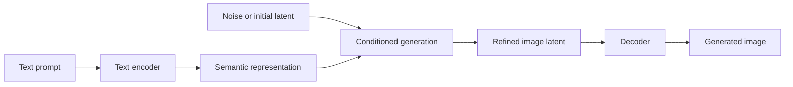
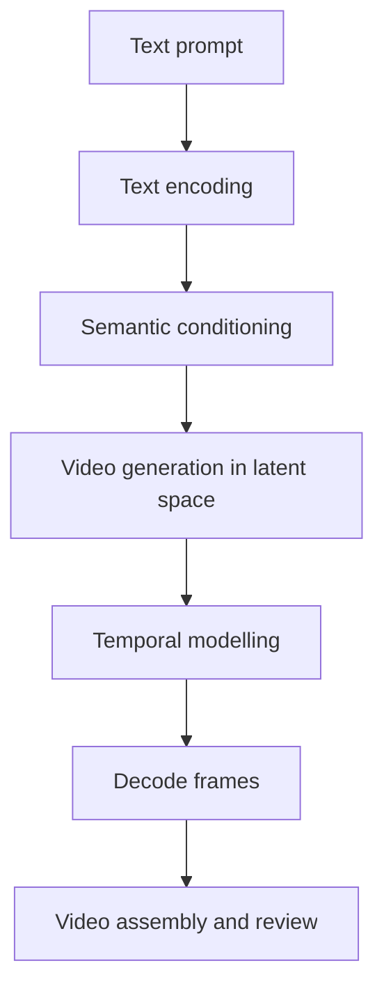
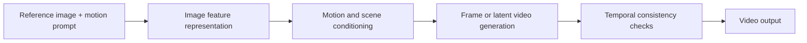
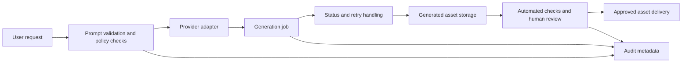

# 04. Generative Media Engineering: Text-to-Image and Video

> Generative media systems turn instructions or reference images into new visual content. The engineering challenge is to control what gets created, preserve consistency, evaluate the result, and use generated media responsibly.

Text-to-image systems create images from written prompts. Text-to-video systems generate a moving scene from a description, while image-to-video systems animate an existing image. Generative media can also support natural-language editing, upscaling, frame interpolation, and filling gaps in existing footage, depending on the tool. These capabilities support design, education, marketing, storytelling, product visualization, simulation, and prototyping—but outputs can contain visual errors, inconsistent motion, or misleading details.

# 1. Text-to-image generation

A text-to-image model converts a natural-language description into an image. The prompt provides the scene, objects, attributes, style, composition, lighting, and other constraints that guide generation.

For example:

> A small red delivery robot crossing a rainy street in Kolkata at dusk, reflections on the road, eye-level camera, cinematic lighting, realistic photography, no visible logos or text.

This prompt gives the model more guidance than “a robot in a city.” Even a detailed prompt does not guarantee that every instruction will be followed exactly.

## How image generation works

Many modern image generators use diffusion-based methods. At a simplified level, training teaches a model to reverse a noising process; during generation, the model iteratively refines a noisy representation while being conditioned on the prompt. Many systems work in a compressed latent space and decode the result into pixels.



**Latent space** is a compact numerical representation used by a model to work with content without operating directly on every raw pixel throughout the generation process. **Diffusion** refers to the iterative denoising process used by diffusion models. Exact architectures differ: not every image generator uses the same latent representation or generation procedure.

## Prompt structure that improves control

A useful image prompt usually specifies:

- **Subject:** what must appear.
- **Setting and context:** where the scene takes place.
- **Composition:** camera position, framing, perspective, and placement.
- **Visual style:** photographic, illustration, 3D render, or another style.
- **Lighting and colour:** mood, palette, and illumination.
- **Constraints:** details to include or avoid, where supported.

Treat these as controllable dimensions, not magic keywords. Too many conflicting instructions can make the result less predictable. Iterate on one or two aspects at a time so you can tell which changes improve the output.

### Example: keep prompt requirements explicit

A small prompt-building helper can make prompts easier to review and reuse before sending them to a provider-specific image API.

```python
from dataclasses import dataclass


@dataclass(frozen=True)
class ImagePrompt:
    subject: str
    setting: str
    composition: str
    style: str
    lighting: str
    constraints: str = ""

    def render(self) -> str:
        required = {
            "subject": self.subject,
            "setting": self.setting,
            "composition": self.composition,
            "style": self.style,
            "lighting": self.lighting,
        }
        missing = [name for name, value in required.items() if not value.strip()]
        if missing:
            raise ValueError(f"Missing prompt fields: {', '.join(missing)}")

        parts = [
            f"Subject: {self.subject}",
            f"Setting: {self.setting}",
            f"Composition: {self.composition}",
            f"Style: {self.style}",
            f"Lighting and colour: {self.lighting}",
        ]
        if self.constraints.strip():
            parts.append(f"Constraints: {self.constraints}")
        return ". ".join(parts)


prompt = ImagePrompt(
    subject="a compact red delivery robot",
    setting="a rainy city street at dusk",
    composition="eye-level medium-wide shot, robot centred",
    style="realistic editorial photography",
    lighting="soft neon reflections, cool blue and warm amber tones",
    constraints="no logos, no readable text, no extra wheels",
)

print(prompt.render())
```

This code structures the prompt; it does not generate an image. The actual generation call depends on the selected provider, model, SDK, and current API schema.

## DALL·E and model-specific interfaces

DALL·E is an example of a text-to-image model family associated with OpenAI. The general workflow is to provide a prompt, request image generation through the supported interface, receive an image or asset reference, and display or store the result under the application's access policy. Some tools also support editing an existing image using a text instruction; that is a different workflow from generating a new image from scratch.

A practical generation loop is:

1. Define the intended use, audience, and required output dimensions.
2. Write a prompt covering subject, setting, composition, style, lighting, and constraints.
3. Generate a small set of candidates if the interface supports it.
4. Review them for prompt adherence, visual defects, and unintended text or logos.
5. Refine the prompt or use supported editing controls, changing one or two requirements at a time.
6. Approve and store the selected asset with appropriate metadata and access controls.

Do not hard-code assumptions about available model names, image sizes, editing capabilities, or response fields from an old example. These details vary by model version and service interface. Keep provider calls behind a small adapter so the application can validate inputs, handle errors, and change providers without rewriting its business logic.

# 2. From text-to-image to video generation

Video adds a time dimension. A still image must maintain spatial coherence within one frame; a video must also keep objects, characters, lighting, and movement coherent across many frames.

## Text-to-video pipeline

Text-to-video starts with a written description. A text encoder represents its meaning, and a generative model uses that representation to guide the creation of a sequence of video frames or latent video representations. A decoder produces frames that can be assembled into a video.



Diffusion-based video models progressively refine noisy representations. Depending on the architecture, temporal relationships may be modelled with mechanisms such as 3D U-Nets, transformers, or other spatiotemporal components. These are architectural approaches, not a universal list of components used by every model.

## Text-to-video versus image-to-video

| Aspect | Text-to-video | Image-to-video |
|---|---|---|
| Starting input | Text description | Existing image, sometimes with text |
| Main task | Create the scene and motion | Preserve the source scene while adding motion |
| Main control challenge | Interpret scene, layout, action, and camera instructions | Decide what should move while preserving the original image's identity and composition |
| Common failure | Missing prompt details, incorrect object relationships, unstable scenes | Warping, unwanted movement, altered faces or objects, background drift |

A useful mental model is: **text-to-video creates a scene; image-to-video animates a starting scene.** Both may use latent representations and temporal modelling, but their conditioning and control requirements differ.

## Image-to-video pipeline

Image-to-video systems analyse a reference image, infer plausible motion, generate new frames, and assemble them into a clip. The model must decide what stays fixed, what moves, and how the camera or scene evolves.



The prompt should distinguish the desired motion from the content that must remain unchanged. For example:

> Animate the leaves and gently move the camera forward. Keep the building, signs, and overall composition unchanged. Use a slow, steady motion with no scene cut.

The result may still alter details. Review the output rather than assuming the prompt is a guarantee.

# 3. Temporal consistency, optical flow, and interpolation

**Temporal consistency** means that the scene remains plausible from frame to frame. A red car should not suddenly become blue, a person's face should not change identity, and an object should not jump to an impossible position without a corresponding movement.

Common video-generation problems include:

- Flickering textures, lighting, or object details.
- Characters or products changing appearance between frames.
- Unnatural motion, deformation, or object merging.
- Camera movement that contradicts the prompt.
- Scene details appearing or disappearing unexpectedly.

Two related video techniques are worth distinguishing:

- **Optical flow** estimates apparent pixel motion between frames. It can help describe where image regions appear to move, but it does not by itself solve the entire video-generation problem.
- **Frame interpolation** creates intermediate frames between existing frames to make motion appear smoother. It can improve playback smoothness, but it cannot reliably repair every semantic inconsistency or incorrect action.

Video systems may use temporal attention, 3D convolutions, optical-flow signals, interpolation, or other techniques. The exact combination is model-dependent. More frames or higher resolution also increase compute, latency, storage, and review costs.

# 4. Sora and the evolving video-model landscape

Sora is an example of a multimodal video-generation system associated with OpenAI. In the material describing its early capabilities, Sora is presented as a diffusion-based transformer that can generate video from text or image conditioning and support natural-language refinements. The key engineering ideas—prompt conditioning, latent video generation, temporal coherence, and iterative review—apply more broadly than any one product.

Examples that have appeared in generative-media discussions include Runway Gen-3 Alpha, Pika, and Google's Lumiere, alongside newer model families and tools. Treat these as historical examples from a changing landscape, **not as a statement that a particular version, feature, or access tier is available today**. Verify current model names, capabilities, licensing, and access before selecting a provider.

A typical generation workflow is:

1. Write a prompt describing the scene, visual details, and motion.
2. Generate a short clip with the selected tool.
3. Review the result for visual quality, temporal consistency, and prompt adherence.
4. Refine the prompt or use supported natural-language editing controls.
5. Where available and appropriate, use upscaling, interpolation, or gap-filling to improve an existing clip; review the result again because post-processing can introduce artefacts.
6. Approve the final asset and record its provenance where needed.

Video prompts benefit from cinematic specificity: scene context, subject and action, lighting and colour, camera angle, and camera movement. For example, “slow dolly-in” describes a different camera movement from “pan left.” Avoid adding many unrelated actions to a short clip; complex prompts can be difficult to satisfy consistently.

# 5. Video captioning and understanding

Generation creates media; **video captioning describes media that already exists**. A captioning system may produce a short summary of the whole clip, timestamped descriptions of segments, or answers to questions about visible actions. Some workflows sample frames or combine visual representations across time; the approach depends on the model and required temporal detail.

A single-frame caption cannot reliably describe an action that unfolds over time. For example, identifying a person beside a door is different from determining whether the person opened it, entered the room, and closed it. For temporal tasks, evaluate event order and timestamps as well as object recognition.

Video captioning can support:

- Searchable media libraries and content discovery.
- Video summaries for training and education.
- Accessibility descriptions.
- Review queues for human moderators or analysts.
- Metadata enrichment for downstream retrieval.
- Synthetic-data workflows for developing or testing tracking, segmentation, and action-recognition systems, provided generated examples are validated for realism and representativeness.

Captions are still model-generated interpretations. They can omit events, confuse the order of actions, or infer intent that is not visible. Keep timestamps and source-video references where traceability matters.

# 6. Production applications and architecture

Generative images and videos are useful for marketing concepts, product mock-ups, storyboards, education, internal training, entertainment, and creative prototyping. They can reduce the effort required to produce a first draft, but they do not remove the need for review, licensing checks, and quality control.

A production service should separate request handling from generation and asset delivery:



Video generation is often asynchronous and resource-intensive. A service should not assume the model returns a finished video immediately. Design for job IDs, status polling or callbacks, timeouts, retry limits, cancellation where supported, and secure storage of generated assets. Keep API keys on the server and validate every returned asset before making it available to users.

## Evaluation checklist

Evaluate the output against the actual use case rather than relying only on whether it looks impressive.

- **Prompt adherence:** are the requested subject, setting, style, and actions present?
- **Visual quality:** are details, lighting, and composition acceptable?
- **Temporal consistency:** do identity, objects, and motion remain plausible across frames?
- **Factual correctness:** does the clip misrepresent a real product, person, process, or event?
- **Usability:** does the clip meet required duration, aspect ratio, resolution, and accessibility needs?
- **Operational performance:** what are generation latency, failure rate, compute cost, and review effort?

For business-critical use, add domain-specific checks and human approval. Generated media should not be treated as evidence that a real event occurred. For product imagery, compare generated visuals with the real product specification; a model may invent ports, labels, dimensions, or other details that are commercially important.

# 7. Risks and responsible use

Realistic generated images and videos can be used for misinformation, impersonation, non-consensual content, or misleading product representations. Training data and prompts may also encode cultural or demographic bias. Governance should be part of the design, not a final checklist item.

- **Consent and identity:** obtain appropriate permission before generating or modifying identifiable people's likenesses.
- **Copyright and licensing:** review rights for source images, reference assets, generated outputs, and intended commercial use.
- **Provenance:** retain generation metadata and consider watermarking or content-credential mechanisms where available.
- **Privacy:** do not send confidential source images or video to a provider without an approved data-handling basis.
- **Review and disclosure:** establish when synthetic media must be labelled and when a human must approve it.
- **Abuse prevention:** enforce provider policies and application-level restrictions; do not rely on prompt wording alone as a safety control.

Watermarks and synthetic-media detectors can be useful signals, but neither should be treated as a perfect guarantee of authenticity. Responsible deployment combines technical controls, process, user education, and legal review.

# 8. Common mistakes

- Treating a detailed prompt as a guarantee of exact output.
- Confusing text-to-video with image-to-video.
- Assuming all image and video models use the same diffusion architecture.
- Ignoring temporal consistency and checking only a few attractive frames.
- Expecting interpolation to fix identity changes or incorrect actions.
- Treating historical model names, features, or subscription details as current.
- Exposing provider keys or generated assets through an insecure application.
- Publishing realistic synthetic media without reviewing consent, rights, provenance, and potential deception.

# 9. Quick revision and interview questions

**Remember**

- Text-to-image generates a still image from a prompt.
- Text-to-video generates a sequence from a text description; image-to-video animates a reference image.
- Latent representations provide a compact space for generation; diffusion iteratively refines noisy representations.
- Video quality requires spatial quality **and** temporal consistency.
- Optical flow estimates apparent motion; frame interpolation adds intermediate frames.
- Model capabilities and availability change; check the target provider's current documentation.

**Interview questions**

1. How does a diffusion-based image generator turn a prompt into an image?
2. What is a latent representation, and why is it useful?
3. How do text-to-video and image-to-video differ in their conditioning?
4. Why is temporal consistency harder than generating a single image?
5. What do optical flow and frame interpolation do, and what are their limitations?
6. How would you architect an asynchronous video-generation API?
7. Which quality metrics and human-review gates would you use before publishing generated media?
8. How would you manage consent, copyright, provenance, and deepfake risks?

## References and further reading

- [OpenAI Sora](https://openai.com/sora/) — check the current product information and supported workflows.
- [OpenAI image generation documentation](https://platform.openai.com/docs/guides/image-generation) — verify the current image-generation API and model-specific request format.
- [Hugging Face Diffusers documentation](https://huggingface.co/docs/diffusers/index) — diffusion concepts, pipelines, and implementation patterns.
- [Runway](https://runwayml.com/) — product information for its current generative video tools.
- [Google DeepMind](https://deepmind.google/) — research and product information for Google's generative media systems.

## Next in This Section

Continue with [**05. Production Multimodal Applications and Orchestration**](05-production-multimodal-applications-and-orchestration.md), covering how to integrate speech, vision, and generative media into reliable application workflows.

> **Enterprise AI Engineering Handbook**
>
> *Building Production-Grade Enterprise AI Systems — One Chapter at a Time.*
