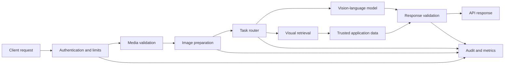
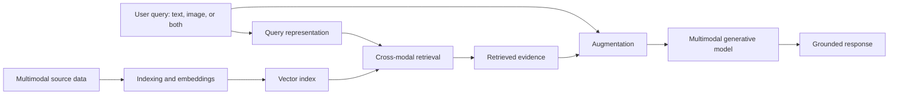
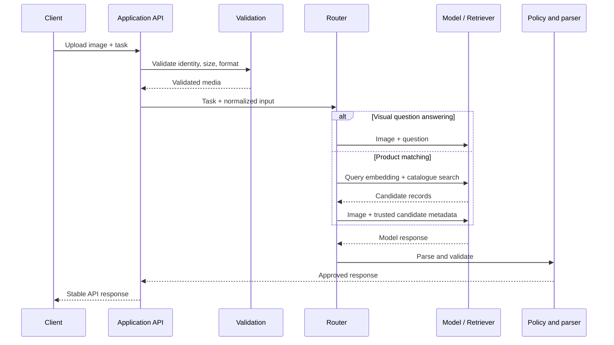
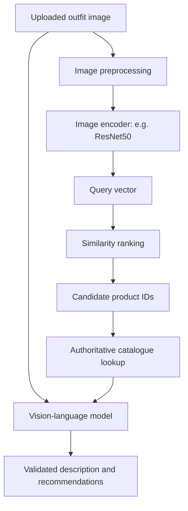
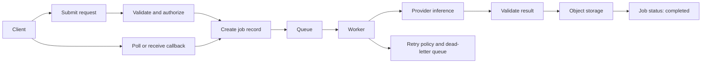

# 05. Production Multimodal Applications and Orchestration

Multimodal AI becomes useful when it can retrieve relevant information across modalities and use that evidence to produce a grounded response. Multimodal Retrieval-Augmented Generation (MM-RAG) combines multimodal inputs and retrieval with generative models, helping bridge the gap between a model's general visual understanding and an application's specific catalogue or knowledge base.

This chapter explains the MM-RAG pipeline first, then applies it to a visual shopping assistant inspired by the Style Finder pattern. Production engineering guidance—media validation, orchestration, response contracts, security, observability, and evaluation—is included to show how the pattern can be developed beyond a prototype.

## 1. A reusable multimodal application architecture

A typical request passes through several explicit stages:



Keep the stages separate even if an initial prototype implements them in one service. This makes it easier to change providers, test each boundary, and identify whether an error came from media handling, retrieval, inference, or response formatting.

**Responsibilities at a glance**

- **API layer:** authentication, authorization, request limits, and a stable client contract.
- **Media layer:** format and size checks, decoding, resizing, and provider-specific image representation.
- **Orchestration layer:** chooses the task and invokes the required model or retrieval component.
- **Retrieval layer:** returns candidate records from a trusted catalogue or knowledge source.
- **Validation layer:** parses model output and checks required fields and allowed values.
- **Operations layer:** records latency, errors, usage, cost estimates, and trace identifiers without unnecessarily retaining sensitive media.

## 2. The MM-RAG pipeline

MM-RAG extends retrieval-augmented generation to data such as text, images, audio, and video. A multimodal model may interpret an image, but it does not automatically have access to an organisation's product catalogue, documents, or other private knowledge. Retrieval supplies relevant records so the generated answer can use application-specific context.

The core pipeline has four stages:



1. **Data indexing:** prepare supported content and create embeddings for retrieval. Store vectors with stable IDs and metadata that point back to the source records.
2. **Data retrieval:** represent the incoming query and search for semantically relevant items. Depending on the system, the query may be text, an image, or a combination.
3. **Augmentation:** combine the original query with the retrieved records and relevant metadata to provide context to the generative model.
4. **Response generation:** ask the model to answer using the augmented context, while preserving the distinction between retrieved evidence and generated interpretation.

### Cross-modal embeddings and contrastive learning

Embeddings represent content as vectors that can be compared mathematically. In a cross-modal embedding space, related items from different modalities—for example, a picture of a cat and the phrase “a domestic feline”—can be mapped to nearby representations. Contrastive learning is one approach used to train models to bring related examples closer and distinguish unrelated examples.

This alignment can enable text-to-image retrieval or other cross-modal searches. It is not automatic for every encoder: the chosen model and index must support the intended query and content modalities. A vector index also needs metadata and source identifiers so retrieval results can be resolved into usable evidence.

**Important distinction:** an embedding is a numerical representation used for comparison and retrieval. Base64 is a way to encode bytes for transport in an API request. They solve different problems; converting an image to Base64 does not create a semantic embedding.

## 3. Accept and prepare image inputs safely

Web applications commonly receive image uploads as multipart form data. Validate the upload before passing its bytes to an image decoder or model API. The filename and client-provided MIME type are not proof of the actual file format.

A framework-neutral preparation helper can enforce basic limits and use Pillow to verify and decode the image:

```python
from io import BytesIO
from PIL import Image, UnidentifiedImageError

MAX_UPLOAD_BYTES = 8 * 1024 * 1024
MAX_PIXELS = 20_000_000
ALLOWED_FORMATS = {"JPEG", "PNG", "WEBP"}


def prepare_image(raw: bytes) -> Image.Image:
    if not raw:
        raise ValueError("Image is empty")
    if len(raw) > MAX_UPLOAD_BYTES:
        raise ValueError("Image exceeds the upload limit")

    try:
        with Image.open(BytesIO(raw)) as image:
            if image.format not in ALLOWED_FORMATS:
                raise ValueError("Unsupported image format")
            width, height = image.size
            if width <= 0 or height <= 0 or width * height > MAX_PIXELS:
                raise ValueError("Image dimensions are not allowed")

            image.verify()

        # Reopen after verify(), which checks the stream but does not leave
        # a decoded image ready for downstream processing.
        with Image.open(BytesIO(raw)) as image:
            image.load()
            return image.convert("RGB")

    except UnidentifiedImageError as exc:
        raise ValueError("Uploaded content is not a supported image") from exc
```

This is a starting point, not a complete upload-security system. Production deployments should also consider decoder patching, request-body limits at the proxy, decompression-bomb protections, EXIF orientation, timeouts, malware scanning where appropriate, and a policy for animated images. Avoid logging raw bytes or Base64 payloads.

### Base64 and image URLs are transport choices

Some model APIs accept a URL, while others accept a data URL or an SDK-specific image object. Base64 is an encoding for transport; it is **not** an image embedding and does not provide semantic search.

```python
import base64


def to_data_url(image_bytes: bytes, mime_type: str = "image/jpeg") -> str:
    # Call only after validating the actual image format and matching MIME type.
    encoded = base64.b64encode(image_bytes).decode("ascii")
    return f"data:{mime_type};base64,{encoded}"
```

Use this only when the selected provider supports data URLs. For larger inputs, controlled object storage may be more efficient. If an application fetches images from URLs, protect it against server-side request forgery (SSRF): restrict destinations, validate redirects and resolved IP addresses, apply download limits and timeouts, and block internal or link-local addresses. Never fetch arbitrary user-provided URLs without controls.

## 4. Orchestrate provider calls behind a stable interface

Application code should not be tightly coupled to one provider's request schema. A small internal interface keeps business logic separate from SDK-specific details.

```python
from typing import Protocol


class VisionClient(Protocol):
    def answer(self, image_data: bytes, question: str) -> str:
        """Return a textual answer for a validated image and question."""
        ...


def describe_image(client: VisionClient, image_data: bytes, question: str) -> str:
    if not question.strip():
        raise ValueError("Question must not be empty")

    # Media validation and provider-specific encoding happen at clear boundaries.
    answer = client.answer(image_data, question)
    if not isinstance(answer, str) or not answer.strip():
        raise RuntimeError("Vision provider returned an empty or invalid answer")
    return answer.strip()
```

The protocol is intentionally minimal. A concrete adapter can translate it into the provider's current SDK, authentication, content-block schema, timeout settings, and response format. Keep credentials in environment-based configuration or a secrets manager—not in source code or notebooks. Pin and update SDK versions deliberately, and follow the selected provider's current API documentation because request shapes and model availability change.

For hosted services such as watsonx, separate configuration, authentication, request construction, and response extraction into different functions or modules. Do not assume that token acquisition, model identifiers, image formats, or response fields are identical across providers.

### Orchestration flow



The router should select a known workflow from application-controlled task types. Do not let untrusted model output grant permissions, choose arbitrary URLs, or execute privileged operations. If a model proposes an action, validate it against an allowlist and perform authorization in ordinary application code.

## 5. Build a visual shopping assistant

A visual shopping assistant combines image understanding with retrieval from a product catalogue. A vision-language model (VLM) can describe the uploaded outfit, but the catalogue should remain authoritative for product names, prices, stock status, and purchase URLs.

The Style Finder pattern uses a pretrained ResNet50 model from `torchvision` to produce an image feature vector. It also encodes the uploaded image as Base64 for the model request. The feature vector supports visual similarity search; the Base64 string carries the image to the vision-language model. These are separate representations for separate purposes. The example names Llama Vision Instruct for generation; treat that as the implementation's model choice, not a guarantee of current availability or a universal API contract.

A useful pipeline is:

1. Preprocess the uploaded outfit image using the same image transformations used for indexed dataset images.
2. Generate a feature vector with pretrained ResNet50.
3. Compare the query vector with pre-encoded dataset vectors using cosine similarity.
4. Select the highest-scoring match and retrieve the other items associated with that outfit record.
5. Retrieve structured metadata such as product names, prices, and URLs from the external dataset.
6. Send the image and retrieved metadata to the vision-language model with instructions to describe materials, patterns, and colours, and to present item details or similar items as appropriate.
7. Return a catalogue-style response, keeping product facts tied to the retrieved data.



### Cosine similarity and candidate ranking

For vectors \(u\) and \(v\), cosine similarity is:

\[
\operatorname{cosine}(u,v)=\frac{u\cdot v}{\|u\|\,\|v\|}
\]

A higher score indicates that the vectors point in a more similar direction. It does not prove that two images show the same product or that two products are interchangeable. Results depend on the encoder, preprocessing, catalogue diversity, and domain.

```python
import numpy as np


def rank_by_cosine(
    query_vector: np.ndarray,
    dataset_vectors: np.ndarray,
    top_k: int = 5,
) -> list[tuple[int, float]]:
    query = np.asarray(query_vector, dtype=np.float32).reshape(-1)
    vectors = np.asarray(dataset_vectors, dtype=np.float32)

    if vectors.ndim != 2 or vectors.shape[1] != query.size:
        raise ValueError("Query and dataset vectors must have matching dimensions")
    if query.size == 0 or not np.isfinite(query).all():
        raise ValueError("Query embedding must be non-empty and finite")
    if not np.isfinite(vectors).all():
        raise ValueError("Dataset embeddings must be finite")
    if top_k < 1:
        raise ValueError("top_k must be at least 1")

    query_norm = np.linalg.norm(query)
    vector_norms = np.linalg.norm(vectors, axis=1)
    if query_norm == 0:
        raise ValueError("Query embedding has zero norm")

    valid = vector_norms > 0
    scores = np.full(len(vectors), -np.inf, dtype=np.float32)
    scores[valid] = (vectors[valid] @ query) / (vector_norms[valid] * query_norm)

    k = min(top_k, int(valid.sum()))
    if k == 0:
        return []

    indices = np.argpartition(scores, -k)[-k:]
    indices = indices[np.argsort(scores[indices])[::-1]]
    return [(int(i), float(scores[i])) for i in indices]
```

This helper returns indices and scores—not product facts. Use the returned IDs to query the authoritative catalogue. Do not ask a generative model to invent or overwrite prices, stock status, brand names, or URLs.

**Thresholds must be measured.** Do not assume a cosine score such as `0.8` is universally meaningful. Choose a match threshold using representative validation examples and a target error trade-off. For important shopping flows, evaluate top-k retrieval accuracy, duplicate products, visually similar but functionally different items, and the quality of the “no suitable match” response.

ResNet50 can serve as a simple feature extractor for a prototype. For production visual search, compare it with encoders trained for image-text alignment or the target product domain. Precompute catalogue vectors and version them with the encoder and preprocessing configuration. Never compare embeddings produced by incompatible models or preprocessing pipelines.

## 6. Multimodal chat and visual question answering

A multimodal chatbot accepts a question plus one or more supported media inputs. The model's job is to interpret visual content and answer the question; the application's job is to set evidence boundaries, enforce access, and validate the output.

A useful prompt contract specifies:

- **Task:** identify, compare, summarize, or answer a question.
- **Visual focus:** objects, attributes, relationships, or readable text.
- **Evidence boundary:** distinguish visible evidence from assumptions.
- **Output contract:** required fields, types, and allowed values.
- **Uncertainty behaviour:** state when the image is ambiguous, incomplete, or too low-resolution.

Example instruction:

> Describe the visible clothing items and their colours. Separate directly visible details from uncertain inferences. If you cannot identify an item confidently, say so. Do not invent product names, prices, or purchase links; those must come from the supplied catalogue records.

Use structured output when the application needs predictable fields, but treat schema compliance and factual correctness as separate checks. A valid JSON object can still contain a false claim.

### Food-image analysis: communicate uncertainty

An image can support a rough description of likely food items, but it usually cannot reveal exact portion weight, hidden ingredients, cooking oil, or preparation method. If estimating nutrition, return ranges or qualified estimates when appropriate, explain the major uncertainties, and avoid presenting the result as a medical assessment.

For example, an API response might include:

```json
{
  "items": [
    {
      "label": "rice",
      "portion_estimate": "small bowl",
      "confidence": "moderate"
    }
  ],
  "nutrition_estimate": {
    "calories_kcal": null,
    "note": "Exact calories cannot be estimated reliably from this image alone."
  },
  "limitations": [
    "Portion weight is unknown",
    "Ingredients and preparation method are not fully visible"
  ]
}
```

The `null` value is deliberate: the application should not force a numeric estimate when the available evidence does not support one. If estimates are provided, label them as approximate and test them against the intended use case.

## 7. API design, asynchronous jobs, and resilience

Image and video inference can be slow, variable in cost, and subject to provider quotas. Small requests may fit a synchronous API; expensive generation or batch processing often benefits from an asynchronous job pattern.



A production job record should include a job ID, owner or tenant, task type, status, timestamps, input reference, model/version configuration, and result reference. Avoid storing sensitive media in queue messages; pass controlled object-storage references instead. Enforce authorization when users poll jobs or retrieve results.

**Resilience practices**

- Apply connection and read timeouts to provider calls.
- Retry only transient failures, with bounded exponential backoff and jitter.
- Do not blindly retry non-idempotent operations that may incur duplicate cost.
- Use request IDs or idempotency keys where supported.
- Limit concurrency and queue depth to protect provider quotas and application capacity.
- Distinguish invalid input, policy rejection, provider timeout, rate limit, and internal error.
- Set a maximum job lifetime and clean up abandoned uploads and results according to retention policy.

## 8. Production evaluation and observability

Evaluate each stage independently as well as the end-to-end user experience. Otherwise, a poor final answer may be incorrectly blamed on the model when the real problem is a malformed image or an irrelevant retrieval result.

| Layer | What to measure |
|---|---|
| Media handling | Invalid-file rejection, decode failures, dimensions, processing time |
| Vision-language model | Task accuracy, groundedness, uncertainty behaviour, refusal quality |
| Visual retrieval | Recall@k, precision@k, ranking quality, no-match accuracy |
| Structured output | Parse success, schema validity, missing or invalid fields |
| Service reliability | Latency percentiles, timeouts, retry rate, availability |
| Operations | Cost per request, token/image usage where available, queue age |
| User outcome | Correction rate, task completion, feedback, escalation rate |

Monitor model and data drift after deployment. Changes in catalogue images, user-upload patterns, preprocessing, encoder versions, or provider models can change the result distribution. Keep an evaluation set that reflects real lighting, backgrounds, orientations, image quality, and relevant user groups.

Use traces to correlate the API request, retrieval, and model call. Record model IDs, configuration versions, latency, status, and safe error metadata. Avoid logging raw images, Base64 strings, access tokens, or sensitive extracted content by default.

## 9. Security, privacy, and trust boundaries

Multimodal inputs introduce risks beyond ordinary text requests.

- **Untrusted image content:** text embedded in an image may attempt to influence a model. Treat it as input data, not as system instruction or authorization.
- **Sensitive media:** define access controls, retention periods, deletion paths, and provider data-handling requirements.
- **URL fetching:** guard against SSRF, malicious redirects, oversized files, and content-type spoofing.
- **Model output:** validate response structure and business constraints before returning or acting on it.
- **Catalogue integrity:** retrieve product facts from trusted records, not generated text.
- **Tenant isolation:** ensure one tenant cannot query another tenant's uploads, vectors, job results, or catalogue data.
- **Human review:** route consequential or low-confidence decisions to qualified people.
- **Provenance:** preserve source IDs and model/version metadata where outputs need auditability.

A VLM is not a safety certifier, medical professional, or source of verified real-world facts merely because it produces a fluent explanation. Design the application around what the model can reasonably observe and what the surrounding system can independently verify.

## 10. Common implementation mistakes

- Passing unvalidated upload bytes directly to a provider.
- Treating Base64 as an embedding or retrieval index.
- Mixing provider-specific request formats into business logic.
- Returning unvalidated model output as a stable API response.
- Using generated product details instead of catalogue records.
- Choosing similarity thresholds without a representative evaluation set.
- Comparing vectors produced by different encoders or preprocessing versions.
- Fetching arbitrary image URLs without SSRF protections.
- Retrying all failures indiscriminately and accidentally multiplying cost.
- Logging raw media or secrets while debugging.
- Reporting estimated nutrition or visual observations as certain facts.
- Measuring only end-to-end latency without identifying slow stages.

## 11. Quick revision and interview questions

**Remember**

- MM-RAG follows indexing, retrieval, augmentation, and response generation.
- Cross-modal embeddings can connect related content across modalities when the encoder supports that alignment.
- A production multimodal application needs explicit media validation, orchestration, response validation, and observability.
- Base64 is a transport encoding; embeddings support vector comparison and retrieval.
- Style Finder combines ResNet50 features, cosine-similarity matching, outfit-level catalogue retrieval, metadata augmentation, and a vision-language model.
- Visual search retrieves candidate records, while a VLM describes content and helps interpret candidates.
- Cosine similarity is a ranking signal, not proof of identity or interchangeability.
- Business-critical product facts must come from authoritative records.
- Long-running inference often benefits from queues, job status, retries, and controlled result storage.
- Multimodal security includes untrusted visual instructions, sensitive media, URL fetching, tenant isolation, and model-output validation.

**Interview questions**

1. How would you separate media validation, provider calls, and business logic in a multimodal API?
2. Why should product search use both vector retrieval and a trusted catalogue lookup?
3. How would you calibrate a similarity threshold and measure false matches?
4. When would you choose asynchronous processing over a synchronous endpoint?
5. Which fields would you log for observability, and which data would you avoid logging?
6. How would you defend an image-fetching service against SSRF?
7. How would you handle a model response that is valid JSON but contains unsupported claims?

## References

- [Hugging Face Transformers documentation](https://huggingface.co/docs/transformers/index)
- [Hugging Face Diffusers documentation](https://huggingface.co/docs/diffusers/index)
- [IBM watsonx.ai documentation](https://www.ibm.com/docs/en/watsonx)
- [Pillow documentation](https://pillow.readthedocs.io/)
- [OWASP Server-Side Request Forgery Prevention Cheat Sheet](https://cheatsheetseries.owasp.org/cheatsheets/Server_Side_Request_Forgery_Prevention_Cheat_Sheet.html)

**Next chapter:** [**06. Multimodal AI Risks, Evaluation and Governance**](06-multimodal-ai-risks-evaluation-and-governance.md)

---

**Enterprise AI Engineering Handbook**

*Building Production-Grade Enterprise AI Systems — One Chapter at a Time.*
