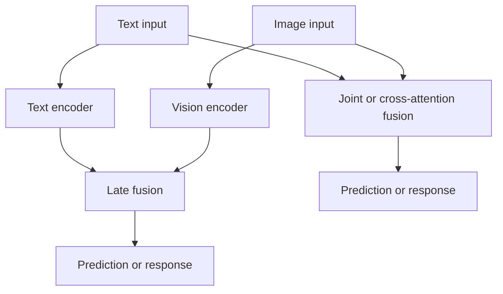
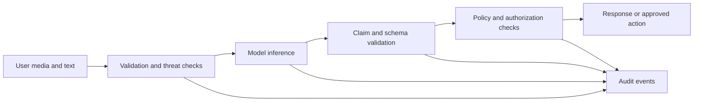
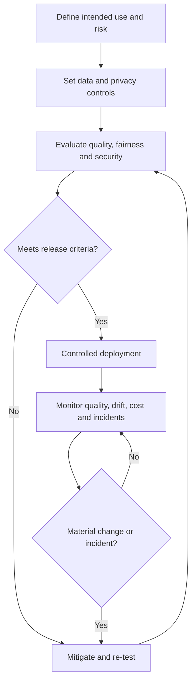

# 06. Multimodal AI Risks, Evaluation and Governance

Multimodal AI can connect text, images, audio, and video in ways that a single-modality system cannot. It can use complementary signals, answer questions about visual content, and support more natural interactions. Those benefits come with a trade-off: the system must align different kinds of evidence, and an error in one modality can affect the final answer.

A model may misread an image, overlook an important detail, or give a confident answer that the evidence does not support. A production system needs to test these failure modes, protect sensitive data, check for unfair performance differences, and make clear where the model's capabilities end.

## 1. What multimodal models do well—and where they struggle

Multimodal models are useful because different inputs can contribute different pieces of evidence. A photograph can show the state of an object, while text explains the user's question. Audio can carry words and tone, while video adds motion and scene context. When the model connects these signals well, it can provide a richer answer than a system that sees only one input type.

Common strengths include:

- **Cross-modal understanding:** connecting visual content with language and other supported modalities.
- **Flexible use:** applying learned representations to related tasks or unfamiliar examples, sometimes with little task-specific training.
- **Complementary evidence:** combining inputs can help when one source is incomplete or noisy.
- **Natural interaction:** letting people ask questions about images, speak to an assistant, or work with mixed media.

These are capabilities, not guarantees. A second modality does not automatically make a prediction more accurate. If the inputs conflict, the model may combine them incorrectly; if one input is poor quality, it may mislead the response. Evaluate whether the extra modality improves the target task rather than assuming that more input always means better results.

## 2. Technical risks: alignment, fusion and consistency

### Data alignment

Different modalities represent information in different ways. A system may receive an image with a question, a transcript with audio, or a video with timestamps and accompanying text. If these elements are incomplete, poorly synchronized, or incorrectly paired, the model may connect the wrong evidence to the query.

**Engineering responses**

- Validate that each media item belongs to the correct request and source record.
- Preserve timestamps, speaker identifiers, document IDs, and other useful metadata.
- Evaluate on varied image quality, accents, languages, lighting, backgrounds, and recording conditions.
- Test cases where a modality is missing, noisy, contradictory, or irrelevant.

### Fusion strategy

Two broad patterns are useful to distinguish:

- **Late fusion:** process each modality separately and combine their outputs later. It can be modular and easier to debug, but may miss fine-grained interactions between modalities.
- **Early or deeper fusion:** combine information earlier or allow modalities to interact through mechanisms such as cross-attention. This can support richer interactions but may increase architectural complexity and compute requirements.

There is no universally best fusion method. The right choice depends on the task, available data, latency, compute budget, and whether the application needs tight alignment between modalities.

### Cross-modal consistency and hallucination

A multimodal model can misread an object, overlook text in an image, confuse speakers, or produce a response that does not agree with the evidence in another modality. Fluency is not proof of correctness.

Mitigations include:

- Ground claims in retrieved records or other verifiable evidence where available.
- Cross-check important visual claims with specialized detectors, OCR, metadata, or deterministic rules when suitable.
- Ask the model to distinguish observations from estimates and assumptions.
- Validate structured outputs and required fields in application code.
- Provide a safe uncertainty response when evidence is missing or ambiguous.
- Route consequential decisions to qualified human reviewers.

Independent checks are not infallible either. Evaluate the complete checking pipeline, including its own false positives and false negatives.

## 3. Evaluation: test the system, not only the model

A useful evaluation strategy separates component quality from end-to-end usefulness. A model may perform well on image captioning but poorly on small text, culturally specific objects, or questions that require joining an image with private catalogue data.

| Evaluation layer | Questions to answer | Example measures |
|---|---|---|
| Input and preprocessing | Are files decoded, resized and synchronized correctly? | Decode failure rate, rejected-input rate |
| Individual modality | Does each encoder or model handle its input reliably? | Task-specific accuracy, word error rate for speech |
| Cross-modal alignment | Are related text, image, audio and video elements connected correctly? | Retrieval precision/recall, alignment error rate |
| Generation | Are responses supported, complete and appropriately uncertain? | Factuality review, groundedness, human ratings |
| Structured output | Does the response satisfy the application contract? | Schema-valid rate, missing-field rate |
| Fairness and robustness | Does quality vary across relevant populations and conditions? | Slice-based performance gaps, error rates by condition |
| Production service | Is the system dependable at expected load? | Latency percentiles, timeout rate, availability, cost |
| User outcome | Does the system help users complete the task safely? | Correction rate, escalation rate, task completion |

### Build a representative evaluation set

Include ordinary examples and deliberate edge cases:

- Clear, low-resolution, cropped, rotated, or partially obscured media.
- Different accents, dialects, languages, speaking rates, and background noise for speech tasks.
- Diverse cultural contexts, objects, environments, and user populations.
- Conflicting text and image evidence.
- Missing modalities, incorrect timestamps, duplicate records, and irrelevant retrieved items.
- Prompt injection attempts embedded in text or images.
- Requests outside the model's intended use.

Keep test examples separate from training and tuning data where applicable. Version the dataset, annotation guidelines, model configuration, prompts, preprocessing, and evaluation code so that regressions can be traced.

### Measure uncertainty and failure

Do not report only one aggregate score. Inspect failure categories and performance slices. For a visual search system, for example, evaluate retrieval ranking and catalogue correctness separately from the quality of the generated description. For a speech pipeline, assess transcription errors separately from downstream intent recognition.

Confidence scores from models are not necessarily calibrated probabilities. Test whether confidence corresponds to actual correctness before using it to automate decisions. Establish a defined fallback when the system cannot meet the required quality threshold.

## 4. Bias, representation and fairness

Multimodal models can inherit imbalances and stereotypes from training data. Some languages, accents, cultural objects, skin tones, environments, or accessibility needs may be represented less effectively than others. A model may also make unsupported assumptions from a person's appearance or voice.

**Practical controls**

1. Identify the populations, contexts, and conditions that matter for the intended application.
2. Evaluate performance across those groups and conditions where lawful and appropriate.
3. Review data coverage, label quality, and collection practices.
4. Use suitable data augmentation or targeted data collection to improve underrepresented cases.
5. Test outputs for stereotypes, unsupported personal inferences, and disparate error patterns.
6. Provide human review, appeal, or correction mechanisms when decisions affect people.

Data augmentation can improve coverage but does not automatically remove bias. Synthetic examples may repeat the same stereotypes as the model that generated them. Re-evaluate after every significant change to data, prompts, encoders, or model versions.

## 5. Privacy, security and adversarial inputs

Images, recordings, and videos may contain faces, voices, locations, documents, private conversations, or other sensitive information. Collecting multiple modalities can reveal more about a person than any single input alone.

### Privacy and data governance

- Collect only the media and metadata required for the task.
- Explain the purpose of processing and apply appropriate consent and legal requirements.
- Define retention, deletion, access, and data-sharing policies.
- Protect media and derived embeddings with appropriate access controls and encryption.
- Avoid logging raw media, transcripts, credentials, or sensitive extracted details by default.
- Review provider retention and data-use terms before sending sensitive content to a hosted service.
- Consider anonymization or privacy-preserving methods where appropriate, while recognizing that these do not guarantee anonymity.

Differential privacy is a specific mathematical approach that can limit the influence of individual records in certain data-processing or training settings. It is not a generic switch that automatically protects every inference request.

### Adversarial inputs and prompt injection

A model may interpret text found inside an image, a document, or a video frame as an instruction. Treat all user-supplied media and retrieved content as untrusted data.

- Keep system instructions and tool permissions under application control.
- Do not grant access to tools, secrets, or private records because media content asks for them.
- Validate tool arguments and enforce authorization in deterministic code.
- Restrict remote media fetching to reduce server-side request forgery (SSRF) risk.
- Apply file-size, format, decoder, rate, and resource limits.
- Test malicious, misleading, and conflicting multimodal inputs.

Security controls should be layered. A model-based detector can help flag suspicious content, but it should not be the sole enforcement mechanism.

## 6. Deepfakes, misinformation and provenance

Generative systems can produce realistic images, voices, and videos that misrepresent events or imitate real people. Risks include impersonation, fraud, harassment, non-consensual synthetic media, and the spread of false information.

Useful safeguards include:

- Obtain appropriate consent before generating or using media depicting identifiable people.
- Clearly label synthetic or materially edited media where required or appropriate.
- Preserve provenance information, such as source records, generation metadata, model/version information, and edit history.
- Consider watermarking or content credentials where supported.
- Use review and escalation workflows for sensitive publication contexts.
- Apply abuse monitoring and restrictions to high-risk generation workflows.

Watermarks and AI-generated-media detectors can be useful signals, but neither guarantees that content is authentic or synthetic. Metadata can be removed, and detectors can fail. Provenance is strongest when supported by a trustworthy chain of custody rather than a single classifier.

## 7. Transparency, explainability and accountability

Multimodal models are often difficult to interpret. A fluent answer may conceal whether the model relied on an image region, a transcript, retrieved context, or an unsupported inference. Explanations generated by the same model are not automatically faithful accounts of its internal reasoning.

For accountability:

- Document intended use, limitations, known failure modes, data sources, and evaluation results.
- Preserve source references and retrieval IDs when responses rely on external evidence.
- Make uncertainty and important limitations visible to users.
- Record model and prompt versions, policy decisions, and relevant operational events.
- Provide a path for correction, escalation, or human review.
- Define who owns deployment approval, incident response, and ongoing monitoring.

For regulated or high-impact uses, involve legal, privacy, security, domain, and risk stakeholders early. Applicable requirements depend on jurisdiction and use case; do not assume that one general principle or a single regulation resolves every obligation.

## 8. Cost, latency and deployment trade-offs

Multimodal processing can require substantial compute, memory, bandwidth, and storage. Video and high-resolution images can be particularly expensive to process. Real-time applications must balance quality with response time and operating cost.

| Technique | Potential benefit | Trade-off to test |
|---|---|---|
| Resize or sample media | Lower processing cost | May remove small but important details |
| Smaller or distilled model | Lower latency and resource use | May reduce accuracy or robustness |
| Modular modality-specific services | Easier scaling and replacement | More orchestration and synchronization |
| Batch processing | Better throughput and resource utilization | Higher waiting time |
| Edge inference | Lower network dependence and potentially better privacy | Device constraints and update complexity |
| Cache reusable representations | Avoid repeated embedding work | Requires careful invalidation and versioning |
| Route tasks to suitable models | Balance quality and cost | Routing errors and operational complexity |

Choose optimizations using representative benchmarks. Track end-to-end latency and cost, not just the model's inference time. Re-test after changing image resolution, sampling rates, model quantization, batching, or routing rules because these can alter quality as well as performance.

## 9. Practical applications and their risk boundaries

The same capabilities can be useful in very different settings, and each setting needs its own evaluation:

- **Accessibility:** describe visual surroundings or convert text to speech. Test whether descriptions omit important details and whether the interaction works for the intended users.
- **Healthcare support:** help organize or summarize images alongside records. Clinical conclusions require domain validation and qualified oversight.
- **Education:** combine diagrams, text, audio and interactive explanations. Check factual correctness, accessibility, and whether generated explanations fit the learner's needs.
- **Content creation and moderation:** generate or review images, audio and video. Consider consent, rights, provenance and the risk of false moderation decisions.
- **Autonomous or physical systems:** combine vision with maps, instructions or sensor data. Errors can have direct consequences, so safety-critical actions need stronger validation than a conversational response.
- **Retail and visual search:** find similar products from images. Keep prices, stock status and product links tied to trusted catalogue records rather than generated guesses.

A model's ability to produce a plausible result is not evidence that it is suitable for a particular domain. The application context determines the acceptable error rate, fallback behaviour, and level of human review.

## 10. Where multimodal AI is heading

Several directions may change how multimodal systems are built and deployed:

- **More unified models:** systems are increasingly designed to work across several modalities within a shared architecture. This can make interactions more natural, though it does not remove alignment or reliability problems.
- **Edge computing:** running some inference on devices can reduce network delay and the amount of media sent to remote services. Device memory, power, and model-size limits still matter.
- **Self-supervised learning:** learning from large amounts of unlabelled data can reduce reliance on expensive manual annotation, but the quality and coverage of the data remain important.
- **Personalization:** adapting responses to a person's needs can improve relevance, but it requires clear consent, careful access controls, and sensible retention policies.
- **Responsible AI practices:** fairness, transparency, privacy and misuse prevention need to be considered throughout development and operation, not added after deployment.

These are directions to evaluate, not automatic improvements. A newer architecture or a more personalized model should still be tested against the application's requirements and risk level.

## 11. A practical governance lifecycle

Governance should match the system's intended use and level of risk. A low-risk captioning tool and a system that influences a consequential decision should not have identical approval processes, but both need clear ownership and a way to respond when something goes wrong.

A lightweight governance record should capture:

- Intended users and permitted use cases.
- Prohibited uses and known limitations.
- Data sources, consent basis, retention, and access controls.
- Model, encoder, prompt, preprocessing, and index versions.
- Evaluation datasets, metrics, results, and known gaps.
- Human-review thresholds and fallback behaviour.
- Monitoring owners, incident procedures, and rollback criteria.
- Change history and approval decisions.

Review the record when a provider model changes, new modalities are introduced, the user population changes, or the application begins supporting higher-impact decisions.

## 12. Common mistakes

- Assuming multimodal models always interpret each modality consistently.
- Measuring only aggregate accuracy and missing performance gaps.
- Treating generated explanations as proof that a prediction is correct.
- Using a single confidence threshold without calibration.
- Assuming more data or synthetic augmentation automatically removes bias.
- Sending sensitive media to a provider without reviewing retention and data-use terms.
- Treating text embedded in an image as trusted instructions.
- Relying only on watermarking or AI detectors to establish authenticity.
- Optimizing cost or latency without re-testing quality.
- Treating governance as documentation with no operational owner or review cycle.

## 13. Quick revision and interview questions

**Remember**

- Multimodal systems can combine complementary signals, but extra modalities do not guarantee better answers.
- Key challenges include alignment, fusion, hallucination, bias, privacy, security, cost, and interpretability.
- Late fusion is modular but can miss deep interactions; early or cross-attention fusion can improve interactions at added complexity.
- Evaluate each modality, cross-modal behaviour, application outputs, and user outcomes separately.
- Fairness requires representative evaluation and ongoing review, not just balanced-looking training data.
- Privacy and security controls must cover raw media, derived representations, retrieval, model output, and tools.
- Watermarks and synthetic-media detectors are signals, not definitive proof.
- Future directions include unified models, edge inference, self-supervised learning, personalization, and stronger responsible-AI practices.
- Governance requires intended-use boundaries, evidence, accountable owners, monitoring, and a response plan.

**Interview questions**

1. How would you design an evaluation set for an application that accepts both images and text?
2. What are the trade-offs between late fusion and deeper cross-modal fusion?
3. How would you detect hallucinations that contradict visual evidence?
4. How would you assess whether model performance differs across languages or cultural contexts?
5. Why is a watermark or deepfake detector insufficient to prove authenticity?
6. How would you protect sensitive images and recordings throughout their lifecycle?
7. What metrics and alerts would you monitor after deploying a multimodal system?
8. What should trigger a review or rollback after a model or dataset update?

## References

- [OpenAI — Reducing Bias and Improving Safety in DALL·E 2](https://openai.com/index/reducing-bias-and-improving-safety-in-dall-e-2/)
- [Google DeepMind — Mapping the Misuse of Generative AI](https://deepmind.google/discover/blog/mapping-the-misuse-of-generative-ai/)
- [University of Michigan — Biases in Large Image-Text AI Models Favor Wealthier, Western Perspectives](https://news.engin.umich.edu/2023/12/biases-in-large-image-text-ai-model-favor-wealthier-western-perspectives/)
- [NIST — AI Risk Management Framework](https://www.nist.gov/itl/ai-risk-management-framework)

---

**Enterprise AI Engineering Handbook**

*Building Production-Grade Enterprise AI Systems — One Chapter at a Time.*
