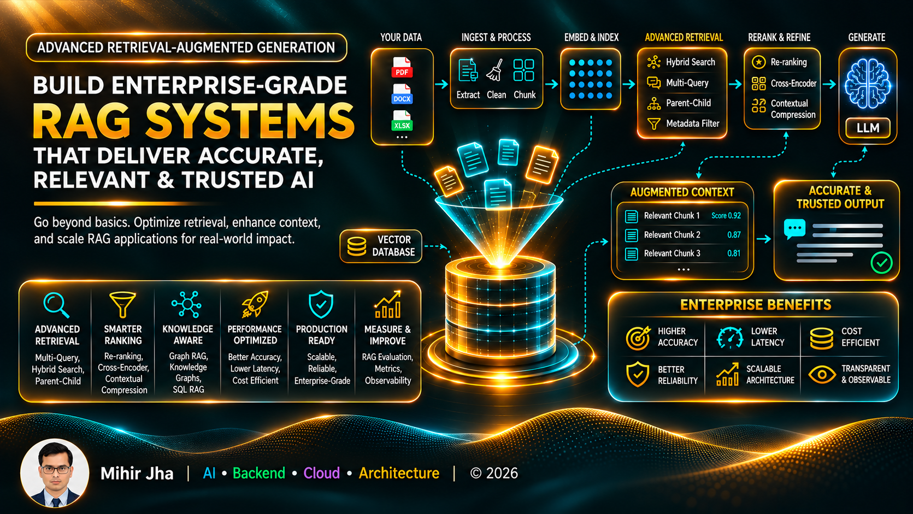
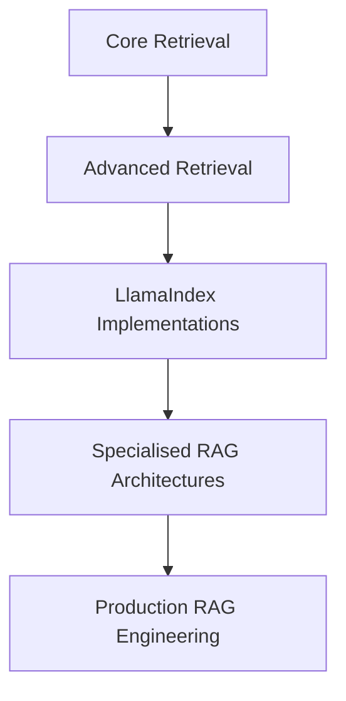

# Part V — Advanced Retrieval-Augmented Generation

> Move beyond basic vector search and learn how to design, evaluate and operate reliable RAG systems.

## Overview

Part IV introduced the basic RAG flow: retrieve relevant information, add it to the model's context, and generate an answer.

Real-world systems need more. A query may use unfamiliar wording, require exact terms, depend on metadata, or span several documents and data sources. Even when retrieval works, the system still needs to select useful context, produce grounded answers and behave reliably under production conditions.

This part builds those capabilities in a practical sequence. You will explore retrieval patterns, see how they are implemented with LlamaIndex, study specialised RAG architectures, and then move into production engineering.

## Learning path

## What you'll learn

- Choose retrieval strategies based on the problem being solved.
- Combine semantic and keyword search, and improve result ranking.
- Use query expansion, metadata filters and hierarchical retrieval.
- Understand how LlamaIndex implements common retrieval patterns.
- Explore Graph RAG, SQL RAG, multimodal RAG and Agentic RAG.
- Design production pipelines for context selection, validation and citations.
- Evaluate retrieval quality and monitor system behaviour.
- Address performance, cost, deployment, caching, tenant isolation and failure handling.

## 1. Core Retrieval Engineering

Start with the retriever patterns that extend basic vector similarity search.

| Chapter | Topic |
|---|---|
| 01 | [VectorStore Retriever](01-core-retrieval-engineering/01-vectorstore-retriever.md) |
| 02 | [Multi-Query Retriever](01-core-retrieval-engineering/02-multi-query-retriever.md) |
| 03 | [Self-Query Retriever](01-core-retrieval-engineering/03-self-query-retriever.md) |
| 04 | [Parent-Document Retriever](01-core-retrieval-engineering/04-parent-document-retriever.md) |
| 05 | [Retriever Comparison](01-core-retrieval-engineering/05-retriever-comparison.md) |

These chapters move from a straightforward vector retriever to query expansion, metadata-aware retrieval and parent-document context.

## 2. Enterprise Retrieval Engineering

Learn how to improve relevance, coverage and context quality by combining retrieval techniques.

| Chapter | Topic |
|---|---|
| 01 | [Contextual Compression Retriever](02-enterprise-retrieval-engineering/01-contextual-compression-retriever.md) |
| 02 | [Ensemble Retriever](02-enterprise-retrieval-engineering/02-ensemble-retriever.md) |
| 03 | [Multi-Vector Retriever](02-enterprise-retrieval-engineering/03-multivector-retriever.md) |
| 04 | [Time-Weighted Retriever](02-enterprise-retrieval-engineering/04-timeweighted-retriever.md) |
| 05 | [Hybrid Search Retriever](02-enterprise-retrieval-engineering/05-hybrid-search-retriever.md) |
| 06 | [HyDE Retriever](02-enterprise-retrieval-engineering/06-hyde-retriever.md) |
| 07 | [Router Retriever](02-enterprise-retrieval-engineering/07-router-retriever.md) |
| 08 | [Multi-Stage Retrieval](02-enterprise-retrieval-engineering/08-multi-stage-retrieval.md) |
| 09 | [Agentic Retrieval](02-enterprise-retrieval-engineering/09-agentic-retrieval.md) |
| 10 | [Re-ranking Techniques](02-enterprise-retrieval-engineering/10-reranking-techniques.md) |
| 11 | [MMR & Diversity-Aware Retrieval](02-enterprise-retrieval-engineering/11-mmr-and-diversity-aware-retrieval.md) |
| 12 | [Metadata-Aware Retrieval](02-enterprise-retrieval-engineering/12-metadata-aware-retrieval.md) |
| 13 | [Advanced Query Rewriting](02-enterprise-retrieval-engineering/13-advanced-query-rewriting.md) |

The key idea is to match the retrieval strategy to the query. Hybrid search can help with exact terminology; reranking can improve the order of retrieved candidates; and compression can remove context that does not help answer the question.

## 3. LlamaIndex Retrieval Engineering

Apply retrieval concepts using LlamaIndex. The focus here is on retrieval implementation, not a general introduction to the framework.

| Chapter | Topic |
|---|---|
| 01 | [LlamaIndex Retrievers Overview](03-llamaindex-retrieval-engineering/01-llamaindex-retrievers-overview.md) |
| 02 | [LlamaIndex Indexes](03-llamaindex-retrieval-engineering/02-llamaindex-indexes.md) |
| 03 | [Vector Index Retriever](03-llamaindex-retrieval-engineering/03-vector-index-retriever.md) |
| 04 | [BM25 Retriever](03-llamaindex-retrieval-engineering/04-bm25-retriever.md) |
| 05 | [Document Summary Retriever](03-llamaindex-retrieval-engineering/05-document-summary-retriever.md) |
| 06 | [Recursive Retriever](03-llamaindex-retrieval-engineering/06-recursive-retriever.md) |
| 07 | [Query Fusion Retriever](03-llamaindex-retrieval-engineering/07-query-fusion-retriever.md) |
| 08 | [Auto-Merging Retriever](03-llamaindex-retrieval-engineering/08-auto-merging-retriever.md) |

## 4. Multimodal AI Engineering

RAG is not limited to text. Enterprise knowledge may also include audio, images, tables, charts and video. This section broadens the view to multimodal systems and their engineering considerations.

| Chapter | Topic |
|---|---|
| 01 | [Multimodal AI Fundamentals and Architecture](05-multimodal-ai-engineering/01-multimodal-ai-fundamentals-and-architecture.md) |
| 02 | [Enterprise Speech AI: STT, TTS and Voice Pipelines](05-multimodal-ai-engineering/02-enterprise-speech-ai-stt-tts-and-voice-pipelines.md) |
| 03 | [Vision-Language Models and Image Understanding](05-multimodal-ai-engineering/03-vision-language-models-and-image-understanding.md) |
| 04 | [Generative Media Engineering: Text-to-Image and Video](05-multimodal-ai-engineering/04-generative-media-engineering-text-to-image-and-video.md) |
| 05 | [Production Multimodal Applications and Orchestration](05-multimodal-ai-engineering/05-production-multimodal-applications-and-orchestration.md) |
| 06 | [Multimodal AI Risks, Evaluation and Governance](05-multimodal-ai-engineering/06-multimodal-ai-risks-evaluation-and-governance.md) |

## 5. Advanced RAG Architectures

Explore architectures that go beyond conventional text-based vector retrieval.

| Chapter | Topic |
|---|---|
| 01 | [Advanced RAG Architecture](06-advanced-rag-architecture/01-advanced-rag-architecture.md) |
| 02 | [Graph RAG](06-advanced-rag-architecture/02-graph-rag.md) |
| 03 | [Knowledge Graphs for RAG](06-advanced-rag-architecture/03-knowledge-graphs-for-rag.md) |
| 04 | [SQL RAG](06-advanced-rag-architecture/04-sql-rag.md) |
| 05 | [Multimodal RAG](06-advanced-rag-architecture/05-multimodal-rag.md) |
| 06 | [Agentic RAG](06-advanced-rag-architecture/06-agentic-rag.md) |

These patterns address different kinds of knowledge and query complexity. Choose them when the data or retrieval problem calls for them—not simply to make the architecture more elaborate.

## 6. Production RAG Engineering

A retrieval pipeline is not production-ready just because it returns relevant documents. The following chapters cover the engineering needed to assemble, validate, evaluate, deploy and operate a dependable system.

| Chapter | Topic |
|---|---|
| 01 | [Prompt Assembly](07-production-rag-engineering/01-prompt-assembly.md) |
| 02 | [Context Selection & Context Engineering](07-production-rag-engineering/02-context-selection-and-context-engineering.md) |
| 03 | [Response Validation](07-production-rag-engineering/03-response-validation.md) |
| 04 | [Citation & Source Attribution](07-production-rag-engineering/04-citation-and-source-attribution.md) |
| 05 | [Enterprise Response](07-production-rag-engineering/05-enterprise-response.md) |
| 06 | [RAG Evaluation & Benchmarking](07-production-rag-engineering/06-rag-evaluation-and-benchmarking.md) |
| 07 | [RAG Observability](07-production-rag-engineering/07-rag-observability.md) |
| 08 | [RAG Performance Optimization](07-production-rag-engineering/08-rag-performance-optimization.md) |
| 09 | [RAG Cost Optimization](07-production-rag-engineering/09-rag-cost-optimization.md) |
| 10 | [Production Retrieval Architecture](07-production-rag-engineering/10-production-retrieval-architecture.md) |
| 11 | [Building Production RAG Systems](07-production-rag-engineering/11-building-production-rag-systems.md) |
| 12 | [RAG Deployment Patterns](07-production-rag-engineering/12-rag-deployment-patterns.md) |
| 13 | [RAG Caching Strategies](07-production-rag-engineering/13-rag-caching-strategies.md) |
| 14 | [Multi-Tenant RAG](07-production-rag-engineering/14-multi-tenant-rag.md) |
| 15 | [RAG Testing Frameworks](07-production-rag-engineering/15-rag-testing-frameworks.md) |
| 16 | [RAG Failure Patterns](07-production-rag-engineering/16-rag-failure-patterns.md) |

## The production mindset

As you work through the final section, keep a few principles in mind:

- **Start with the simplest retrieval that works.** Add hybrid search, reranking or agentic retrieval when evaluation shows a need.
- **Measure retrieval separately from generation.** A fluent answer cannot compensate for missing or irrelevant evidence.
- **Treat security as an application responsibility.** Prompts are not authorization controls; enforce access before data reaches the model.
- **Measure trade-offs.** Retrieval quality, latency, cost and operational complexity need to be considered together.
- **Design for failure.** Account for stale indexes, unavailable dependencies, timeouts, invalid outputs and recovery.

## How this part fits into the handbook

Part IV established the foundations of RAG. Part V builds on them with advanced retrieval and production engineering. The next part moves from retrieving knowledge to systems that can reason, use tools and take actions.

- **Previous:** [Part IV — Retrieval-Augmented Generation](../04-retrieval-augmented-generation/index.md)
- **Next:** [Part VI — AI Agents](../06-ai-agents/index.md)

## Start learning

Begin with [01. VectorStore Retriever](01-core-retrieval-engineering/01-vectorstore-retriever.md) and follow the sections in order. You can then use the production chapters as a guide when turning retrieval experiments into a system that is measurable, secure and reliable.

---

> **Enterprise AI Engineering Handbook**
>
> *Building Production-Grade Enterprise AI Systems — One Chapter at a Time.*

---
