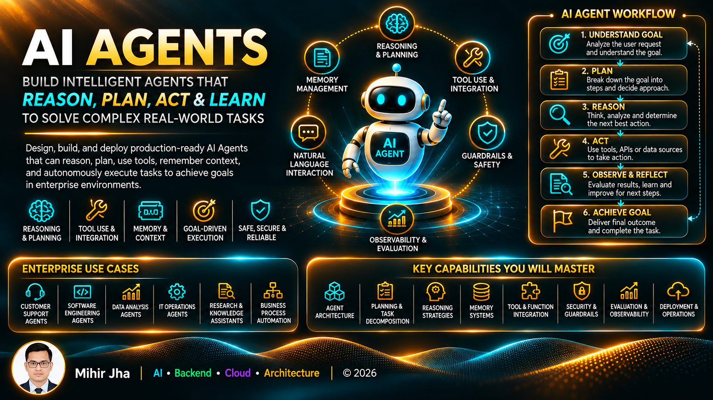
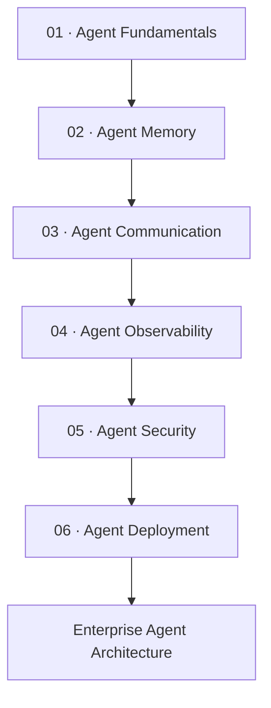
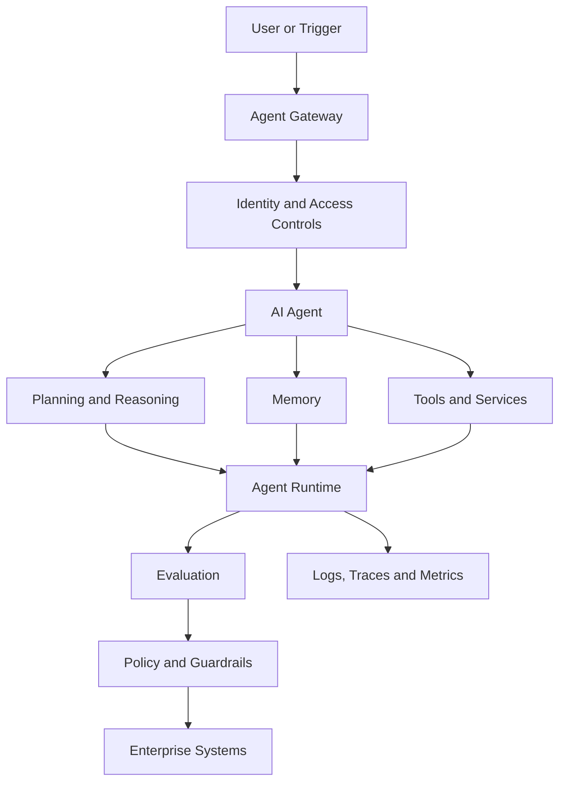

# Part VI — AI Agents

> Learn how to design and operate AI agents that can reason about goals, use tools, maintain state, and execute tasks reliably within enterprise systems.



## Overview

A conventional LLM application typically responds to a request. An AI agent can go further: it can decide what information it needs, select an available action, call a tool, inspect the result, and determine what to do next.

A simplified execution loop looks like this:

```text
Goal
  ↓
Reason and plan
  ↓
Select an action
  ↓
Call a tool
  ↓
Observe the result
  ↓
Update state
  ↓
Continue, revise, or finish
```

This Part focuses on the engineering foundations of an individual agent: its reasoning and execution model, tools, memory, communication, evaluation, security, and runtime. The emphasis is on building agents as dependable software components—not simply connecting an LLM to a collection of APIs.

The progression is deliberate:

```text
Understand the agent
        ↓
Plan and reason
        ↓
Use tools
        ↓
Maintain memory
        ↓
Communicate
        ↓
Evaluate and observe
        ↓
Secure and deploy
```

The material is intended for software and backend engineers, AI engineers, cloud engineers, and solution or enterprise architects.

## What you will learn

By working through this Part, you will learn to:

- Explain the architecture and execution lifecycle of an AI agent.
- Design planning, task-decomposition, reasoning, reflection, and self-correction patterns.
- Build tools and understand manual and framework-assisted tool calling.
- Select memory models and design storage, retrieval, compression, and optimisation strategies.
- Apply message-passing, shared-memory, event-driven, and publish-subscribe communication patterns.
- Coordinate agent interactions and reason about negotiation and conflict resolution.
- Evaluate agent behaviour and task completion.
- Instrument agent runs with logs, traces, metrics, debugging, cost monitoring, and alerts.
- Apply authentication, authorisation, secrets management, privacy controls, sandboxing, guardrails, and risk management.
- Design agent runtimes and production deployments that account for concurrency, latency, failures, and scaling.

## Learning path

Part VI is organised into six engineering areas. Follow the chapters in sequence; each area builds on the concepts introduced earlier.



## 01 — AI Agent Fundamentals

Start with the agent execution model: how an agent interprets a goal, reasons about possible actions, plans work, invokes tools, and responds to results. The later chapters move from core concepts into practical tool integration, design patterns, and enterprise architecture.

| Chapter | Status |
|---|:---:|
| [01. AI Agent Fundamentals](01-ai-agent-fundamentals/01-ai-agent-fundamentals.md) | ✅ |
| [02. Tool Calling & Function Calling](01-ai-agent-fundamentals/02-tool-calling-and-function-calling.md) | ✅ |
| [03. Building & Orchestrating Tools](01-ai-agent-fundamentals/03-building-and-orchestrating-tools.md) | ✅ |
| [04. LCEL & Manual Tool Calling](01-ai-agent-fundamentals/04-lcel-and-manual-tool-calling.md) | ✅ |
| [05. LangChain Built-in Agents](01-ai-agent-fundamentals/05-langchain-built-in-agents.md) | ✅ |
| [06. AI Agent Design Best Practices](01-ai-agent-fundamentals/06-ai-agent-design-best-practices.md) | ✅ |
| [07. Enterprise AI Agent Architecture](01-ai-agent-fundamentals/07-enterprise-ai-agent-architecture.md) | ✅ |
| [08. Planning & Task Decomposition](01-ai-agent-fundamentals/08-planning-and-task-decomposition.md) | ✅ |
| [09. Agent Reasoning](01-ai-agent-fundamentals/09-agent-reasoning.md) | ✅ |
| [10. Reflection & Self-Correction](01-ai-agent-fundamentals/10-reflection-and-self-correction.md) | ✅ |

An agent's execution is often iterative rather than strictly linear:

```text
                  ┌──────────────┐
                  │     Goal     │
                  └──────┬───────┘
                         ↓
                  ┌──────────────┐
                  │   Reason     │
                  └──────┬───────┘
                         ↓
                  ┌──────────────┐
                  │    Plan      │
                  └──────┬───────┘
                         ↓
                  ┌──────────────┐
                  │ Select Tool  │
                  └──────┬───────┘
                         ↓
                  ┌──────────────┐
                  │ Execute Tool │
                  └──────┬───────┘
                         ↓
                  ┌──────────────┐
                  │   Observe    │
                  └──────┬───────┘
                         ↓
                  ┌──────────────┐
                  │ Evaluate     │
                  └──────┬───────┘
                         └──────→ Continue, revise, or finish
```

The focus is on observable reasoning behaviour and system decisions, not exposing private model reasoning.

## 02 — Agent Memory

An agent needs access to relevant context while it works. Some information is temporary and belongs to the current task; other information may need to persist across interactions. This section examines the memory models and engineering patterns used to manage that distinction.

| Chapter | Status |
|---|:---:|
| [01. Agent Memory Overview](02-agent-memory/01-agent-memory-overview.md) | ✅ |
| [02. Short-Term Memory](02-agent-memory/02-short-term-memory.md) | ✅ |
| [03. Long-Term Memory](02-agent-memory/03-long-term-memory.md) | ✅ |
| [04. Working Memory](02-agent-memory/04-working-memory.md) | ✅ |
| [05. Episodic Memory](02-agent-memory/05-episodic-memory.md) | ✅ |
| [06. Semantic Memory](02-agent-memory/06-semantic-memory.md) | ✅ |
| [07. Memory Storage Patterns](02-agent-memory/07-memory-storage-patterns.md) | ✅ |
| [08. Memory Retrieval Patterns](02-agent-memory/08-memory-retrieval-patterns.md) | ✅ |
| [09. Memory Compression](02-agent-memory/09-memory-compression.md) | ✅ |
| [10. Memory Optimization](02-agent-memory/10-memory-optimization.md) | ✅ |

The chapters move from memory concepts and types to the practical concerns of storing, retrieving, compressing, and managing context. The aim is to treat memory as an explicit part of agent architecture—not as an unlimited conversation history.

## 03 — Agent Communication

Agents may need to exchange information with other agents or services. This section introduces the communication patterns that support those interactions, while keeping the focus on the communication foundations of an individual agent system.

| Chapter | Status |
|---|:---:|
| [01. Agent Communication Overview](03-agent-communication/01-agent-communication-overview.md) | ✅ |
| [02. Message Passing](03-agent-communication/02-message-passing.md) | ✅ |
| [03. Shared Memory](03-agent-communication/03-shared-memory.md) | ✅ |
| [04. Event-Driven Agents](03-agent-communication/04-event-driven-agents.md) | ✅ |
| [05. Publish-Subscribe Pattern](03-agent-communication/05-publish-subscribe-pattern.md) | ✅ |
| [06. Agent Coordination](03-agent-communication/06-agent-coordination.md) | ✅ |
| [07. Agent Negotiation](03-agent-communication/07-agent-negotiation.md) | ✅ |
| [08. Conflict Resolution](03-agent-communication/08-conflict-resolution.md) | ✅ |

```text
Agent A
   │
   │ Message or event
   ▼
Communication layer
   ├── Agent B
   ├── Agent C
   └── External service
          │
          ▼
        Results
```

These patterns prepare you for the broader collaboration and orchestration architectures explored in Part VII.

## 04 — Agent Observability

An agent run can involve multiple model calls, tool invocations, state changes, retries, and decisions. A final response alone does not tell an operator what happened along the way. Observability makes that execution inspectable and measurable.

| Chapter | Status |
|---|:---:|
| [01. Agent Observability Overview](04-agent-observability/01-agent-observability-overview.md) | ✅ |
| [02. Agent Logging](04-agent-observability/02-agent-logging.md) | ✅ |
| [03. Agent Tracing](04-agent-observability/03-agent-tracing.md) | ✅ |
| [04. Agent Monitoring](04-agent-observability/04-agent-monitoring.md) | ✅ |
| [05. Agent Metrics](04-agent-observability/05-agent-metrics.md) | ✅ |
| [06. Agent Debugging](04-agent-observability/06-agent-debugging.md) | ✅ |
| [07. Agent Evaluation Metrics](04-agent-observability/07-agent-evaluation-metrics.md) | ✅ |
| [08. Agent Cost Monitoring](04-agent-observability/08-agent-cost-monitoring.md) | ✅ |
| [09. Agent Alerting](04-agent-observability/09-agent-alerting.md) | ✅ |
| [10. Agent Evaluation](04-agent-observability/10-agent-evaluation.md) | ✅ |

Key signals include run outcomes, model and tool latency, errors, retries, token usage, cost, and relevant state transitions. Together, logs, traces, and metrics help teams understand behaviour, investigate failures, and operate agents against defined service expectations.

## 05 — Agent Security

An agent may access enterprise data and invoke tools that change business systems. Its security boundary therefore extends beyond the model prompt: identity, permissions, data access, tool execution, and runtime isolation all matter.

| Chapter | Status |
|---|:---:|
| [01. Agent Security Overview](05-agent-security/01-agent-security-overview.md) | ✅ |
| [02. Prompt Injection](05-agent-security/02-prompt-injection.md) | ✅ |
| [03. Tool Security](05-agent-security/03-tool-security.md) | ✅ |
| [04. Agent Authentication](05-agent-security/04-agent-authentication.md) | ✅ |
| [05. Agent Authorization](05-agent-security/05-agent-authorization.md) | ✅ |
| [06. Secrets Management](05-agent-security/06-secrets-management.md) | ✅ |
| [07. Data Privacy](05-agent-security/07-data-privacy.md) | ✅ |
| [08. Agent Sandboxing](05-agent-security/08-agent-sandboxing.md) | ✅ |
| [09. Agent Guardrails](05-agent-security/09-agent-guardrails.md) | ✅ |
| [10. Agent Risk Management](05-agent-security/10-agent-risk-management.md) | ✅ |

The objective is controlled, auditable autonomy. Security controls should be enforced at the relevant boundaries—especially before sensitive data is accessed or a tool performs a consequential action.

## 06 — Agent Deployment

The final section moves from agent design to the runtime and operational architecture needed to run agents reliably. It covers execution, scaling, resilience, and production deployment.

| Chapter | Status |
|---|:---:|
| [01. Agent Deployment Overview](06-agent-deployment/01-agent-deployment-overview.md) | ✅ |
| [02. Agent Runtime & Execution](06-agent-deployment/02-agent-runtime-and-execution.md) | ✅ |
| [03. Agent Scaling & Resilience](06-agent-deployment/03-agent-scaling-and-resilience.md) | ✅ |
| [04. Production Agent Deployment](06-agent-deployment/04-production-agent-deployment.md) | ✅ |

Production design must account for concurrent requests, long-running executions, model and tool latency, timeouts, retries, failure recovery, queue-based processing, backpressure, rate limits, and resource isolation.

A simplified deployment view:

```text
Client
  ↓
API / Agent Gateway
  ↓
Agent Service and Runtime
  ├── Model gateway
  ├── Tool services
  ├── Memory services
  └── Execution state
  ↓
Logs · Traces · Metrics
  ↓
Enterprise systems
```

## Bringing the pieces together

The six areas form a connected engineering system. Planning and tools determine what an agent can do; memory and communication provide context and interaction; evaluation and observability help establish whether it behaves as expected; security constrains what it is allowed to do; and the runtime makes execution dependable.



## How Part VI fits into the handbook

Part V focuses on retrieving and grounding knowledge. Part VI builds on that foundation by introducing agents that can use retrieval, tools, memory, and APIs as part of a goal-directed execution loop.

```text
Part V · Advanced RAG
        ↓
Grounded knowledge
        ↓
Part VI · AI Agents
        ↓
Intelligent task execution
        ↓
Part VII · Agentic AI & Multi-Agent Systems
        ↓
Autonomous collaboration and orchestration
        ↓
Part VIII · AI Engineering Frameworks & Tooling
        ↓
Framework and protocol implementations
```

**Scope boundary:** Part VI concentrates on the foundations and engineering of individual agents. Part VII expands into autonomous workflows, multi-agent collaboration, supervision, Agentic RAG, enterprise agent platforms, and agent communication protocols such as A2A. Framework-specific implementation belongs in Part VIII.

## Chapter Navigation

⬅️ **Previous:** [Part V — Advanced Retrieval-Augmented Generation](../05-advanced-retrieval-augmented-generation/)

📚 **Current:** Part VI — AI Agents

➡️ **Next:** [Part VII — Agentic AI & Multi-Agent Systems](../07-agentic-ai/)

## Start learning

Begin with [01. AI Agent Fundamentals](01-ai-agent-fundamentals/01-ai-agent-fundamentals.md), then follow the six sections in order.

> **The goal:** Design AI agents that can reason, plan, use tools, maintain memory, communicate, evaluate their results, operate securely, and run reliably as enterprise software.

---

> **Enterprise AI Engineering Handbook**
>
> *Building Production-Grade Enterprise AI Systems — One Chapter at a Time.*

---
