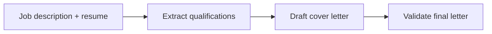
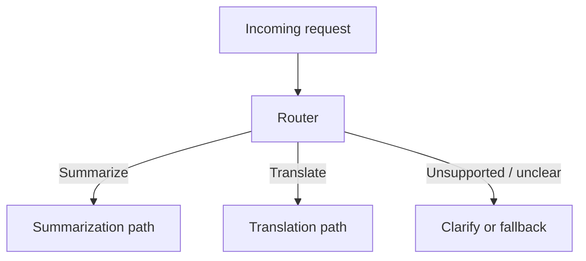
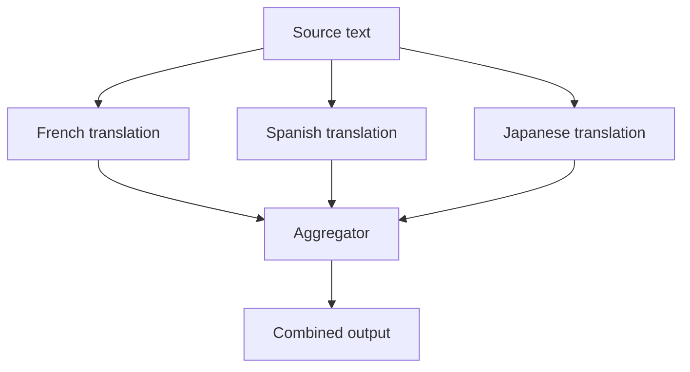
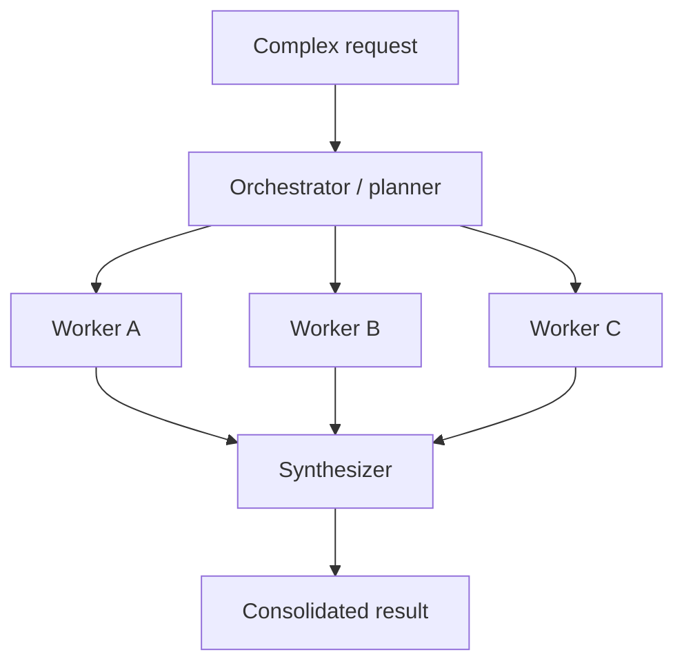
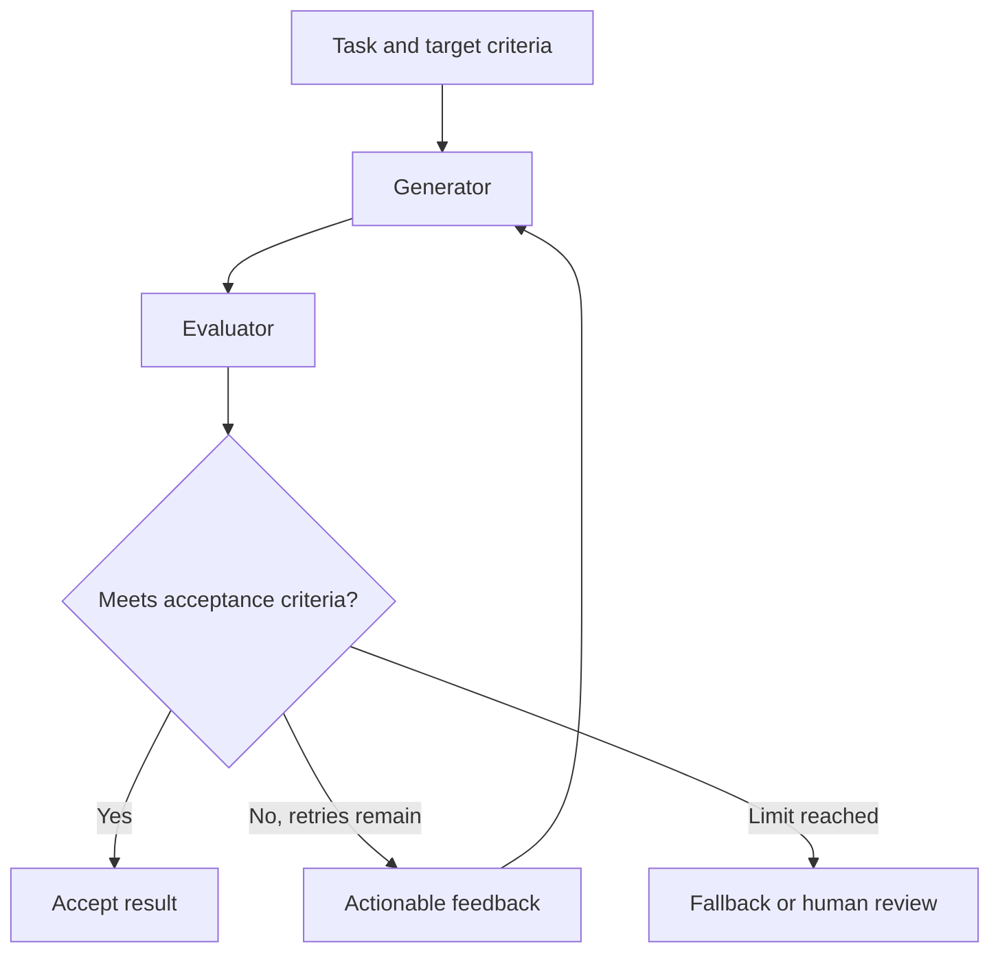
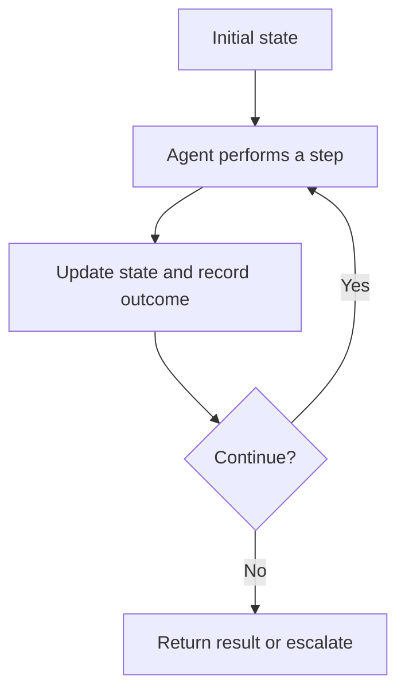
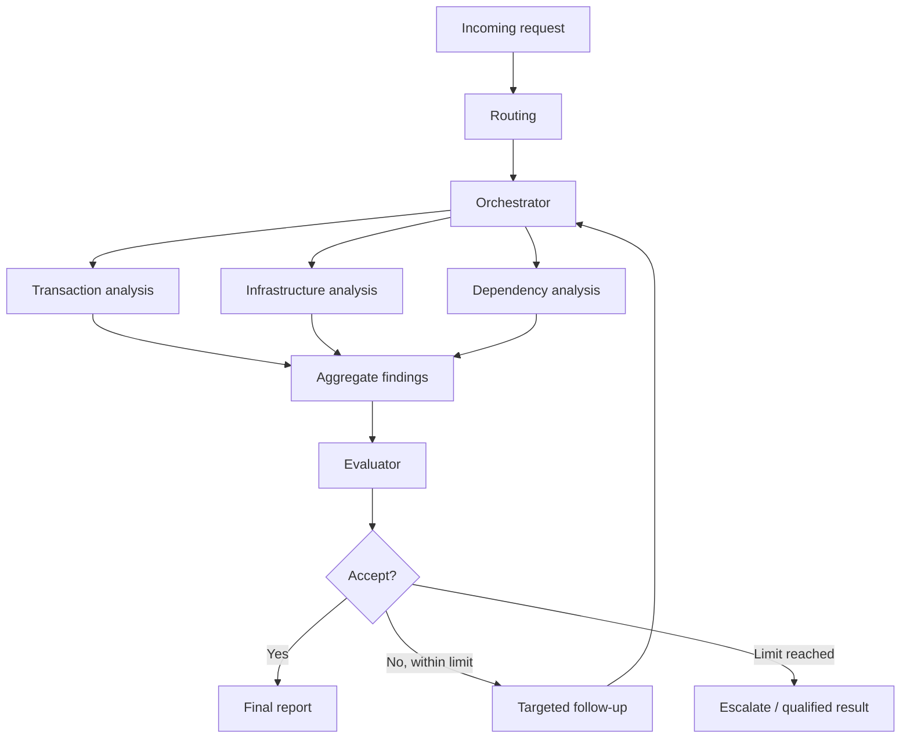

# 03 — Agentic Workflow Design Patterns

> Workflow patterns define how an agentic system moves from a request to a result: what runs, what runs next, and when execution is complete.

## Introduction

Chapter 02 introduced the building blocks of a multi-agent system: agents, responsibilities, collaboration models, and system architecture. This chapter looks at how those components execute a task.

## 1. Sequential Workflow

A sequential workflow, often called **prompt chaining**, passes the output of one stage to the next. Each stage has a focused responsibility, and later stages depend on information produced earlier.



The course uses a cover-letter example. One step extracts relevant qualifications from a resume in the context of a job description. The next uses that summary and the job description to draft a tailored letter. A final validation step can check that required information is present.

```python
def cover_letter_flow(job, resume):
    summary = summarize_resume(resume, job)
    draft = draft_letter(summary, job)
    return validate_letter(draft, job)
```

Each function may call an LLM, an agent, a tool, or ordinary application logic. The important feature is the dependency: the next step receives the previous step's result.

## 2. Routing Pattern

A routing workflow interprets an incoming request and directs it to an appropriate execution path. It is useful when a system supports several distinct capabilities but only one, or a small subset, is needed for a particular request.



The course example uses a router to decide whether a request requires summarization or translation. The router returns a task type, and conditional workflow logic selects the corresponding node.

```python
def handle_request(request):
    route = classify(request)  # "summarize" or "translate"
    handlers = {"summarize": summarize, "translate": translate}
    handler = handlers.get(route)
    return handler(request) if handler else clarify(request)
```

## 3. Parallelization Pattern

Parallelization runs independent subtasks concurrently and combines their results after execution. The pattern is often described as **fan-out followed by fan-in**.



The course demonstrates this pattern by translating the same English input into French, Spanish, and Japanese at the same time. Each branch receives the original text, stores its result separately, and sends it to an aggregator that combines the translations.

```python
import asyncio

async def translate_all(text):
    languages = ["French", "Spanish", "Japanese"]
    results = await asyncio.gather(
        *(translate(text, language) for language in languages)
    )
    return dict(zip(["fr", "es", "ja"], results))
```

## 4. Orchestrator-Worker Pattern

The orchestrator-worker pattern is useful when a request is complex enough that its required subtasks cannot be fully specified in advance. An orchestrator interprets the objective, decomposes it into bounded tasks, assigns work to suitable workers, and aggregates their results.



The course illustrates this with a meal-planning workflow. An orchestrator breaks a request into individual dishes and returns structured dish details. A worker handles each dish independently, while shared state provides common context and worker state carries task-specific information. A synthesizer then combines the completed results into one meal guide. The number of workers can change with the complexity of the request.

```python
async def orchestrate(request):
    tasks = await planner(request)  # structured subtasks
    results = await asyncio.gather(
        *(worker(task, shared_context=request) for task in tasks)
    )
    return synthesize(results, request)
```

The main responsibilities are task decomposition, worker assignment, context transfer, progress tracking, and aggregation. The orchestrator may create different tasks for different requests or react to intermediate findings, making this more dynamic than a fixed sequence.

That flexibility adds coordination complexity. Poor decomposition can cause duplicated effort or missing coverage; an overloaded orchestrator can become a bottleneck. Keep task creation bounded, define worker input and output contracts, limit delegation depth and task count, and specify how incomplete or failed worker results are handled. The orchestrator coordinates the work, but it should not become an unreviewed source of truth. A useful design separates shared context—such as the original request and global constraints—from worker-specific state, such as the assigned subtask and its local findings. This avoids sending every worker the entire conversation while preserving the information needed for consistent results.

**How this differs from routing:** routing selects an existing path for a request. Orchestrator-worker decides what work is needed, creates or selects subtasks, delegates them, and combines their results. A larger workflow can use routing first and orchestration afterwards.

## 5. Evaluator-Optimizer Pattern

The evaluator-optimizer pattern adds a feedback loop to a generation process. A generator produces an output, an evaluator checks it against defined criteria, and the workflow either accepts the result or sends feedback for another attempt.



The course's investment-planning example evaluates a generated plan against a target risk grade. The evaluator returns a grade and feedback; the generator uses that feedback to revise the plan. An iteration counter stops the process when the target is met or the maximum number of attempts is reached.

```python
def refine(task, max_rounds=3):
    draft = generate(task)
    for _ in range(max_rounds):
        review = evaluate(draft, task.criteria)
        if review.accepted:
            return draft
        draft = generate(task, previous=draft, feedback=review.feedback)
    return escalate(draft)
```

## 6. Iterative Agent Workflows

An iterative workflow repeats one or more steps while carrying forward relevant state. It continues until a stopping condition is met, new information is no longer useful, or an execution limit is reached.

Evaluator-optimizer is one specific form of iteration: evaluator feedback guides the next generation attempt. Iteration is the broader design idea and can also support repeated retrieval, planning, analysis, or tool execution as new information becomes available.



The course's reflection example follows a generator-reflector loop. The generator creates an initial response, the reflector critiques it, and the feedback is passed back to the generator. Workflow state accumulates messages and conditional routing decides whether to continue or end. This is useful when an agent needs to revisit a result after reflection, retrieve additional evidence, or continue planning based on an earlier tool response. The loop should carry forward only the context needed for the next step.

```python
def iterate(state, max_steps=4):
    for _ in range(max_steps):
        state["result"] = agent_step(state)
        state["feedback"] = reflect(state["result"])
        if state["feedback"].done:
            break
    return state
```

## Combining Patterns in One Workflow

These patterns are design choices, not mutually exclusive architectures. A single enterprise workflow can combine several of them.



For example, a payment incident investigation can route a request to an incident workflow, use an orchestrator to assign transaction, infrastructure, and dependency analysis, run those investigations in parallel, and aggregate the findings. An evaluator then checks whether the report contains the required evidence and whether the stated cause is supported. If gaps remain, the workflow can request targeted follow-up work within a bounded limit.

## Choosing the Right Pattern

| Pattern | Design question | Use it when |
|---|---|---|
| Sequential | What must happen next? | Stages have dependencies |
| Routing | Which existing path should handle this? | Requests map to distinct capabilities |
| Parallelization | Which independent tasks can run together? | Branches can execute independently and results can be combined |
| Orchestrator-worker | What subtasks are needed, and who should perform them? | Work must be decomposed and delegated dynamically |
| Evaluator-optimizer | Does the result meet defined criteria? | Feedback can guide a useful revision |
| Iterative workflow | Should execution repeat with updated state? | New information or repeated steps can advance the task |

## 💼 Backend Architecture Parallel

| Backend engineering concept | Agentic workflow equivalent |
|---|---|
| Sequential service pipeline | Sequential workflow |
| API gateway or request dispatcher | Routing pattern |
| Concurrent service calls with result aggregation | Parallelization pattern |
| Workflow engine coordinating worker services | Orchestrator-worker pattern |
| Validation and controlled retry | Evaluator-optimizer pattern |
| Stateful process with conditional re-entry | Iterative workflow |

In practice, this means an agentic workflow should be designed with the same discipline as a distributed backend process: define request and response schemas, correlate each execution, make retries idempotent where possible, isolate untrusted tool output, and record why a route or loop was selected. Model flexibility does not remove the need for predictable system boundaries.

## Key Takeaways

- Workflow patterns define execution flow; they do not dictate how many agents a system must contain.
- Sequential workflows handle dependent stages, while routing selects an appropriate existing path.
- Parallelization runs independent tasks concurrently and requires deliberate result aggregation.
- Orchestrator-worker workflows dynamically decompose requests and delegate bounded subtasks.
- Evaluator-optimizer workflows use explicit feedback to refine an output; iteration is the broader loop-based approach.
- State, contracts, validation, termination limits, and failure policies are essential to dependable execution.
- Combine patterns only when the problem requires it; complexity should earn its place.

## What's Next?

This chapter explored how agentic tasks are structured and executed. The next chapter examines how agents exchange information and coordinate their work.

**Chapter 04 — Multi-Agent Communication & Coordination**

We will look at agent communication models, message passing, shared state and context, coordination strategies, conflict resolution, and communication overhead and failure handling.

## References

- [LangGraph documentation](https://docs.langchain.com/oss/python/langgraph/overview)
- [Pydantic documentation](https://docs.pydantic.dev/)


> **Enterprise AI Engineering Handbook**\
> *Building Production-Grade Enterprise AI Systems --- One Chapter at a
> Time.*