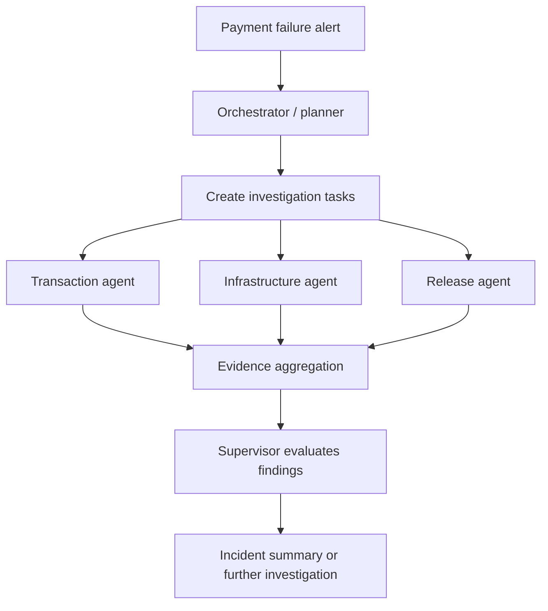
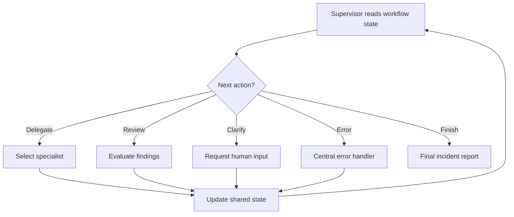
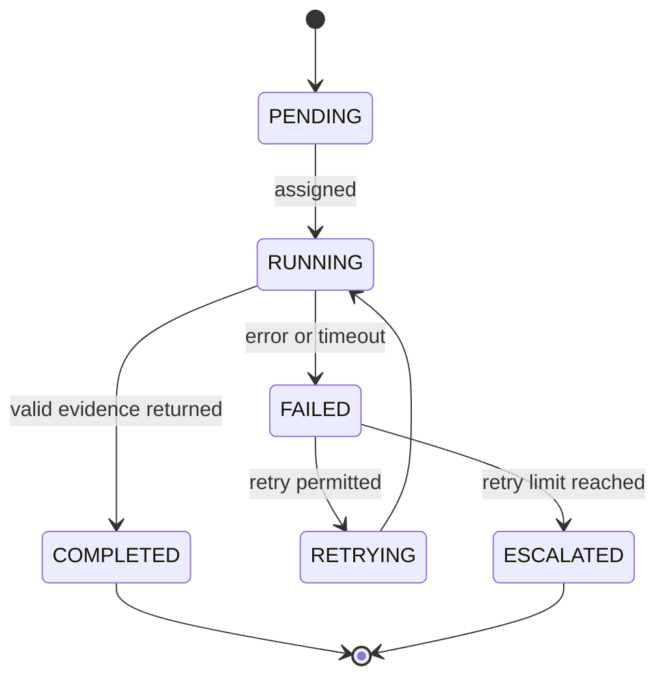

# 05 — Agent Orchestration & Supervisor Patterns

> A multi-agent system needs more than capable workers. It needs a control layer that decides what work happens next, who is allowed to perform it, and when the investigation is complete.

## Introduction

Chapters 03 and 04 introduced agentic workflow patterns and communication. This chapter brings those ideas together through an enterprise scenario: a payment platform reports a sudden increase in failed transactions.

Several specialist agents could help investigate the incident, but simply launching them is not enough. The system must plan the investigation, route tasks, track progress, enforce limits, and handle failures. That is the job of orchestration.

We will build the design progressively. The payment scenario is an illustrative enterprise application. Framework mechanisms are drawn from the course transcripts; production controls and reliability practices are identified as engineering guidance.

## 1. Centralized Orchestration

A centralized orchestrator owns the investigation workflow. It converts the incident into bounded tasks, assigns them to specialist workers, monitors their results, and combines the evidence.

The initial plan might contain three investigations:

- **Transaction analysis:** identify failure patterns, affected payment methods, and error codes.
- **Infrastructure analysis:** inspect service health, latency, and dependency failures.
- **Release analysis:** check whether a recent deployment correlates with the incident.



This follows the course's planner-worker-synthesizer example: a planner creates structured work items, workers process them, and a synthesizer combines their outputs. The course demonstrates this with dynamically assigned meal-planning tasks; here, the same pattern is applied to incident investigation.

Centralization gives the workflow a clear place to enforce policy and maintain an audit trail. It can also become a bottleneck or single point of failure. Keep the orchestrator focused on coordination and validation rather than performing every specialist task itself.

## 2. Supervisor Architecture

A supervisor repeatedly examines workflow state and chooses the next action. It may delegate another investigation, request clarification, send findings for review, handle an error, or finish.

The important distinction is that the supervisor reacts to evidence rather than blindly executing a fixed sequence.



A model can recommend the next investigation, but application code should resolve that recommendation through a fixed worker registry. Model output must never become an arbitrary executable destination.

```python
WORKERS = {
    "transactions": transaction_agent,
    "infrastructure": infrastructure_agent,
    "release": release_agent,
}

def choose_next(state):
    if state["deadline_exceeded"] or not state["pending_tasks"]:
        return {"next_action": "finish"}

    task = state["pending_tasks"][0]  # read; do not mutate shared state
    worker = WORKERS.get(task["domain"])

    if worker is None:
        return {"next_action": "clarify", "task": task}

    return {
        "next_action": "delegate",
        "worker": worker,
        "task": task,
    }
```

The worker functions are injected dependencies, not agent implementations. In a graph runtime, the returned action drives a conditional edge. The course demonstrates related controls through LangGraph shared state and conditional edges. AG2's `GroupChatManager` provides another orchestration model: it controls which agent speaks next and when the conversation ends.

## 3. Dynamic Task Routing

Dynamic routing selects a worker or execution path using the request and the latest workflow state. If transaction analysis finds failures concentrated around one payment gateway, the supervisor may request a gateway-focused infrastructure check. If evidence points to a recent release, it can route work to the release agent.

The course demonstrates dynamic fan-out with LangGraph's `Send`: a planner creates structured work items, and an assignment node sends each item to a worker. The number of workers can vary with the task list.

```python
from langgraph.types import Send

def assign_investigations(state):
    tasks = state["pending_tasks"][:state["max_workers"]]
    return [
        Send("investigator", {
            "task": task,
            "incident_id": state["incident_id"],
            "shared_context": state["context"],
        })
        for task in tasks
    ]
```

The graph must define the `investigator` node and a path for collecting results. Each worker receives task-specific details alongside shared incident context. Validate task fields and cap fan-out before dispatch.

LangGraph can also route from a state field such as `next_action`:

```python
def route(state):
    return {
        "delegate": "assign_workers",
        "handle_error": "error_handler",
        "finish": "finalize",
        "clarify": "human_review",
    }.get(state["next_action"], "error_handler")
```

This mirrors the transcript's sales-report workflow, where agents update `next_action` and errors are collected for a central handler. An explicit fallback prevents an unknown action from silently continuing.

## 4. Agent Lifecycle Management

Every investigation task needs a visible lifecycle. Track the task execution, not just the worker process: the same worker can handle many tasks.



Record the owner, parent incident ID, timestamps, deadline, attempt count, and last error. The following state machine keeps transitions explicit:

```python
ALLOWED = {
    "PENDING": {"RUNNING"},
    "RUNNING": {"COMPLETED", "FAILED"},
    "FAILED": {"RETRYING", "ESCALATED"},
    "RETRYING": {"RUNNING"},
}

def transition(task, target):
    if target not in ALLOWED.get(task["status"], set()):
        raise ValueError(f"Invalid transition: {task['status']} -> {target}")
    task["status"] = target
```

The transcript teaches workflow state and error paths, but not a complete durable task-lifecycle implementation. Atomic persistence, ownership and recovery are additional enterprise engineering concerns. In production, the read-check-write transition must be atomic so two orchestrators cannot claim the same task.

## 5. Execution Control

A supervisor needs boundaries. Otherwise, one incident could trigger unbounded investigations, overwhelm model providers, or remain active long after it is useful.

For the payment investigation, define maximum parallel workers, a task budget, a deadline, allowed domains, and approval requirements.

```python
def may_dispatch(state, task):
    return all((
        not state["deadline_exceeded"],
        state["active_workers"] < state["max_concurrency"],
        state["tasks_created"] < state["max_tasks"],
        task["domain"] in state["allowed_domains"],
    ))
```

| Control | Payment investigation example |
|---|---|
| Fan-out | At most five investigation tasks |
| Concurrency | At most three active workers |
| Deadline | Stop after the incident time budget expires |
| Tool invocation | Limit repeated calls to a diagnostic tool |
| Allowed domains | Transaction, infrastructure, and release |
| Human approval | Required before production remediation |
| Termination | Finish when evidence is sufficient or the budget is exhausted |

The course shows how different frameworks implement execution controls:

- **AG2:** `GroupChatManager` supports default handoffs, automatic speaker selection, round-robin, random, and manual selection. Context-based or conditional handoffs can route an urgent incident to an escalation agent. Maximum turns/rounds, maximum consecutive auto-replies, and termination messages prevent conversations from running indefinitely.
- **BeeAI:** `ConditionalRequirement` controls tool order and invocation frequency. `AskPermissionRequirement` pauses for human approval before a protected tool call. `ControlTrajectoryMiddleware` records the execution path for debugging and transparency.

These framework mechanisms are useful, but they do not replace application-level authorization, concurrency limits, deadlines, or audit persistence. A model-generated plan is a proposal; it must not expand its own permissions or execution budget.

## 6. Orchestration Failure Handling

Suppose the infrastructure agent times out while querying service metrics. The supervisor must decide whether to retry, continue with partial evidence, or escalate.

The first course transcript demonstrates a LangGraph sales-report workflow in which multiple agents can route errors to a central handler. The workflow records errors and uses `next_action` to continue, handle the error, or terminate. The retry policy below extends that example with explicit lifecycle transitions.

```python
def handle_failure(task, error, max_attempts=2):
    task["last_error"] = str(error)
    transition(task, "FAILED")

    if task["retryable"] and task["attempt"] < max_attempts:
        task["attempt"] += 1
        transition(task, "RETRYING")
        return "retry"

    transition(task, "ESCALATED")
    return "escalate"
```

The task must start in `RUNNING`, with `attempt` and `retryable` initialized. This example illustrates the decision; persistence, backoff and timeout execution belong to the runtime.

Distinguish failure types:

- **Transient timeout:** retry with bounded backoff if safe to repeat.
- **Invalid evidence:** reject it and request a corrected result.
- **Partial investigation:** continue only if acceptance rules allow missing evidence, and disclose the gap.
- **Repeated failure:** stop automatic retries and escalate.
- **Supervisor failure:** persist workflow state so another process can resume or safely terminate the investigation.

Never blindly retry side effects. Repeating a metrics lookup differs from repeating a payment or account mutation. Use idempotency keys for operations that change external state. Investigation agents should normally gather evidence; remediation should follow a separate approval-controlled path.

## 💼 Backend Architecture Parallel

| Backend architecture | Agent orchestration equivalent |
|---|---|
| Workflow engine / process manager | Orchestrator or supervisor |
| Command dispatcher | Worker selection and task routing |
| Job scheduler | Dynamic assignment and concurrency control |
| Job state machine | Investigation task lifecycle |
| Retry policy / dead-letter queue | Bounded retry and escalation |
| Timeout and cancellation | Execution budget and termination |
| Approval workflow | Human gate before production remediation |
| Execution tracing | Agent trajectory and workflow trace |

The same principle applies: keep state transitions, permissions, resource limits, and side effects under deterministic application control. Use the model for flexible reasoning inside those boundaries.

## Key Takeaways

- Centralized orchestration gives an agentic workflow a clear execution owner.
- A supervisor evaluates state and selects the next permitted action.
- Dynamic routing dispatches only the investigations the current state requires.
- Task lifecycle tracking makes work observable and recoverable.
- LangGraph, AG2 and BeeAI provide different mechanisms for routing, turn control, tool constraints and execution visibility.
- Failure handling needs explicit retry, partial-result, escalation, and termination policies.

## What's Next?

Chapter 06 — **Hierarchical Agents & Task Delegation** — extends orchestration into multi-level manager-worker structures, focusing on task decomposition, delegation strategies, result aggregation, and hierarchical execution control.


## References

- [LangGraph documentation](https://docs.langchain.com/oss/python/langgraph/overview)

> **Enterprise AI Engineering Handbook**
>
> *Building Production-Grade Enterprise AI Systems — One Chapter at a Time.*
