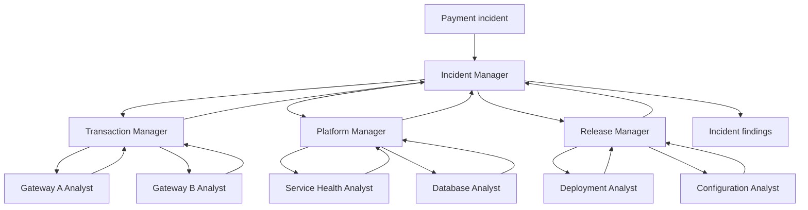
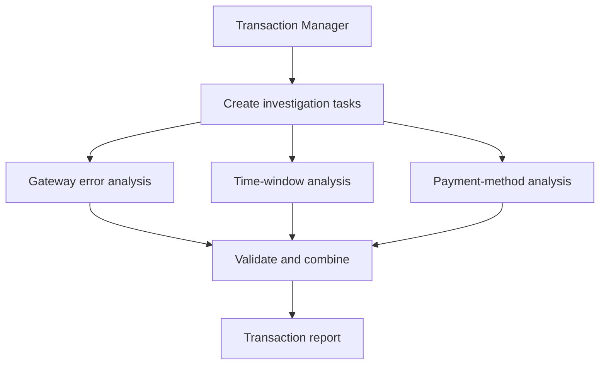
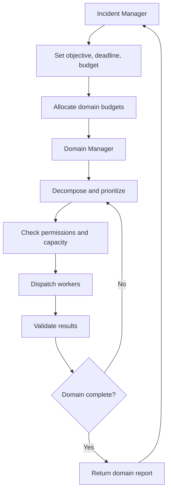

# 06 — Hierarchical Agents & Task Delegation

> A supervisor decides what happens next. A hierarchy decides how a large objective is divided across managers and specialist teams—and how their work comes back together.

## Introduction

In Chapter 05, one supervisor coordinated an investigation into rising payment failures. That works while the supervisor can manage the tasks directly. Now imagine the incident spans several gateways, infrastructure services, and recent releases. Each area needs its own investigation, and some investigations require further specialists.

Sending every task to one supervisor creates a coordination bottleneck. A hierarchy introduces domain managers that own workstreams and coordinate their own workers.

The key change is **delegation across levels of responsibility**, not simply adding more agents. Course transcripts introduce this through CrewAI's hierarchical process, LangGraph's planner-worker assignment, and structured task handoffs. The deeper enterprise controls in this chapter extend those foundations.

## 1. Hierarchical Agent Architecture

A hierarchical system has a top-level manager, domain managers, and specialist workers. Each level owns a smaller part of the overall objective.



The incident manager owns the overall objective, deadline, and final synthesis. Domain managers plan work within their areas. Specialist workers investigate a bounded question and return evidence.

A manager may be an agent, deterministic workflow logic, or both. Use hierarchy when work separates naturally into domains; otherwise extra levels add coordination and latency.

## 2. Manager-Worker Pattern

The manager-worker pattern separates planning from execution. A manager receives an objective, decides what work is needed, assigns tasks, and checks the returned results.

For example, the transaction manager wants to know whether failures are concentrated around one gateway. It can assign separate checks for gateway error codes, the incident timeline, and affected payment methods.



This is related to two mechanisms shown in the course, but they are not identical:

- **LangGraph planner-worker:** a planner creates structured tasks; an assignment step uses `Send` to dispatch a variable number of workers; a synthesizer combines their results. This is dynamic fan-out and aggregation, typically at one delegation level.
- **CrewAI hierarchical process:** the course introduces a manager agent that dynamically assigns and oversees tasks. This is the closer match to manager-led delegation. By contrast, CrewAI's sequential process runs predefined tasks in order.

The course's CrewAI example also shows why delegation boundaries matter: an agent can be configured with `allow_delegation=False` so it completes its own assigned task rather than delegating further.

A typed contract makes handoffs explicit:

```python
from pydantic import BaseModel
from typing import Literal

class InvestigationTask(BaseModel):
    task_id: str
    domain: Literal["gateway", "timeline", "payment_method"]
    objective: str
    expected_output: str

class WorkerResult(BaseModel):
    task_id: str
    status: Literal["completed", "failed"]
    findings: list[str]
    evidence_refs: list[str]
```

The manager creates tasks; workers return results. Schema validation checks structure, not truth.

## 3. Task Decomposition

Decompose around the question, not the number of available agents.

**Incident objective:** Explain why payment failures increased during the last 30 minutes.

The incident manager can create three workstreams:

1. **Transactions:** identify affected gateways, error codes, and payment methods.
2. **Platform:** inspect service health, dependency latency, and database saturation.
3. **Releases:** correlate the incident with deployments or configuration changes.

The platform manager may then split its work further: one worker checks application metrics, another checks database metrics. This is where hierarchy becomes useful—the domain manager understands the local work well enough to decompose it without sending every detail back to the incident manager.

Each task needs an objective, scope, inputs, expected output, constraints, and completion condition. Metrics and release-history checks can run in parallel; root-cause assessment waits for evidence.

```python
def decompose_incident(incident_id: str) -> list[InvestigationTask]:
    return [
        InvestigationTask(
            task_id=f"{incident_id}-gateway",
            domain="gateway",
            objective="Identify gateway-specific failure patterns",
            expected_output="Affected gateways, error codes, evidence references",
        ),
        InvestigationTask(
            task_id=f"{incident_id}-timeline",
            domain="timeline",
            objective="Compare failures across the incident window",
            expected_output="Timeline and notable changes",
        ),
        InvestigationTask(
            task_id=f"{incident_id}-methods",
            domain="payment_method",
            objective="Identify disproportionately affected methods",
            expected_output="Affected methods and failure distribution",
        ),
    ]
```

This is illustrative logic, not an autonomous planner. Production task creation validates scope, enforces allowed domains, and persists task IDs. Avoid splitting work when dispatch and aggregation cost more than execution.

## 4. Delegation Strategies

After decomposition, the manager chooses who should do the work. A useful strategy depends on the task and the available workers.

| Strategy | Example |
|---|---|
| Capability-based | Send database analysis to a worker with database expertise |
| Rule-based | Route a gateway ID to its owning team |
| Load-aware | Choose an eligible worker with available capacity |
| Priority-based | Dispatch customer-impacting failures first |
| Dynamic | Create another task when new evidence reveals an affected region |

These strategies can be combined. Filter workers by capability and authorization, then choose one with capacity while respecting priority.

```python
def select_worker(task, workers):
    eligible = [
        worker for worker in workers
        if task["capability"] in worker["capabilities"]
        and task["domain"] in worker["allowed_domains"]
        and worker["active_tasks"] < worker["capacity"]
    ]
    if not eligible:
        return None
    return min(eligible, key=lambda worker: worker["active_tasks"])
```

A model may suggest a capability, but application code enforces worker registry, permissions, and capacity. A worker allowed to inspect metrics must not gain permission to restart production services.

## 5. Result Aggregation

Results travel upward. Workers return findings to their domain manager; domain managers validate and summarize them; the incident manager combines the domain reports.

The course's CrewAI meal-planning lab offers a useful, smaller example of aggregation. A meal planner creates a structured meal plan, a shopping organizer consumes it through task context, a budget advisor checks costs, and a leftover manager contributes reuse suggestions. A summary agent then combines those outputs into one guide. The agents are specialized, and structured Pydantic outputs help downstream tasks consume earlier results.

The payment investigation follows the same broad idea. Transaction analysis may identify Gateway B, platform analysis may find connection-pool saturation, and release analysis may uncover a recent configuration change. The incident manager correlates these as evidence for a hypothesis—not proof of root cause by themselves.

```python
class DomainReport(BaseModel):
    domain: str
    status: Literal["complete", "partial", "failed"]
    findings: list[str]
    evidence_refs: list[str]
    open_questions: list[str]

def aggregate_reports(reports: list[DomainReport]) -> dict:
    return {
        "findings": [
            finding for report in reports for finding in report.findings
        ],
        "evidence_refs": sorted({
            ref for report in reports for ref in report.evidence_refs
        }),
        "incomplete_domains": [
            report.domain for report in reports
            if report.status != "complete"
        ],
        "open_questions": [
            question for report in reports for question in report.open_questions
        ],
    }
```

Preserve partial completion, open questions, contradictory findings, and evidence provenance. Distinguish facts from hypotheses; a failed worker must not disappear inside an apparently complete summary.

## 6. Hierarchical Execution Control

A hierarchy needs controls at every level. The incident manager sets the overall objective, deadline, and resource budget. Domain managers allocate only the capacity delegated to them. Workers execute bounded tasks and return results through the agreed contract.



Important controls include:

- **Delegation depth:** limit how many manager levels can create subtasks.
- **Concurrency:** cap active tasks globally and within each domain.
- **Execution budget:** constrain model calls, tool calls, tokens, and elapsed time.
- **Permission inheritance:** child tasks receive only the permissions needed for their scope.
- **Completion and escalation:** define what happens when evidence is missing, a task fails, or the budget runs out.

Only the parent should approve a larger child budget or deadline extension.

| Failure mode | Control |
|---|---|
| Too many levels | Maximum delegation depth |
| Duplicate work | Task IDs and explicit ownership |
| Worker overload | Local and global concurrency limits |
| Conflicting reports | Preserve evidence; escalate unresolved conflicts |
| Lost results | Persist parent-child task state |
| Manager failure | Controlled reassignment from persisted state |
| Endless decomposition | Completion criteria and task budget |

The transcripts introduce manager oversight, dynamic assignment, structured outputs, and aggregation. Durable ownership, budget propagation, manager failover, and permission inheritance are additional enterprise engineering guidance—not fully implemented in the course examples.

## 💼 Backend Architecture Parallel

| Backend concept | Hierarchical agent equivalent |
|---|---|
| Parent-child job orchestration | Manager and sub-manager delegation |
| Job queue and worker pool | Worker assignment and execution |
| Typed request/response DTO | Task and result contracts |
| Aggregation service | Manager-level result synthesis |
| Quota propagation | Hierarchical execution budgets |
| Access-control inheritance | Bounded child-task permissions |
| Distributed workflow state | Parent-child task lifecycle |

As in distributed systems, a parent owns the objective, delegates bounded work, and collects results. Agent outputs need evidence and limits, not just a successful process status.

## Key Takeaways

- Hierarchy creates multiple responsibility levels; it is not simply a larger worker pool.
- Managers decompose objectives, delegate bounded tasks, and validate results.
- LangGraph `Send` demonstrates dynamic fan-out; CrewAI's hierarchical process introduces manager-led task assignment and oversight.
- Structured outputs make handoffs and aggregation more dependable.
- Preserve partial results, evidence, and unresolved questions when combining findings.
- Enforce budgets, permissions, ownership, and escalation throughout the hierarchy.

## What's Next?

Chapter 07 — **Collaborative Agents & Swarm Architectures** — moves beyond manager-led delegation to explore peer collaboration, swarm-style coordination, distributed decision-making, and collective problem solving.

## References

### Course Material

- [LangGraph documentation](https://docs.langchain.com/oss/python/langgraph/overview)
- [CrewAI documentation](https://docs.crewai.com/)

> **Enterprise AI Engineering Handbook**
>
> *Building Production-Grade Enterprise AI Systems — One Chapter at a Time.*
