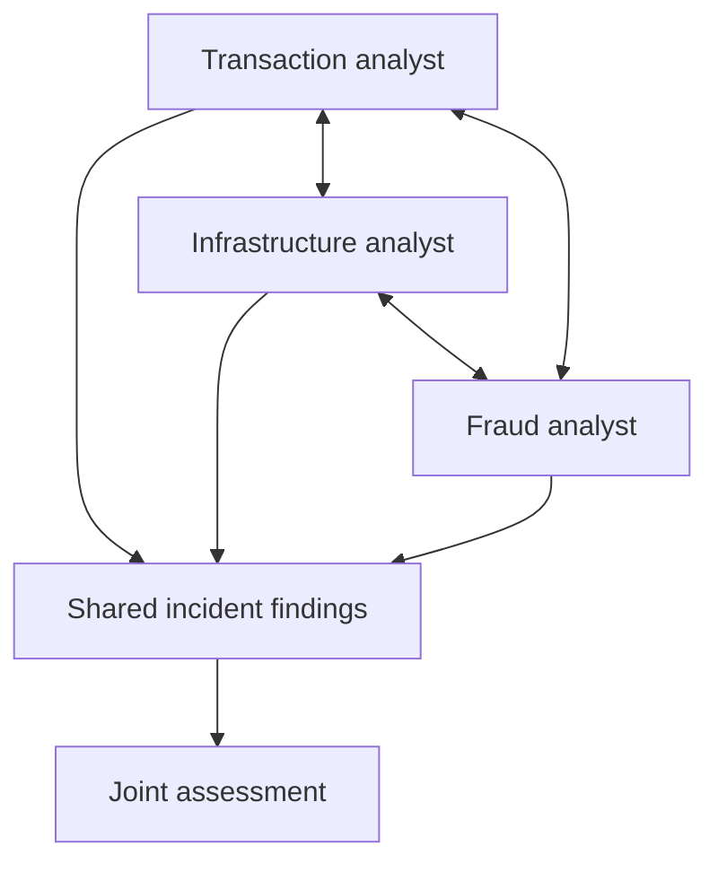
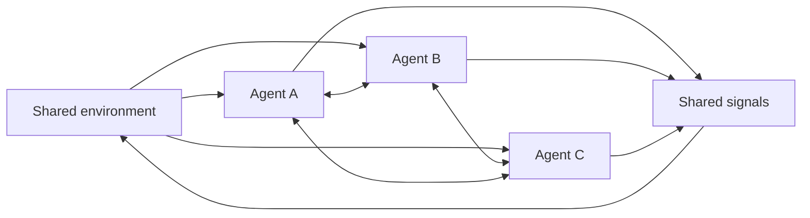
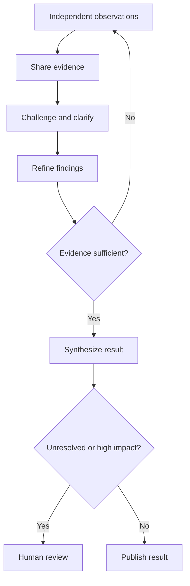

# 07 — Collaborative Agents & Swarm Architectures

> Not every agent team needs a permanent manager. Some problems benefit when specialists exchange evidence, challenge assumptions, and coordinate around a shared objective.

## Introduction

Previous chapters explored communication, supervisor control, and hierarchical delegation. Collaboration lets agents refine a shared understanding, not just pass results along a chain.

In a payment incident, transaction, infrastructure, and fraud analysts see different signals. Their interaction may reveal a shared cause. A swarm-inspired architecture goes further: agents make local decisions using shared signals. Use it only when decentralized adaptation is needed.

## 1. Collaborative Agent Models

Collaborative agents retain distinct responsibilities while contributing to a common outcome. They can communicate directly, participate in a shared conversation, or publish structured findings to shared state.

| Model | How it works | Suitable situation |
|---|---|---|
| Peer dialogue | Agents ask questions, exchange evidence and challenge claims | Uncertain investigations |
| Group conversation | Several agents share a conversation under participation rules | Comparing specialist perspectives |
| Shared workspace | Agents read and contribute structured state or findings | Combining observations without repeating full conversations |

The first transcript illustrates interactive dialogue: a requirements agent asks a data agent about metric availability, the data agent seeks filtering details, and the requirements agent refines its request. Interaction changes the work rather than merely forwarding a result.



A shared workspace reduces repeated context, but access should remain limited to each agent's role.

## 2. Peer-to-Peer Collaboration

In peer-to-peer collaboration, agents communicate directly for a task. There may be no permanent supervisor choosing every interaction. One agent can request evidence, another can challenge a conclusion, and the first can revise its analysis.

Peers do not necessarily have equal authority: requesting latency evidence must not grant permission to restart a production service.

A message contract makes exchanges easier to validate and trace:

```python
from typing import Literal
from pydantic import BaseModel, Field

class PeerMessage(BaseModel):
    conversation_id: str
    sender: str
    recipient: str
    message_type: Literal["request", "evidence", "challenge", "response"]
    content: str
    evidence_refs: list[str] = Field(default_factory=list)
```

This framework-independent contract is not a messaging implementation; transport, authorization, correlation IDs, and delivery policy are still required.

**Peer dialogue is not the same as a managed group chat.** The course's AG2 example uses a `GroupChat` to define participants and a `GroupChatManager` to manage turn-taking. The manager can use automatic, round-robin, manual, or random speaker selection. This supports collaborative discussion, but the conversation flow remains centrally managed.

The following course-style example adapts the lesson-planning group chat to the payment-incident scenario:

```python
import autogen

transaction_agent = autogen.AssistantAgent(
    name="transaction_analyst",
    system_message="Analyse transaction failures and provide evidence."
)

infrastructure_agent = autogen.AssistantAgent(
    name="infrastructure_analyst",
    system_message="Analyse latency, capacity and infrastructure signals."
)

fraud_agent = autogen.AssistantAgent(
    name="fraud_analyst",
    system_message="Assess fraud-rule changes and affected transactions."
)

incident_team = autogen.GroupChat(
    agents=[transaction_agent, infrastructure_agent, fraud_agent],
    messages=[],
    max_round=6,
    speaker_selection_method="auto"
)

manager = autogen.GroupChatManager(groupchat=incident_team)

# A configured user/proxy agent starts the discussion:
# incident_coordinator.initiate_chat(
#     manager,
#     message="Investigate the rise in payment failures."
# )
```

This follows the AG2 structure taught in the course: participants, a shared conversation, a manager, a speaker strategy, and a termination condition. Imports and options vary by release, so verify against your installed version.

After the coordinator starts the chat:

1. The transaction analyst reports the failure spike and affected routes.
2. The infrastructure analyst reports connection-pool saturation.
3. The fraud analyst challenges a single-cause explanation, citing a separate transaction segment affected by a rule change.
4. The transaction analyst narrows the investigation and requests evidence linking each signal to failed payments.
5. The team stops when evidence is sufficient or the round limit is reached.

With `speaker_selection_method="auto"`, the manager selects the next speaker from context. Round-robin rotates in fixed order; the course also covers manual and random selection. These are turn-taking strategies, not consensus algorithms.

LangGraph offers a different model: agents are graph nodes that update shared state, while edges and conditional transitions control execution. Use a graph for explicit workflow transitions and group chat for turn-based discussion.

## 3. Swarm Intelligence

Swarm intelligence takes inspiration from groups of relatively simple agents—such as ants, birds, or fish—whose local interactions produce coordinated group behaviour. No individual needs a complete view. Agents follow local rules, react to signals, and adjust their actions based on what they observe.

A software system inspired by this idea lets agents observe a shared environment, make bounded local decisions, publish signals, adapt to other agents, and contribute without one agent planning every action.



A warehouse robot fleet is a useful analogy: robots share position and intent, then adjust routes to avoid collisions. Enterprise workers might similarly publish workload signals and adapt task selection.

A group chat is not automatically a swarm: a controller may still select speakers. A swarm-inspired design needs local autonomy and shared interaction rules; poor rules can cause duplicated work, congestion, or instability.

**Transcript boundary:** the course covers multi-agent collaboration and group conversations, but it does not implement a formal swarm algorithm or demonstrate decentralized convergence. This section is architectural context, not a claim about a swarm implementation in LangGraph or AG2.

Consider a distributed document-processing service. Workers observe a shared queue and their own workload. An idle worker claims an eligible document; a busy worker leaves it for another. Completion and failure signals help peers adapt. The system still needs atomic claims, leases, duplicate protection, and recovery for abandoned work—distributed-systems controls, not automatic agent-framework features.

## 4. Distributed Decision-Making

Distributed decision-making means that multiple agents contribute local knowledge to an outcome. The system must define how their contributions influence the decision.

| Approach | Mechanism | Important consideration |
|---|---|---|
| Consensus | Participants exchange views until an agreement condition is met | May be slow or fail to converge |
| Voting | Eligible participants submit a choice | Works only when choices are comparable |
| Weighted evaluation | Contributions are weighted by expertise or evidence quality | Weighting rules must be explicit |
| Evidence aggregation | Findings and conflicts are combined for assessment | Must preserve uncertainty and disagreement |

These are broader architecture approaches, not mechanisms implemented in the course. AG2 speaker selection determines who speaks next; it is not consensus, and manager-led synthesis does not prove agreement.

In the payment incident, the transaction agent may report gateway timeouts, the infrastructure agent may identify connection-pool saturation, and the fraud agent may report a rule change affecting a different transaction subset. A majority vote would be misleading if the findings are complementary rather than competing answers.

A useful first step is to structure findings before deciding how to combine them:

```python
from pydantic import BaseModel, Field

class Finding(BaseModel):
    agent: str
    claim: str
    evidence_refs: list[str]
    supports: list[str] = Field(default_factory=list)
    contradicts: list[str] = Field(default_factory=list)

def build_decision_packet(findings: list[Finding]) -> dict:
    return {
        "findings": [item.model_dump() for item in findings],
        "conflicts": [
            item.claim for item in findings if item.contradicts
        ],
        "requires_review": any(item.contradicts for item in findings),
    }
```

This prepares evidence; it does not implement consensus or prove a claim. Assess source independence, evidence quality, recency, and impact. Consequential actions such as disabling a payment route still require authorization and approval.

## 5. Collective Problem Solving

Collective problem solving combines different observations and capabilities to address a problem difficult for one agent alone.

A practical cycle: **observe**, **share** evidence, **challenge** assumptions, **refine**, **synthesize**, then **close or escalate** against acceptance criteria.



The second transcript's location example uses a researcher, a weather agent, and a synthesizer. This is collective problem solving through complementary contributions, not negotiated consensus.

For the payment incident, synthesis should relate the connection-pool change to gateway timeouts while keeping the separate fraud-rule impact distinct. Cite evidence and preserve uncertainty rather than concatenate responses or force agreement.

## 6. Collaboration Trade-offs

Collaboration has costs: more agents mean more model calls, messages, context, latency, and failure points. Larger discussions can also amplify shared misconceptions.

| Benefit | Risk or cost | Design response |
|---|---|---|
| Diverse perspectives | Conflicting or repetitive conclusions | Require evidence and track disagreement |
| Parallel exploration | Higher compute and token cost | Bound participants and task scope |
| Peer clarification | Circular or prolonged discussion | Set turn, time, and progress limits |
| Local autonomy | Inconsistent decisions | Define shared policies and state contracts |
| Broader coverage | Correlated errors and groupthink | Use independent sources and adversarial review |
| Alternative contributors | No guarantee another agent can recover failed work | Define fallback and escalation paths |

The transcripts identify context management, agent granularity, communication overhead, coordination complexity, debugging, and security as design challenges. They reinforce the need for clear roles and structured interfaces.

Record contributors, message/task IDs, evidence, decision-changing exchanges, and stopping reasons. Validate messages, protect shared state, and limit turns, time, concurrency, and resource use.

Choose the simplest architecture that fits:

| Architecture | Who controls interaction? | Best fit |
|---|---|---|
| Sequential workflow | Predefined steps | Known dependencies |
| Parallel workers | Workflow/orchestrator | Independent subtasks |
| Managed group chat | Group-chat manager | Multi-perspective discussion |
| Peer collaboration | Participating agents | Unplanned clarification and challenge |
| Swarm-inspired system | Local rules and shared signals | Continuous decentralized adaptation |

A managed group chat may include peer discussion, but its manager controls turn-taking. A swarm removes that central controller from the core coordination loop, not system-wide policies or safeguards.

## 💼 Backend Architecture Parallel

| Backend engineering concept | Collaborative agent equivalent |
|---|---|
| Service-to-service communication | Peer agent messages |
| Event bus / publish-subscribe | Shared signals and observations |
| Distributed cache or blackboard | Shared workspace |
| Consensus or quorum mechanism | Collective decision rule |
| Distributed tracing | Conversation and contribution trace |
| Rate limiting and circuit breakers | Message, turn, and interaction limits |
| Authorization policies | Agent capability and action boundaries |

Decentralization makes contracts, observability, security, and failure handling more important because no single component sees every interaction.

## Key Takeaways

- Collaboration works when distinct agents exchange useful evidence, not merely when more agents are added.
- Managed group chat, peer dialogue and swarm-inspired coordination are different interaction models.
- Speaker selection and response synthesis are not consensus protocols.
- Preserve evidence, disagreement and uncertainty in collective results.
- Bound interaction cost, latency, authority and failure impact.

## What's Next?

Chapter 08 — **Human-in-the-Loop Agentic Workflows** — explores where human approval, intervention, review, and escalation belong in agentic systems, especially when decisions are sensitive or consequential.

## References

- [LangGraph documentation](https://docs.langchain.com/oss/python/langgraph/overview)
- [AutoGen / AG2 documentation](https://docs.ag2.ai/)
- [Pydantic documentation](https://docs.pydantic.dev/)

> **Enterprise AI Engineering Handbook**
>
> *Building Production-Grade Enterprise AI Systems — One Chapter at a Time.*
