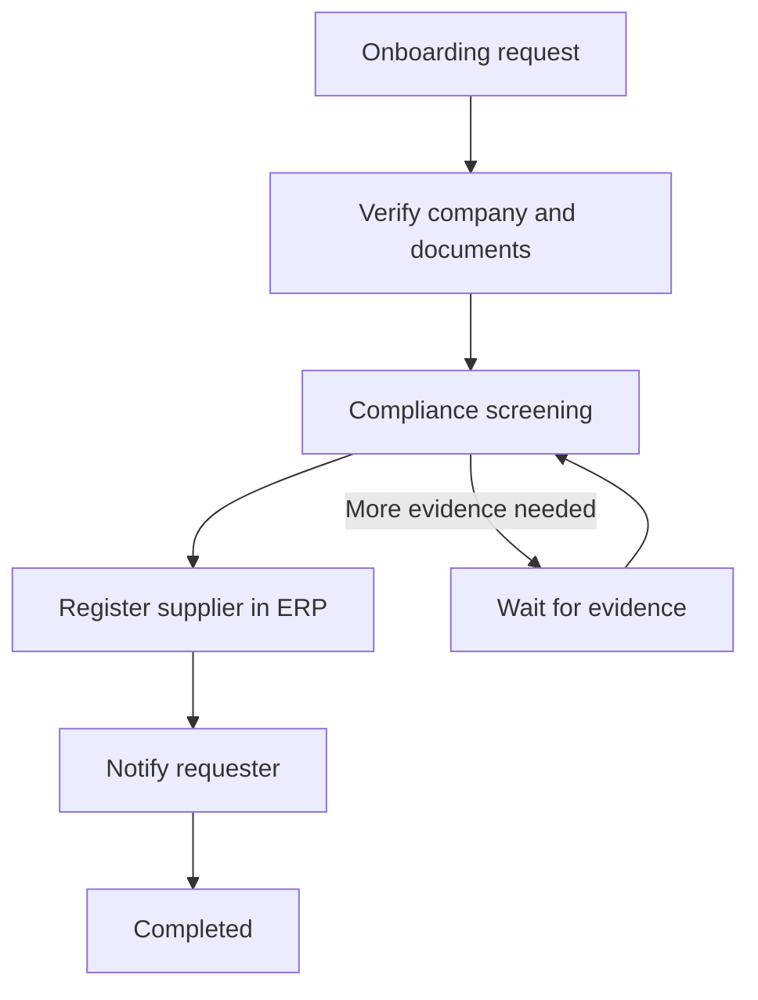
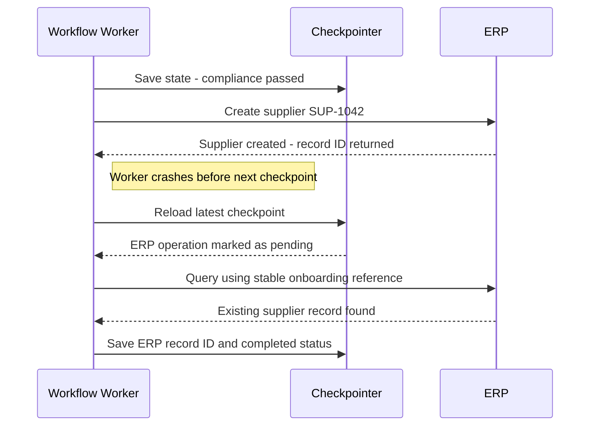
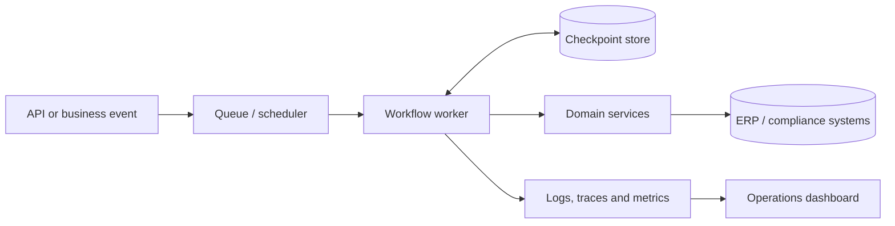

# 09 — Long-Running Agentic Workflows & Durable Execution

> **09:14** — Supplier verification is complete.  
> **09:15** — The ERP creates supplier `SUP-1042`.  
> **09:15:03** — The workflow worker crashes before saving the ERP record ID.  
> **09:17** — The queue redelivers the onboarding event.
>
> The workflow knows that ERP registration was attempted. It does not know whether the ERP committed it. Should it create the supplier again?

This is where a prototype agent becomes an enterprise workflow problem. The challenge is not simply remembering what the model said. It is preserving business progress and recovering safely when processes, services or people become unavailable.

## Introduction — The workflow must outlive the worker

Agentic workflows can run for seconds, hours or days. Supplier onboarding may wait for compliance screening; an insurance claim for evidence; a payment investigation for human approval. Workers restart, APIs time out, queues redeliver messages and external systems may complete an operation even when the caller never receives its response.

**Durable execution** preserves the state and control information needed to continue a workflow after interruption. The system must distinguish completed work from pending work, identify uncertain side effects and decide whether to resume, reconcile, retry or escalate.

A conversation transcript alone cannot provide those guarantees. The workflow needs an explicit execution model.

## 1. Stateful Agentic Workflows

In LangGraph, a workflow is modelled as nodes connected by edges. Nodes read the current state and return updates; edges determine what executes next. Conditional edges can branch or loop, making the graph useful for processes that change direction as new information arrives.

For supplier onboarding, state might track:

```python
from typing import TypedDict

class OnboardingState(TypedDict):
    request_id: str
    supplier_id: str
    verification_status: str
    compliance_status: str
    erp_operation_status: str
    erp_record_id: str | None
    notification_status: str
```

The graph follows this path:



Notice that the workflow is not just a sequence of prompts. It has business states, conditional paths and a wait state. If evidence is missing, it can pause without discarding completed verification. If registration succeeds but notification fails, the workflow should not repeat the earlier business steps.

Keep state purposeful: store identifiers, statuses and results required by later nodes. Store large documents and sensitive payloads in suitable external systems, then retain references in workflow state.

## 2. Persistent Execution — Remembering beyond a process

A worker's in-memory variables disappear when the process stops. Persistence allows selected workflow state to survive that boundary.

LangGraph uses a **checkpointer** to save graph execution state. A stable `thread_id` identifies the workflow thread whose checkpoints should be retrieved.

```python
from langgraph.checkpoint.memory import InMemorySaver

checkpointer = InMemorySaver()
app = builder.compile(checkpointer=checkpointer)

config = {
    "configurable": {
        "thread_id": "supplier-onboarding-1042"
    }
}

result = app.invoke(initial_state, config=config)
```

`InMemorySaver` is useful for local development and tests, but it does not survive process loss. For persistent deployments, select a supported durable checkpointer and storage backend appropriate to the operational environment. Your LangGraph study notes discuss SQLite for lightweight local persistence and PostgreSQL for shared deployments.

A checkpoint is not the same thing as long-term business memory. It records workflow execution state; it does not make every stored value authoritative. Before taking a consequential action, validate important facts against the source business system.

Persistence also creates responsibilities: access control, encryption, backup, retention, deletion and schema/version management. A workflow that resumes weeks later must not depend on expired credentials or data references.

## 3. Checkpointing and Recovery — The dangerous gap

A checkpoint records progress at a point in execution. It gives the workflow a known state from which to continue, but it cannot atomically commit a transaction in an independent ERP, payment or compliance system.

Return to the incident:



The critical failure window sits between the external side effect and the next checkpoint. The ERP may have committed the supplier while the workflow still says registration is pending.

Blindly retrying could create a duplicate. Treating the step as complete without checking could leave the workflow with a missing or incorrect record reference.

The recovery action is **reconciliation**: query the ERP using a stable business reference or idempotency key, determine what actually happened, then update workflow state. If no record exists, the operation may be attempted again under the appropriate duplicate-protection policy.

A checkpoint preserves the workflow's view of progress. Reconciliation checks that view against reality.

## 4. Retry and Compensation — Two different recovery decisions

Not every failure deserves a retry. A timeout may be temporary; invalid supplier data is not. Authentication failure may indicate a security or configuration problem. Repeating every failed step can amplify an outage.

| Failure | Appropriate response |
|---|---|
| Temporary network error | Bounded retry with backoff |
| Rate limit | Respect `Retry-After` or back off |
| Invalid supplier data | Stop and request correction |
| Authentication/authorization failure | Stop and alert |
| ERP timeout with unknown outcome | Reconcile before retry |
| Permanent business rejection | Fail or route for review |

A retry policy should define retryable error classes, maximum attempts, timeouts, backoff and a terminal path. For operations that change external state, use a stable idempotency key where the target API supports it:

```python
def create_supplier(state, erp_client):
    key = f"onboarding:{state['request_id']}"

    return erp_client.create_supplier(
        supplier_id=state["supplier_id"],
        idempotency_key=key,
    )
```

This example assumes the ERP honours idempotency keys. If it does not, use a durable operation ledger and reconciliation strategy. Generating a key in the client does not, by itself, make an operation exactly-once.

**Compensation is not retry.** Retry attempts an operation again because it may not have succeeded. Compensation performs a new business action to counteract an earlier action that did succeed. If a supplier was registered but a later mandatory control fails, the business may deactivate the supplier or open a remediation task.

That is not a database rollback: other systems may already have observed the original action, and compensation can fail too. Model it as an explicit, auditable step with its own authorization, retry and escalation rules.

## 5. Workflow Resumption — Continue, don't restart

Resumption continues an interrupted workflow using its persisted identity and state. A worker restart or queue redelivery should not create a new logical onboarding request.

In LangGraph, the same thread configuration is used to access the saved workflow context. The exact input supplied on continuation depends on the graph's state schema and execution point:

```python
config = {
    "configurable": {
        "thread_id": "supplier-onboarding-1042"
    }
}

# Illustrative continuation after the ERP result was reconciled.
result = app.invoke(
    {"erp_operation_status": "completed"},
    config=config,
)
```

Before resuming, validate the request identity, graph/state version and required external references and credentials.

Do not confuse **resume** with **replay**. Resume continues from persisted progress. Replay deliberately re-executes earlier logic, for example during debugging or a controlled rebuild. Replaying a node that sends a payment, creates an account or sends an email can repeat a real-world effect unless it is protected by idempotency or deduplication.

The same idea connects to the previous chapter's human approval workflow. A pending approval becomes a durable wait state: preserve the proposal and review context, wait for a decision event, validate the reviewer and decision, then resume. Duplicate callbacks or timeouts must not accidentally authorize the action.

## 6. Long-Running Enterprise Tasks — From graph to platform

A graph defines workflow logic; production execution also needs infrastructure around it. A practical architecture separates orchestration from the business services that own transactional rules.



The queue dispatches work; workers execute graph steps; the checkpoint store preserves progress. Domain services perform business operations, while observability helps teams detect stuck, delayed or failed workflows.

A production design should define:

- **Identity:** stable workflow, request and operation identifiers.
- **Durability:** persistent checkpoints and appropriate backup/restore.
- **Delivery:** queue redelivery, scheduling and delayed continuation behaviour.
- **Safety:** idempotent integrations, reconciliation and explicit compensation.
- **Operations:** deadlines, cancellation, stuck-work detection, manual recovery and controlled replay.
- **Governance:** access control, audit records, retention and sensitive-data handling.

### 💼 Backend Architecture Parallel

| Backend engineering concept | Durable workflow equivalent |
|---|---|
| Stateful service / state machine | Explicit workflow state and transitions |
| Database persistence | Checkpoint store |
| Message queue | Asynchronous execution and continuation |
| Idempotency key | Duplicate-safe side effects |
| Retry with backoff | Recovery from transient dependency failures |
| Saga compensation | Business-level reversal or remediation |
| Correlation ID | Workflow and operation traceability |
| Dead-letter queue | Failed work requiring investigation |

The familiar distributed-systems lesson still applies: a process restart must not erase business progress, and a retry must not silently repeat a side effect. Reliability comes from explicit state, durable records, idempotent operations and tested recovery paths—not from assuming an agent framework makes failures disappear.

## Key Takeaways

- Model long-running work as explicit state and control flow, not just a conversation.
- Use durable checkpoints and stable workflow identity to preserve progress.
- Reconcile uncertain external side effects before retrying.
- Classify failures and bound retries; never blindly repeat every failed step.
- Treat compensation as a new business action, not a rollback.
- Distinguish resumption from replay and protect replayed side effects.
- Test crashes before and after external operations, duplicate delivery and repeated resume.

## What's Next?

Chapter 10 — **Agentic Workflow Evaluation & Reliability** — moves from preserving execution to measuring whether workflows actually work: task completion, execution tracing, failure detection, recovery and performance.

## References

- [LangGraph documentation](https://docs.langchain.com/oss/python/langgraph/overview)
- [LangGraph persistence concepts](https://docs.langchain.com/oss/python/langgraph/persistence)
- [LangGraph durable execution](https://docs.langchain.com/oss/python/langgraph/durable-execution)

> **Enterprise AI Engineering Handbook**
>
> *Building Production-Grade Enterprise AI Systems — One Chapter at a Time.*
