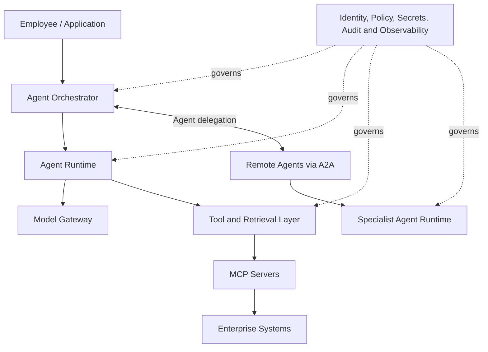
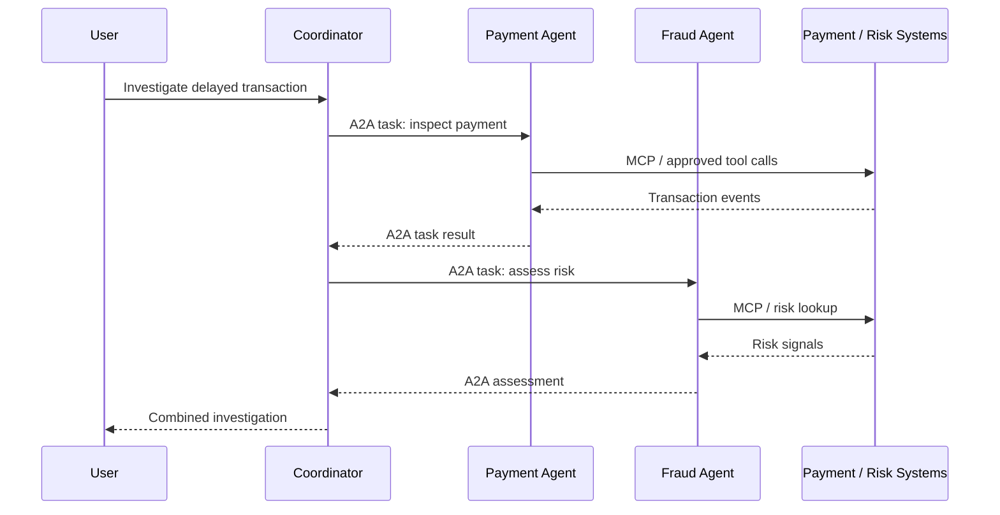

# Chapter 15 — Enterprise Agent Platforms: Architecture & Concepts

## 1. From an Agent Demo to an Enterprise Platform

An agent can look impressive in a demo: give it a model, a prompt and a payment lookup tool, and it may answer in seconds. But making it available to hundreds of employees changes the engineering problem. Who can use it? Where do credentials live? What happens when an API fails or a task takes five minutes? How are actions audited and new versions deployed safely?

Consider a payment-operations assistant that investigates delayed transactions, retrieves customer context, checks payment events and asks a fraud specialist for an assessment. Its reasoning is only one part of the solution. Production also requires execution, connectivity, identity, policy, observability and lifecycle management.

An **enterprise agent platform** brings these capabilities together. It may be one managed product or an architecture assembled from frameworks, runtimes, model gateways, infrastructure and existing enterprise systems. Its purpose is to give teams reusable operational foundations instead of making every agent team rebuild them.

## 2. Enterprise Agent Platform Architecture

Think of the platform as a set of cooperating responsibilities rather than one large agent product.

<box border radius="lg" padding={3} gap={2}>
  <box background="surface-secondary" radius="md" padding={3} gap={1}>
    **Experience and orchestration**

    User applications, workflow coordination, agent delegation and human approval
  </box>
  <box align="center"><icon name="arrow-down" color="secondary"/></box>
  <box background="surface-secondary" radius="md" padding={3} gap={1}>
    **Agent runtime**

    Execution, sessions, state, memory, retries, scheduling and scaling
  </box>
  <box align="center"><icon name="arrow-down" color="secondary"/></box>
  <box background="surface-secondary" radius="md" padding={3} gap={1}>
    **Models and integrations**

    Model access, prompts, retrieval, business tools, MCP servers and A2A agents
  </box>
  <box align="center"><icon name="arrow-down" color="secondary"/></box>
  <box background="surface-secondary" radius="md" padding={3} gap={1}>
    **Enterprise foundation**

    Identity, secrets, network controls, policy, observability, audit and governance
  </box>
</box>

These are logical responsibilities, not a mandatory deployment topology. A managed platform may bundle them; another organization may combine a framework, Kubernetes, a model gateway and existing identity and monitoring services. Clear boundaries matter: tightly coupling agent logic to a runtime or vendor-specific service makes future changes expensive.


The same architecture can be viewed as services around the agent:



Governance cuts across every layer: identity and policy must apply to tool calls and agent delegation, not just the user interface.

## 3. Agent Runtime Platforms: Where the Work Actually Runs

A framework helps developers define an agent's behavior. A runtime is responsible for executing that behavior reliably.

Imagine the payment investigation takes several minutes. The user closes the browser, a downstream API times out and the agent process is restarted during a deployment. A simple in-memory loop may lose the task or leave the user without an answer. A production runtime must account for these conditions.

Depending on the platform, runtime capabilities can include:

- **Execution and sessions:** Manage requests, concurrent runs and conversation context.
- **State and persistence:** Preserve task state when work continues beyond one process lifetime.
- **Scheduling and scaling:** Allocate capacity for variable workloads and long-running tasks.
- **Reliability controls:** Apply timeouts, retries, cancellation and failure recovery.
- **Connectivity:** Provide controlled access to models, tools, data and other agents.
- **Observability:** Emit traces, logs, metrics and execution events.

The application still needs sensible retry rules, bounded execution, state design and failure handling. The platform supplies mechanisms; engineering teams must use them correctly.

## 4. Agent Development Frameworks: Defining How an Agent Works

Frameworks help developers structure the behavior inside an agent. They may provide model abstractions, tool calling, state management, workflow graphs, planning and multi-agent coordination.

The ecosystem includes options such as LangGraph, Microsoft Semantic Kernel and Google ADK, alongside development capabilities offered by cloud platforms. They differ in programming model, orchestration style and level of abstraction. The right choice depends on the workflow, the team's skills and the degree of control required.

A framework can make a workflow explicit instead of hiding every decision inside one prompt:

```python
def investigate_payment(transaction_id, tools):
    payment = tools.get_payment(transaction_id)

    if payment["status"] != "delayed":
        return {"status": payment["status"]}

    events = tools.get_processing_events(transaction_id)
    assessment = tools.analyse_events(events)

    return {
        "transaction_id": transaction_id,
        "status": "delayed",
        "assessment": assessment
    }
```

This ordinary Python example illustrates business flow, not a framework-specific agent. A framework can add model-driven routing, tool schemas, checkpoints, approvals and tracing. Keep domain rules outside framework-specific abstractions where possible so changing frameworks does not require rewriting business logic.


A small interface can keep the application boundary independent of a framework:

```python
from typing import Protocol, Any

class AgentRunner(Protocol):
    def run(
        self,
        request: str,
        context: dict[str, Any]
    ) -> dict[str, Any]:
        ...

def handle_request(
    runner: AgentRunner,
    request: str,
    user_context: dict[str, Any]
) -> dict[str, Any]:
    return runner.run(request, user_context)
```

LangGraph, a cloud-hosted agent or a custom service can adapt to this contract.  

## 5. Platform-Level Tool Integration: Give Agents Capabilities, Not Unlimited Access

An agent becomes useful when it can do something beyond generating text. It may retrieve a transaction, search a knowledge base, create a support ticket or request a fraud assessment. But exposing every internal API directly to every agent creates a security and maintenance problem.

Platforms provide reusable integration paths: connectors to enterprise applications, custom tools around internal APIs, retrieval connections, MCP servers for tools and resources, and A2A connections for delegation to independent agents.

MCP standardizes access to tools, resources and services; A2A standardizes communication and task delegation between independent agents.

For example, the payment assistant may be allowed to read transaction details but not issue a refund. A refund operation could be exposed as a separate tool requiring stronger authorization and human approval.

A simple tool boundary might look like this:

```python
def request_refund(user, transaction_id, amount, refund_service):
    if not user.has_permission("refund:request"):
        raise PermissionError("Refund permission required")

    return refund_service.submit_for_approval(
        transaction_id=transaction_id,
        amount=amount,
        requested_by=user.id
    )
```

The model may decide that a refund should be considered, but the application—not the model—enforces authorization. This is a critical platform design principle: **tools expose capabilities; policy determines who can use them and under what conditions.**


Enforce policy at every tool boundary; do not rely on the model remembering a prompt instruction:

```python
def invoke_tool(user, tool, arguments, policy, audit):
    decision = policy.evaluate(
        subject=user.id,
        action=tool.name,
        resource=arguments
    )

    audit.record(
        actor=user.id,
        tool=tool.name,
        decision=decision
    )

    if not decision.allowed:
        raise PermissionError("Tool invocation denied")

    return tool.execute(arguments)
```

A real policy engine may also evaluate tenant, data classification, transaction limits and approval state. The control belongs between the agent request and the business operation.

## 6. Multi-Agent Deployment: From One Process to a Distributed System

Once the payment assistant delegates work to separate fraud and support agents, the architecture changes. These agents may be owned by different teams, have different scaling profiles and be released independently.

A common deployment pattern is to run each agent as an independently managed service:

```text
                    User
                      |
                      v
              Coordinator Agent
                 /         \
              A2A           A2A
               /             \
              v               v
       Payment Agent      Fraud Agent
              |               |
             MCP             MCP
              |               |
              v               v
        Payment APIs      Risk Services
```

This gives teams independent release and scaling boundaries, but also introduces distributed-systems concerns: unavailable agents, timeouts, partial completion, duplicate requests and interface-version mismatches.

Treat handoffs as service-to-service interactions. Define timeout, retry and cancellation behavior, task ownership, compatibility and fallback paths. Use correlation and task IDs to trace work across agents, and persist long-running task state so a process restart does not erase progress.

Do not split every workflow into multiple agents. Each boundary adds latency and failure modes. Create a separate agent when capability, ownership, security or scaling genuinely needs to be independent.


The interaction is easier to reason about when the handoff is explicit:



The coordinator owns the overall request, while each specialist owns its delegated task. This prevents a common design mistake: assuming that successful communication automatically means successful end-to-end orchestration.

For long-running work, a coordinator should also avoid treating a network timeout as proof that the remote task failed. A task may still be running. A simplified retry boundary might look like this:

```python
def delegate_with_recovery(agent, request, task_store):
    task = agent.send(request)
    task_store.save(task.id, status="submitted")

    try:
        result = agent.wait_for_result(task.id, timeout=20)
        task_store.save(task.id, status="completed")
        return result
    except TimeoutError:
        # Check the existing task before submitting another one.
        status = agent.get_task(task.id)
        task_store.save(task.id, status=status.state)
        return {"task_id": task.id, "state": status.state}
```

This is illustrative orchestration logic. Production systems should also use bounded retries, backoff, cancellation rules and idempotency controls for operations that can change business state.

## 7. Enterprise Integration and Governance: Production Is About Control

An enterprise agent platform must fit into the organization's existing security and operating model. It should not become a parallel environment with unmanaged credentials, unknown data flows and activity that cannot be audited.

For the payment assistant, governance needs to answer practical questions: which employee initiated the investigation, which customer data could the agent read, which tools were called, whether a refund was requested and who approved it.

That requires several platform-level controls:

- **Identity and access:** Authenticate users, services and agents; enforce least privilege.
- **Secrets management:** Keep credentials out of prompts, logs and source code; rotate them safely.
- **Data governance:** Apply classification, retention, residency and access rules to retrieved and generated data.
- **Policy enforcement:** Control sensitive tools, high-impact actions and human approvals.
- **Observability and audit:** Trace model calls, tool invocations, agent handoffs, task outcomes, latency and cost.
- **Lifecycle management:** Version agents, prompts, tools and workflows; test changes before promotion.
- **Evaluation and monitoring:** Track task success, groundedness, safety, reliability and regressions.

A useful trace shows which agents and tools participated, where time was spent, what failed and which policy decisions applied. Redact sensitive payloads according to data-protection requirements. Build controls into standard development and deployment paths; relying on every team to add them independently leads to inconsistent governance.

## 8. Selecting an Enterprise Agent Platform

Platform selection should begin with the workload and operating model—not a vendor feature list.

| Decision area | What to evaluate |
|---|---|
| Development | Languages, frameworks, testing and developer experience |
| Runtime | Sessions, persistence, concurrency, long-running tasks and recovery |
| Interoperability | Support for MCP, A2A and existing enterprise APIs |
| Integration | Identity, networks, data platforms and observability |
| Governance | Permissions, approvals, audit and policy enforcement |
| Operations | Deployment, monitoring, versioning and rollback |
| Portability | Dependence on proprietary APIs and runtime abstractions |
| Economics | Model usage, infrastructure, integration and operational costs |

Managed platforms accelerate delivery but may increase vendor dependence. Self-managed stacks offer control but make the organization responsible for upgrades, scaling and reliability. A hybrid approach can combine managed model services with organization-owned orchestration and domain tools.

Evaluate a representative workload, not just a demo. Test tool failures, unavailable agents, long-running tasks and unauthorized actions. Measure recovery, traceability and cost under realistic load. The best platform is the one that operates agents safely and economically—not necessarily the one with the longest feature list.

## Further Reading

This chapter explains the platform capabilities required to build and operate enterprise agents. For the communication protocols used across these architectures, see **13 — Model Context Protocol (MCP)** and **14 — Agent2Agent (A2A) Protocol**. For hands-on implementation and platform-specific development, continue to **Part VIII — MCP & Agent Protocol Development**.

---

**Enterprise AI Engineering Handbook**  
*Building Production-Grade Enterprise AI Systems — One Chapter at a Time.*
