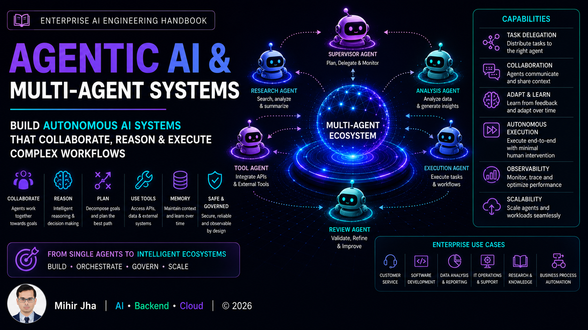

# Part VII — Agentic AI & Multi-Agent Systems

> Design and operate enterprise AI systems in which specialized agents collaborate, delegate tasks, coordinate complex workflows, and execute work autonomously—with the reliability, security, and governance production environments demand.



---

## 📖 Overview

An AI agent can handle a focused task. But what happens when a business problem needs several capabilities, multiple decisions, access to different systems, and work that may continue long after the first request?

That is where **Agentic AI and Multi-Agent Systems** become relevant.

Instead of building one agent that does everything, an agentic system can bring together specialized agents with clearly defined responsibilities. One agent may interpret the request, another investigate a transaction, a third assess risk, while an orchestrator coordinates the work and brings the results together. Some workflows are centrally supervised; others rely on collaboration or more distributed coordination. The architecture depends on the problem—not on how many agents a framework allows us to create.

This part of the handbook takes a progressive, engineering-focused look at that design space. It begins with the foundations of agentic systems, then explores workflow patterns, orchestration, delegation, collaboration, and human oversight. From there, it moves into long-running execution and evaluation before examining Agentic RAG, communication protocols, and enterprise agent platforms.

The emphasis is on the decisions that make multi-agent systems work beyond a demonstration: defining agent boundaries, choosing the right coordination model, managing state and failures, evaluating outcomes, and governing interactions with tools, data, users, and other agents.

The goal is not to make every workflow autonomous or to split every task across multiple agents. It is to understand when agent collaboration adds value—and how to engineer it responsibly when it does.

---

## 🎯 Learning Outcomes

After completing this part, you will be able to:

- Explain the foundations and architectural characteristics of Agentic AI.
- Distinguish individual AI agents, agentic workflows, and multi-agent systems.
- Identify when a multi-agent design is justified and when a simpler workflow is preferable.
- Design multi-agent architectures with clear responsibilities and interaction boundaries.
- Select appropriate workflow, supervisor, hierarchical, and swarm-based patterns.
- Coordinate agents through communication, collaboration, and task delegation.
- Incorporate human review, approval, and intervention into autonomous workflows.
- Design long-running workflows with durable state, recovery, and controlled execution.
- Evaluate agentic workflows for task success, reliability, and operational behavior.
- Understand how Agentic RAG extends retrieval into agent-driven workflows.
- Explain the different roles of MCP, A2A, and the wider agent communication protocol landscape.
- Assess the platform capabilities required to develop, deploy, integrate, and govern enterprise agents.

---

## 🗺️ Chapter Roadmap

The chapters move from foundational concepts to coordination patterns, operational reliability, and enterprise architecture. Each chapter builds on the ideas introduced earlier while focusing on a distinct design problem.

| Chapter | Focus |
|---|---|
| [01 — Agentic AI Fundamentals](01-agentic-ai-fundamentals.md) | Core concepts and the foundations of agentic behavior |
| [02 — Multi-Agent Systems Architecture](02-multi-agent-systems-architecture.md) | Structuring systems around multiple specialized agents |
| [03 — Agentic Workflow Design Patterns](03-agentic-workflow-design-patterns.md) | Reusable patterns for designing agent-driven workflows |
| [04 — Multi-Agent Communication & Coordination](04-multi-agent-communication-coordination.md) | How agents exchange information and coordinate work |
| [05 — Agent Orchestration & Supervisor Patterns](05-agent-orchestration-supervisor-patterns.md) | Centralized orchestration and supervisor-led execution |
| [06 — Hierarchical Agents & Task Delegation](06-hierarchical-agents-task-delegation.md) | Decomposing goals and assigning work across agent levels |
| [07 — Collaborative Agents & Swarm Architectures](07-collaborative-agents-swarm-architectures.md) | Decentralized collaboration and collective problem-solving |
| [08 — Human-in-the-Loop Agentic Workflows](08-human-in-the-loop-agentic-workflows.md) | Human review, approval, and intervention |
| [09 — Long-Running Agentic Workflows & Durable Execution](09-long-running-agentic-workflows-durable-execution.md) | State, persistence, recovery, and extended task execution |
| [10 — Agentic Workflow Evaluation & Reliability](10-agentic-workflow-evaluation-and-reliability.md) | Measuring outcomes and improving workflow reliability |
| [11 — Agentic RAG](11-agentic-rag.md) | Retrieval-augmented generation within agentic systems |
| [12 — Agent Communication & Integration Protocols](12-agent-communication-and-integration-protocols.md) | The protocol landscape for agentic systems |
| [13 — MCP: Architecture & Concepts](13-mcp-architecture-and-concepts.md) | Standardized access to tools, resources, and external systems |
| [14 — A2A: Architecture & Concepts](14-a2a-architecture-and-concepts.md) | Communication and task delegation between independent agents |
| [15 — Enterprise Agent Platforms](15-enterprise-agent-platforms.md) | Runtime, frameworks, integration, deployment, and governance |

---

## 🧭 How the Topics Fit Together

The progression is intentional:

```text
Agentic AI Foundations
          |
          v
Multi-Agent Architecture
          |
          v
Workflow Design & Orchestration
          |
          v
Delegation & Collaboration
          |
          v
Human Oversight
          |
          v
Durable Execution & Evaluation
          |
          v
Agentic RAG & Communication
          |
          v
Enterprise Agent Platforms
```

The first chapters explain how to structure agentic systems and coordinate their work. The middle chapters address what happens when workflows need human decisions, persist over time, or must be evaluated beyond a successful final response. The final chapters connect these architectures to retrieval, interoperability, and the platforms used to operate agents in enterprise environments.

A useful distinction runs through the entire part: **orchestration is not the same as communication, and communication is not the same as execution**. An architecture may use A2A to delegate work, MCP to access tools, and a durable runtime to keep a long-running task alive. Each addresses a different responsibility.

---

## 🏗️ Architectural Perspective

A production multi-agent system is more than a collection of agents exchanging messages. It needs clear ownership and control across several concerns:

- **Agent boundaries:** Each agent should have a meaningful responsibility and a well-defined contract.
- **Coordination:** The system must decide who delegates work, how results are combined, and how conflicts are handled.
- **Execution:** Long-running tasks need state, persistence, timeout handling, and recovery.
- **Interoperability:** Agents and tools need explicit communication interfaces rather than hidden framework-specific assumptions.
- **Evaluation:** Teams need evidence that workflows complete correctly, safely, and consistently.
- **Governance:** Identity, authorization, auditability, and human approval must remain effective as autonomy increases.

These concerns are connected, but they should not be collapsed into one abstraction. The chapters explore them separately so that the trade-offs remain visible when designing a complete system.

---

## 🚧 Module Status

> **Status: Under Active Development**

The chapter roadmap is established, and the content is being developed progressively. Chapters focus on practical architecture, meaningful diagrams, code examples, design trade-offs, production considerations, and references where they add value.

---

## 🔗 Where This Part Fits in the Handbook

Part VII builds on the retrieval and agent engineering foundations established earlier:

- **Part V — Advanced Retrieval-Augmented Generation:** Provides the retrieval architectures and grounding techniques that agentic systems can use.
- **Part VI — AI Agents:** Establishes the foundations of individual agents, including tools, memory, communication, observability, security, and deployment.
- **Part VII — Agentic AI & Multi-Agent Systems:** Extends those capabilities into coordinated, collaborative, and long-running agentic systems.
- **Part VIII — AI Engineering Frameworks & Tooling:** Moves into the frameworks, SDKs, and implementation techniques used to build these systems.

---

> **Enterprise AI Engineering Handbook**  
> *Building Production-Grade Enterprise AI Systems — One Chapter at a Time.*
