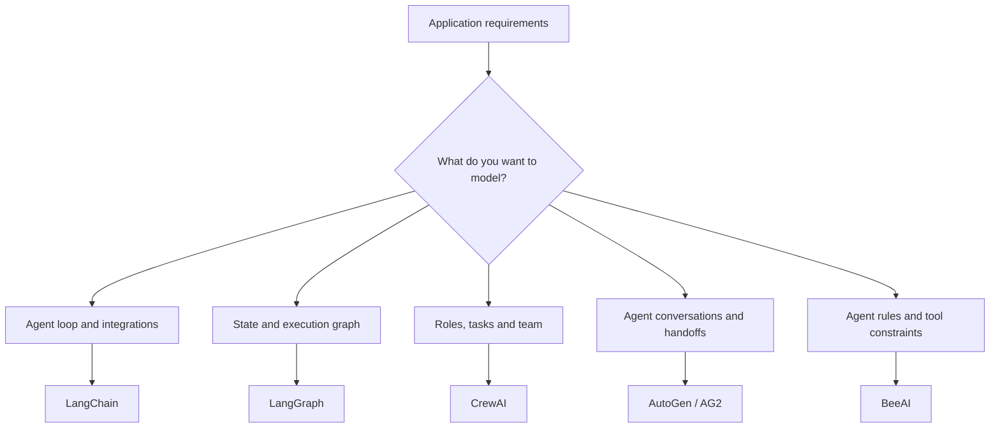
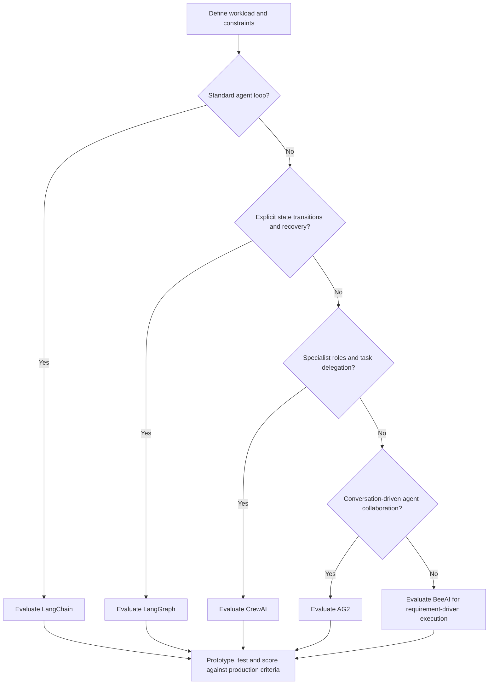

# 54. Enterprise AI Framework Comparison

Choosing an AI framework is an architecture decision, not a popularity contest. The right choice depends on the execution model you need: an agent loop, an explicit graph, a role-based team, agent conversations or enforced execution requirements.

It focuses on architectural fit, not feature counts. Verify capabilities against the exact version you plan to deploy.

## 1. The frameworks at a glance

| Framework | Primary abstraction | Natural fit |
|---|---|---|
| **LangChain** | Models, tools, integrations and higher-level agent loops | Quickly composing LLM applications and standard tool-using agents |
| **LangGraph** | Stateful graph runtime: state, nodes and edges | Custom, branching, long-running workflows requiring explicit control |
| **CrewAI** | Role-oriented agents and tasks, coordinated through Crews and Flows | Specialist teams inside structured business automations |
| **AutoGen / AG2** | Conversational agents and multi-agent coordination | Agent-to-agent collaboration, conversation-driven workflows and networked agents |
| **BeeAI** | Agents, tools, declarative execution requirements and middleware | Provider-flexible agents with explicit tool-use constraints and interoperability |

These products are not exact equivalents: LangChain and LangGraph serve different abstraction levels; CrewAI combines teams and workflows; AG2 has evolved beyond its AutoGen-derived API.

## 2. LangChain vs LangGraph

**LangChain optimizes the starting point; LangGraph gives you control over the execution path.**

LangChain provides integrations and higher-level abstractions for models, tools and standard agent loops. Its agents are built on LangGraph, so adopting LangChain does not mean abandoning the LangGraph runtime underneath.

LangGraph exposes the lower-level orchestration model: shared state, nodes, edges, conditional transitions, persistence and resumable execution. It is useful when a workflow mixes deterministic business logic with model-driven decisions.

| Decision factor | LangChain | LangGraph |
|---|---|---|
| Abstraction | Higher-level agent and integration APIs | Lower-level graph runtime |
| Control flow | Standard agent loop and middleware | Explicit nodes, edges, branches and loops |
| State | Agent state through its runtime | Application-defined graph state and reducers |
| Best starting point | Common LLM applications | Non-trivial, stateful workflows |
| Trade-off | Less orchestration code initially | More design responsibility and graph modeling |

**Rule of thumb:** start with LangChain when a conventional agent loop is enough. Move to LangGraph when the workflow itself becomes a first-class part of the application—especially when it needs branching, checkpoints, interrupts or carefully controlled transitions.

LangGraph can also be used without LangChain. They are complementary, not inseparable.

## 3. LangGraph vs CrewAI

Both can coordinate multiple agents, but they make different things easy.

- **LangGraph starts with the workflow.** Developers model state and transitions; agents can be placed inside graph nodes.
- **CrewAI starts with the team.** Developers define agents, roles and tasks, then use a Crew to coordinate the work. Flows add application-level routing, state and deterministic steps around those Crews.

| Dimension | LangGraph | CrewAI |
|---|---|---|
| Primary mental model | Graph of state transitions | Specialist team plus workflow |
| Orchestration | Explicit graph control | Crew processes and event-driven Flows |
| Agent collaboration | Composed as graph nodes/subgraphs or handoffs | Role- and task-oriented delegation |
| State | Typed application state and checkpoints | Flow state, structured or unstructured; persistence options |
| Strong fit | Complex branching and precise execution control | Business processes naturally expressed as specialist work |

A useful CrewAI pattern is **Flow outside, Crew inside**: the Flow handles routing and business decisions; a Crew performs a bounded collaborative task. Choose LangGraph when execution topology is central, or CrewAI when role-based delegation best describes the work.

## 4. CrewAI vs AutoGen / AG2

CrewAI and AG2 both support multi-agent collaboration, but their coordination models differ.

**CrewAI is role-and-task oriented.** A developer describes specialist agents and assigns tasks. Crews coordinate that work, while Flows provide routing, state and application-level control.

**AG2 is conversation-and-coordination oriented.** Its earlier Classic API (the `autogen` namespace) supports two-agent chats, sequential chats, group chats, speaker-selection patterns and handoffs. This is useful when collaboration emerges through messages between agents rather than a fixed task list.

An important version distinction: AG2 is a community-led continuation that diverged from the original AutoGen codebase. Current AG2 1.x introduces a newer async, network-oriented architecture; it is not a drop-in replacement for AG2 Classic. Chapters 47–50 use the Classic-style concepts and APIs, so treat migration as a separate engineering task—not a package upgrade.

| Dimension | CrewAI | AG2 |
|---|---|---|
| Core abstraction | Agents, tasks, Crews and Flows | Agents, conversations and coordination networks |
| Typical control model | Configured task/process execution plus Flow routing | Conversation, handoff and transition rules |
| Collaboration | Specialist roles working on assigned tasks | Agents exchange messages and transfer control |
| State/context | Flow state and agent/crew context | Conversation context; newer network workflows add durable messaging/state mechanisms |
| Strong fit | Repeatable business processes with defined roles | Dynamic collaboration and communication-heavy agent systems |

Neither model is inherently more reliable. Reliability depends on bounded responsibilities, explicit termination, constrained tools and tested transitions.

## 5. BeeAI vs other agent frameworks

BeeAI takes a distinctive approach: it combines agent and tool abstractions with declarative execution requirements. Its `RequirementAgent` lets developers express constraints around tool use and execution, rather than relying only on instructions in a prompt.

That creates a different emphasis:

- Compared with **LangGraph**, BeeAI offers a more agent-centric, requirement-driven execution model; LangGraph gives developers broader control over the complete workflow graph.
- Compared with **CrewAI**, BeeAI emphasizes constraints on an agent's execution and tool use, while CrewAI foregrounds role-based teams and Flows.
- Compared with **AG2**, BeeAI's `HandoffTool` supports specialist delegation, while AG2 centers its coordination model on agent conversations, handoffs and (in newer versions) network workflows.

BeeAI also provides provider abstractions, memory options, middleware, caching, and MCP/A2A integration points. These are useful building blocks, not a substitute for application-level identity, authorization, durable business state or deployment governance.

This describes design emphasis, not exclusive capabilities.

## 6. Framework abstraction models

An abstraction determines what developers describe and what the runtime manages.



| Abstraction | Developer primarily defines | Framework primarily coordinates |
|---|---|---|
| Agent-loop | Model, tools and middleware | Standard agent cycle |
| Graph | State, nodes and transitions | Graph execution |
| Role/task | Roles, tasks and process | Delegation and task execution |
| Conversation/network | Agents and handoff rules | Turn-taking and communication |
| Requirement-driven | Tools and constraints | Allowed, forced or restricted actions |

The abstraction shapes debugging and testing.

## 7. Orchestration, state and memory

| Concern | Architectural question |
|---|---|
| Orchestration | Is the path a graph, a task sequence, a conversation or a set of enforced requirements? |
| State | Where is authoritative workflow state, and who updates it? |
| Memory | Is context thread-scoped, cross-session or business data? |
| Recovery | Can execution resume safely after failure? |
| Collaboration | Is context shared or exchanged through messages? |

Conversation memory is not business state: a chat history is not an order ledger or approval record. Persist transactions in application-owned systems with authorization and idempotency. For long-running workflows, test checkpoint semantics, replay, state versioning and recovery.

## 8. Tool integration and protocol support

All five ecosystems connect agents to external capabilities, but their integration surfaces differ:

- **LangChain/LangGraph:** broad model and tool integrations; tools can be used inside agent loops or explicitly wired into graph nodes.
- **CrewAI:** tools are assigned to agents and tasks; current ecosystem documentation also covers MCP and A2A integration.
- **AG2:** tools/functions participate in agent conversations and coordination; newer AG2 network capabilities add protocol-driven communication.
- **BeeAI:** built-in and custom tools, MCP tool discovery/integration, and A2A-related serving or client capabilities.

Check protocol support by operation and version. “Supports MCP” may mean consuming tools, exposing a server, or both; “supports A2A” may mean client, server, discovery or a specific adapter. Record the capability you actually need.

## 9. Production readiness: evaluate the system, not the demo

A successful local run proves little about production suitability. Score candidates against the same workload.

| Evaluation area | Questions to test |
|---|---|
| Control and safety | Can actions be restricted, approved and audited? |
| Recovery | Can workflows resume without duplicate side effects? |
| Reliability | Are timeouts, retries and partial failures handled? |
| Observability | Can operators trace tools, transitions and outcomes? |
| Scale | Are concurrency and tenant isolation tested? |
| Integration | Are required providers and protocols supported? |
| Maintainability | Is routing understandable and testable? |
| Lifecycle | Are upgrades, support and ownership clear? |

Framework tracing, persistence and guardrails are not complete enterprise controls. Validate the end-to-end application.

## 10. Enterprise framework selection

Start with the workload, not framework popularity.



A practical selection process:

1. Describe the workload and non-negotiable constraints.
2. Test a difficult path: timeout, rejected action, restart and duplicate request.
3. Measure quality, latency, cost, recovery and operating effort.
4. Choose the smallest abstraction that fits.

A simple scorecard makes trade-offs visible:

```python
weights = {"control": 0.25, "recovery": 0.25, "integration": 0.20,
           "observability": 0.15, "team_fit": 0.15}

scores = {"LangGraph": [5, 5, 4, 4, 3],
          "CrewAI": [4, 4, 4, 4, 5]}

for framework, values in scores.items():
    total = sum(v * w for v, w in zip(values, weights.values()))
    print(framework, round(total, 2))
```

Use workload-specific scores; these numbers are illustrative, not benchmark results.

Hybrid designs can work—for example, a LangGraph workflow can call a CrewAI team for bounded research. Keep boundaries explicit; do not stack frameworks just to collect features.

## Key takeaways

- LangChain accelerates common agent and integration patterns; LangGraph provides explicit workflow control.
- CrewAI makes role-based teams and Flows natural; AG2 emphasizes agent conversations and coordination.
- BeeAI stands out for requirement-driven execution and provider-flexible agent building.
- State, memory, persistence and business records are different concerns.
- Protocol support must be verified at the capability and version level.
- Production readiness is demonstrated through failure testing and operational evidence—not a polished demo.

The framework decision closes Part VIII. Next, Part IX examines how AI systems are deployed, monitored and operated through MLOps, LLMOps and AIOps.

## References

- [LangChain and LangGraph overview](https://docs.langchain.com/oss/python/langgraph/overview)
- [LangGraph Graph API](https://docs.langchain.com/oss/python/langgraph/graph-api)
- [CrewAI documentation](https://docs.crewai.com/)
- [CrewAI production architecture](https://docs.crewai.com/en/concepts/production-architecture)
- [AG2 documentation](https://docs.ag2.ai/)
- [AG2 Classic documentation](https://classic.docs.ag2.ai/)
- [AG2 multi-agent network overview](https://docs.ag2.ai/docs/user-guide/network/overview/)
- [BeeAI Framework documentation](https://i-am-bee.github.io/beeai-framework/)
- [BeeAI RequirementAgent](https://i-am-bee.github.io/beeai-framework/modules/agents/requirement-agent)

## 🧭 Chapter Navigation

⬅️ **Previous:** [53. BeeAI Production Engineering, Runtime & Deployment](53-beeai-production-engineering-runtime-deployment.md)

📚 **Part:** [AI Engineering Frameworks & Tooling](index.md)

➡️ **Next:** Part IX — MLOps, LLMOps & AIOps

---

> **Enterprise AI Engineering Handbook**
>
> *Building Production-Grade Enterprise AI Systems — One Chapter at a Time.*

---
