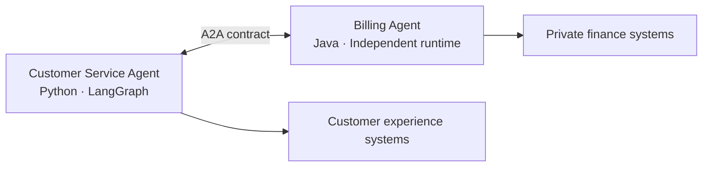
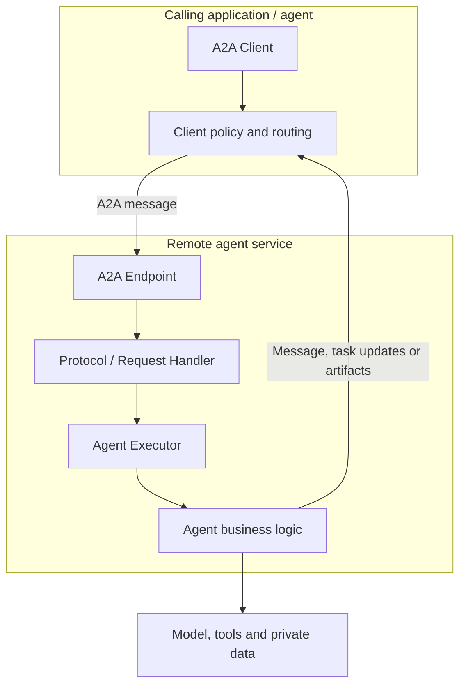
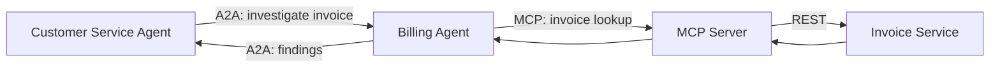
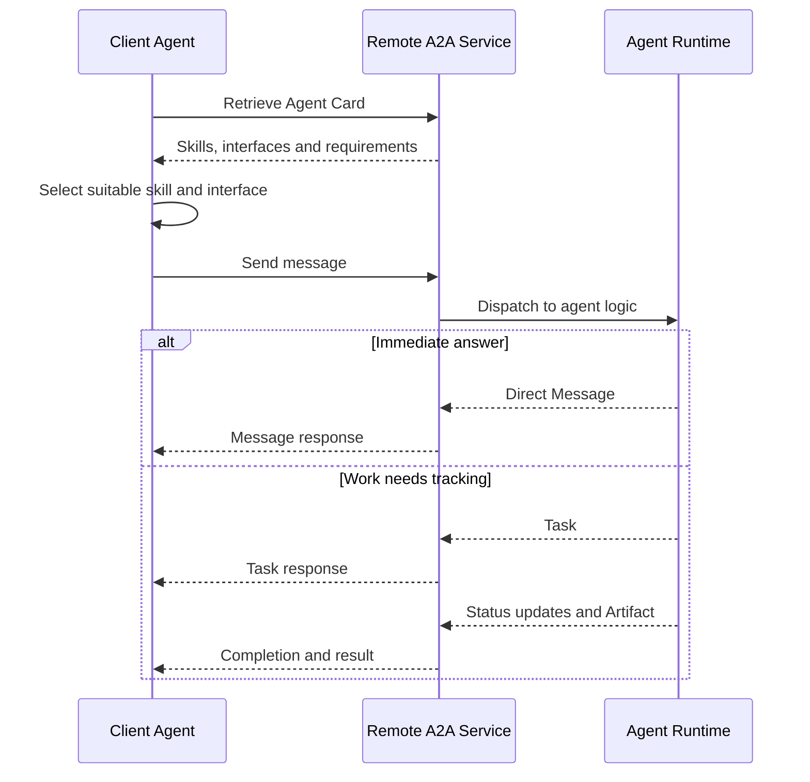

# 01. A2A Protocol Engineering Fundamentals

Imagine asking an AI assistant to investigate a disputed invoice. It
finds that the answer requires finance expertise, so it contacts a
billing agent owned by another team. That agent checks the payment
history, returns its findings, and the original assistant prepares the
response.

The interesting part is not that two LLMs exchanged text. It is that two
independently operated agent systems collaborated without sharing their
prompts, models, memory, tools or internal architecture.

That is the problem the **Agent2Agent (A2A) Protocol** is designed to
address.

A2A defines a common way for agentic applications to discover one
another, exchange messages and manage work that may continue beyond a
single request. It is an interoperability protocol---not an agent
framework, orchestration engine or replacement for MCP.

## 1. Introduction to the A2A Protocol

A2A is an open protocol for independent AI agents to discover one another, exchange messages and manage work that may continue asynchronously.

A simple example is a writing workflow: a routing agent asks a title agent for a headline, then passes that result to an outline agent. Each specialist owns its own implementation.

This matters when teams build agents using different languages, frameworks, model providers and deployment platforms. A2A establishes a shared interaction contract without requiring teams to expose prompts, memory, tools or internal reasoning.

Each agent remains free to choose its own model, runtime, data sources and operational ownership. A2A standardizes the boundary—not how agents think.

### The essential idea



The agents need a compatible protocol interface, a way to discover it, and appropriate trust and access controls.

## 2. A2A Architecture and Core Components

An A2A interaction has two protocol roles:

-   **A2A client:** initiates a request on behalf of a user, application
    or another agent.
-   **A2A server (remote agent):** exposes an A2A endpoint and handles
    incoming interactions.

These are roles, not permanent identities. An agent can call another
agent as a client and expose its own endpoint as a server.

### Inside the boundary



The protocol endpoint and request handler translate incoming A2A
operations into work for the agent. The executor connects that protocol
boundary to the agent's application logic. The agent can then use its
own model, tools and data.

This separation is useful when replacing an agent implementation: the
protocol contract can remain stable while the internal runtime changes.

### Core A2A vocabulary

  ---------------------------------------------------------------------
  Concept                            What it represents
  ---------------------------------- ----------------------------------
  Agent Card                         Published description of the
                                     agent, its skills, interfaces and
                                     interaction requirements

  Agent Skill                        A capability the agent advertises,
                                     such as invoice investigation

  Message                            A communication turn between
                                     client and agent

  Part                               A unit of message or artifact
                                     content, such as text, a file or
                                     structured data

  Task                               A unit of work whose state and
                                     progress may need to be tracked

  Artifact                           Output produced by a task, such as
                                     a report or structured result

  Context                            An identifier that can group
                                     related messages and tasks
  ---------------------------------------------------------------------

### Protocol bindings


## 3. Why Agent-to-Agent Communication?

A conventional API exposes known operations such as retrieving an invoice or creating an order. That remains the right choice for many business services.

An agent may interpret an ambiguous request, ask a follow-up question, perform several steps or return multiple outputs. Treating every remote agent as a simple function can hide these behaviours behind custom conventions.

A2A helps with:

1. **Framework diversity:** teams can use different languages and agent frameworks.
2. **Implementation privacy:** consumers interact with a published contract, not private prompts or reasoning.
3. **Capability discovery:** clients can inspect advertised skills instead of hardcoding every agent.
4. **Long-running work:** clients can handle task-oriented interactions.
5. **Organizational boundaries:** independently operated agents can collaborate under explicit trust and access controls.

A2A does not remove distributed-systems concerns such as network failures, duplicate requests or unreliable outputs.

## 4. A2A vs MCP vs REST APIs

These technologies solve different integration problems. Choosing
between them is about the role of the endpoint---not which technology is
newer.

  ------------------------------------------------------------------------
  Dimension        A2A              MCP              REST APIs
  ---------------- ---------------- ---------------- ---------------------
  Main purpose     Agent-to-agent   Access to tools, Application/service
                   communication    resources and    integration
                                    prompts          

  Typical peer     Independent      MCP server       Business or platform
                   remote agent     exposing         service
                                    capabilities     

  Interaction      Messages and     Discover and     Request and response
  model            task-oriented    invoke           operations
                   work             capabilities     

  Useful when      Delegating work  Giving an agent  Calling a defined
                   to an agent      access to a      business operation
                                    capability       

  Internal         Remote agent can MCP server owns  API service owns
  implementation   remain opaque    capability       business logic
                                    implementation   
  ------------------------------------------------------------------------

**A practical decision rule**

-   Choose **A2A** when the remote participant is an independent agent
    and the interaction benefits from agent-level communication or task
    handling.
-   Choose **MCP** when an agent needs access to a tool, resource or
    prompt through a standard capability interface.
-   Choose a **REST API** when a conventional service exposes a
    well-defined business operation.

### They can work together

A customer-service agent can delegate an investigation to a billing
agent through A2A. The billing agent can use MCP to access an invoice
lookup capability. That capability may call an internal REST API.



A2A does not require MCP, and MCP does not require A2A. Use each at the
boundary it was designed to serve. Also, REST APIs can support
asynchronous workflows; A2A's distinction is its standardized
agent-oriented interaction and task model, not the mere existence of
asynchronous HTTP.

## 5. A2A Protocol Lifecycle

A typical interaction follows this path:



1.  **Discover:** obtain the Agent Card from a known location, registry
    or trusted configuration.
2.  **Inspect:** understand the agent's skills, supported interfaces and
    declared interaction requirements.
3.  **Select:** choose a suitable capability and a protocol binding
    supported by the client.
4.  **Send:** submit a message to the remote agent.
5.  **Process:** the remote agent handles the request. It may respond
    directly or create a task for work that needs tracking.
6.  **Consume:** handle the returned message or follow the task and
    retrieve its outputs.


### A small protocol-level example

The following illustrates the shape of a message sent using the A2A
HTTP+JSON binding. The endpoint is taken from the selected interface in
the remote agent's Agent Card; the operation path shown is the HTTP+JSON
send-message endpoint.

``` http
POST /message:send HTTP/1.1
Host: billing-agent.example.com
Content-Type: application/json
A2A-Version: 1.0
Authorization: Bearer <access-token>

{
  "message": {
    "messageId": "msg-1001",
    "role": "user",
    "parts": [
      {
        "text": "Investigate invoice INV-2048 and summarize its payment status."
      }
    ]
  }
}
```

The response contains either a `message` for a direct reply or a `task`
when the work needs tracking. The client should inspect which result it
received rather than assuming every request returns the same shape.

### A minimal Python client illustration

This example uses `httpx` to show the HTTP boundary. It is intentionally
small; production code should use a maintained A2A SDK for protocol
models, binding behaviour, authentication and error handling.

``` python
import httpx

async def send_a2a_message(
    endpoint: str,
    access_token: str,
    text: str,
) -> dict:
    payload = {
        "message": {
            "messageId": "msg-1001",
            "role": "user",
            "parts": [{"text": text}],
        }
    }

    headers = {
        "Authorization": f"Bearer {access_token}",
        "A2A-Version": "1.0",
        "Content-Type": "application/json",
    }

    async with httpx.AsyncClient(timeout=30) as client:
        response = await client.post(
            f"{endpoint.rstrip('/')}/message:send",
            json=payload,
            headers=headers,
        )
        response.raise_for_status()
        result = response.json()

    if "task" in result:
        return {"type": "task", "data": result["task"]}

    if "message" in result:
        return {"type": "message", "data": result["message"]}

    raise ValueError("Unexpected A2A response")
```


## 6. A2A Ecosystem and SDKs

A2A is an open project hosted by the Linux Foundation. Its ecosystem includes a specification, SDKs, samples and developer documentation.

Implementations and SDKs are available across languages including Python, Java, JavaScript/TypeScript, Go and .NET. Feature coverage and maturity can differ.

Before adopting an SDK, check its release history, supported A2A version, protocol bindings and capabilities. Prefer maintained SDK abstractions in production, and test interoperability between the exact client and server versions you plan to deploy.

Useful starting points:

- [A2A Protocol documentation](https://a2a-protocol.org/latest/)
- [A2A v1.0.1 specification](https://a2a-protocol.org/v1.0.1/specification/)
- [Official SDK documentation](https://a2a-protocol.org/latest/sdk/)
- [A2A project repositories](https://github.com/a2aproject/)
- [A2A sample implementations](https://github.com/a2aproject/a2a-samples)

## 7. Enterprise A2A Use Cases

A2A is useful when specialist agents have separate responsibilities and ownership.

- **Customer service:** delegate invoice investigation to a billing agent that returns findings from its own systems.
- **Procurement:** request availability and delivery estimates from supplier agents, then apply enterprise sourcing rules.
- **IT operations:** ask cloud, log-analysis and network agents to contribute diagnostics to an incident.
- **Financial services:** delegate a transaction assessment to a compliance agent with its own controls.
- **Knowledge work:** ask departmental specialist agents to contribute research while retaining control of their data.

A2A provides the communication contract. It does not grant access, validate conclusions or enforce business approvals; those remain application responsibilities.

## Key Takeaways

-   A2A enables communication between independently implemented AI
    agents.
-   The protocol standardizes the interaction boundary while keeping
    each agent's internal implementation private.
-   Agent Cards advertise identity, capabilities and supported
    interfaces.
-   A client may receive a direct message or a task that needs tracking.
-   A2A complements MCP and REST APIs; it does not replace either.
-   Protocol interoperability still requires compatible versions, secure
    identity and application-level validation.
-   Use maintained SDKs for production and verify their actual protocol
    and binding support.

## Review Questions

1.  What problem does A2A solve when agents are owned by different
    teams?
2.  Why can an application act as both an A2A client and an A2A server?
3.  What information does an Agent Card provide at a high level?
4.  When would A2A be more appropriate than MCP or a REST API?
5.  What are the two broad response paths a client must handle?
6.  Why should a production client use an A2A SDK instead of
    constructing every protocol message manually?
7.  Which responsibilities remain outside the A2A protocol itself?

## References

1.  [A2A Protocol --- What is
    A2A?](https://a2a-protocol.org/latest/topics/what-is-a2a/)
2.  [A2A Protocol --- Core
    Concepts](https://a2a-protocol.org/latest/topics/key-concepts/)
3.  [A2A Protocol --- A2A and
    MCP](https://a2a-protocol.org/latest/topics/a2a-and-mcp/)
4.  [A2A Protocol --- v1.0.1
    Specification](https://a2a-protocol.org/v1.0.1/specification/)
5.  [A2A Protocol --- SDKs](https://a2a-protocol.org/latest/sdk/)

------------------------------------------------------------------------

## 🧭 Chapter Navigation

⬅️ **Previous:** [10. Enterprise MCP Architecture & Design
Patterns](../mcp-engineering/10-enterprise-mcp-architecture-design-patterns.md)

📚 **Part:** [AI Engineering Frameworks & Tooling](../index.md)

➡️ **Next:** [02. A2A Agent Cards, Discovery &
Interoperability](02-a2a-agent-cards-discovery-interoperability.md)

---

> **Enterprise AI Engineering Handbook**
>
> *Building Production-Grade Enterprise AI Systems — One Chapter at a Time.*

---
