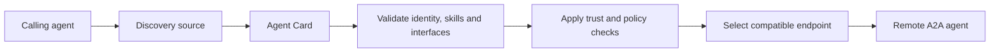
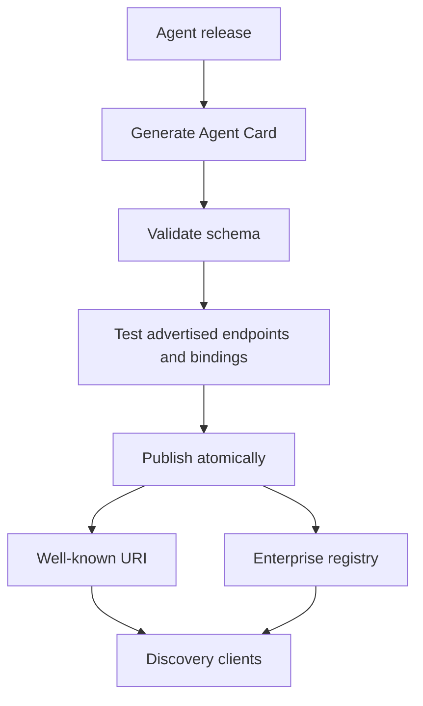
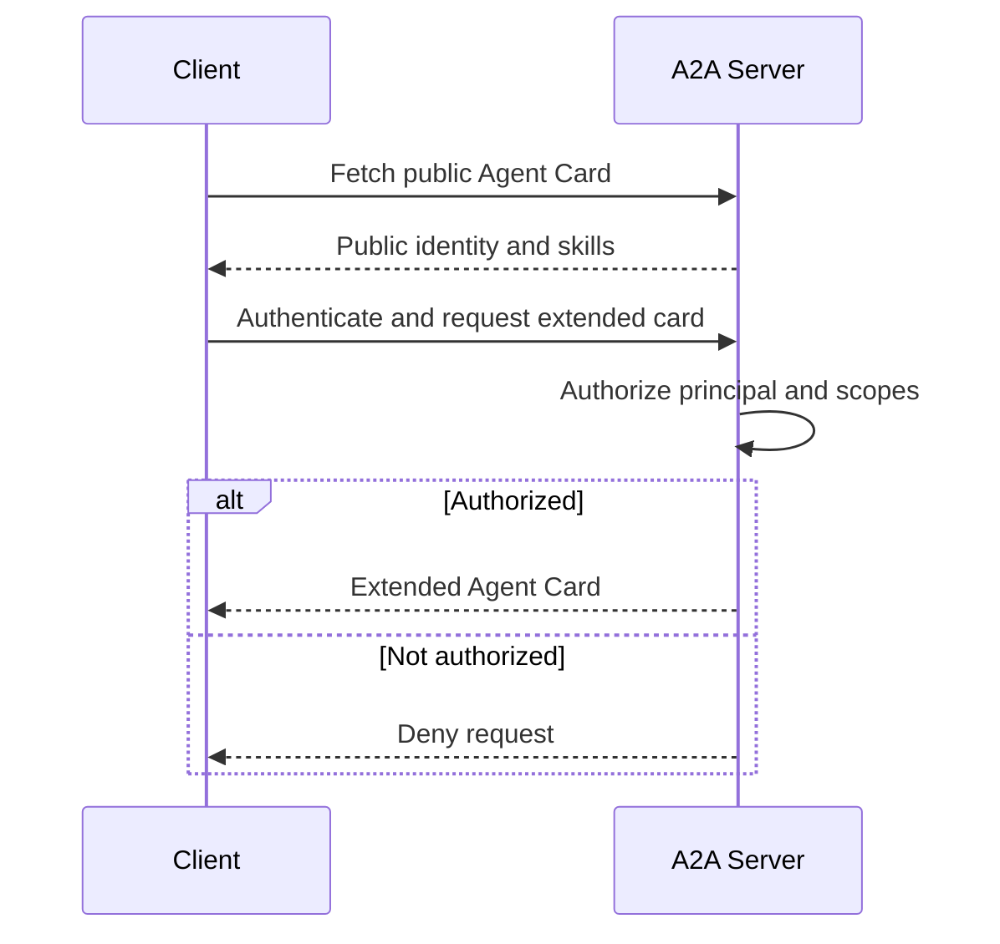
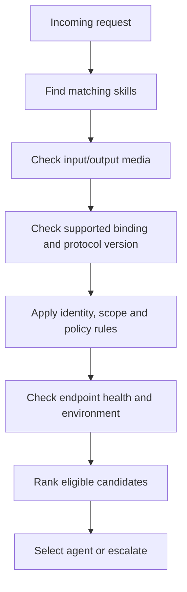

# 02. A2A Agent Cards, Discovery & Interoperability

A production agent network needs more than agents and endpoints. It needs a reliable answer to three questions:

1. **Who is this agent?**
2. **What work can it actually do?**
3. **How can I connect to it safely and compatibly?**

Imagine an enterprise assistant receiving: “Check whether invoice INV-2048 has been paid.” The organization has billing, procurement, customer-support and compliance agents. Picking the first endpoint containing the word *finance* is not discovery. The caller needs a trustworthy description of each agent, its skills, supported protocol interfaces and access requirements.

That description is the **A2A Agent Card**. This chapter is about designing and consuming that discovery contract—not implementing the agent executor or handling its tasks.

## 1. The Agent Card: a contract, not a brochure

An Agent Card is a machine-readable JSON document describing an A2A server. It gives clients enough information to decide whether an agent is a candidate and how to connect.



A card is not the agent, a guarantee of success, a detailed API schema or an authorization decision. Treat it as a published service contract.

### What belongs in the card?

| Area | What it tells a client |
|---|---|
| Identity | Agent name, purpose and release version |
| Provider | Who operates or owns the agent |
| Interfaces | Endpoint URL, protocol binding and protocol version |
| Capabilities | Features such as streaming or push notifications |
| Modes | Default input and output media types |
| Skills | The tasks the agent advertises |
| Security | Supported authentication schemes and requirements |
| Signatures | Optional integrity and origin verification |

## 2. Describe the agent so a router can choose it

A card is only useful when its metadata is precise. “Finance Agent” tells a router almost nothing. Compare it with:

> Investigates invoice payment status and reconciles payment references. Read-only: it cannot approve refunds or modify customer bank details.

The second description gives both a positive capability and an operational boundary.

Important identity fields include:

- `name`: a recognizable name for the agent.
- `description`: purpose, domain and meaningful limitations.
- `version`: the agent's own release version—not the A2A protocol version.
- `provider`: the organization responsible for the service.
- `documentationUrl`: optional supporting documentation.

Do not turn the description into marketing copy. Write it for the system that must decide whether to trust and route a request to this agent.

## 3. Skills are tasks; capabilities are protocol features

These terms are easy to mix up:

- A **skill** describes work the agent is designed to perform, such as `invoice_status_lookup`.
- A **capability** describes a feature of the A2A server, such as streaming or push notifications.

A server may support streaming but have no skill relevant to a particular request. Conversely, an agent may advertise invoice lookup but only support a non-streaming interaction.

A skill typically includes an identifier, name, description and tags. Examples and skill-specific input/output modes make the description more useful.

```json
{
  "id": "invoice_status_lookup",
  "name": "Invoice Status Lookup",
  "description": "Returns payment and settlement status for an invoice. Does not initiate refunds.",
  "tags": ["invoice", "payment-status", "read-only"],
  "examples": [
    "Check whether invoice INV-2048 has been paid."
  ],
  "inputModes": ["text/plain"],
  "outputModes": ["application/json"]
}
```

Prefer small, bounded skills over vague labels such as `finance`, `business` or `assistant`. Tags help discovery; they do not grant permission to perform an operation.

## 4. A practical A2A v1.0 Agent Card

The following example describes a billing agent with two supported interfaces. The first interface is preferred, so clients that support both bindings should select it.

```json
{
  "name": "Enterprise Billing Agent",
  "description": "Investigates invoice payment status and reconciles payment references. It does not approve refunds.",
  "supportedInterfaces": [
    {
      "url": "https://billing.example.com/a2a",
      "protocolBinding": "HTTP+JSON",
      "protocolVersion": "1.0"
    },
    {
      "url": "https://billing-rpc.example.com/a2a",
      "protocolBinding": "JSONRPC",
      "protocolVersion": "1.0"
    }
  ],
  "provider": {
    "organization": "Example Financial Services",
    "url": "https://example.com"
  },
  "version": "2.3.0",
  "documentationUrl": "https://docs.example.com/billing-agent",
  "capabilities": {
    "streaming": true,
    "pushNotifications": false,
    "extendedAgentCard": true
  },
  "defaultInputModes": ["text/plain"],
  "defaultOutputModes": ["application/json"],
  "skills": [
    {
      "id": "invoice_status_lookup",
      "name": "Invoice Status Lookup",
      "description": "Retrieves invoice payment and settlement details.",
      "tags": ["invoice", "payment", "read-only"],
      "examples": ["Check payment status for invoice INV-2048."],
      "inputModes": ["text/plain"],
      "outputModes": ["application/json"]
    }
  ]
}
```

The example omits security declarations to keep the discovery structure readable. In a real deployment, publish the appropriate `securitySchemes` and `securityRequirements` for the authentication model. Never put passwords, API keys, bearer tokens or other credentials in the card.

### Validate before publishing

A malformed or stale card can break every client that depends on it. Validate the document in CI against the official schema for the exact A2A release you deploy.

```python
import json
from jsonschema import Draft202012Validator

with open("agent-card.schema.json", encoding="utf-8") as f:
    schema = json.load(f)

with open("agent-card.json", encoding="utf-8") as f:
    card = json.load(f)

validator = Draft202012Validator(schema)
errors = sorted(validator.iter_errors(card), key=lambda e: list(e.path))

if errors:
    for error in errors:
        print(f"{list(error.path)}: {error.message}")
    raise SystemExit("Agent Card validation failed")

print("Agent Card schema validation passed")
```

Use the schema distributed by the A2A project or the matching SDK release; do not assume that a schema copied from an unrelated registry matches your deployed protocol version. Schema validation checks structure, not whether the endpoint is reachable or the advertised skill is truthful. Those need integration and contract tests.

## 5. Publish the card where clients can find it

The standard public discovery location is:

`https://{agent-domain}/.well-known/agent-card.json`

A client can retrieve it directly over HTTPS. An enterprise may also maintain a registry that indexes approved agents, owners, domains, tags and operational metadata.



Generate the card from the service release configuration, validate it, test every advertised interface and publish it atomically. Monitor availability after deployment. Never advertise a feature merely because the SDK supports it; the deployed endpoint must actually provide it.

## 6. Choose a discovery mechanism

A2A clients can obtain cards in several ways:

| Mechanism | How it works | Best fit |
|---|---|---|
| Well-known URI | Fetch from the agent's standard domain path | Directly reachable agents |
| Registry or catalogue | Search a curated directory of agents | Enterprise-wide discovery |
| Direct configuration | Supply a trusted card URL or card document | Small, fixed integrations |

A registry should record the registering owner, card source, last verification time and environment approval. Keep its searchable index separate from the authoritative card: the index finds candidates; the card describes the published interface and capabilities.

## 7. Public and authenticated discovery

Some metadata is safe to publish publicly; some is not. A public card might reveal that an agent handles billing queries, while a restricted skill list may be available only to authenticated enterprise clients.

A2A supports this pattern through `capabilities.extendedAgentCard` and the authenticated `GetExtendedAgentCard` operation.



Keep sensitive capabilities out of public metadata. Authenticate and authorize extended-card access, enforce authorization again when a skill is invoked, and log access to restricted discovery information. Possessing a card is not permission to use the agent.

## 8. Select an agent using hard constraints first

Discovery produces candidates. Routing still has to decide which candidate is appropriate.

For the invoice request, a router might find three agents with overlapping finance-related tags. It should not simply choose the one with the highest text-similarity score.



Filter candidates in this order: task fit, media-type compatibility, protocol compatibility, provider trust and caller authorization, then endpoint health and environment approval. Rank only the candidates that pass these hard constraints.

Semantic similarity is useful for candidate discovery, but it must not override security, protocol or policy constraints. A highly relevant agent with no authorization is still the wrong agent.

## 9. Protocol bindings and version compatibility

In A2A v1.0, `supportedInterfaces` is an ordered list. Each entry declares its own `url`, `protocolBinding` and `protocolVersion`. The first entry is preferred; clients should select the first interface they support.

Common bindings include:

- `HTTP+JSON`
- `JSONRPC`
- `GRPC`

Keep three version numbers separate:

| Version | Meaning |
|---|---|
| `protocolVersion` | A2A protocol version for a specific interface |
| Agent `version` | Release version of the agent/card |
| SDK version | Library version used by a client or server |

During migration, expose multiple interfaces only when each is implemented and tested. Do not relabel an older card as v1.0: v1.0 consolidates `url`, `preferredTransport` and `additionalInterfaces` into `supportedInterfaces`, moves protocol version into each interface, and changes extended-card and security fields. Validate the migrated card against the target schema.

## Key Takeaways

- An Agent Card is the discovery contract for an A2A server—not an execution API or an authorization grant.
- Write descriptions and skills with clear task boundaries.
- Capabilities describe protocol features; skills describe the work an agent offers.
- Publish the card at the well-known URI and/or through a governed enterprise registry.
- Use authenticated extended cards for restricted discovery, while enforcing authorization on every real operation.
- Apply protocol, identity, policy and health filters before ranking candidates by semantic relevance.
- Keep agent, protocol and SDK versions distinct; validate every card during release.

## Review Questions

1. What decisions should a client be able to make from an Agent Card?
2. How does an Agent Skill differ from a server capability?
3. Why is a skill description such as `finance` too broad for reliable routing?
4. When would a registry be preferable to direct well-known URI discovery?
5. What does `capabilities.extendedAgentCard` signal?
6. Why must authorization be checked again when a skill is invoked?
7. How are protocol version, agent version and SDK version different?

## References

1. [A2A Protocol — Agent Card and Discovery](https://a2a-protocol.org/latest/specification/agent-card/)
2. [A2A Protocol — Agent Discovery](https://a2a-protocol.org/latest/topics/agent-discovery/)
3. [A2A Protocol — What's New in v1.0](https://a2a-protocol.org/latest/whats-new-v1/)
4. [A2A Protocol — Official SDKs](https://a2a-protocol.org/latest/sdk/)
5. [RFC 8785 — JSON Canonicalization Scheme](https://www.rfc-editor.org/rfc/rfc8785)

---

## 🧭 Chapter Navigation

⬅️ **Previous:** [01. A2A Protocol Engineering Fundamentals](01-a2a-protocol-engineering-fundamentals.md)

📚 **Part:** [AI Engineering Frameworks & Tooling](../index.md)

➡️ **Next:** [03. Building A2A Agents & Servers](03-building-a2a-agents-and-clients.md)

---

> **Enterprise AI Engineering Handbook**
>
> *Building Production-Grade Enterprise AI Systems — One Chapter at a Time.*

---
