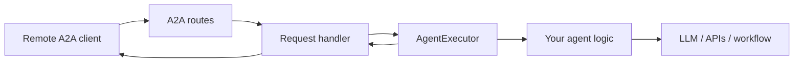
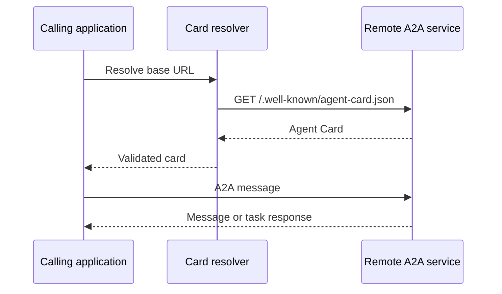
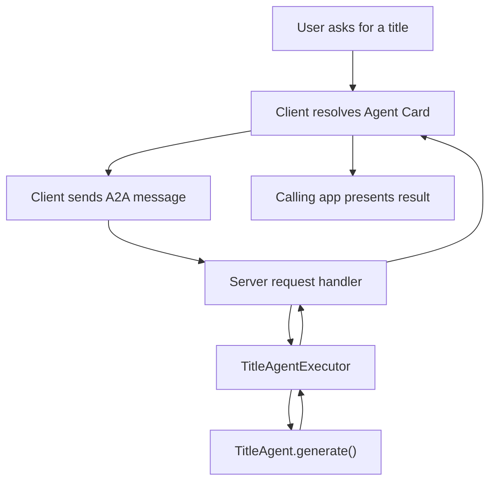

# 39. Building A2A Agents & Clients

An agent is not part of an agent network just because it has a clever prompt. It needs a service boundary: something that receives a request, invokes its own logic and returns a response in a form another agent can understand.

Let’s build that boundary.

We’ll use a **Title Agent** that turns a topic into a blog headline. It is deliberately small: the interesting engineering is not the prompt, but how the agent is exposed through A2A and called by a separate client. The same pattern applies when the logic sits behind an LLM, a workflow engine or an enterprise API.

> **Chapter boundary:** Chapter 38 explains how clients discover and assess Agent Cards. This chapter implements the agent endpoint and a client that calls it. Detailed message structures, task-state transitions, streaming, polling and cancellation workflows are reserved for Chapter 40.

## 1. A2A SDKs and the development environment

A2A defines the interoperability contract; an SDK supplies the language-specific types and server/client building blocks. Official SDKs exist for Python, Java, JavaScript/TypeScript, Go and .NET. Their feature sets and release cadence can differ, so check compatibility before connecting implementations written in different languages.

This walkthrough uses the **A2A Python SDK 1.x** API.

```bash
python -m venv .venv

# macOS / Linux
source .venv/bin/activate

# Windows PowerShell
# .venv\Scripts\Activate.ps1

python -m pip install --upgrade pip
pip install "a2a-sdk[http-server]"
```

Pin the SDK version in your project lock file. Do not copy older 0.3 snippets into a 1.x project without checking the migration guide. Among the breaking changes: the request handler now receives the Agent Card, server applications are assembled from route factories, and clients are created with `create_client()`.

## 2. The server: a protocol adapter around your agent

Think of the A2A server as an adapter, not the intelligence itself. It accepts protocol requests and hands execution to your application-specific code.



Each component has one job:

- **Routes** expose the selected A2A transport.
- **Request handler** dispatches protocol operations and coordinates task handling.
- **Agent executor** translates an A2A request into a call to your agent.
- **Agent logic** performs the domain work; it should not need to know about HTTP or JSON-RPC.

That separation is valuable. You can test the title-generation logic without starting a server, then reuse it behind a CLI, a REST endpoint or an A2A service.

## 3. Implement the agent executor

Start with plain application logic. Keep it independent of the protocol:

```python
class TitleAgent:
    async def generate(self, topic: str) -> str:
        # Replace this deterministic example with an LLM call.
        return f"An Engineer's Guide to {topic}: From Basics to Production"
```

The SDK’s `AgentExecutor` is the bridge between that logic and A2A. Its `execute()` method receives a `RequestContext` and an `EventQueue`. The context contains the incoming message and any existing task context; the queue carries the response events. `cancel()` is the corresponding hook for cancellation support.

Here is a compact task-based executor:

```python
from a2a.server.agent_execution import AgentExecutor, RequestContext
from a2a.server.events import EventQueue
from a2a.server.tasks import TaskUpdater
from a2a.helpers import (
    get_message_text,
    new_task_from_user_message,
    new_text_message,
    new_text_part,
)
from a2a.types import TaskState

class TitleAgentExecutor(AgentExecutor):
    def __init__(self):
        self.agent = TitleAgent()

    async def execute(
        self, context: RequestContext, event_queue: EventQueue
    ) -> None:
        task = context.current_task
        if task is None:
            task = new_task_from_user_message(context.message)
            await event_queue.enqueue_event(task)

        updater = TaskUpdater(event_queue, task.id, task.context_id)
        await updater.update_status(
            state=TaskState.TASK_STATE_WORKING,
            message=new_text_message("Drafting a title..."),
        )

        topic = get_message_text(context.message) or ""
        title = await self.agent.generate(topic)

        await updater.add_artifact(
            parts=[new_text_part(text=title, media_type="text/plain")]
        )
        await updater.update_status(
            state=TaskState.TASK_STATE_COMPLETED,
            message=new_text_message("Title generated."),
        )

    async def cancel(
        self, context: RequestContext, event_queue: EventQueue
    ) -> None:
        raise NotImplementedError("This example does not support cancellation")
```

Notice the order: create and enqueue the task first, then publish status and artifact updates. The SDK validates event sequences; mixing message-only responses with task-lifecycle events can cause a runtime error. For a truly simple agent, a single `Message` response may be enough. Choose one response pattern for a request rather than mixing the two.

The example deliberately reports cancellation as unsupported. In a real workflow, implement cancellation only if the underlying model call, job or tool operation can actually be stopped.

## 4. Expose the agent through an HTTP server

The server needs an Agent Card, a task store, a request handler and routes. Chapter 38 owns the design of the card; here we provide the minimum metadata needed to wire this service.

```python
import uvicorn
from starlette.applications import Starlette

from a2a.server.request_handlers import DefaultRequestHandler
from a2a.server.routes import (
    create_agent_card_routes,
    create_jsonrpc_routes,
)
from a2a.server.tasks import InMemoryTaskStore
from a2a.types import (
    AgentCapabilities,
    AgentCard,
    AgentInterface,
    AgentSkill,
)

skill = AgentSkill(
    id="generate_blog_title",
    name="Generate Blog Title",
    description="Creates one clear title from an article topic.",
    tags=["writing", "title-generation"],
    examples=["Suggest a title for an article about Kubernetes."],
)

card = AgentCard(
    name="Title Agent",
    description="Generates concise technical article titles.",
    version="1.0.0",
    supported_interfaces=[
        AgentInterface(
            url="http://127.0.0.1:9000/",
            protocol_binding="JSONRPC",
            protocol_version="1.0",
        )
    ],
    default_input_modes=["text/plain"],
    default_output_modes=["text/plain"],
    capabilities=AgentCapabilities(streaming=False),
    skills=[skill],
)

handler = DefaultRequestHandler(
    agent_executor=TitleAgentExecutor(),
    task_store=InMemoryTaskStore(),
    agent_card=card,
)

app = Starlette(routes=[
    *create_agent_card_routes(card),
    *create_jsonrpc_routes(handler, "/"),
])

if __name__ == "__main__":
    uvicorn.run(app, host="127.0.0.1", port=9000)
```

The Agent Card route publishes discovery metadata at the well-known endpoint; the JSON-RPC route handles A2A operations. Keep the local server bound to `127.0.0.1` while developing. A deployed service needs HTTPS, authentication, authorization, controlled network exposure and a task store appropriate to its reliability requirements.

`InMemoryTaskStore` is convenient for a single-process example. It is not a shared persistence layer: tasks can disappear on restart and are not automatically visible to another server replica.

## 5. The client: discover, connect, call

The client has a different responsibility. It resolves the remote agent’s card, creates a compatible SDK client and sends a message.



A successful card fetch does not mean the caller is authorized to use every skill. Authentication and authorization must still be enforced when the operation is invoked.

### Resolve the Agent Card and create a client

```python
import httpx
from a2a.client import A2ACardResolver, create_client

async def connect_to_title_agent():
    async with httpx.AsyncClient(timeout=15) as http:
        resolver = A2ACardResolver(
            httpx_client=http,
            base_url="http://127.0.0.1:9000",
        )
        card = await resolver.get_agent_card()

    return await create_client(agent=card)
```

For production, use HTTPS and configure the SDK’s supported authentication mechanism. Also define connection and request timeouts deliberately; a remote agent is a network dependency, not a local function call.

### Send a message and inspect the response

```python
from a2a.helpers import new_text_message
from a2a.types import Role, SendMessageRequest

async def request_title(client):
    message = new_text_message(
        "Create a title for an article about enterprise RAG.",
        role=Role.ROLE_USER,
    )
    request = SendMessageRequest(message=message)

    async for response in client.send_message(request):
        if response.message:
            print("Message:", response.message)
        elif response.task:
            print("Task:", response.task.id)
        elif response.status_update:
            print("Status:", response.status_update)
        elif response.artifact_update:
            print("Artifact:", response.artifact_update)
```

The SDK client returns a stream of response envelopes. Even when you expect a quick answer, inspect the response type rather than assuming every call returns a plain text message. This example shows the dispatch boundary only; Chapter 40 explores task and streaming event handling in depth.

## 6. Put the pieces together

Run the server, then invoke `connect_to_title_agent()` and `request_title()` from an async client application. The end-to-end path is intentionally small:



Before treating the service as production-ready, verify the details that a local demo can hide:

- The card advertises the actual endpoint and protocol version.
- Client and server SDKs support the same protocol binding and version.
- Authentication and per-skill authorization are enforced.
- Invalid input and agent exceptions produce deliberate protocol outcomes.
- The task store matches the deployment topology.
- Logs carry correlation identifiers but do not expose credentials or sensitive prompts.

Keep retry behaviour conservative. A timeout does not prove the remote agent failed; blindly retrying a non-idempotent operation can execute it twice. For operations with side effects, design idempotency at the application boundary.

## Key Takeaways

- An A2A server is a protocol adapter around independently testable agent logic.
- `AgentExecutor` implements the execution boundary; the request handler coordinates protocol dispatch and task handling.
- The server combines an Agent Card, request handler, task store and transport routes.
- A client resolves the remote card, creates a compatible SDK client and sends typed messages.
- Handle response envelopes by type; do not assume every response is a direct message.
- Pin SDK versions and test the exact client/server combination you intend to deploy.

## Review Questions

1. Why should agent business logic remain independent of A2A?
2. What responsibilities belong to `AgentExecutor` and the request handler?
3. Why must a task be enqueued before its status and artifact updates?
4. What does the Agent Card resolver provide to the client?
5. Why does successful discovery not imply authorization?
6. When is an in-memory task store insufficient?
7. Why can an automatic retry be dangerous for an operation with side effects?

## References

1. [A2A Python SDK — Installation and Compatibility](https://a2aproject.github.io/a2a-python/)
2. [A2A Python SDK — Samples](https://a2aproject.github.io/a2a-python/samples/)
3. [A2A Python SDK — v0.3 to v1.0 Migration](https://a2aproject.github.io/a2a-python/docs/migrations/v1_0/)
4. [A2A Protocol — Agent Executor](https://a2a-protocol.org/latest/tutorials/python/4-agent-executor/)
5. [A2A Protocol — Start Server](https://a2a-protocol.org/v1.0.1/tutorials/python/5-start-server/)

---

## 🧭 Chapter Navigation

⬅️ **Previous:** [38. A2A Agent Cards, Discovery & Interoperability](38-a2a-agent-cards-discovery-interoperability-optimised.md)

📚 **Part:** [AI Engineering Frameworks & Tooling](index.md)

➡️ **Next:** [40. A2A Messaging, Tasks & Streaming](40-a2a-messaging-tasks-and-streaming.md)

---

> **Enterprise AI Engineering Handbook**
>
> *Building Production-Grade Enterprise AI Systems — One Chapter at a Time.*

---
