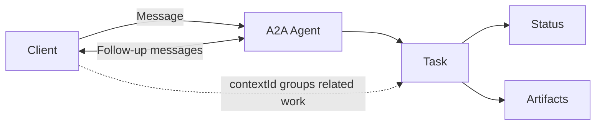
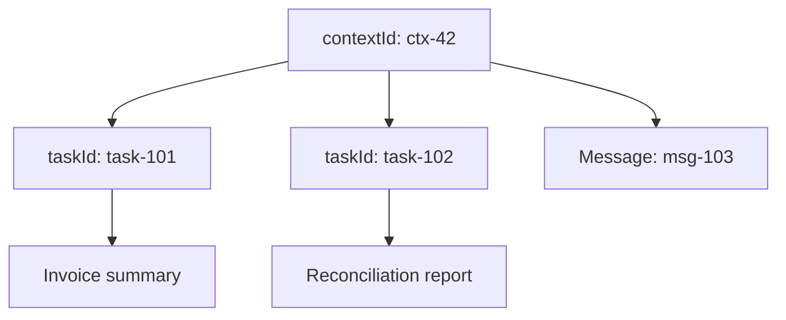
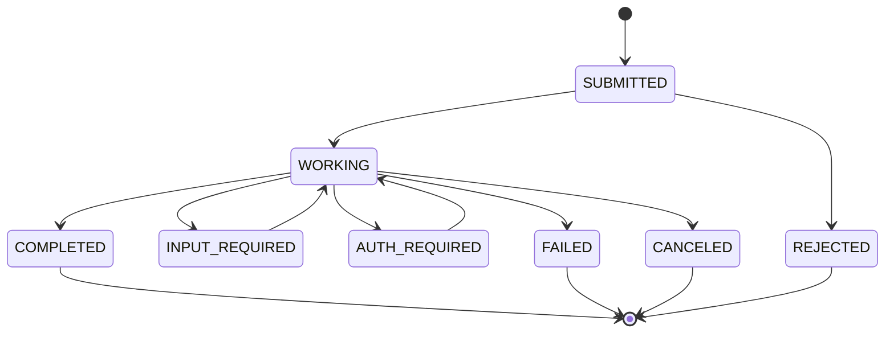
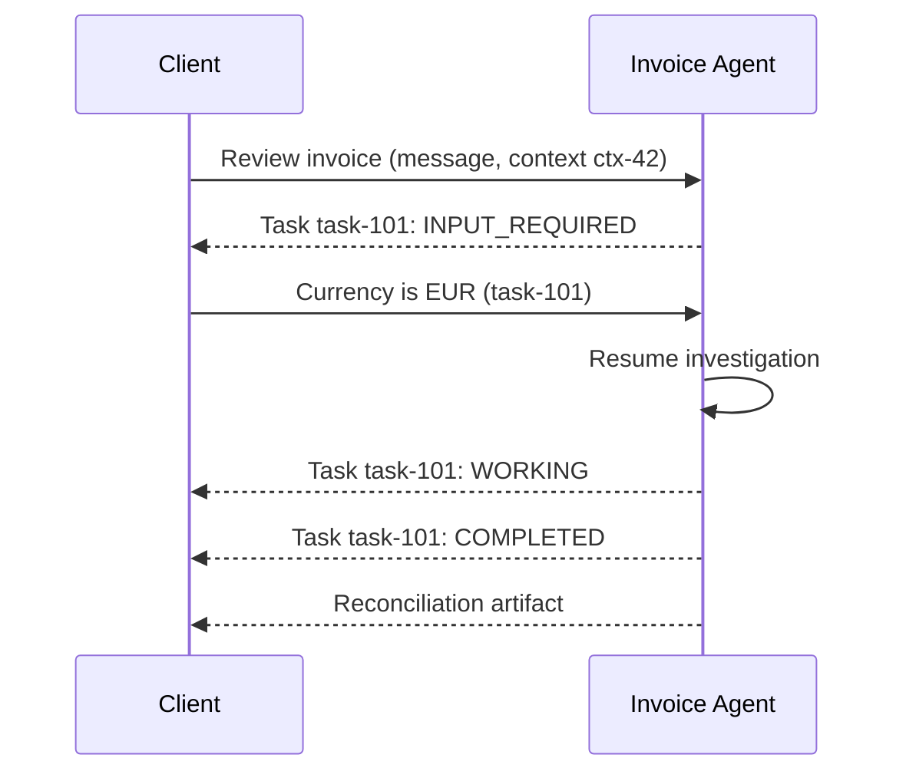

# 04. A2A Messages, Tasks & Execution Lifecycle

A remote agent receives: “Review this invoice, explain the discrepancy, and attach a reconciliation report.”

What comes back? Not necessarily one neat string.

The agent may acknowledge the request, ask for the purchase order, spend time checking records, report progress, attach a report—or fail because a downstream service is unavailable. A2A models these outcomes explicitly instead of pretending every agent interaction is a synchronous function call.

The mental model is simple: **Messages communicate. Tasks track work. Parts carry content. Contexts connect related interactions. Artifacts hold results.**

## 1. A2A Message Architecture

A `Message` is one unit of communication between a client and an agent. It can initiate work, provide clarification, or add information to an existing task.

A `Task` is different: it represents work whose progress and outcome may need to be tracked.

| Object | Think of it as |
|---|---|
| Message | A communication turn |
| Task | A tracked unit of work |
| Part | One content segment |
| Context | A logical conversation grouping |
| Artifact | A task output |



A `SendMessage` operation returns either a direct `Message` or a `Task`. It does not return both in the same response. Simple interactions can avoid task tracking; longer or stateful work benefits from a Task. [A2A v1.0 specification](https://a2a-protocol.org/v1.0.0/specification/)

## 2. Message Roles and Structure

A Message includes a unique `messageId`, a sender `role`, and one or more `parts`. It may also carry `contextId`, `taskId`, metadata, extensions and references to related tasks.

| Field | Purpose |
|---|---|
| `messageId` | Unique identifier created by the message sender |
| `role` | `ROLE_USER` or `ROLE_AGENT` |
| `parts` | Content segments |
| `contextId` | Associates the message with a conversation context |
| `taskId` | Associates it with an existing task |
| `referenceTaskIds` | References related tasks |
| `metadata` | Optional application or extension data |

A client request might look like this:

```json
{
  "message": {
    "messageId": "msg-7f21",
    "role": "ROLE_USER",
    "contextId": "ctx-invoice-42",
    "parts": [
      {
        "text": "Explain the variance in invoice INV-2048.",
        "mediaType": "text/plain"
      }
    ]
  }
}
```

The role identifies who sent the message—not whether its content is trustworthy. Treat remote content as untrusted input, validate it, and enforce authorization independently.

## 3. Parts and Multimodal Content

A `Part` is a content segment inside a Message or Artifact. One message can combine text, a file and structured data.

A2A v1.0 defines four content forms:

- `text` — human-readable text.
- `raw` — file bytes, base64-encoded in JSON.
- `url` — a reference to externally hosted content.
- `data` — structured JSON content.

```json
{
  "messageId": "msg-evidence-18",
  "role": "ROLE_USER",
  "parts": [
    {"text": "Compare the invoice with this evidence."},
    {
      "url": "https://files.example.com/invoice-2048.pdf",
      "mediaType": "application/pdf",
      "filename": "invoice-2048.pdf"
    },
    {
      "data": {"invoiceId": "INV-2048", "currency": "EUR"},
      "mediaType": "application/json"
    }
  ]
}
```

The `mediaType` tells the receiver how to interpret the content. It does not guarantee that the agent can process it. Check the agent's advertised input modes and validate the actual content type.

A URL is not permission to fetch arbitrary resources. Apply host allow-lists, authentication, payload limits, MIME validation and malware scanning. For raw file content, limit size and avoid logging file bytes.

## 4. Contexts and Conversation Continuity

A `contextId` groups related Messages and Tasks. A `taskId` identifies one specific unit of work. They are related, but not interchangeable.

For an invoice investigation:

- `ctx-42` groups the overall conversation.
- `task-101` retrieves the invoice.
- `task-102` compares a purchase order supplied later.
- `msg-103` carries the user's clarification.



The agent may generate a context when the client does not provide one; if it does, the returned Task or Message must include it. An agent may accept a client-provided context or reject it if it cannot support it. It must not silently replace an unsupported client context with a different one.

**Practical rule:** treat server-generated context IDs as opaque. Clients should not invent context IDs unless they understand how that server handles them. A client can use a known `contextId` to start another task in the same conversation, or include a `taskId` to continue a particular task. If both are supplied, they must refer to the same context.

A context ID is not an authorization token or a guaranteed memory store. Persistence, tenant isolation and context expiry remain implementation responsibilities.

## 5. Task Creation and Identification

When an interaction needs tracking, the server creates a Task and assigns its unique `id`. The Task includes a status and may include history, artifacts and metadata.

```json
{
  "id": "task-101",
  "contextId": "ctx-42",
  "status": {
    "state": "TASK_STATE_SUBMITTED",
    "timestamp": "2026-11-14T10:15:00Z"
  },
  "history": []
}
```

The client should persist the returned task ID if it needs to retrieve status, continue the interaction or request cancellation. A message ID identifies a message; a task ID identifies work. Never substitute one for the other.

## 6. Task States and Lifecycle Transitions

A2A v1.0 defines these Task states:

| State | Meaning | Lifecycle |
|---|---|---|
| `TASK_STATE_SUBMITTED` | Request acknowledged | Non-terminal |
| `TASK_STATE_WORKING` | Agent is processing | Non-terminal |
| `TASK_STATE_INPUT_REQUIRED` | More user input is needed | Interrupted |
| `TASK_STATE_AUTH_REQUIRED` | Authentication is needed | Interrupted |
| `TASK_STATE_COMPLETED` | Work succeeded | Terminal |
| `TASK_STATE_FAILED` | Work ended with an error | Terminal |
| `TASK_STATE_CANCELED` | Work was canceled | Terminal |
| `TASK_STATE_REJECTED` | Agent declined the work | Terminal |



This is a conceptual path, not a mandatory sequence every Task must follow. An agent can reject work early; it can pause for input or authentication and resume later. Terminal states mean that Task is finished. A new unit of work requires a new Task, though it can belong to the same Context.

## 7. Task Status Updates

A `TaskStatus` contains the current state, an optional explanatory Message and a timestamp. A `TaskStatusUpdateEvent` identifies the `taskId` and `contextId` and carries the new status.

Good progress updates answer “what changed?”:

- “Invoice located; validating line items.”
- “Waiting for the purchase order attachment.”
- “Reconciliation completed.”

Keep status messages useful and safe. They are not a place for internal reasoning, secrets, raw database output or debug traces.

A client may receive status and artifact events while work is running. These events are covered here as lifecycle concepts; detailed streaming, reconnection and push-delivery design belongs in Chapter 41.

## 8. Artifacts and Generated Outputs

Messages are for communication. **Artifacts are for task outputs.** A Task can produce one or more Artifacts, each containing one or more Parts.

```json
{
  "artifactId": "reconciliation-report",
  "name": "Invoice reconciliation",
  "description": "Comparison of invoice and purchase order line items",
  "parts": [
    {
      "data": {
        "invoiceId": "INV-2048",
        "currency": "EUR",
        "variance": 125.50,
        "finding": "Shipping charge differs from purchase order"
      },
      "mediaType": "application/json"
    }
  ]
}
```

An artifact can be a document, image, text result or structured payload. It may arrive as a complete object or as incremental artifact updates. The update includes the artifact and can indicate whether content should be appended and whether the last chunk has arrived.

Do not mistake a progress message for the deliverable. A2A separates status communication from task outputs so clients can track work and consume results independently.

## 9. Multi-Turn Interactions

Suppose the invoice agent cannot proceed until it knows the currency. It moves the Task to `TASK_STATE_INPUT_REQUIRED` and explains what it needs. The client replies with a new Message that references the same task and context.



A follow-up message can reference `taskId` alone; the server infers the task's context. If the client sends both identifiers, they must match. A client can also send only a known `contextId` to begin a new Task within that conversation.

The protocol provides correlation, not unlimited memory. The agent decides what history to retain and how to use it. Define retention, expiry and tenant isolation explicitly.

## 10. Task Cancellation and Failure Handling

A cancellation request does not prove that work has stopped. The task may already have completed, the agent may be unable to interrupt a downstream operation, or cancellation may be rejected. Check the resulting Task state.

For task management, the core operations include:

| Operation | Purpose |
|---|---|
| `GetTask` | Retrieve current task state and available results |
| `CancelTask` | Request cancellation |

The JSON-RPC binding exposes these as `GetTask` and `CancelTask` methods. For example, a task lookup uses the task ID:

```json
{
  "jsonrpc": "2.0",
  "id": 12,
  "method": "GetTask",
  "params": {
    "id": "task-101",
    "historyLength": 10
  }
}
```

A robust client distinguishes three failure classes:

1. **Transport failure:** timeout, connection reset or DNS failure. The remote outcome may be unknown.
2. **Protocol failure:** malformed request, unsupported operation, authentication or authorization error.
3. **Task failure:** the agent accepted the work but could not complete it; the Task reaches `TASK_STATE_FAILED`.

A timeout is not an A2A Task state. It describes what the caller knows: the response did not arrive. The remote Task may still be running or may already have completed. If the task ID is known, retrieve its status before deciding to resubmit. For side-effecting operations, add application-level idempotency and duplicate detection.

## Key Takeaways

- Messages carry communication; Tasks track work; Artifacts carry outputs.
- Parts support text, raw files, URLs and structured data.
- `contextId` groups related interactions; `taskId` identifies one unit of work.
- Task states distinguish active, interrupted and terminal outcomes.
- Status messages report progress; Artifacts carry deliverables.
- Cancellation is a request, not confirmation.
- A timeout leaves the remote outcome uncertain; it does not prove task failure.

## Review Questions

1. How does a Message differ from a Task and an Artifact?
2. What content forms can a Part carry?
3. Why are `contextId` and `taskId` separate identifiers?
4. Which Task states are terminal, and which represent interruption?
5. Why should a client not treat a status message as the final output?
6. How can a client continue a Task that requires more input?
7. Why is retrying a timed-out side-effecting request dangerous?

## References

1. [A2A Protocol v1.0 Specification — Data Model and Operations](https://a2a-protocol.org/v1.0.0/specification/)
2. [A2A Protocol — Life of a Task](https://a2a-protocol.org/latest/topics/life-of-a-task/)
3. [A2A Protocol — Core Concepts](https://a2a-protocol.org/latest/topics/key-concepts/)

---

## 🧭 Chapter Navigation

⬅️ **Previous:** [03. Building A2A Agents & Clients](03-building-a2a-agents-and-clients.md)

📚 **Part:** [AI Engineering Frameworks & Tooling](../index.md)

➡️ **Next:** [05. A2A Streaming & Asynchronous Communication](05-a2a-streaming-and-asynchronous-communication.md)

---

> **Enterprise AI Engineering Handbook**
>
> *Building Production-Grade Enterprise AI Systems — One Chapter at a Time.*

---
