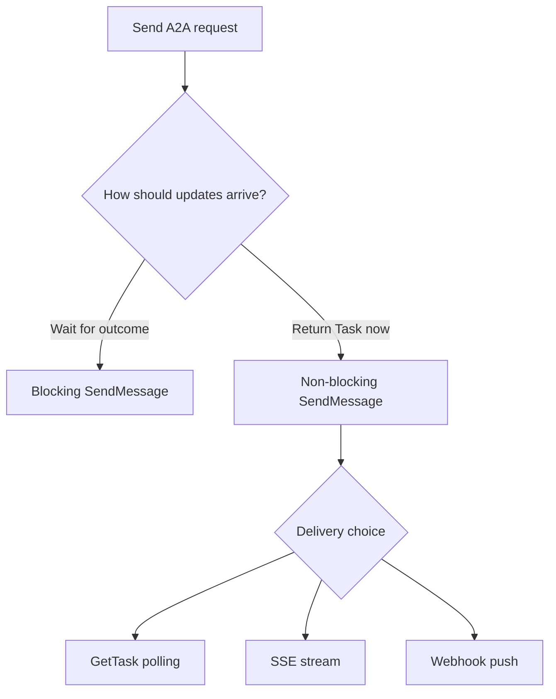
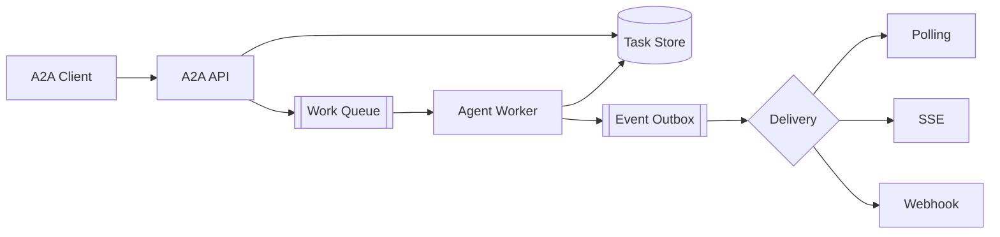
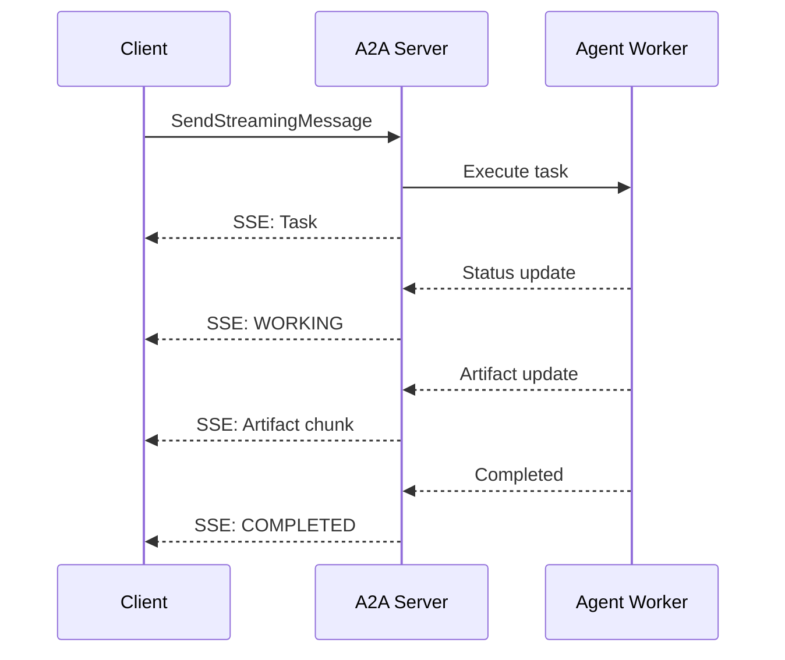
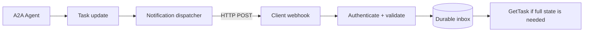

# 05. A2A Streaming & Asynchronous Communication

Your invoice agent has been reconciling a payment for two minutes. The browser tab is gone. The API gateway has closed the connection. But the agent is still waiting for the ERP system.

Did the task fail?

Not necessarily. The connection failed; the task may still be running. In a distributed agent system, **work and the connection used to observe that work have different lifecycles**.

A2A gives clients three ways to follow task progress: polling, streaming and push notifications. This chapter explores when to use each, and how to recover when networks behave like networks.

## 1. Synchronous vs Asynchronous Communication

A short request may be easiest to handle by waiting for its response. For longer work, the client should be able to receive a Task identifier and follow the execution separately.

A2A's `SendMessage` operation is blocking by default when it creates a Task: it waits until the Task reaches a terminal or interrupted state. Set `returnImmediately: true` in `SendMessageConfiguration` to return the Task while it is still in progress.

| Pattern | Client experience | Typical use |
|---|---|---|
| Blocking request | Waits for task outcome | Short operations |
| Non-blocking request | Receives Task early | Long-running work |
| Streaming | Receives events over an open connection | Live progress |
| Push notification | Receives HTTP callbacks | Disconnected clients |

The `returnImmediately` setting does not change a direct `Message` response and has no effect on streaming operations. Asynchronous execution does not automatically mean streaming: a client can receive a Task immediately and then poll it.



## 2. Long-Running Agent Tasks

Model inference, multiple tool calls, human approval and remote enterprise APIs can turn one request into a long-running workflow. The task should not depend on a browser tab or a single HTTP connection remaining open.

A practical server design separates accepting a request from executing it:

1. Validate the incoming A2A request and create the Task.
2. Return the Task identifier when non-blocking execution is requested.
3. Execute the work in a worker or durable workflow.
4. Persist task state and important output events.
5. Deliver updates through polling, streaming or push.
6. Record the terminal outcome and final artifacts.



This is a production architecture pattern, not a mandatory A2A topology. A durable task store and event outbox help prevent work or notifications from disappearing during process restarts. An in-memory store is appropriate for a local example, not a multi-replica service.

## 3. Task Status Polling

Polling is straightforward and works even when the client cannot maintain a persistent connection. The client periodically calls `GetTask` with the task ID and checks the returned state.

```json
{
  "jsonrpc": "2.0",
  "id": 21,
  "method": "GetTask",
  "params": {
    "id": "task-invoice-2048",
    "historyLength": 10
  }
}
```

Avoid hammering the server. Use bounded exponential backoff with jitter, and slow the polling interval when the user is no longer watching.

```python
import asyncio
import random

TERMINAL = {
    "TASK_STATE_COMPLETED",
    "TASK_STATE_FAILED",
    "TASK_STATE_CANCELED",
    "TASK_STATE_REJECTED",
}

async def wait_for_task(get_task, task_id, max_wait=300):
    delay = 1.0
    elapsed = 0.0

    while elapsed < max_wait:
        task = await get_task(task_id)  # SDK-specific GetTask adapter
        if task.status.state in TERMINAL:
            return task

        pause = min(delay + random.uniform(0, delay * 0.2), 15)
        await asyncio.sleep(pause)
        elapsed += pause
        delay = min(delay * 2, 15)

    raise TimeoutError(f"Task {task_id} is still unresolved")
```

This is application-level polling logic; `get_task` is an injected SDK adapter. A client-side timeout only ends the wait. It does not cancel the remote Task.

## 4. Server-Sent Events (SSE) Streaming

Polling trades simplicity for latency. If a user is watching a task, waiting several seconds for the next check can make the system feel unresponsive.

A2A supports streaming through `SendStreamingMessage` and `SubscribeToTask`. With the HTTP-based JSON-RPC binding, the server returns `Content-Type: text/event-stream`; each SSE event carries a protocol response in its `data` field. The Agent Card must advertise `capabilities.streaming: true`.



An A2A stream is not necessarily an LLM token stream. It carries `StreamResponse` envelopes, each containing one of: a Task, Message, status update or artifact update. The client must inspect the payload type instead of treating every event as text.

`SubscribeToTask` opens a stream for an existing non-terminal Task. It is useful when the initial client disconnected or another application needs to observe the same work.

## 5. Incremental Task Updates

A client may receive an initial Task, status changes, artifact chunks and a final status event. These updates serve different purposes:

- **Task:** establishes or refreshes the task snapshot.
- **Status update:** reports progress or a change in task state.
- **Artifact update:** delivers or extends task output.

For artifact updates, respect `append` and `lastChunk`. If `append` is true, add the content to the artifact with the same ID; otherwise, replace the previous representation. `lastChunk` marks the final chunk of that artifact.

```python
def apply_event(event, view):
    if event.task is not None:
        view.task = event.task

    elif event.status_update is not None:
        update = event.status_update
        view.status = update.status.state

    elif event.artifact_update is not None:
        update = event.artifact_update
        if update.append:
            view.append_artifact(update.artifact)
        else:
            view.replace_artifact(update.artifact)

    return view
```

This illustrates the handling strategy; adapt property names to the generated types in your SDK version. Make updates idempotent so replayed events do not duplicate content.

## 6. Push Notification Architecture

An open stream is useful while a client is connected. For work that may take minutes or hours, a webhook can notify a client without requiring it to hold a connection open.

The Agent Card must advertise `capabilities.pushNotifications: true`. The client provides a `TaskPushNotificationConfig` with a webhook URL and optional validation token and authentication details. It can be supplied with the initial request or created later for an existing Task.



The webhook payload uses the A2A `StreamResponse` shape. Treat the notification as a signal that something changed, not as the only durable copy of task state.

## 7. Webhook and Notification Configuration

For JSON-RPC, the operation is `CreateTaskPushNotificationConfig`. The following illustrates the v1.0 request shape:

```json
{
  "jsonrpc": "2.0",
  "id": 31,
  "method": "CreateTaskPushNotificationConfig",
  "params": {
    "taskId": "task-invoice-2048",
    "url": "https://client.example.com/a2a/events",
    "token": "opaque-client-validation-token",
    "authentication": {
      "scheme": "Bearer",
      "credentials": "webhook-access-token"
    }
  }
}
```

The `token` is for client-side validation; `authentication` supplies credentials the agent uses when calling the webhook. Protect both as secrets. Use HTTPS, restrict accepted callback destinations, and defend the sender against server-side request forgery (SSRF).

A webhook receiver should authenticate the caller, validate the expected task ID, enforce payload limits and persist or enqueue the notification before returning HTTP 2xx. Keep the handler fast; do not run the full business workflow inside the webhook request.

## 8. Client Disconnection and Reconnection

A browser closing should not silently destroy an invoice reconciliation. The Task belongs to the agent; an SSE connection belongs to one observer.

After reconnecting:

1. Load the persisted `taskId`.
2. Call `GetTask` to retrieve the current state.
3. If the Task is non-terminal and streaming is supported, call `SubscribeToTask`.
4. Reconcile incoming events with the state already stored.
5. Fall back to polling if streaming is unavailable.

A2A permits multiple streams to observe one Task. Closing one stream does not cancel the Task or other streams. However, do not assume every missed status message will be replayed after reconnection. Retrieve the Task snapshot; use application-level event IDs or sequence numbers if exact event replay is required.

## 9. Timeouts, Retries and Resilience

Configure timeouts for connection establishment, request processing, idle streams and webhook delivery separately. A single global timeout is rarely appropriate.

- Retry transient network failures with bounded exponential backoff and jitter.
- Respect `Retry-After` when supplied.
- Do not blindly retry authentication, validation or unsupported-operation errors.
- After an ambiguous timeout, retrieve the Task if its ID is known.
- Use application-level idempotency for side-effecting operations.

The first request may have reached the agent even if its response was lost. Retrying blindly can send duplicate emails, trigger repeated provisioning or process a payment twice. A retry policy must account for the operation's side effects, not just its HTTP method.

## 10. Event Ordering and Duplicate Notifications

A2A requires events on a stream to remain in generation order. Multiple active streams for a Task receive the same events in that order. Push delivery has at-least-once semantics: agents must attempt delivery, and duplicate notifications may occur.

Use a durable inbox pattern:

1. Authenticate and validate the notification.
2. Derive a deduplication key from a stable event ID or a carefully defined task/event fingerprint.
3. Persist the event and key atomically.
4. Return HTTP 2xx after durable acceptance.
5. Process asynchronously with idempotent downstream actions.

Do not infer event order from arrival time alone. Use task state, protocol timestamps and application-level sequence numbers where available. A stale notification must not roll a completed task back to `WORKING`.

## Key Takeaways

- A Task can outlive the connection that initiated it.
- Blocking and non-blocking execution are different from streaming.
- Polling, SSE and push notifications serve different delivery needs.
- Reconnect by retrieving the Task, then resubscribe or poll.
- Artifact updates must respect append and final-chunk indicators.
- Push notifications are at-least-once; build for duplicates.
- Bounded retries and idempotency protect downstream systems.

## Review Questions

1. What does `returnImmediately` change, and what does it not change?
2. When would polling be preferable to SSE?
3. What does `SubscribeToTask` provide after a disconnection?
4. Why should a webhook acknowledge only after durable acceptance?
5. How do `append` and `lastChunk` affect artifact assembly?
6. What is guaranteed about stream ordering?
7. Why must webhook consumers handle duplicate notifications?

## References

1. [A2A Protocol v1.0.1 Specification — Task Update Delivery](https://a2a-protocol.org/v1.0.1/specification/)
2. [A2A Protocol — Streaming and Asynchronous Operations](https://a2a-protocol.org/latest/topics/streaming-and-async/)
3. [A2A Protocol — Life of a Task](https://a2a-protocol.org/latest/topics/life-of-a-task/)

---

## 🧭 Chapter Navigation

⬅️ **Previous:** [04. A2A Messages, Tasks & Execution Lifecycle](04-a2a-messages-tasks-and-execution-lifecycle.md)

📚 **Part:** [AI Engineering Frameworks & Tooling](../index.md)

➡️ **Next:** [06. A2A Security & Production Operations](06-a2a-security-testing-production-operations.md)

---

> **Enterprise AI Engineering Handbook**
>
> *Building Production-Grade Enterprise AI Systems — One Chapter at a Time.*

---
