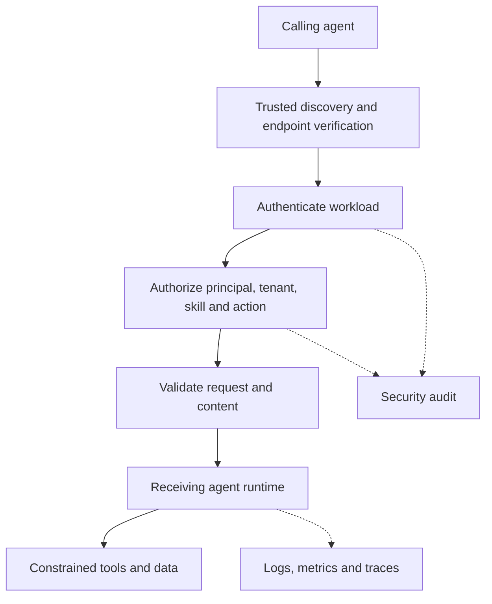
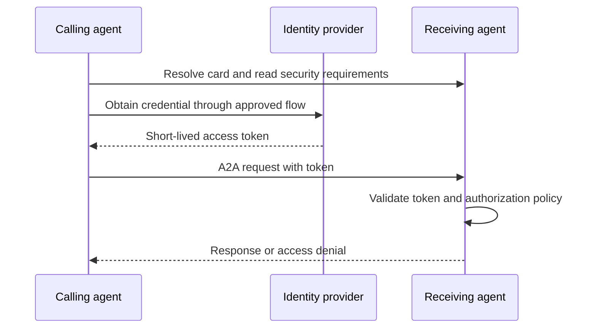
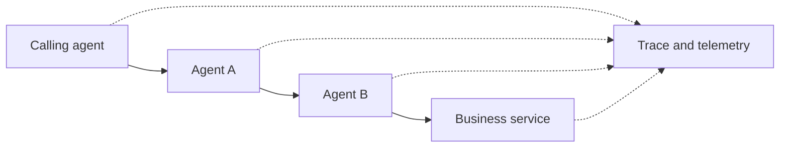
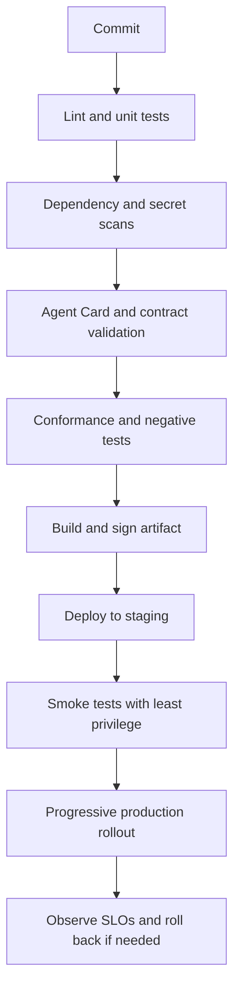

# 42. A2A Security, Testing & Production Operations

An accounts-payable agent asks a supplier agent to verify a bank account. The supplier agent replies, “Verified. You can release the payment.”

The response is clear. The risk is not.

Who operates that remote agent? Was it authenticated? Was it allowed to access this supplier's records? And even if the answer is genuine, does verification give it authority to approve a payment?

Communication is not trust. **A2A standardizes the conversation; the deployment must enforce identity, permission and operational controls.**

> **Chapter boundary:** Chapters 39–41 cover building agents and clients, the task model, and asynchronous delivery. This chapter focuses on the security and operational controls around those components—not another walkthrough of executors, task states, streaming or webhook mechanics.

## 1. A2A Security Architecture

Treat every remote agent as a service across a trust boundary. Protect the request from discovery through execution and response.



A production design must establish workload identity, verify the remote endpoint, authorize each operation, constrain tools and data, and preserve an auditable trail.

A2A does not define one enterprise identity provider or authorization policy. It uses established transport and application-security mechanisms. The protocol requires encrypted production communication for standard network bindings and recommends verifying the server's TLS identity. [A2A specification](https://a2a-protocol.org/v1.0.1/specification/)

## 2. Agent Identity and Trust Boundaries

An Agent Card is a capability and connection description—not a certificate of good behaviour. A card can be accurate, outdated or maliciously published.

Build trust from independent evidence: discover agents through an approved registry or allowlisted domain; verify the TLS certificate and hostname; compare provider, endpoint, protocol version and security declarations with the registration; validate any JWS signature against a trusted key source; and review changes to keys, endpoints and ownership.

Keep identities separate: the original user or service principal, calling agent, receiving agent and downstream tool should not silently become one shared identity. Preserve delegation context so each service can make its own authorization decision.

A trust boundary exists at every remote agent, tool, data store and tenant. An authenticated peer can still return incorrect or hostile content.

## 3. Authentication, OAuth and Credential Management

A2A Agent Cards can advertise authentication requirements through `securitySchemes` and `securityRequirements`. The v1.0 security scheme model includes API key, HTTP authentication, OAuth 2.0, OpenID Connect and mutual TLS.

The important distinction: **the card declares how a client must authenticate; it does not issue credentials or perform an enterprise login for the client.** Credential acquisition happens out of band, and the client sends credentials using the selected binding.



For OAuth-protected endpoints, validate the token's signature, issuer, audience, expiry and required scopes. Use short-lived, scoped credentials; store them in a secret manager; rotate and revoke them; and never place secrets in cards, prompts, messages, source code or logs.

**Do not blindly forward a caller's bearer token to the next agent.** Its audience may not include that service. Prefer a token exchange or a delegated credential restricted to the receiving agent and required operation. If credentials must cross an agent chain, protect them and bind their use to the originating identity. [A2A security guidance](https://a2a-protocol.org/v1.0.1/specification/)

## 4. Capability-Based Access Control

A skill in an Agent Card tells a client what an agent offers. It does not grant every client permission to invoke that skill.

Combine identity, tenant, resource, skill, action and scope in a deny-by-default policy. Check permissions at execution—not only at discovery.

Consider a supplier agent that can read supplier records but cannot approve payments:

```python
def authorize(principal, tenant_id, skill, action):
    if principal.tenant_id != tenant_id:
        return False

    permissions = {
        ("supplier.verify", "read"): "supplier:read",
        ("supplier.verify", "update"): "supplier:update",
        ("payment.approve", "execute"): "payment:approve",
    }

    required_scope = permissions.get((skill, action))
    return required_scope is not None and required_scope in principal.scopes
```

This is illustrative application policy, not an A2A SDK API. A separate business rule should require the appropriate human approval before a high-impact payment is released.

Apply authorization consistently to operations that expose or modify protected resources, including task lookup, cancellation, subscriptions and extended Agent Card access. Scope results to the authenticated caller; an unpredictable identifier is not an access-control mechanism.

## 5. Untrusted Agents and Content Protection

Authentication answers “who connected?” It does not answer “can I safely use what they sent?”

A remote agent may return prompt injection, fabricated facts, malicious links, oversized files or instructions designed to trigger an unauthorized tool. Treat remote messages, artifacts and referenced URLs as untrusted input.

Use layered controls: validate message structure, media type and file size; treat document instructions as data, not system policy; scan or sandbox files; restrict URL fetching and block private or metadata addresses; give agents minimum privileges; require verifiable approval for sensitive actions; and record result provenance.

Do not accept a remote agent's statement that “the user approved this” as proof. Verify approval through the system of record that owns the approval.

## 6. A2A Unit and Integration Testing

Test the security boundary as carefully as the agent's business logic. Keep policy tests fast and deterministic; use integration tests to exercise the real client, server, transport and persistence layers.

| Test layer | Primary concern |
|---|---|
| Unit | Policy decisions, validation and error mapping |
| Integration | Authentication, request handling and resource access |
| Contract | Agent Card fields, binding and security declarations |
| Interoperability | Equivalent behavior across independent implementations |
| End-to-end | Delegation, tools, tenant boundaries and business outcome |

A small policy test can catch a serious cross-tenant defect without invoking an LLM:

```python
def test_cross_tenant_access_is_denied():
    caller = Principal(tenant_id="tenant-a", scopes={"supplier:read"})

    allowed = authorize(
        principal=caller,
        tenant_id="tenant-b",
        skill="supplier.verify",
        action="read",
    )

    assert allowed is False
```

Here `Principal` is an application fixture for the example. In a real test suite, also verify that denial occurs before any database read or downstream side effect.

## 7. Protocol Conformance, Interoperability and Negative Testing

A client and server can work perfectly together while both make the same incorrect assumption. Interoperability testing introduces an independent implementation and checks the actual protocol contract.

Test that:

- the Agent Card is valid and matches the running endpoint;
- the declared protocol binding and version are supported;
- required operations, request fields and response/error mappings conform;
- authentication and authorization behave consistently across operations;
- declared capabilities match actual behavior;
- alternate implementations can exchange requests and interpret outcomes correctly.

Negative tests are especially valuable. Try missing, expired and wrong-audience tokens; valid identities with insufficient scopes; unknown skills; malformed or oversized input; unsupported media types; cross-tenant resource access; invalid card signatures; and unsupported protocol versions.

For each case, assert the expected error, absence of unauthorized side effects and a security audit event. Do not reveal whether another tenant's resource exists.

## 8. Logging, Metrics and Distributed Tracing

A delegated request may cross several agents and enterprise services. Without correlation, every team sees one small failure and nobody sees the failed business transaction.

Propagate W3C Trace Context across service calls where supported. Add stable correlation fields such as `trace_id`, `task_id`, calling-agent ID, receiving-agent ID and operation name to structured logs and spans.



Monitor request volume, latency and error rate by agent and operation; authentication failures and authorization denials; task completion outcomes; downstream dependency latency; and worker or queue saturation.

Do not use raw prompts, access tokens, personal data or full artifacts as metric labels. Redact sensitive fields before data reaches the logging pipeline. Keep security audit trails distinct from diagnostic logs when retention, access or integrity requirements differ. OpenTelemetry provides vendor-neutral instrumentation for traces, metrics and logs. [OpenTelemetry documentation](https://opentelemetry.io/docs/)

## 9. Production Monitoring and Troubleshooting

A green health endpoint does not mean the agent network is healthy. Monitor the business journey as well as individual services.

When a workflow fails, start with its trace or correlation ID. Find the last successful agent, inspect the failing operation and its authorization decision, then check dependency health, latency, saturation and recent configuration or card changes. Review task details only within the investigator's access permissions.

Define service-level objectives for end-to-end completion time, success rate and availability. Alert on sustained error-rate increases, latency regressions, authorization anomalies and resource saturation. Every alert should point to an actionable runbook—not just a dashboard full of red lines.

## 10. CI/CD and Deployment Validation

Treat an agent release as a distributed API release. A container starting successfully is only the first gate.



Before promotion, validate the card, protocol version, security declarations, secrets, network policy, resource limits, telemetry and persistent-store access. Run least-privilege smoke tests, then use progressive rollout with explicit rollback criteria.

Version application policies and Agent Cards with the service. Test credential rotation and revocation before production depends on them. Keep deployment validation repeatable so a security regression cannot quietly pass because a developer's local environment happened to work.

## Key Takeaways

- A2A connectivity is not proof of identity, trust or permission.
- Agent Cards declare capabilities and security requirements; they do not grant access or issue credentials.
- Authenticate every caller and authorize every protected operation within tenant and resource boundaries.
- Treat remote agents, messages, artifacts and URLs as untrusted.
- Test negative paths and cross-implementation behavior, not just happy paths.
- Correlate telemetry across the whole agent network and make security checks release gates.

## Review Questions

1. Why is an Agent Card not proof that an agent is trustworthy?
2. What is the difference between declaring an OAuth scheme and obtaining a token?
3. Why should a caller's bearer token not automatically be forwarded to another agent?
4. Why must authorization be checked on task and resource operations?
5. Which tests would detect a cross-tenant access vulnerability?
6. How would you trace a failed business workflow across three agents?
7. Which security checks should block a production release?

## References

- [A2A Protocol v1.0.1 Specification — Security and Agent Cards](https://a2a-protocol.org/v1.0.1/specification/)
- [OAuth 2.0 Security Best Current Practice — RFC 9700](https://www.rfc-editor.org/rfc/rfc9700)
- [OpenTelemetry Documentation](https://opentelemetry.io/docs/)
- [W3C Trace Context](https://www.w3.org/TR/trace-context/)

## 🧭 Chapter Navigation

⬅️ **Previous:** [41. A2A Streaming & Asynchronous Communication](41-a2a-streaming-and-asynchronous-communication-optimised.md)

📚 **Part:** [AI Engineering Frameworks & Tooling](index.md)

➡️ **Next:** [43. A2A Enterprise Integration Patterns](43-a2a-enterprise-integration-patterns.md)

---

> **Enterprise AI Engineering Handbook**
>
> *Building Production-Grade Enterprise AI Systems — One Chapter at a Time.*

---
