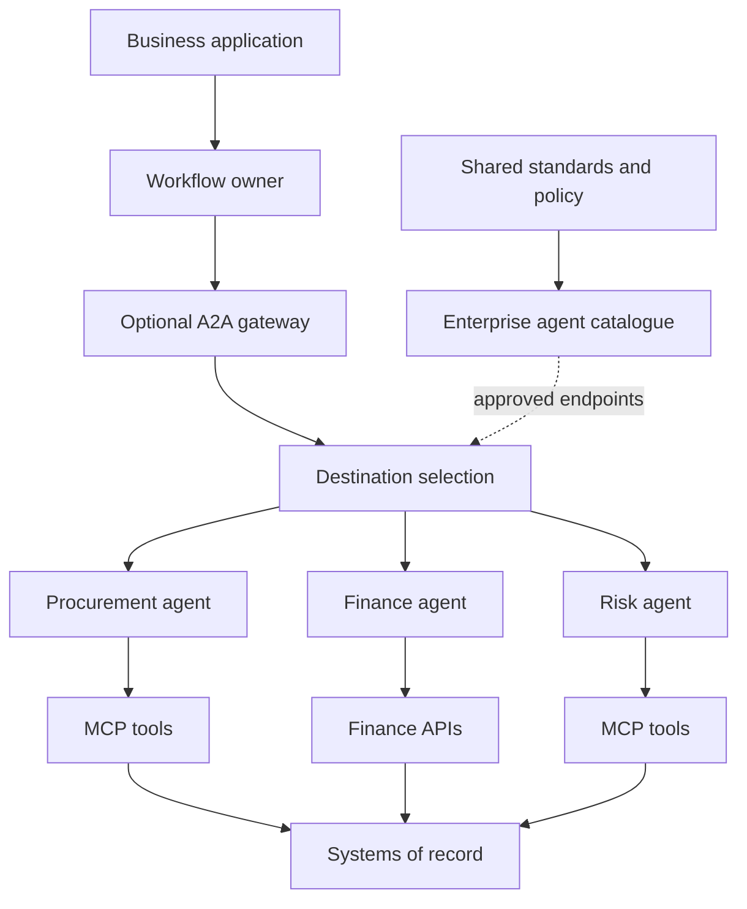
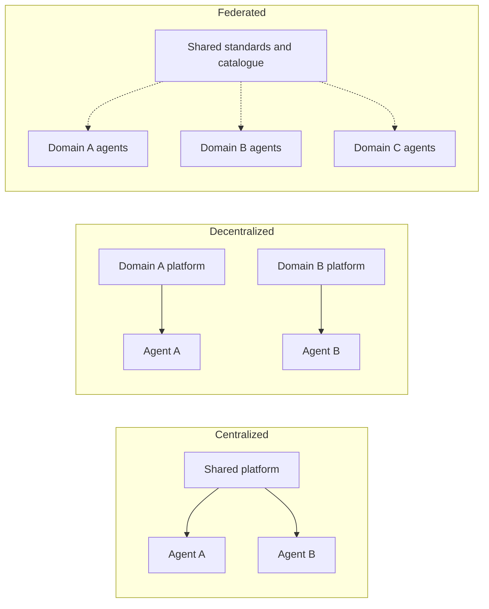
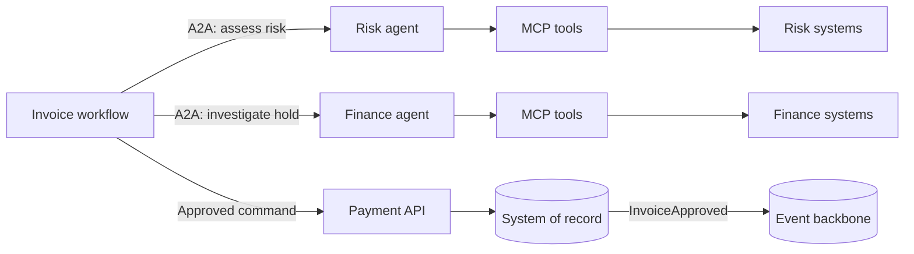
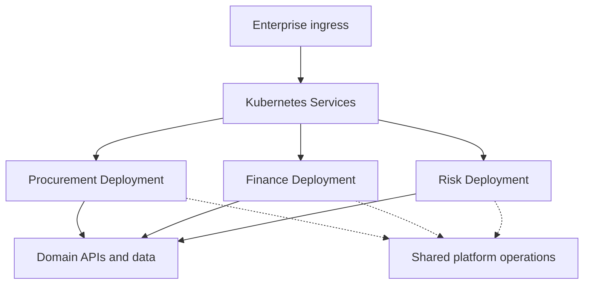

# 43. Enterprise A2A Architecture & Design Patterns

Imagine a customer asks: **“Why is my supplier invoice on hold, and when will it be paid?”**

The answer crosses three teams. Procurement knows the supplier relationship. Finance knows the invoice status. Risk knows whether a compliance review is blocking payment.

Each team has its own agent. They use different models, services and release cycles. Simply giving each agent an endpoint does not create a dependable enterprise system. Someone still has to decide who owns the workflow, how agents are selected, where business authority lives and what happens when teams change their services.

That is the real job of enterprise A2A architecture.

This final A2A chapter focuses on **system topology, organizational ownership and integration boundaries**. It does not repeat Agent Card fields, protocol message handling, task-state mechanics, authentication configuration, testing procedures or operational telemetry. Those are separate engineering concerns.

## 1. The enterprise reference architecture

A useful design separates two responsibilities:

- **Control plane:** approved agent catalogue, ownership, lifecycle metadata and shared policies.
- **Collaboration plane:** workflow coordination and A2A calls between domain agents.

The control plane helps the enterprise know which agents exist and who is accountable for them. The collaboration plane lets those agents perform work. Keep the distinction logical; it does not mean every box needs its own microservice.



The workflow owner decides what the business process needs. The router selects an eligible destination. Each domain agent remains responsible for its own capability. Systems of record remain authoritative for customer, supplier, payment and inventory data.

**Architecture rule:** agents may investigate, interpret and recommend; they should not quietly become competing systems of record.

## 2. Centralized, decentralized or federated?

Enterprises usually land somewhere between two extremes.

| Model | What it looks like | Main trade-off |
|---|---|---|
| Centralized | One platform team operates most agents | Consistency, but possible bottlenecks |
| Decentralized | Each domain owns its agents and infrastructure | Autonomy, but uneven standards |
| Federated | Shared standards; domains own execution | Balance, but requires clear contracts |



For many large organizations, federation is the practical target: central teams provide reusable infrastructure and minimum standards; domain teams own business logic, data access and releases.

Centralize what benefits from consistency—identity integration, catalogue conventions, policy baselines and shared platform services. Decentralize what requires domain knowledge—agent behavior, business rules and domain data. Avoid turning the central platform team into an approval queue for every prompt or release.

## 3. Registry, gateway and router: three different jobs

These components are often collapsed into one vague “agent platform” box. Keep their responsibilities distinct.

- **Registry:** records approved agent metadata, owner, environment, lifecycle and published contract location.
- **Gateway:** provides an optional shared ingress point for common transport and platform controls.
- **Router:** chooses an eligible destination for a particular request.

A registry record is enterprise metadata, not a replacement for the agent's published A2A contract:

```json
{
  "agent_id": "finance.invoice-review",
  "owner": "finance-platform",
  "environment": "production",
  "domain": "finance",
  "lifecycle": "active",
  "contract_url": "https://finance.example.com/.well-known/agent-card.json"
}
```

A catalogue can help answer “who owns the invoice agent?” It cannot answer “is this caller authorized to release a payment?” Discovery and business authorization are separate decisions.

A gateway is useful when many consumers need a consistent entry point. It is not mandatory for every deployment, and it should not become a hidden workflow orchestrator. Keep business sequencing in the workflow owner; keep destination selection in the router.

## 4. Design around domain ownership

Organize agents around business capabilities, not around prompts, model vendors or individual database tables.

| Domain agent | Owns this capability | Does not automatically own |
|---|---|---|
| Procurement | Supplier onboarding and procurement assessment | Finance payment approval |
| Finance | Invoice investigation and finance interpretation | Supplier risk policy |
| Risk | Risk assessment and compliance findings | Final procurement workflow |

A domain agent should expose a stable capability while keeping its internal model, prompts and tools private. If two proposed agents share the same data, owner, release cadence and operational team, they may be better kept as capabilities inside one service. Distributed architecture has a cost; do not create a network boundary just to make a diagram look more sophisticated.

For cross-company collaboration, add an explicit partner boundary. Agree on the exposed capability, data purpose, contract version, support owner and service expectations. Share only the information required for that interaction—not internal prompts, unrestricted tools or the enterprise-wide agent catalogue.

## 5. Delegate work without delegating accountability

Return to the invoice example. Procurement asks Finance to investigate the hold. Finance owns the investigation it accepts, but Procurement remains accountable for the supplier workflow. A returned answer is evidence for the next decision, not automatic permission to perform it.

A useful delegation contract makes the boundary explicit:

```python
from dataclasses import dataclass

@dataclass
class Delegation:
    task: str
    business_context: str
    expected_result: str
    allowed_actions: tuple[str, ...]
    deadline_seconds: int

invoice_review = Delegation(
    task="investigate_invoice_hold",
    business_context="supplier_id=SUP-204; invoice_id=INV-881",
    expected_result="reason, evidence, recommended_next_step",
    allowed_actions=("read_invoice", "read_payment_status"),
    deadline_seconds=45,
)
```

This is an application-level contract, not an A2A protocol type. Its purpose is to make scope and authority reviewable. Notice what is absent: permission to release funds. Separate investigation from irreversible execution, and route consequential actions through the system and approval process that own them.

## 6. Choose the right integration boundary

A2A is one part of the enterprise integration toolbox—not a replacement for all of it.

| Need | Prefer | Example |
|---|---|---|
| Delegate reasoning to an independently operated agent | A2A | Ask Risk to assess a supplier |
| Give an agent access to tools or context | MCP | Let Finance query approved invoice tools |
| Perform a deterministic business operation | Enterprise API | Retrieve invoice status or submit an approved payment |
| Distribute a committed business fact | Event backbone | Publish `InvoiceApproved` |
| Coordinate known steps and approvals | Workflow orchestration | Enforce the invoice review sequence |



A useful pattern is **A2A between independently owned domain agents, MCP inside each agent, APIs for deterministic commands and events for durable facts**. The workflow may use several mechanisms; choose the boundary for each interaction rather than forcing the whole process onto one protocol.

## 7. Deployment topology and scaling

A2A does not require Kubernetes. A small system may run agents as ordinary services. Kubernetes becomes useful when independent scaling, controlled rollout and placement across failure domains justify its operational cost.



Scale the dependency chain, not just the agent pods. A model provider, specialist agent, shared gateway or downstream system may be the real bottleneck. Keep durable workflow state outside replaceable compute instances and avoid making a shared catalogue or gateway an accidental single point of failure. Detailed timeout, retry, idempotency and monitoring design belongs in production operations, not in this topology overview.

## 8. A practical architecture review

Before onboarding another domain, ask:

1. Is this genuinely an independently owned capability?
2. Who owns the agent, its data and its business result?
3. Is the registry metadata current, and is the contract published separately?
4. Does the gateway, router and workflow owner each have one clear job?
5. Are A2A, MCP, APIs and events used for the right responsibilities?
6. Can the business process continue or fail safely when a dependency is unavailable?
7. Is Kubernetes solving a real scaling or availability need, or adding unnecessary complexity?

If these answers are unclear, adding more agents will multiply the ambiguity.

## Key takeaways

- Federation combines shared enterprise standards with domain-owned agents.
- Registries manage enterprise ownership and lifecycle; Agent Cards publish the agent contract.
- Gateways, routers and workflow owners solve different problems.
- Delegate bounded work, but keep business accountability explicit.
- Use A2A for agent collaboration, MCP for tools, APIs for commands and events for durable facts.
- Scale the complete dependency graph, not only the agent runtime.

## Further reading

- [A2A Protocol Specification](https://a2a-protocol.org/latest/specification/)
- [A2A Agent Cards](https://a2a-protocol.org/latest/specification/agent-card/)
- [Microsoft: Multi-Agent Architecture Patterns](https://learn.microsoft.com/en-us/agents/architecture/multi-agent-patterns)
- [Kubernetes: Production Environment](https://kubernetes.io/docs/setup/production-environment/)

## What comes next?

A2A gives independently operated agents a way to collaborate. The next question is how we build the agents themselves. We now move from protocol-level interoperability to framework-level engineering, beginning with **CrewAI**—its architecture, role-based agents, tasks, crews and orchestration model. The same enterprise principles still apply: clear responsibilities, bounded authority and explicit integration contracts.

## 🧭 Chapter Navigation

⬅️ **Previous:** [42. A2A Security, Testing & Production Operations](42-a2a-security-testing-production-operations-optimised.md)

📚 **Part:** [AI Engineering Frameworks & Tooling](index.md)

➡️ **Next:** [44. CrewAI Architecture & Core Concepts](44-crewai-architecture-and-core-concepts.md)


---

> **Enterprise AI Engineering Handbook**
>
> *Building Production-Grade Enterprise AI Systems — One Chapter at a Time.*

---
