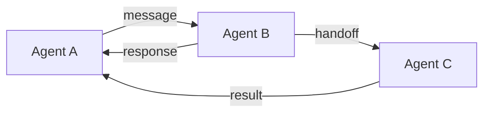
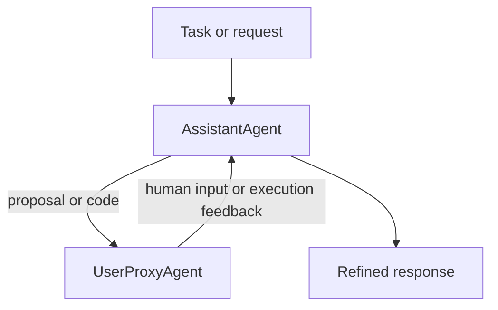
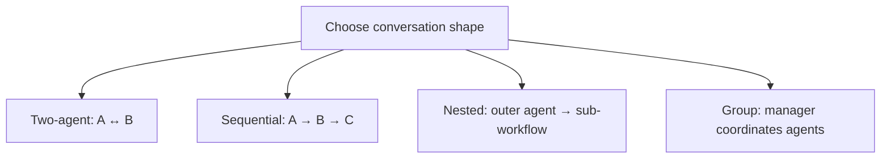
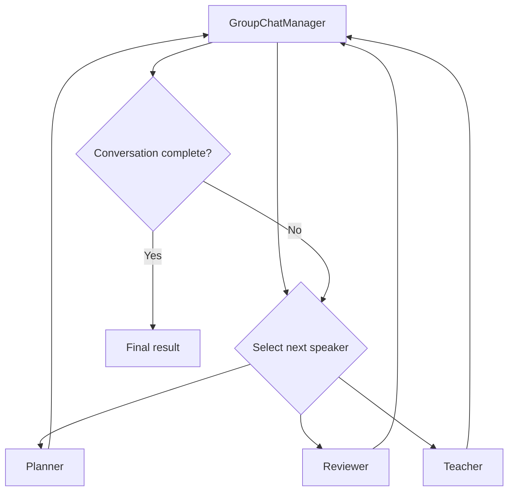

# 01. AutoGen / AG2 Architecture & Core Concepts

## Introduction

Imagine a small engineering team handling a production incident. One person investigates, another challenges the diagnosis, and a lead decides what happens next. The value is not simply that three people are involved. It is that each has a clear job and knows when to hand work over.

**AutoGen / AG2 brings that collaborative idea to AI agents.** Instead of asking one model to investigate, decide, execute, and review everything in a single prompt, developers can create agents with distinct responsibilities and let them communicate through conversations.

The defining idea is conversation-driven collaboration: agents exchange messages, use their assigned roles to contribute, and coordinate who acts next.

This chapter establishes the core vocabulary and architecture. It focuses on the conversational agent model, common agent roles, model configuration, and the main shapes of agent communication. Detailed workflow construction and advanced routing are deliberately left to the following chapters.

## 1. AutoGen and AG2: understand the API boundary

AG2 is the AutoGen-derived framework described in this section. Its examples use familiar conversational concepts such as `ConversableAgent`, `AssistantAgent`, `UserProxyAgent`, `GroupChat`, and `GroupChatManager`.

One naming detail matters: examples using the `autogen` namespace and examples using the newer `ag2` namespace may belong to different API generations. Do not assume their imports, constructors, or orchestration objects are interchangeable. Identify the package and version first, then use documentation for that API generation consistently.

For clarity, the examples below use the **Classic conversational API style**. They are teaching examples; confirm exact imports and supported parameters against the version installed in your environment.

## 2. The conversational agent: more than a prompt

A conventional LLM call usually follows a simple pattern:

```text
Application → Prompt → LLM → Response
```

A conversational agent participates in an ongoing exchange. It can receive a message, respond using its role and conversation context, and continue interacting with another agent.

In the Classic API, `ConversableAgent` is the foundational abstraction. It provides the message-based behaviour from which more specialised agent types are built.



An agent's behaviour is shaped by three core elements:

- **Name:** Identifies the participant in the conversation.
- **System message:** Defines its role, responsibilities, and behavioural boundaries.
- **LLM configuration:** Specifies the model and provider settings used when the agent needs model-generated responses.

Conversation history supplies the context for the next exchange. Two agents can use the same model and still behave differently because their instructions and responsibilities differ.

### A small example: student and tutor

```python
from autogen import ConversableAgent

student = ConversableAgent(
    name="student",
    system_message="Ask focused questions about machine learning.",
    llm_config=llm_config,
    human_input_mode="NEVER",
)

tutor = ConversableAgent(
    name="tutor",
    system_message="Explain machine learning clearly with examples.",
    llm_config=llm_config,
    human_input_mode="NEVER",
)

student.initiate_chat(
    recipient=tutor,
    message="Explain how a neural network learns.",
    max_turns=4,
    summary_method="reflection_with_llm",
)
```

The student starts the exchange; the tutor responds; and the conversation can continue within the configured limit. The optional reflection summary turns the exchange into a concise result. The important architectural point is the interaction between two role-defined participants—not the specific subject they discuss.

## 3. Assistant and user-proxy agents: different responsibilities

Two familiar agent types make the separation of responsibilities easier to see.

| Agent | Main responsibility | Typical contribution |
|---|---|---|
| `AssistantAgent` | AI reasoning and response generation | Analyses a request, explains a concept, or proposes code |
| `UserProxyAgent` | Human-facing participation and optional execution | Collects human input, can execute configured code, and returns feedback |

Think of the assistant as the engineer proposing a change and the proxy as the participant who can provide feedback or carry out a configured execution step.



A `UserProxyAgent` does **not** automatically provide a secure execution environment. Execution requires explicit configuration. The example in the source material uses a local command-line executor to run generated Python code and return the result to the assistant. Treat generated code as untrusted: isolate the execution environment and restrict filesystem, network, and process permissions before enabling it.

The practical lesson is to keep proposing and executing separate. An agent that can generate a command should not automatically receive unrestricted permission to run it.

## 4. Model configuration and system messages

Agents need a model configuration when their responses are generated by an LLM. AG2 examples use `LLMConfig` to define model and connection settings. A shared configuration can be applied to several agents, while individual agents can use different configurations when their tasks require it.

A simplified configuration shape looks like this:

```python
import os
from autogen import LLMConfig

llm_config = LLMConfig({
    "config_list": [
        {
            "model": "YOUR_MODEL_NAME",
            "api_key": os.environ["LLM_API_KEY"],
        }
    ],
    "temperature": 0.0,
})
```

The provider-specific fields depend on the model integration and installed package version. Keep credentials outside source code; use environment variables or a managed secret store.

The **system message** is just as important as the model choice. Compare these two role definitions:

```python
reviewer_role = (
    "Review proposed changes. Identify risks, missing tests, "
    "and unsupported assumptions. Do not implement the change."
)

developer_role = (
    "Propose a focused implementation for the requested change. "
    "Explain the files affected and the tests needed."
)
```

Both agents may use the same LLM, but they have different jobs. Good role definitions state what an agent should do—and, just as importantly, what it should not do.

## 5. Four ways agents can communicate

The right conversation pattern depends on the shape of the work. A direct exchange is often enough; a multi-stage task may need a sequence; and a collaborative discussion may need a shared group conversation.

| Pattern | How it works | Good fit |
|---|---|---|
| **Two-agent chat** | Two agents exchange messages through `initiate_chat()` | Question and answer, drafting, or review |
| **Sequential chat** | Multiple conversations run in order through `initiate_chats()`; outputs can carry forward | A known series of stages |
| **Nested chat** | `register_nested_chats()` places a sub-workflow behind a trigger agent | Reusable specialist work inside a larger task |
| **Group chat** | Several agents share a conversation coordinated by a manager | Work requiring multiple perspectives |



For example, a document can move from an ideation agent to a drafting agent and then to a formatting agent. That is naturally sequential. A curriculum planner that delegates subject-specific work to smaller teams is a better fit for a nested workflow. A support discussion involving triage, technical support, and general support agents may benefit from group chat.

These are not interchangeable ways to write the same workflow. Choose based on whether the work is direct, ordered, reusable, or collaborative.

## 6. Group chat: a shared conversation

In the Classic conversational API, group chat introduces two central components:

- **`GroupChat`:** Defines the participating agents and the conversation settings.
- **`GroupChatManager`:** Coordinates the shared conversation and manages speaker selection.

For a lesson-planning example, a planner drafts the material, a reviewer checks it, and a teacher coordinates the discussion.



Classic `GroupChat` examples describe four speaker-selection values:

| Setting | Behaviour |
|---|---|
| `auto` | The LLM selects the next speaker based on the conversation |
| `round_robin` | Agents take turns in a fixed order |
| `random` | A participant is selected randomly |
| `manual` | A human chooses the next speaker |

These are **Classic speaker-selection settings**. They should not be confused with the newer pattern-oriented API's classes such as `AutoPattern` and `RoundRobinPattern`. The latter belong to a different orchestration abstraction and are covered separately in Chapter 49.

## 7. Human input is an architectural choice

Agent autonomy is not an all-or-nothing decision. AG2's conversational examples use `human_input_mode` to control when a proxy requests human participation.

| Mode | Behaviour |
|---|---|
| `ALWAYS` | Requests human input at each response checkpoint |
| `NEVER` | Does not request human input during the exchange |
| `TERMINATE` | Requests human input when the agent reaches a termination point |

A learning assistant can often operate with `NEVER`. A bug-triage assistant may use `ALWAYS` when a person must approve each decision. `TERMINATE` can suit a workflow that runs through its steps and then asks a person to review the outcome.

Choose the mode according to the consequence of the action, not just the complexity of the task. A recommendation to close a production incident, change a customer record, or trigger a payment needs an approval boundary enforced by the application—not merely a polite instruction in a system message.

## Key takeaways

- AG2's conversational model treats agents as role-defined participants that exchange messages.
- `ConversableAgent` is the foundation; `AssistantAgent` and `UserProxyAgent` provide common specialised roles.
- `LLMConfig` and system messages shape how agents are configured and what responsibilities they perform.
- Two-agent, sequential, nested, and group conversations solve different coordination problems.
- Human input should be designed into the workflow wherever judgement or approval matters.
- Keep API generations distinct: Classic imports and speaker-selection values are not interchangeable with newer AG2 patterns.

## What comes next?

This chapter established the vocabulary; the next step is to put it to work. **Chapter 48, Building Conversational Multi-Agent Systems**, moves from architecture to implementation: defining practical agent roles, coordinating a support-style team, connecting an assistant to a code executor, and adding human approval and execution limits.

## 🧭 Chapter Navigation

⬅️ **Previous:** [03. CrewAI Advanced Engineering](../crewai-engineering/03-crewai-advanced-engineering.md)

📚 **Part:** [AI Engineering Frameworks & Tooling](../index.md)

➡️ **Next:** [02. Building Conversational Multi-Agent Systems](02-building-conversational-multi-agent-systems.md)


---

> **Enterprise AI Engineering Handbook**
>
> *Building Production-Grade Enterprise AI Systems — One Chapter at a Time.*

---
