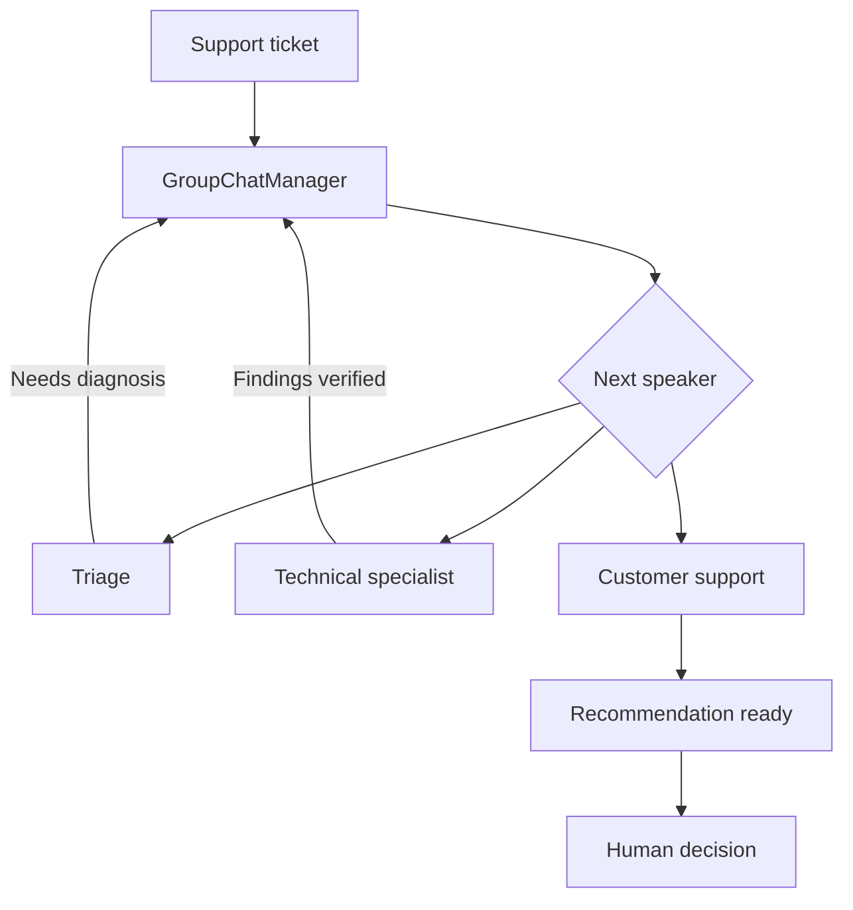
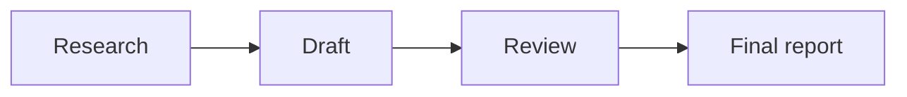
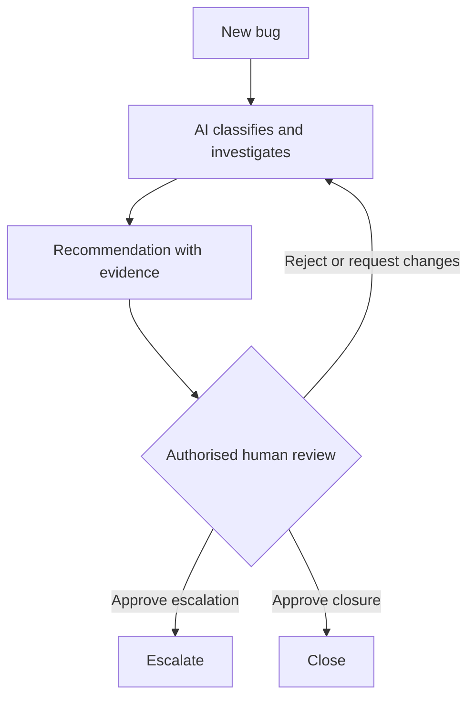

# 48. Building Conversational Multi-Agent Systems

## Introduction

Imagine a production incident at 2 a.m. One engineer classifies the alert, another investigates the service, a third checks the proposed fix, and an incident lead decides what happens next. Asking one person to do all four jobs is possible—but usually messy.

Multi-agent systems apply the same idea to AI. The trick is not to create the biggest team. It is to give each agent a useful responsibility, make handoffs understandable, and know when the conversation must stop. Otherwise, you have simply created a very expensive meeting.

Chapter 47 introduced AG2's conversational building blocks. This chapter puts those pieces to work in practical collaboration workflows.

> **API scope:** Examples use the AG2 Classic conversational API and its `autogen` import namespace (`GroupChat`, `GroupChatManager`, and `LocalCommandLineCodeExecutor`). The newer pattern-oriented API is a separate orchestration model covered in Chapter 49. Check imports and constructor arguments against the exact Classic release installed in your environment.

## 1. Design the team around the task

Start by mapping the work, not by counting agents. Each participant should have a distinct responsibility and a clear boundary.

For a support-ticket workflow:

| Participant | Owns | Should not |
|---|---|---|
| Triage agent | Classifies the issue and assesses severity | Claim that it fixed the issue |
| Technical agent | Investigates symptoms and proposes checks | Make customer commitments |
| Support agent | Communicates verified findings | Invent a technical diagnosis |
| Human reviewer | Approves escalation or closure | Approve without reviewing evidence |

A useful rule: if two agents have the same instructions and produce interchangeable outputs, they probably do not need to be separate agents.

## 2. Coordinate specialists with GroupChat

A `GroupChat` holds the participating agents and conversation settings. A `GroupChatManager` coordinates the discussion and selects the next speaker using the configured strategy.

The following example assumes `triage_agent`, `technical_agent`, `support_agent`, and `llm_config` have already been configured.

```python
from autogen import GroupChat, GroupChatManager

team_chat = GroupChat(
    agents=[triage_agent, technical_agent, support_agent],
    messages=[],
    max_round=8,
    speaker_selection_method="auto",
)

manager = GroupChatManager(
    groupchat=team_chat,
    llm_config=llm_config,
)

triage_agent.initiate_chat(
    manager,
    message=(
        "Investigate the checkout failure. "
        "Classify its severity, identify likely causes, "
        "and recommend the next action."
    ),
)
```

The manager coordinates turns; it does not guarantee that the agents agree or that their conclusions are correct. Give them a concrete objective and require an outcome: a recommendation, a decision, or an explicit blocker.

### Choose the speaker strategy deliberately

The Classic API offers four speaker-selection values:

- **`auto`** — the model selects the next speaker from the conversation. Useful when the next specialist depends on what has just been discovered.
- **`round_robin`** — participants take turns in a fixed order. Useful for predictable review cycles.
- **`manual`** — a person selects the next speaker. Useful when human direction is part of the workflow.
- **`random`** — selects a participant randomly. Better suited to exploratory participation than controlled operational processes.

For a support workflow, `auto` may be a sensible starting point. For a compliance review with mandatory stages, predictable transitions are usually preferable. These Classic string values are not the newer pattern classes such as `AutoPattern` or `RoundRobinPattern`; those belong to Chapter 49.



## 3. Use the right conversation shape

A shared group discussion is not always the best choice. Select the simplest interaction pattern that fits the work.

### Sequential workflow: fixed stages

When each stage has a known next step, `initiate_chats()` can chain conversations. The earlier exchange's result or summary can be carried into the next stage.

```python
results = coordinator.initiate_chats([
    {
        "recipient": researcher,
        "message": "Gather the key facts and cite the evidence.",
        "max_turns": 2,
    },
    {
        "recipient": writer,
        "message": "Draft the report from the research findings.",
        "max_turns": 2,
    },
    {
        "recipient": reviewer,
        "message": "Check the draft for gaps and unsupported claims.",
        "max_turns": 2,
    },
])
```



This is a good fit for document production, data preparation, or other workflows with stable stages. Validate the exact carryover and summary behaviour against your installed Classic version.

### Nested workflow: delegate a specialist sub-process

A nested chat uses `register_nested_chats()` to package a sub-workflow behind a trigger agent. The outer conversation can request a specialist result without managing every internal exchange.

```text
Project planner
      |
      v
  Nested workflow
   /          \
Data expert  Domain expert
   \          /
  Combined findings
      |
      v
Project planner
```

Use this when a sub-process is reusable or too detailed for the main conversation. Define its input and expected output clearly. The registration callback and chat-queue configuration are version-sensitive, so use the installed API's documentation rather than copying a partial callback from another release.

## 4. Generate code, then execute it deliberately

A practical AG2 demonstration pairs an assistant with a `UserProxyAgent` configured to execute generated code. The assistant proposes a Python script; the executor runs it; the result or error can be returned for another bounded attempt.

The example below configures a local executor. It assumes the assistant agent is created separately and paired with this proxy in the conversation.

```python
from pathlib import Path
from autogen import UserProxyAgent
from autogen.coding import LocalCommandLineCodeExecutor

work_dir = Path("agent_workspace")
work_dir.mkdir(exist_ok=True)

executor = LocalCommandLineCodeExecutor(
    work_dir=work_dir,
    timeout=30,
)

code_runner = UserProxyAgent(
    name="code_runner",
    human_input_mode="NEVER",
    code_execution_config={"executor": executor},
    max_consecutive_auto_reply=3,
)
```

A simple task prompt for the assistant might be: “Create a Matplotlib plot of `y = sin(x)` for values from 0 to 2π, label both axes, and save it as `sine_wave.png`.” The generated script could look like this:

```python
import numpy as np
import matplotlib.pyplot as plt

x = np.linspace(0, 2 * np.pi, 200)
y = np.sin(x)

plt.plot(x, y)
plt.xlabel("x")
plt.ylabel("sin(x)")
plt.title("Sine wave")
plt.savefig("sine_wave.png")
```

The executor's output tells the assistant whether the script succeeded or needs correction. This illustrates the feedback loop; it does not mean the script should be trusted merely because it ran.

**Important security distinction:** a working directory is not a sandbox. Local code runs with the permissions of the process and may access files, networks, or system resources available to it. Do not run untrusted generated code on a developer workstation or production host. Use an isolated container or VM, restricted credentials, network controls, resource limits, and approval gates appropriate to the task.

`max_consecutive_auto_reply` limits repeated automatic exchanges; it does not provide process isolation or replace the executor timeout.

## 5. Keep a human at consequential decision points

Consider a bug-triage assistant. It can classify an issue, estimate severity, and recommend escalation or closure. It should not silently make a consequential business decision simply because its conversation reached a confident-sounding conclusion.



Chapter 47 introduced the `ALWAYS`, `NEVER`, and `TERMINATE` human-input modes. Here, the key implementation lesson is that a conversational pause is not the same as business approval.

For consequential actions, the application should:

1. Present the proposed action and supporting evidence.
2. Authenticate the reviewer and check their authority.
3. Record the decision, reviewer, and timestamp.
4. Execute only after approval.
5. Recheck permissions and target state immediately before execution.

A prompt that says “ask a human first” is not an authorization mechanism.

## 6. Give every workflow a finish line

A multi-agent conversation can loop, repeat failed work, or consume tokens long after it has stopped producing value. Use explicit limits at the conversation and execution levels.

| Classic control | What it limits |
|---|---|
| `max_turns` | Turns in a two-agent conversation |
| `max_round` | Rounds in a group chat |
| `max_consecutive_auto_reply` | Consecutive automatic replies |
| `is_termination_msg` | A configured completion message, such as `DONE!` |
| Human exit | A user's ability to end an interactive session |

For code execution, also set a runtime timeout and an application-level deadline. Define what happens when a retry budget is exhausted: stop, return the error, or escalate. Do not let an agent endlessly rewrite and rerun the same failing script.

Newer pattern-based transitions, including `TerminateTarget` and custom reply-routing logic, are deliberately left to Chapter 49.

## 7. Match the pattern to the job

| Use case | Suitable shape |
|---|---|
| Support triage with several specialists | Group chat |
| Research, drafting, and review | Sequential conversations |
| Reusable domain-expert sub-process | Nested chat |
| Bounded calculations or visualisation | Assistant plus code executor |
| Bug escalation or closure | Human-supervised workflow |

Do not use a group chat just because the framework supports one. A two-agent exchange may be cheaper, faster, and easier to debug. Add participants only when they bring distinct expertise or a necessary control.

## Key takeaways

- Give agents distinct responsibilities and explicit handoff expectations.
- Use `GroupChat` when specialists need a shared discussion.
- Prefer sequential conversations for fixed stages and nested chats for reusable sub-processes.
- Treat generated code as untrusted and isolate its execution environment.
- Enforce human approval in application logic, not only in agent instructions.
- Bound conversations, retries, and execution time.

## What comes next?

We have built the conversational collaboration layer: specialists can share a discussion, pass work through stages, delegate nested tasks, and request human judgement. The next challenge is more precise control over *why* an agent gets the next turn and *what context* drives that decision. **Chapter 49 – Advanced Agent Orchestration & Workflow Design** moves into shared context, conditional and context-based routing, handoffs, fallback behaviour, and custom transitions.

## 🧭 Chapter Navigation

⬅️ **Previous:** [47. AutoGen / AG2 Architecture & Core Concepts](47-autogen-ag2-architecture-and-core-concepts.md)

📚 **Part:** [AI Engineering Frameworks & Tooling](index.md)

➡️ **Next:** [49. Advanced Agent Orchestration & Workflow Design](49-advanced-agent-orchestration-and-workflow-design.md)


---

> **Enterprise AI Engineering Handbook**
>
> *Building Production-Grade Enterprise AI Systems — One Chapter at a Time.*

---
