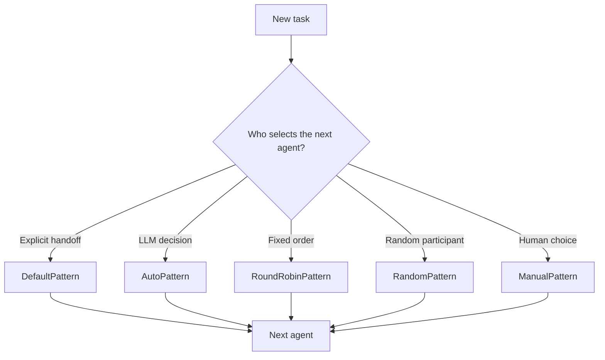
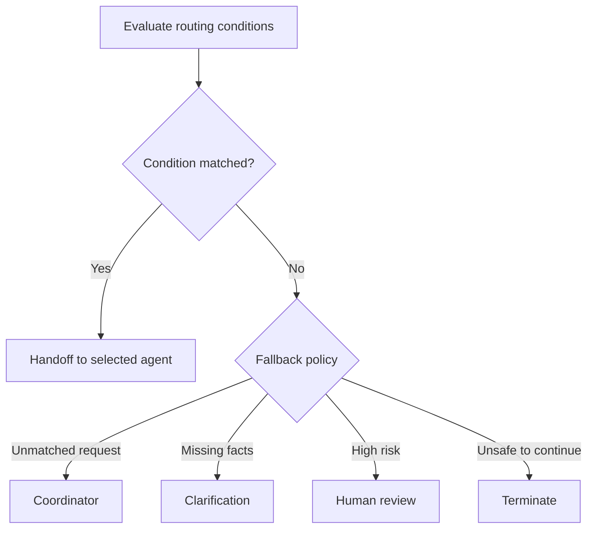
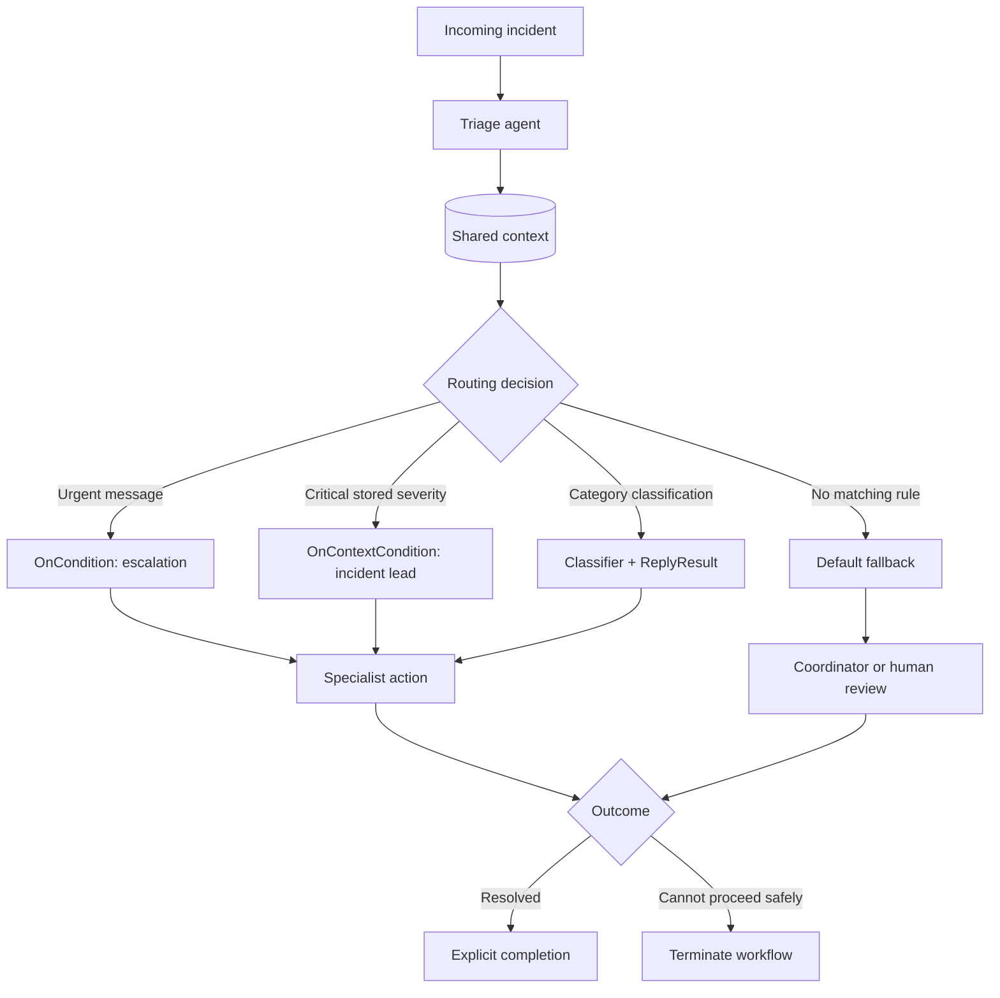

# 49. Advanced Agent Orchestration & Workflow Design

## Introduction

Imagine a production incident arriving at 2:13 a.m. The support agent recognises an outage. A technical agent confirms that several regions are affected. The severity changes from *medium* to *critical*. Should the workflow ask another agent to review the logs, notify the incident commander, or stop and request human intervention?

That is orchestration: deciding **who acts next, what information drives that decision, and how the workflow exits safely**.

Chapter 48 covered AG2 Classic conversations: group discussions, sequential and nested workflows, code execution, and human checkpoints. This chapter moves to AG2's pattern-oriented orchestration model—patterns, shared context, conditional routing, handoffs, and termination transitions.

> **API boundary:** `DefaultPattern`, `AutoPattern`, `OnCondition`, `ContextVariables`, and related constructs belong to the pattern-oriented AG2 API. They are not interchangeable with Classic `GroupChat` speaker-selection strings such as `"auto"` and `"round_robin"`. The examples below explain the control flow. Where the source does not provide a complete API signature, the code is explicitly conceptual; check the installed AG2 release for exact imports and parameters.

## 1. Choose the rule for selecting the next agent

A multi-agent workflow needs a turn-taking policy. AG2 describes five pattern types, each suited to a different level of control.

| Pattern | How the next participant is selected | Good fit |
|---|---|---|
| `DefaultPattern` | Agents make explicit handoffs | Predictable, rule-driven workflows |
| `AutoPattern` | An LLM selects the next speaker from context | Adaptive collaboration |
| `RoundRobinPattern` | Agents take turns in a fixed sequence | Status reviews and structured updates |
| `RandomPattern` | A random agent is selected, excluding the current one | Brainstorming and varied input |
| `ManualPattern` | A person chooses the next speaker | Human-directed workflows |

The right pattern depends on the consequence of a wrong turn. Random selection may be fine when collecting ideas; it is difficult to justify when a regulated workflow requires a specific reviewer before an action can proceed.



## 2. Keep workflow facts in shared context

Conversation history tells agents what has been said. Workflow context records facts that later decisions must use.

AG2's `ContextVariables` provides a shared key-value store for group workflows. It is accessible across agents and orchestration patterns and can persist across tool calls and interactions. But there is an important distinction: a stored value is **not automatically added to an LLM prompt**. If an agent needs to reason about a value, the application or workflow must explicitly provide it.

For the incident above, context might contain:

```python
# Conceptual illustration of shared workflow state
context = {
    "ticket_id": "INC-2048",
    "issue_severity": "medium",
    "affected_regions": ["eu-central"],
    "approval_required": False,
}

# Investigation updates the facts used by later routing decisions
context["issue_severity"] = "critical"
context["affected_regions"].append("ap-south")
context["approval_required"] = True
```

This dictionary illustrates the state model; it is not a claim about the exact constructor or mutation syntax of `ContextVariables` in every AG2 release.

A useful production rule is to treat shared context like an application contract: define the keys, types, allowed values, ownership, and update permissions. Do not make a critical routing decision depend only on a vague sentence buried in a long conversation.

## 3. Route using message meaning or stored facts

AG2 describes two conditional routing approaches. They sound similar, but they answer different questions.

- **`OnCondition`** evaluates the message or conversation condition using an LLM. Use it when the meaning of the request matters—for example, recognising that “all checkout requests are failing” describes an urgent outage.
- **`OnContextCondition`** checks values in `context_variables`. Use it when the workflow has already established a structured fact—for example, `issue_severity` is `critical`.

Here is the decision logic in simplified form:

```python
# Conceptual routing logic, not a version-specific AG2 snippet
if message_indicates_urgent_outage:
    next_agent = escalation_agent       # OnCondition
elif context["issue_severity"] == "critical":
    next_agent = incident_commander     # OnContextCondition
else:
    next_agent = support_agent         # default route
```

Prefer a structured context check when the fact is already known. Asking an LLM to rediscover a value that the application has reliably stored adds cost and creates another opportunity for an inconsistent decision.

## 4. Let a tool return a routing decision

Sometimes the next step should be selected by deterministic application logic rather than another round of agent discussion.

AG2 uses `ReplyResult` to structure a reply and guide the next step in a conversation. The source describes a classifier function that assesses a request and routes it to a finance or HR agent. Conceptually, the result carries both the classification and the transition:

```python
# Conceptual example: classifier outcome drives the handoff

def route_request(topic):
    if topic == "payroll":
        destination = finance_agent
    else:
        destination = hr_agent

    return ReplyResult(
        content={"classified_topic": topic},
        # The transition identifies the next workflow participant.
        transition=destination,
    )
```

This illustrates the role of `ReplyResult`, not a guaranteed constructor signature. The exact transition representation must match the AG2 version in use. The key design point is that a tool result can carry a control-flow decision as well as data. Chapter 50 covers tool registration and implementation; here, the concern is how a result influences orchestration.

## 5. Design the fallback before you need it

Routing rules are easy to write when every request fits a known category. Real systems are less cooperative: a condition may not match, a classifier may return an unfamiliar category, or no specialist may be suitable.

AG2 describes after-work or default routing for cases where no condition is met. Choose that behaviour deliberately:

- Send an understood but unmatched request to a coordinator.
- Ask for clarification when a required fact is missing.
- Escalate to a person when the decision is consequential or uncertain.
- Stop safely when the workflow cannot continue responsibly.



A fallback is not a loophole for broader access. If the finance specialist is unavailable, silently routing a payroll request to an agent with unrestricted access is not resilience—it is a permissions problem.

## 6. Make termination an explicit transition

A workflow should finish because it reached a defined outcome, not because the agents ran out of things to say. The pattern-oriented AG2 material identifies several ways to end control flow:

| Mechanism | Role in the workflow |
|---|---|
| `None` | No next agent is selected; the conversation halts |
| `TerminateTarget` | An explicit termination target used when no further handoff is possible |
| Custom reply `(True, None)` | Custom reply logic signals an intentional end |

Keep successful completion distinct from an inability to proceed. “Incident resolved” and “no authorised route available” are different outcomes and should be represented differently to the calling application.

Conversation limits and termination-message controls were covered in Chapter 48. This section is specifically about pattern-level transitions and how an orchestration path reaches its end.

## 7. Put the decisions together

The incident workflow now has a clear sequence: collect facts, update shared state, evaluate routing conditions, select a specialist, and use a defined fallback or termination path.



For a production implementation, record the reason for each handoff, validate context updates, and enforce permissions outside the LLM. A routing decision determines who should act next; it does not, by itself, authorise that agent to perform a business operation.

## Design checklist

Before shipping a pattern-oriented workflow, ask:

- Is the speaker-selection pattern appropriate for the risk and predictability of the task?
- Are shared context keys typed, validated, and updated by authorised components?
- Are language-based conditions separated from checks on known structured facts?
- Does every unmatched condition have a safe fallback?
- Can every path end explicitly, with success distinguishable from failure?
- Are handoffs observable and business permissions enforced by the application?

## Key takeaways

AG2's pattern-oriented model gives developers control over turn selection, shared workflow state, conditional routing, tool-driven transitions, and termination. The central engineering lesson is simple: make every handoff explainable, every fallback intentional, and every exit unambiguous.

## What comes next?

The workflow now knows how to choose its next agent and when to stop. The next engineering challenge is making the work performed during those transitions safe and dependable. **Chapter 50 – AG2 Tools, Structured Outputs & Production Engineering** will cover function registration and integrations, Pydantic contracts, input/output guardrails, secure configuration, reliability practices, and operational monitoring—without revisiting the orchestration patterns developed here.

## 🧭 Chapter Navigation

⬅️ **Previous:** [48. Building Conversational Multi-Agent Systems](48-building-conversational-multi-agent-systems.md)

📚 **Part:** [AI Engineering Frameworks & Tooling](index.md)

➡️ **Next:** [50. AG2 Tools, Structured Outputs & Production Engineering](50-ag2-tools-structured-outputs-and-production-engineering.md)


---

> **Enterprise AI Engineering Handbook**
>
> *Building Production-Grade Enterprise AI Systems — One Chapter at a Time.*

---
