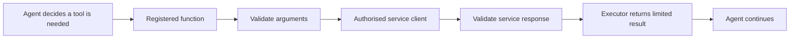
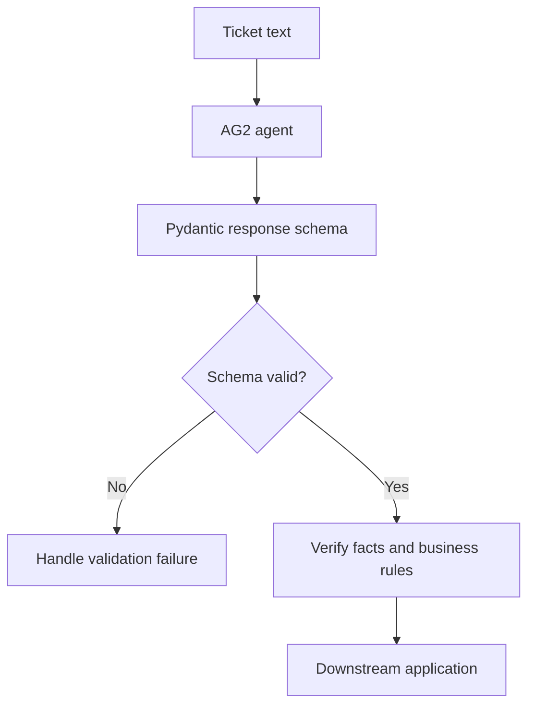
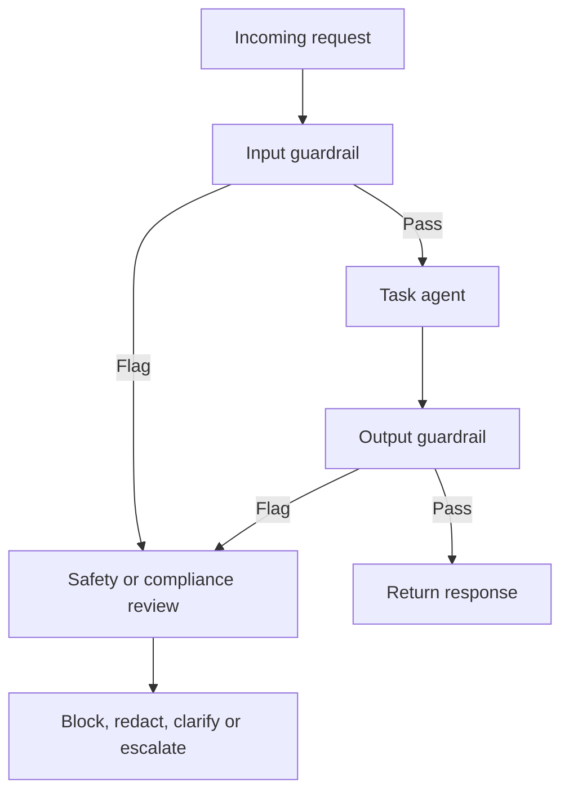
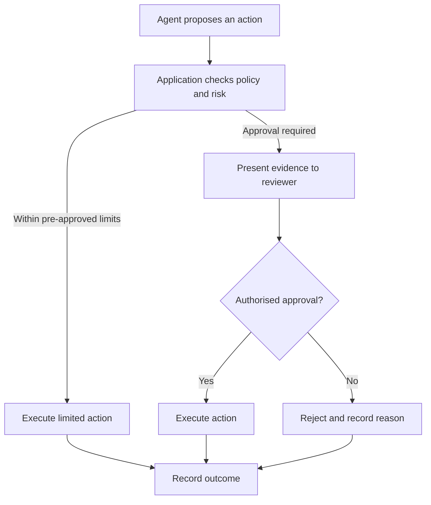

# 50. AG2 Tools, Structured Outputs & Production Engineering

## Introduction: when an agent can act, mistakes become operations

Imagine a customer writes: *“My order never arrived. Please refund me.”*

An assistant can explain the refund policy. A tool-enabled assistant can look up the order, check its delivery status, and start a refund workflow. That is a much more useful system—but it also creates a much bigger engineering responsibility.

A confident-sounding answer can be corrected. A duplicate refund, leaked API key, or unauthorised account change can become an incident.

This chapter focuses on the engineering boundary between an agent's decision and an application action. We will extend AG2 agents with tools, define reliable response contracts with Pydantic, apply guardrails, and add the operational controls needed around real integrations.

> **API scope:** Examples use the AG2/AutoGen Classic conversational-agent style, including `AssistantAgent`, `UserProxyAgent`, and `register_function`. Chapter 49 covers the separate pattern-oriented orchestration API. Confirm imports, provider options, and supported model features against the AG2 version pinned by your application.

## 1. Give the agent a tool—not the keys to the kingdom

An LLM can decide that it needs an order status. It should not be given unrestricted database access or a production credential and told to “figure it out.” Instead, expose a small function that performs one well-defined operation.

AG2's `register_function()` connects a **caller** to an **executor**:

- The caller decides when the function is relevant and requests the tool call.
- The executor runs the function and returns its result.

That separation makes it easier to review what the model may request and what the application will actually execute.

### A simple example: a deterministic calculation

The following example follows the tool-registration pattern: the assistant requests a primality check and a separate proxy executes it.

```python
from autogen import AssistantAgent, UserProxyAgent, register_function

math_asker = AssistantAgent(
    name="math_asker",
    llm_config=llm_config,
    system_message="Determine when a primality check is needed. Use the tool."
)

math_executor = UserProxyAgent(
    name="math_executor",
    human_input_mode="NEVER",
    code_execution_config=False
)

def is_prime(number: int) -> bool:
    """Return whether an integer is prime."""
    if number < 2:
        return False
    return all(
        number % divisor != 0
        for divisor in range(2, int(number ** 0.5) + 1)
    )

register_function(
    is_prime,
    caller=math_asker,
    executor=math_executor,
    name="is_prime",
    description="Check whether an integer is prime."
)
```

The important design choice is not the maths. It is the boundary: the model chooses whether to request the operation, while ordinary Python performs it. For business tools, keep the same separation and validate every argument inside the function. A tool description helps the model choose correctly; it is not a substitute for validation.

### Apply the same idea to a business API

A real tool might retrieve an order status. Keep the service client behind a narrow wrapper, and return only the fields the agent needs.

```python
from pydantic import BaseModel, Field

class OrderLookup(BaseModel):
    order_id: str = Field(pattern=r"^ORD-[0-9]{6}$")

class OrderStatus(BaseModel):
    order_id: str
    status: str
    delivered: bool


def get_order_status(order_id: str) -> dict:
    """Look up one order; do not modify customer or payment data."""
    request = OrderLookup(order_id=order_id)  # validates the identifier

    # order_service is an application-owned, authenticated client.
    raw = order_service.fetch_status(
        request.order_id,
        timeout=3.0,
    )

    result = OrderStatus.model_validate(raw)
    return result.model_dump()
```

`order_service` represents your own service client; it is deliberately not an AG2 API. In a deployed integration, handle timeouts and service errors explicitly, avoid returning raw exception details to the model, and apply least-privilege credentials. Prefer read-only tools until a business case genuinely requires write access.



**Engineering rule:** the agent may request an operation; the application decides whether that operation is valid and permitted.

## 2. Make model responses usable with Pydantic

Suppose the support workflow needs a ticket summary. One run returns a paragraph, another returns a list, and a third omits the urgency. Downstream code should not have to play detective every time.

AG2 supports structured output using a Pydantic model configured through `response_format` in `llm_config`. The schema makes the expected data contract explicit.

```python
from typing import Literal
from pydantic import BaseModel, Field

class TicketSummary(BaseModel):
    customer_name: str
    issue_type: str
    urgency: Literal["low", "medium", "high", "critical"]
    recommended_action: str = Field(
        description="A concise next step for the support team"
    )
```

Attach the schema to the model configuration:

```python
structured_llm_config = {
    **llm_config,
    "response_format": TicketSummary,
}

ticket_agent = AssistantAgent(
    name="ticket_summarizer",
    llm_config=structured_llm_config,
    system_message=(
        "Summarise the support ticket using the configured response schema. "
        "Do not invent customer details or claim an action has been completed."
    ),
)
```

The model/provider combination must support the configured response format. Test the complete request and parsing path with the exact AG2 version and model you deploy.

A schema improves consistency, enables type validation, and gives downstream services a predictable interface. It does **not** guarantee that the facts are correct or that the recommended action is safe. Validate important business facts against trusted systems, and authorise actions separately.

### Treat schemas as versioned interfaces

Once another service consumes `TicketSummary`, changing a field can break that consumer. Treat the schema like an API contract:

- Add optional fields before making them mandatory.
- Do not silently change the meaning of an existing field.
- Version breaking changes, for example with `TicketSummaryV2`.
- Provide meaningful validation errors and test representative payloads.
- Coordinate migrations with downstream consumers.

Pydantic gives the application a clear structure to validate. It does not remove the need for compatibility planning.



## 3. Add guardrails at the right boundaries

Structured output checks the shape of a response. Guardrails inspect content and help decide whether a conversation should continue normally or be redirected for review.

AG2 identifies two guardrail types:

| Guardrail | What it checks | Example |
|---|---|---|
| `RegexGuardrail` | Known text patterns | Detecting phone-number or sensitive-identifier patterns |
| `LLMGuardrail` | Meaning and context | Detecting unsafe or inappropriate content |

Guardrails can be placed on agent inputs or outputs. When a check detects a concern, control can be redirected to a safety or compliance agent.



Use regex checks for known patterns, not broad semantic judgement. LLM-based checks can interpret context but are probabilistic and can miss issues or flag safe content. Neither replaces application-level authorisation, access control, or validation at the service boundary.

The AG2 material identifies these guardrails and their input/output placement but does not specify complete constructor or registration signatures. The diagram therefore explains the control flow, not a copy-and-paste guardrail implementation.

## 4. Protect credentials and keep model configuration resilient

Never hard-code API keys in source files, notebooks, prompts, or committed configuration. Load credentials from environment variables or a managed secret store, and grant each integration only the permissions it needs.

AG2 model configuration can use a list of model configurations to support fallback options. The following illustrates the configuration idea; provider-specific fields and fallback behaviour must match your installed version and model clients.

```python
import os

llm_config = {
    "config_list": [
        {
            "model": "primary-model",
            "api_key": os.environ["PRIMARY_MODEL_API_KEY"],
        },
        {
            "model": "fallback-model",
            "api_key": os.environ["FALLBACK_MODEL_API_KEY"],
        },
    ],
    "temperature": 0.0,
}
```

A fallback is useful only when it is available, compatible with the task, and tested against the same response contract. The recommended temperature starting points are `0.0` for more consistent structured responses and `0.7–1.0` for creative work. Temperature does not guarantee determinism or factual accuracy.

## 5. Design for failure before production finds it for you

A tool that works once in a demo is not necessarily reliable. External services time out, providers throttle traffic, responses change, and networks fail. The tool wrapper—not the agent's repeated prompting—should own predictable failure handling.

For each integration:

- Set connection and response timeouts.
- Use bounded retries with backoff for transient failures.
- Respect rate limits and cap concurrent requests.
- Do not blindly retry non-idempotent operations.
- Return safe, structured error categories rather than raw stack traces.
- Validate both incoming arguments and external responses.

For a refund or payment operation, use an idempotency key so a retry cannot accidentally repeat the action. Log a correlation ID to connect the agent request to the service operation, but never log credentials or unnecessary sensitive payloads.

## 6. Put a human approval gate before consequential actions

A support agent may recommend a refund. That does not mean it should be able to issue one automatically. Define escalation criteria for high-impact decisions—such as a refund amount threshold, a change to account permissions, or a critical operational action.



Give the reviewer the relevant facts, the proposed action, the reason for escalation, and the consequences. Record the decision for auditability. Most importantly, enforce approval in the application or service that performs the action. A prompt that says “ask a human first” is not an authorisation mechanism.

Chapter 48 already explains AG2 human-input modes and conversational checkpoints. Here the focus is narrower: a business approval must be independently verified by the system executing the operation. Likewise, code execution needs isolated environments, restricted credentials, resource limits, and network controls; a working directory alone is not a security sandbox.

## 7. Test the complete path and observe what happens

Test the tool and the workflow—not just the final answer. A practical test set should include:

| Area | Cases to exercise |
|---|---|
| Tool contract | Valid, malformed, missing, and boundary-value inputs |
| Service reliability | Timeout, rate limit, unavailable dependency, malformed response |
| Structured output | Valid schema, missing field, invalid enum value |
| Guardrails | Sensitive input, unsafe output, false positive and false negative |
| Approval | Approved, rejected, expired, and unauthorised request |
| Recovery | Retry exhaustion, fallback model, duplicate-action prevention |

The source emphasises monitoring conversation quality and logging human interventions. As an operational extension, capture structured events for tool name, execution result, latency, retry count, provider, guardrail outcome, approval decision, and correlation ID. Use metrics and traces to identify slow dependencies, repeated failures, unusual tool-call volume, and workflows that frequently need human intervention. Redact secrets and sensitive data before anything reaches a log sink.

A sensible rollout sequence is to unit-test tools, contract-test schemas and APIs, simulate dependency failures, exercise approval and denial paths, and run end-to-end tests in a controlled environment before enabling real business actions.

## Production readiness checklist

- [ ] Every tool has one focused purpose and a documented contract.
- [ ] Caller and executor responsibilities are explicit.
- [ ] Inputs and external responses are validated.
- [ ] Pydantic schemas are versioned and tested with downstream consumers.
- [ ] Input/output guardrails address the relevant risks.
- [ ] Credentials are managed securely and permissions follow least privilege.
- [ ] Timeouts, rate limits, bounded retries, and fallbacks are tested.
- [ ] Non-idempotent actions cannot be duplicated by retries.
- [ ] Consequential actions require independently verified approval.
- [ ] Tool failures and human interventions are observable without exposing secrets.

## Key takeaways

AG2 tools let agents request real operations. Pydantic gives their outputs a contract. Guardrails add content checks. Production controls protect the boundary between a model's proposal and an action performed by your application.

The goal is not to let an agent do everything. It is to give it narrowly scoped capabilities—and make sure ordinary software still validates, authorises, executes, and records every consequential operation.

## What comes next?

You have now covered the controls around AG2 tools, structured data, and production execution. The next chapter moves to another integration boundary: **Chapter 51 – Building MCP Servers**.

## 🧭 Chapter Navigation

⬅️ **Previous:** [49. Advanced Agent Orchestration & Workflow Design](49-advanced-agent-orchestration-and-workflow-design.md)

📚 **Part:** [AI Engineering Frameworks & Tooling](index.md)

➡️ **Next:** [51. Building MCP Servers](51-building-mcp-servers.md)

---

> **Enterprise AI Engineering Handbook**
>
> *Building Production-Grade Enterprise AI Systems — One Chapter at a Time.*

---
