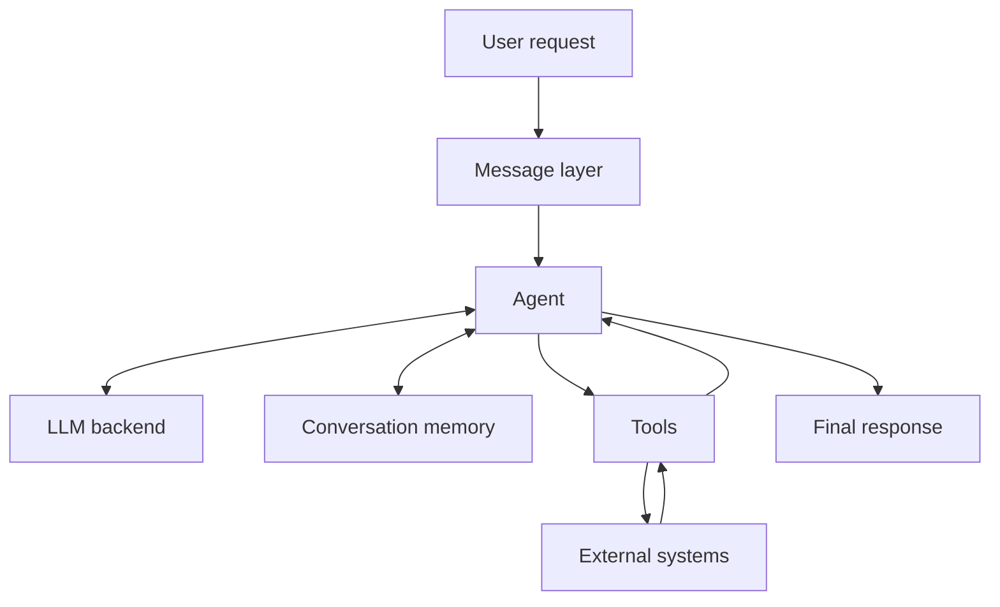

# 01. BeeAI Architecture & Agent Development

> **Framework foundations, architecture and core agent development**

An LLM can explain how an order-processing system works. But can it remember the conversation, follow your application’s rules, and help complete a task consistently?

That is where an agent framework earns its place.

The **BeeAI Framework** gives developers reusable components for model access, messages, prompts, memory, and agent execution. Instead of wiring every interaction by hand, you work with a set of building blocks designed to fit together.

This chapter builds the foundation: what belongs to the BeeAI ecosystem, how the framework is structured, and how to create a first agent. Tool policies, reasoning controls, human approval, handoffs, and production operations are deliberately left to Chapters 52 and 53.

## 1. The BeeAI ecosystem: framework or platform?

First, separate the two names:

- **BeeAI Framework** is the developer framework used to build agents and multi-agent applications.
- **Agent Stack** is the infrastructure for deploying, hosting, sharing, and running agents. It was previously called **BeeAI Platform**.

Agent Stack is designed to host agents built with different frameworks, not just BeeAI Framework. That distinction matters when an organisation has teams using different agent technologies.

| Question | BeeAI Framework | Agent Stack |
|---|---|---|
| Main job | Build agent behaviour | Host and operate agents |
| Typical components | Models, messages, memory, tools, agents | Runtime, hosting, UI, CLI, infrastructure |
| Developer concern | How should the agent work? | How will people access and run it? |

Think of the Framework as the application-building layer and Agent Stack as one deployment option. They complement each other; one does not replace the other.

**Enterprise design tip:** keep agent logic separate from deployment infrastructure. That gives you room to move the runtime later without rebuilding the application from scratch.

## 2. BeeAI Framework architecture

Follow one request through the system: an employee asks about a delayed customer order.



Each component has a distinct responsibility:

| Component | What it does |
|---|---|
| Backend | Provides a consistent interface to supported chat and embedding models |
| Messages | Represent system instructions, user input, assistant output, and tool results |
| Agent | Coordinates model interaction, memory, tools, and execution |
| Memory | Retains conversation messages for later use |
| Tools | Give an agent capabilities beyond text generation |

Events, middleware, caching, serialization, and observability are also part of the framework; their operational use belongs in the production-focused chapter.

The important idea is modularity. You should be able to change the model provider without rewriting your prompt strategy, or change your memory strategy without redesigning the entire application.

## 3. Provider-agnostic LLM integration

A model provider should be a configuration choice—not a dependency that leaks through every layer of your application.

BeeAI's backend uses a provider-based architecture. Its documented integrations include Ollama, OpenAI, IBM watsonx.ai, Anthropic, Groq, Amazon Bedrock, Google Vertex, Azure OpenAI, xAI, Gemini, MistralAI, and Transformers. Support varies by language and capability; for example, some integrations are Python-only.

### Initialize a chat model

The `ChatModel.from_name()` factory accepts a provider-qualified model identifier:

```python
from beeai_framework.backend import ChatModel

llm = ChatModel.from_name("ollama:granite3.3")
```

For a local Ollama model, make sure Ollama is running and the model is available. Hosted providers require their relevant credentials and configuration to be set in the environment.

A simple request:

```python
from beeai_framework.backend import UserMessage

response = await llm.run([
    UserMessage("Explain event-driven architecture in two sentences.")
])

print(response.get_text_content())
```

Switching providers generally means changing configuration and the model identifier, not rewriting application logic. But models still differ in context limits, tool calling, structured output, latency, cost, and quality. Test the target model against the workload before switching.

## 4. Why Python async/await matters

Agent applications spend a surprising amount of time waiting.

A model call waits for a remote inference service. A tool may wait for a database or an external API. A second agent may be waiting for the first one to finish. Python's `async` and `await` syntax helps an application handle this I/O without blocking the event loop.

- `async def` defines a coroutine function.
- `await` suspends the current coroutine while an awaitable operation completes.
- `asyncio.run()` starts the event loop for a standalone Python application.

```python
import asyncio
from beeai_framework.backend import ChatModel, UserMessage

async def main():
    llm = ChatModel.from_name("ollama:granite3.3")

    response = await llm.run([
        UserMessage("What is the role of an API gateway?")
    ])

    print(response.get_text_content())

if __name__ == "__main__":
    asyncio.run(main())
```

Async does not make an individual request faster; it lets other awaitable work progress while I/O is pending. Avoid blocking network calls or long CPU-bound work inside an async function, as they can stall the event loop.

## 5. Conversations are made of messages

Rather than constructing provider-specific payloads, BeeAI applications work with message objects.

- `SystemMessage` sets the assistant's role, rules, and context.
- `UserMessage` carries the user's request or supplied information.
- `AssistantMessage` represents an assistant response.
- `ToolMessage` represents a tool result.

For example, an enterprise architecture assistant might receive a stable role instruction and a task-specific question:

```python
from beeai_framework.backend import (
    ChatModel,
    SystemMessage,
    UserMessage,
)

llm = ChatModel.from_name("ollama:granite3.3")

messages = [
    SystemMessage(
        "You are a concise enterprise Java architecture assistant."
    ),
    UserMessage(
        "Explain why an order service might publish a domain event."
    ),
]

response = await llm.run(messages)
print(response.get_text_content())
```

The message list makes context explicit. The system instruction stays focused on the assistant's behaviour; the user message carries the current task. That separation is simple, but it makes prompts easier to maintain as applications grow.

## 6. Reusable prompts with PromptTemplate

Prompts often contain a stable structure and changing business data. Consider evaluating several technology projects. The evaluation criteria may stay the same, while the project name, problem statement, and success metric change.

The earlier BeeAI example uses the name `SimplePrompt`; current framework documentation describes `PromptTemplate`, which uses Mustache-style placeholders and validates template inputs with a Pydantic schema.

```python
from pydantic import BaseModel
from beeai_framework.template import PromptTemplate

class ProjectInput(BaseModel):
    project_name: str
    business_problem: str
    success_metric: str

template = PromptTemplate(
    schema=ProjectInput,
    template="""
Evaluate this project.

Project: {{project_name}}
Business problem: {{business_problem}}
Success metric: {{success_metric}}

Identify the main delivery risks and the questions
that should be answered before approval.
""",
)

prompt = template.render(
    project_name="Customer Churn Prediction",
    business_problem="Identify customers likely to leave.",
    success_metric="Improve retention without excessive campaign cost.",
)
```

Send the rendered prompt to the model as a message:

```python
from beeai_framework.backend import UserMessage

response = await llm.run([UserMessage(prompt)])
print(response.get_text_content())
```

The template standardises repeated requests and validates inputs; it does not guarantee unbiased or correct model responses.

## 7. Structured outputs with Pydantic

Free-form text is fine when a person is reading the answer. It is much less convenient when the next step is an API, database, or workflow that expects specific fields.

Pydantic lets you define that data contract.

```python
from pydantic import BaseModel, Field
from beeai_framework.backend import ChatModel, UserMessage

class ProjectAssessment(BaseModel):
    project_name: str = Field(description="Name of the project")
    risk_level: str = Field(description="Low, medium, or high")
    key_risks: list[str] = Field(description="Main delivery risks")
    recommendation: str = Field(description="Recommended next action")

llm = ChatModel.from_name("ollama:granite3.3")

response = await llm.run(
    [UserMessage("Assess a customer churn prediction project.")],
    response_format=ProjectAssessment,
)

assessment = response.output_structured
print(assessment.model_dump())
```

Define typed fields, describe them, pass the schema through `response_format`, and read `output_structured`. A valid schema is not proof of a valid business decision. Apply domain rules and human review where needed.

## 8. Conversational memory with UnconstrainedMemory

Without supplied history, each model call is effectively a fresh interaction. Memory gives an application a place to retain messages and reuse them as context.

`UnconstrainedMemory` stores every message added to it. That makes it easy to understand and useful for short conversations, but it has no built-in message or token limit.

```python
from beeai_framework.backend import (
    AssistantMessage,
    SystemMessage,
    UserMessage,
)
from beeai_framework.memory import UnconstrainedMemory

memory = UnconstrainedMemory()

await memory.add(
    SystemMessage("You are an enterprise architecture assistant.")
)

await memory.add_many([
    UserMessage("I am designing an order-processing service."),
    AssistantMessage("Let's examine its service boundaries and event flow."),
])

print(memory.is_empty())  # False

for message in memory.messages:
    print(message.text)

memory.reset()  # Clear the stored conversation
```

| Operation | Purpose |
|---|---|
| `add()` | Add one message |
| `add_many()` | Add several messages |
| `messages` | Read the stored messages |
| `is_empty()` | Check whether messages are stored |
| `reset()` | Clear the memory |

Memory is application-managed context, not permanent model knowledge. Retaining every message increases prompt size and can exceed the context window. BeeAI also provides sliding-window, token-aware, and summarisation strategies; choose deliberately rather than waiting for context overflow.

## 9. Your first RequirementAgent

A chat model processes a message. An agent coordinates a task.

BeeAI's `RequirementAgent` is its recommended rule-oriented agent implementation. It lets developers describe the agent's role and instructions, then run it through a consistent interface. The framework manages the agent execution cycle; the next chapter will examine how requirements control tool behaviour.

Here is a minimal Python agent:

```python
import asyncio

from beeai_framework.agents.requirement import RequirementAgent
from beeai_framework.backend import ChatModel
from beeai_framework.memory import UnconstrainedMemory


async def main():
    agent = RequirementAgent(
        llm=ChatModel.from_name("ollama:granite3.3"),
        role="Enterprise Java architecture assistant",
        instructions=(
            "Give practical, technically accurate answers. "
            "Explain trade-offs and state assumptions."
        ),
        memory=UnconstrainedMemory(),
    )

    response = await agent.run(
        "Explain when an order service should publish a domain event."
    )

    print(response.last_message.text)


if __name__ == "__main__":
    asyncio.run(main())
```

The LLM handles language, the role defines responsibility, instructions guide behaviour, memory retains context, and `run()` starts execution. These instructions are not security controls. Enforce approval and tool restrictions through framework requirements and application-side controls—not polite prompt wording.

## 10. Python and TypeScript support

BeeAI Framework has Python and TypeScript implementations, which is useful for teams working across different application stacks. However, do not interpret broad ecosystem statements about language support as a guarantee that every module is available in both SDKs.

For example, the current documentation marks `RequirementAgent` as Python-only, while the backend and memory modules document support in both languages. Provider availability can also differ.

Before choosing a language for an implementation, verify support for the exact component and provider you intend to use. Do not mechanically translate Python examples into TypeScript; use the matching SDK documentation.

## 11. Key takeaways

- BeeAI Framework is the agent-building layer; Agent Stack is the deployment and hosting infrastructure formerly called BeeAI Platform.
- The Framework separates model access, messages, memory, and agent execution.
- Provider abstraction reduces coupling, but model capabilities and behaviour still vary.
- Async execution helps I/O-heavy applications remain responsive.
- `PromptTemplate` standardises reusable prompts and validates their inputs.
- Pydantic structured generation creates typed output, not guaranteed truth.
- `UnconstrainedMemory` is simple but unbounded; memory strategy matters as context grows.
- `RequirementAgent` is the recommended rule-oriented agent in the current Python documentation.

We now have the basic agent: a model, instructions, and memory. Next, we give it capabilities—and decide exactly when it is allowed to use them.

## References

- [BeeAI Framework — Welcome](https://i-am-bee.github.io/beeai-framework/introduction/welcome)
- [BeeAI Framework — The Grand Tour](https://i-am-bee.github.io/beeai-framework/introduction/tour)
- [BeeAI Framework — Backend](https://i-am-bee.github.io/beeai-framework/modules/backend.html)
- [BeeAI Framework — Templates](https://i-am-bee.github.io/beeai-framework/modules/templates.html)
- [BeeAI Framework — Memory](https://i-am-bee.github.io/beeai-framework/modules/memory.html)
- [BeeAI Framework — Requirement Agent](https://i-am-bee.github.io/beeai-framework/modules/agents/requirement-agent)
- [Introducing Agent Stack (formerly BeeAI Platform)](https://beeai.dev/blog/introducing-agent-stack)

## 🧭 Chapter Navigation

⬅️ **Previous:** [03. CrewAI Advanced Engineering](../crewai-engineering/03-crewai-advanced-engineering.md)

📚 **Part:** [AI Engineering Frameworks & Tooling](../index.md)

➡️ **Next:** [02. BeeAI Agent Control, Tools & Multi-Agent Integration](02-beeai-agent-control-tools-multi-agent-integration.md)

---

> **Enterprise AI Engineering Handbook**
>
> *Building Production-Grade Enterprise AI Systems — One Chapter at a Time.*

---
