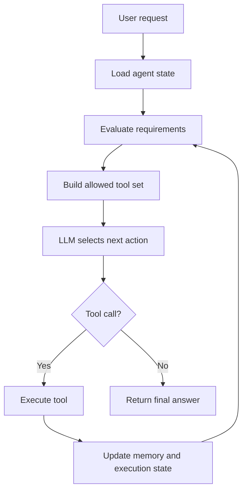
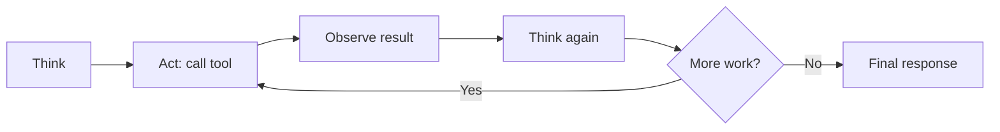
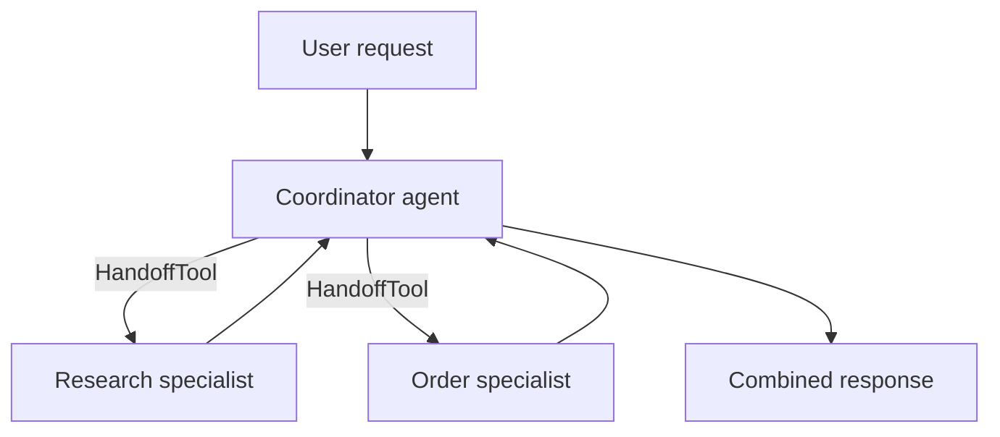

# 52. BeeAI Agent Control, Tools & Multi-Agent Integration

> **Agent behaviour, execution control, extensibility and interoperability**

An agent with tools can search, retrieve records, call APIs and update systems. The challenge is deciding **which capability it may use, when, how often, and whether a human must approve it**. BeeAI addresses this through tools, declarative requirements and handoffs.

## 1. The RequirementAgent execution model

Building on the agent foundation from Chapter 51, the key addition here is execution control: the model proposes an action, while BeeAI evaluates requirements and determines which tools are available or forced at each step.

The execution cycle:



Instructions influence model behaviour; requirements constrain execution. A prompt saying “do not call the delete tool” is not an enforced restriction.

## 2. Built-in tools and ThinkTool

BeeAI's built-in tools cover common tasks without requiring every integration to be written from scratch:

| Tool | Typical use |
|---|---|
| `ThinkTool` | Add a deliberate reasoning step |
| `WikipediaTool`, `DuckDuckGoSearchTool` | Retrieve external information |
| `OpenMeteoTool` | Retrieve weather data |
| `VectorStoreSearchTool` | Search an existing vector store |
| `OpenAPITool` | Turn an API schema into callable operations |
| `MCPTool` | Consume tools exposed by an MCP server |
| `HandoffTool` | Delegate to another agent |

`ThinkTool` gives the agent a place to reason before or between actions; it does not guarantee a correct decision. A requirement can make the first thinking step mandatory:

```python
from beeai_framework.agents.requirement import RequirementAgent
from beeai_framework.agents.requirement.requirements.conditional import (
    ConditionalRequirement,
)
from beeai_framework.backend import ChatModel
from beeai_framework.tools.search.wikipedia import WikipediaTool
from beeai_framework.tools.think import ThinkTool

agent = RequirementAgent(
    llm=ChatModel.from_name("ollama:granite4:micro"),
    tools=[ThinkTool(), WikipediaTool()],
    requirements=[
        ConditionalRequirement(ThinkTool, force_at_step=1),
        ConditionalRequirement(WikipediaTool, max_invocations=1),
    ],
)
```

This forces initial thinking and caps Wikipedia at one call.

## 3. Requirements-driven execution control

`ConditionalRequirement` declares rules for a target tool; BeeAI evaluates them during execution.

| Parameter | What it controls |
|---|---|
| `force_at_step` | Requires the tool at a particular step |
| `min_invocations` | Requires a minimum number of uses before the agent can stop (successful uses by default) |
| `max_invocations` | Caps the number of uses |
| `only_after` | Keeps a tool unavailable until the specified preceding tool or tools have run |
| `only_before` | Disables a tool after another tool has run |
| `force_after` | Forces a tool immediately after a specified tool executes |
| `consecutive_allowed` | Controls whether the same tool may run repeatedly |

For an order workflow, BeeAI can force a confirmation step immediately after order creation and cap it at one invocation:

```python
ConditionalRequirement(
    send_confirmation,
    only_after=[create_order],
    force_after=[create_order],
    max_invocations=1,
    priority=20,
)
```

Here, `send_confirmation` and `create_order` represent your own tool classes or instances. The higher priority is useful when multiple requirements could force different tools at the same step.

When requirements conflict, a prohibition overrides a forced call; the highest-priority forced rule wins; stop-prevention rules accumulate. Treat these as execution policy, not prompt hints.

## 4. Building a ReAct execution pattern

ReAct—Reason and Act—alternates reasoning and tool use, incorporating each result into the next decision.



BeeAI can enforce this pattern by requiring `ThinkTool` first and after tool execution:

```python
from beeai_framework.tools import Tool

requirements = [
    ConditionalRequirement(
        ThinkTool,
        force_at_step=1,
        force_after=Tool,
        consecutive_allowed=False,
        max_invocations=3,
    )
]
```

`force_after=Tool` requires another thinking step after tool use; `consecutive_allowed=False` prevents back-to-back thinking calls. The invocation cap bounds the loop. ReAct is not unrestricted autonomy: limit iterations and expose only necessary tools.

## 5. Execution tracking with trajectory middleware

Requirements constrain execution; trajectory middleware shows what happened.

Current documentation uses `GlobalTrajectoryMiddleware` to display nested execution events, including tool calls:

```python
from beeai_framework.middleware.trajectory import GlobalTrajectoryMiddleware
from beeai_framework.tools import Tool

response = await agent.run(
    "Investigate the reported service outage."
).middleware(GlobalTrajectoryMiddleware(included=[Tool]))

print(response.last_message.text)
```

The supplied learning material also refers to `ControlTrajectoryMiddleware`. Current examples use `GlobalTrajectoryMiddleware`; treat the older name as version-specific rather than copying it into a new implementation without checking the installed package.

Trajectory output helps debug execution order, but it is not a complete audit system. Persist structured events, correlate them with request IDs, protect sensitive values and define retention controls in production.

## 6. Human approval with AskPermissionRequirement

Some actions—deleting records, issuing refunds or changing permissions—need human oversight.

`AskPermissionRequirement` can require approval before selected tools execute. In Python, a custom asynchronous handler can connect the approval decision to an application workflow:

```python
from beeai_framework.agents.experimental.requirements.ask_permission import (
    AskPermissionRequirement,
)

async def approval_handler(tool, tool_input) -> bool:
    # Replace with an authenticated approval service or UI.
    return await approval_service.request(
        action=tool.name,
        arguments=tool_input,
    )

# llm and delete_customer_record are defined by the application.
agent = RequirementAgent(
    llm=llm,
    tools=[delete_customer_record],
    requirements=[
        AskPermissionRequirement(
            include=[delete_customer_record],
            handler=approval_handler,
        )
    ],
)
```

`approval_service` is application code, not a BeeAI built-in. The default approval flow is terminal-oriented; enterprise applications should use an authenticated reviewer and record the decision.

Approval should cover the actual action and arguments, including what changes and who is affected. Current documentation marks `AskPermissionRequirement` as not yet implemented in TypeScript.

## 7. Creating custom tools with the Tool class

Built-in tools cannot know every organisation's business rules. A custom tool exposes a narrow operation, such as checking an order's fulfilment status.

A BeeAI tool class defines a name, description, Pydantic input schema and `_run()` implementation. The following compact example illustrates the current class-based pattern:

```python
from pydantic import BaseModel, Field
from beeai_framework.context import RunContext
from beeai_framework.emitter import Emitter
from beeai_framework.tools import (
    StringToolOutput, Tool, ToolRunOptions,
)

class OrderStatusInput(BaseModel):
    order_id: str = Field(
        description="The unique order identifier to look up."
    )

class OrderStatusTool(
    Tool[OrderStatusInput, ToolRunOptions, StringToolOutput]
):
    name = "OrderStatus"
    description = "Retrieves the fulfilment status for an order."
    input_schema = OrderStatusInput

    def __init__(self, order_service):
        super().__init__()
        self.order_service = order_service

    def _create_emitter(self) -> Emitter:
        return Emitter.root().child(
            namespace=["tool", "orders", "status"],
            creator=self,
        )

    async def _run(
        self,
        input: OrderStatusInput,
        options: ToolRunOptions | None,
        context: RunContext,
    ) -> StringToolOutput:
        status = await self.order_service.get_status(input.order_id)
        return StringToolOutput(result=status)
```

Construct the tool with your application’s `order_service` implementation. Handle missing orders, timeouts, authorization failures and downstream errors explicitly.

### Why the Pydantic schema matters

The schema is the contract between the model and your code. Field types and descriptions support input validation; keep schemas small and validate business rules and authorization again inside the service boundary. A valid Pydantic object does not prove the caller may access the referenced order.

For simple functions, BeeAI also offers a `@tool` decorator. Use a class when you need richer lifecycle behaviour, custom emitters or reusable configuration.

## 8. Multi-agent collaboration with HandoffTool

`HandoffTool` exposes specialist delegation to a coordinator as a tool, so it follows the same tool-selection and requirements model.



A coordinator might ask a research specialist to retrieve policy information and an order specialist to inspect a transaction. Give each specialist a clear role, limited tools and only the data it needs.

```python
from beeai_framework.tools.handoff import HandoffTool

coordinator = RequirementAgent(
    llm=llm,
    tools=[
        ThinkTool(),
        HandoffTool(
            target=research_agent,
            name="research_specialist",
            description="Research policy questions using the approved knowledge sources.",
        ),
        HandoffTool(
            target=order_agent,
            name="order_specialist",
            description="Inspect order details and report the current status.",
        ),
    ],
    requirements=[
        ConditionalRequirement(ThinkTool, force_at_step=1),
    ],
)
```

This is the core wiring pattern; define `research_agent`, `order_agent` and `llm` with the appropriate configuration before constructing the coordinator. A handoff does not automatically solve shared-state, authorization or failure handling. Define what context crosses the boundary, how results are checked and how specialist failures are handled.

## 9. BeeAI-specific MCP integration

MCP connects agents to tools exposed by MCP servers; A2A connects agents to other agents.

Install the optional adapter with `pip install 'beeai-framework[mcp]'`. BeeAI's `MCPTool` can discover tools from an MCP server and make them available to a `RequirementAgent`. For example, the following pattern connects to a remote server using Streamable HTTP:

```python
from mcp.client.streamable_http import streamablehttp_client
from beeai_framework.tools.mcp import MCPTool

async def connect_mcp_server():
    client = streamablehttp_client("https://example.org/mcp")
    mcp_tools = await MCPTool.from_client(client)

    agent = RequirementAgent(
        llm=llm,
        tools=mcp_tools,
    )
    return client, agent
```

For a local MCP server, BeeAI also documents stdio transport. The MCP client currently does not support Roots, Sampling or Elicitation; verify the feature set before depending on those capabilities.

BeeAI can expose its own tools to MCP clients as well:

```python
from beeai_framework.adapters.mcp import MCPServer
from beeai_framework.tools.search.wikipedia import WikipediaTool
from beeai_framework.tools.weather import OpenMeteoTool

server = MCPServer()
server.register_many([WikipediaTool(), OpenMeteoTool()])
server.serve()
```

## 10. BeeAI-specific A2A integration and interoperability

Use A2A when the remote capability is an agent rather than simply a tool. Install the optional adapter with `pip install 'beeai-framework[a2a]'`. BeeAI provides:

- `A2AAgent` to connect to an external A2A-compatible agent.
- `A2AServer` to expose a BeeAI agent through A2A.

The current integration guide documents Python support and shows an A2A server registering one agent per server. A minimal server-side pattern is:

```python
from beeai_framework.adapters.a2a import A2AServer, A2AServerConfig

server = A2AServer(
    config=A2AServerConfig(port=9999)
)
server.register(agent).serve()
```

The adapter is Python-only and supports one agent per server. Use `A2AAgent` to consume a remote BeeAI or compatible agent:

```python
from beeai_framework.adapters.a2a.agents import A2AAgent
from beeai_framework.memory import UnconstrainedMemory

remote_agent = A2AAgent(
    url="http://127.0.0.1:9999",
    memory=UnconstrainedMemory(),
)
result = await remote_agent.run("Check the current order status.")
```

Plan discovery, authentication, sessions and network exposure deliberately. The older Agent Stack adapter is deprecated; current Serve documentation recommends A2A.

### Choosing the right integration

| Need | BeeAI mechanism |
|---|---|
| Call a local or remote capability | Tool |
| Enforce when a tool can run | `ConditionalRequirement` |
| Require approval before a tool runs | `AskPermissionRequirement` |
| Delegate to another in-process BeeAI agent | `HandoffTool` |
| Consume tools from an MCP server | `MCPTool` |
| Expose BeeAI capabilities to MCP clients | `MCPServer` |
| Consume or expose a remote agent | `A2AAgent` / `A2AServer` |

Choose the abstraction that matches the capability: not every API needs to become an agent, and not every agent should be wrapped as a tool.

## 11. Key takeaways

- `RequirementAgent` combines model decisions with declarative execution rules.
- `ThinkTool` and `ConditionalRequirement` can enforce a bounded ReAct-style cycle.
- `GlobalTrajectoryMiddleware` makes execution easier to inspect; it is not a full audit platform.
- `AskPermissionRequirement` adds an approval checkpoint, but enterprise authorization and audit records remain application responsibilities.
- Custom `Tool` classes turn domain operations into typed, reusable capabilities.
- `HandoffTool` delegates work to specialist agents; MCP exposes tools, while A2A connects agents.
- Verify SDK support and integration status against the exact BeeAI version you deploy.

We have now moved from a single agent to a controlled team of agents and external capabilities. The next chapter takes the operational view: how to configure, observe, optimise, test and deploy BeeAI systems reliably.

## References

- [BeeAI Framework — Requirement Agent](https://i-am-bee.github.io/beeai-framework/modules/agents/requirement-agent)
- [BeeAI Framework — Tools](https://i-am-bee.github.io/beeai-framework/modules/tools)
- [BeeAI Framework — Agents and Multi-Agent Hand-offs](https://i-am-bee.github.io/beeai-framework/modules/agents)
- [BeeAI Framework — Serve adapters](https://i-am-bee.github.io/beeai-framework/modules/serve)
- [BeeAI Framework — MCP Integration](https://i-am-bee.github.io/beeai-framework/integrations/mcp.html)
- [BeeAI Framework — A2A Integration](https://i-am-bee.github.io/beeai-framework/integrations/a2a)

## 🧭 Chapter Navigation

⬅️ **Previous:** [51. BeeAI Architecture & Agent Development](51-beeai-architecture-agent-development.md)

📚 **Part:** [AI Engineering Frameworks & Tooling](index.md)

➡️ **Next:** [53. BeeAI Production Engineering, Runtime & Deployment](53-beeai-production-engineering-runtime-deployment.md)

---

> **Enterprise AI Engineering Handbook**
>
> *Building Production-Grade Enterprise AI Systems — One Chapter at a Time.*

---
