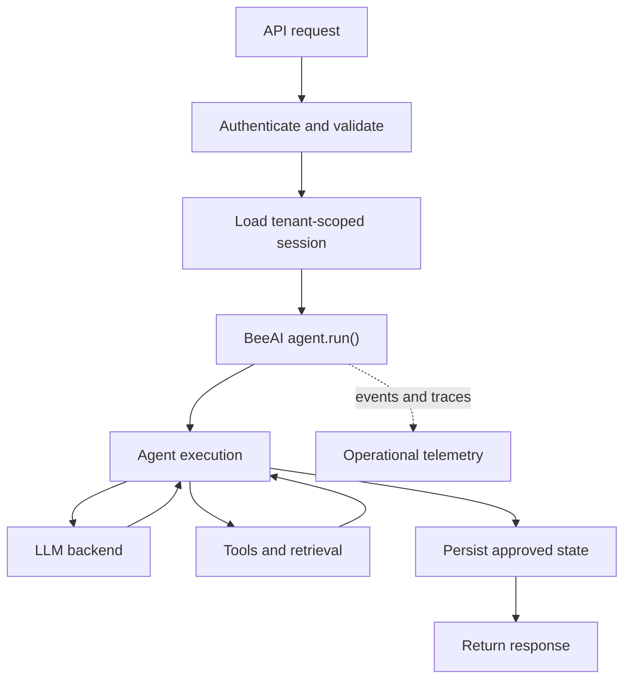
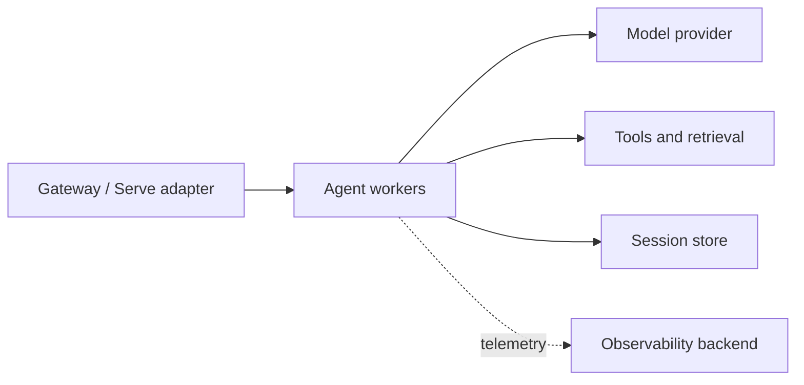

# 53. BeeAI Production Engineering, Runtime & Deployment

> **Operating, optimising, deploying and maintaining BeeAI-based enterprise agents**

A demo agent works beautifully—until the model provider slows down, a tool times out, the conversation grows beyond the context window, or a container restarts halfway through a request.

That is the production test.

BeeAI provides runtime, event, memory, caching, serialization and observability components. The application still owns identity, durable business state, capacity and deployment policy.

## 1. Runtime architecture and execution lifecycle

A production request passes through more than `agent.run()`. The application authenticates the caller, loads the correct session, invokes the agent, observes its work and persists any state that must survive:



The agent coordinates model calls, memory and tools; the application owns admission, tenant boundaries, authorization and persistence. A live Python object is not a durable runtime.

## 2. Runtime configuration and management

Keep environment-specific configuration out of agent instructions and business logic. Manage these settings independently:

- **Model:** provider, model ID, endpoint, credentials and generation parameters.
- **Execution:** request deadline, iteration limits and concurrency caps.
- **Tools:** enabled capabilities, downstream endpoints and per-call timeouts.
- **Memory:** session scope, strategy, token budget and retention.
- **Operations:** log level, telemetry endpoint and deployment environment.

For example, the model can be selected through BeeAI's backend factory while credentials remain in environment variables or a secrets manager:

```python
from beeai_framework.backend import ChatModel

# Provider credentials and endpoint configuration come from the environment.
llm = ChatModel.from_name("ollama:granite3.3")
```

Validate configuration at startup, pin versions and fail fast on missing dependencies. Never share mutable memory across tenants.

## 3. Event-driven middleware and execution events

BeeAI's event system exposes the lifecycle of a run. A component typically emits `start`, then either `success` or `error`, and finally `finish`. Tool and model components expose more specific events, including tool retries and streamed model tokens.

Use a one-off callback for simple diagnostics; use reusable middleware when behaviour must be shared across components. The following attaches listeners to one agent invocation:

```python
def on_start(data, meta):
    logger.info("Agent started: %s", meta.path)

def on_error(data, meta):
    logger.error("Agent run failed: %s", data)

run = agent.run("Summarise the latest support case.")
run.on("start", on_start)
run.on("error", on_error)

response = await run
```

Event payloads and metadata provide execution context. Avoid logging full prompts or tool arguments. Chapter 52 covers `GlobalTrajectoryMiddleware`; this section focuses on lifecycle hooks.

## 4. Agent state persistence and serialization

Conversation memory held in a process disappears when that process exits. Decide what needs to survive: conversation history, workflow progress, user-approved preferences or the status of a business operation.

BeeAI documents a `Serializer` and snapshot support for serializable components. Its current Python serialization examples are marked as forthcoming, while the documented method names are shown in the TypeScript API. Do not assume a Python equivalent without checking the installed release.

A production design needs tenant-scoped session IDs, schema migration, encryption, retention, atomic writes and recovery.

A snapshot is not a transaction log. It cannot undo an external side effect or guarantee safe workflow resumption. Persist business operations separately, with idempotency keys and explicit status transitions.

## 5. Advanced memory management and context optimisation

`UnconstrainedMemory` is useful for short sessions, but retaining every message indefinitely increases token usage, latency and the risk of context overflow. BeeAI offers alternatives:

| Strategy | When it helps |
|---|---|
| `SlidingMemory` | Keep only the most recent messages |
| `TokenMemory` | Enforce a token budget |
| `SummarizeMemory` | Compress older conversation history |
| `UnconstrainedMemory` | Short sessions and controlled tests |

For example, `TokenMemory` can cap the context retained for a conversation:

```python
from beeai_framework.memory import TokenMemory

memory = TokenMemory(llm=llm, max_tokens=8000)
```

The value is illustrative, not a universal setting. Reserve room for the current request, tool results and model output. Preserve critical facts, summarise stale discussion, and retrieve large domain documents from a knowledge base rather than carrying them in every prompt. Define what sensitive data may enter memory and when it must be deleted.

## 6. Caching strategies and performance optimisation

Cache repeatable work, not entire agent runs. BeeAI supports caching for model responses and tool outputs; whole-agent caching is rarely useful because requests usually differ.

```python
from beeai_framework.cache import SlidingCache, UnconstrainedCache
from beeai_framework.tools.weather import OpenMeteoTool

llm.config(cache=SlidingCache(size=50))
weather_tool = OpenMeteoTool(options={"cache": UnconstrainedCache()})
```

Choose cache scope and expiry carefully: include tenant/authorization context, avoid sharing personalised results, use short TTLs for volatile data, invalidate after writes, never cache non-idempotent actions, and measure hit rate and staleness.

Tune prompt size, retrieval count and tool round trips. Benchmark end-to-end latency; the slowest downstream dependency often dominates.

## 7. OpenTelemetry integration and distributed tracing

Trace a request through the agent, model, tools, retrieval and downstream services. BeeAI's Python integration uses OpenInference with OpenTelemetry export.

```bash
pip install openinference-instrumentation-beeai \
  opentelemetry-sdk opentelemetry-exporter-otlp
```

```python
from openinference.instrumentation.beeai import BeeAIInstrumentor
from opentelemetry import trace
from opentelemetry.exporter.otlp.proto.http.trace_exporter import OTLPSpanExporter
from opentelemetry.sdk import trace as trace_sdk
from opentelemetry.sdk.trace.export import BatchSpanProcessor

provider = trace_sdk.TracerProvider()
provider.add_span_processor(BatchSpanProcessor(OTLPSpanExporter()))
trace.set_tracer_provider(provider)

# Initialise instrumentation before importing/using BeeAI components.
BeeAIInstrumentor().instrument()
```

Configure the OTLP endpoint and credentials through deployment settings. Automatic instrumentation is currently documented for Python; verify other language support.

## 8. Agent observability and execution monitoring

Traces explain individual runs; metrics show service health. Combine **metrics** (rate, success, p50/p95 latency, timeouts, tokens, concurrency), **logs** (errors, version, correlation ID), **traces** (agent/model/tool spans) and **business signals** (completion, escalation, approval, correction rates).

BeeAI's instrumentation can expose model, tool and agent activity. Apply data minimisation, access controls and retention limits before exporting telemetry. A diagnostic trace is not automatically a compliant audit record.

## 9. Error handling, retries and fault tolerance

BeeAI groups failures under `FrameworkError` and more specific types such as `BackendError`, `ToolError`, `AgentError`, `AbortError` and `WorkflowError`. Preserve the original error context when reporting a failure:

```python
from beeai_framework.errors import FrameworkError

try:
    response = await agent.run("Summarise the latest support case.")
except FrameworkError as exc:
    logger.error("BeeAI execution failed: %s", exc.explain())
    raise
```

Retry only safe operations. Use bounded attempts, backoff with jitter, timeouts and a request deadline. Respect rate limits; protect side effects with idempotency keys and reconciliation.

For a tool call, set a per-attempt timeout:

```python
from beeai_framework.tools import ToolRunOptions

result = await tool.run(
    tool_input,
    options=ToolRunOptions(timeout=10.0),
)
```

This does not necessarily bound the full agent run. Validate fallback-model tool calling, structured output and context limits before routing traffic to it.

## 10. Resource management and scalability

Async helps with I/O waits, not infinite capacity. Bound concurrent model/tool calls, use connection pools, cap payload sizes and isolate CPU-heavy ingestion from the event loop.

Scale stateless workers horizontally, share session storage across replicas and define backpressure for provider quotas. Monitor memory, connections, queue depth and per-tenant usage—not just CPU.

## 11. RAG integration with BeeAI

BeeAI's RAG module integrates with document loaders, text splitters, vector stores and optional reranking. Install the optional dependencies first:

```bash
pip install "beeai-framework[rag]"
```

The `RAGAgent` performs retrieval, optional reranking and generation. The vector store must already contain documents; production ingestion and index refresh are separate responsibilities.

```python
from beeai_framework.agents.experimental.rag import RAGAgent
from beeai_framework.memory import UnconstrainedMemory

# vector_store is an application-configured, pre-populated vector store.
agent = RAGAgent(
    llm=llm,
    memory=UnconstrainedMemory(),
    vector_store=vector_store,
    # reranker=reranker,  # Optional DocumentProcessor
)

response = await agent.run("What is our approved customer refund policy?")
print(response.last_message.text)
```

`RAGAgent` is under the experimental API, so pin and test the version before relying on it. Alternatively, `VectorStoreSearchTool` can expose semantic search to an agent that already uses tools. Keep document loading, chunking, embeddings, access filtering and index refresh in a managed ingestion pipeline. Measure retrieval relevance, freshness, grounding and tenant-level access correctness.

## 12. Agent serving and deployment architecture

BeeAI `Serve` exposes components through adapters such as A2A and MCP. Chapter 52 covers protocol integration; here the focus is hosting.



Secure the HTTP boundary, apply authentication and rate limits, use health checks, keep secrets outside images, run non-root, pin dependencies and scan images. Readiness checks should avoid expensive model calls.

## 13. BeeAI Platform and enterprise deployment

Chapter 51 introduced Agent Stack as a hosting option. One important distinction for deployment planning: the **BeeAI Framework's Agent Stack serving adapter is deprecated** in current Serve documentation, which recommends A2A for compatible remote agents. This deprecation applies to the Framework integration—not automatically to every Agent Stack product capability.

Validate identity, tenant isolation, secrets, data residency, egress, auditability, backup/restore, upgrades, SLOs and ownership against the current platform release.

## 14. Testing, evaluation and production readiness

Test more than whether the model returns a plausible answer:

1. **Unit tests:** tool validation, business logic, memory policies and error mapping.
2. **Integration tests:** provider connectivity, retrieval, tool contracts and persistence.
3. **Workflow tests:** timeouts, retries, duplicate requests, partial failures and recovery.
4. **Evaluation:** representative tasks, groundedness, tool selection, completion rate, latency and cost.
5. **Operational tests:** load, rate limits, restart behaviour, telemetry export and rollback.

BeeAI provides DeepEval and Ragas adapters. Evaluation is Python-only and requires `pip install "beeai-framework[evaluation]"`. Use mocks for most CI tests and a smaller live-model suite. Maintain a regression dataset and rerun it after prompt, model, tool, retrieval or framework changes.

Before release, verify access, secret rotation, retention, alerts, runbooks, capacity and rollback. One correct answer is not a readiness review.

## Key takeaways

- BeeAI provides runtime, event, memory, caching, serialization and observability building blocks; the application owns identity and durable business state.
- Bound memory, concurrency, retries and cache scope before increasing traffic.
- Trace model, tool and retrieval activity while protecting sensitive data.
- Treat ingestion, persistence, evaluation and deployment as explicit operational systems.
- Verify experimental modules, language support and adapters against the exact release you deploy.

With BeeAI's operational lifecycle covered, the next chapter steps back from implementation and compares frameworks—including BeeAI—by architecture, orchestration, state, interoperability and production trade-offs.

## References

- [BeeAI Framework — Middleware and Events](https://i-am-bee.github.io/beeai-framework/modules/middleware)
- [BeeAI Framework — Memory](https://i-am-bee.github.io/beeai-framework/modules/memory.html)
- [BeeAI Framework — Serialization](https://i-am-bee.github.io/beeai-framework/modules/serialization.html)
- [BeeAI Framework — Cache and Production Guide](https://i-am-bee.github.io/beeai-framework/introduction/tour.html)
- [BeeAI Framework — Observability](https://i-am-bee.github.io/beeai-framework/modules/observability)
- [BeeAI Framework — Errors](https://i-am-bee.github.io/beeai-framework/modules/errors.html)
- [BeeAI Framework — RAG](https://i-am-bee.github.io/beeai-framework/modules/rag.html)
- [BeeAI Framework — Evaluation](https://i-am-bee.github.io/beeai-framework/modules/evaluation.html)
- [BeeAI Framework — Serve](https://i-am-bee.github.io/beeai-framework/modules/serve)
- [BeeAI Framework — Agent Stack integration status](https://i-am-bee.github.io/beeai-framework/integrations/agent-stack.html)

## 🧭 Chapter Navigation

⬅️ **Previous:** [52. BeeAI Agent Control, Tools & Multi-Agent Integration](52-beeai-agent-control-tools-multi-agent-integration.md)

📚 **Part:** [AI Engineering Frameworks & Tooling](index.md)

➡️ **Next:** [54. Enterprise AI Framework Comparison](54-enterprise-ai-framework-comparison.md)

---

> **Enterprise AI Engineering Handbook**
>
> *Building Production-Grade Enterprise AI Systems — One Chapter at a Time.*

---
