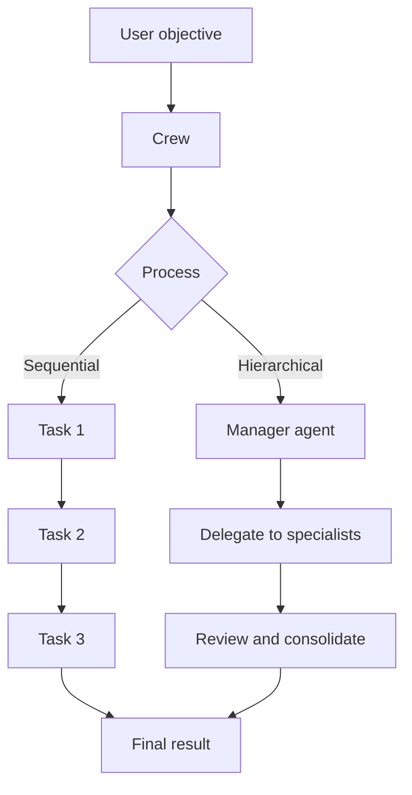
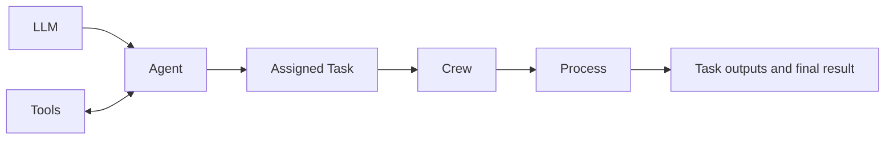
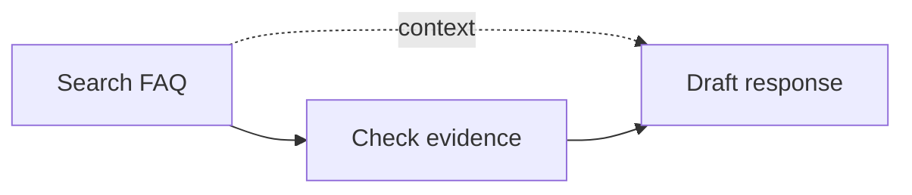
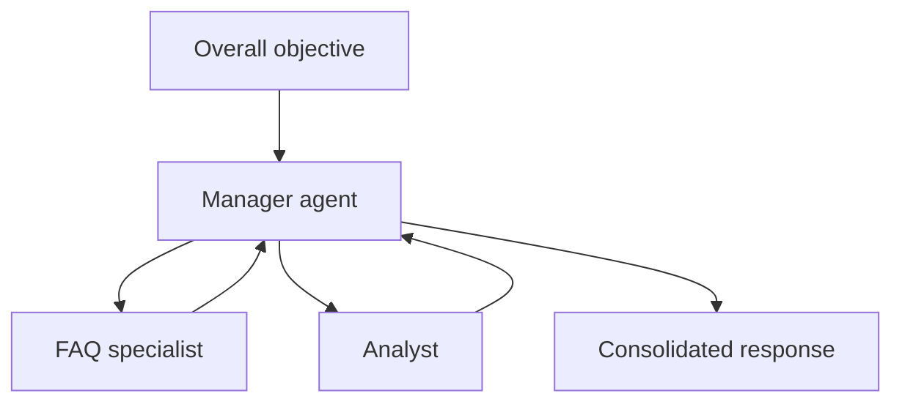

# 01. CrewAI Architecture & Core Concepts

> A team of agents is not automatically a smart team. Without clear ownership, useful tools, and a sensible workflow, it is just several LLM calls wearing different name badges.

## Overview

Imagine a customer asks a restaurant: “What are your opening hours, do you have vegetarian options, and can I book a table?”

One agent could search the FAQ. Another could check additional information. A final agent could turn the findings into a helpful response. The challenge is not generating three personas; it is coordinating the work and passing reliable results between them.

**CrewAI provides a role-based framework for defining agents, assigning tasks, giving them tools, and coordinating execution through a Crew.**

Its core building blocks are:

- **Agent:** the specialist responsible for doing work.
- **Task:** the assignment, constraints, and expected result.
- **Tool:** a callable capability such as search, calculation, or document retrieval.
- **Crew:** the agents and tasks assembled into one working team.
- **Process:** the strategy used to execute and coordinate tasks.



This chapter focuses on CrewAI's **Crew model**; general planning, broad orchestration patterns, enterprise A2A, and CrewAI Flows are separate topics.

## 1. How the CrewAI architecture fits together

CrewAI separates responsibility from execution:



| Component | Its job |
|---|---|
| Agent | Defines who performs the work and what capabilities are available |
| Task | Defines what must be done and what a good result looks like |
| Tool | Gives an agent a way to interact with an external capability |
| Crew | Brings agents and tasks together |
| Process | Determines how the crew executes its tasks |

A Crew is not another LLM. It is the unit that brings the configured workers and assignments together.

## 2. Agents, tasks, and crews

### Agents: define the specialists

An `Agent` is an LLM-powered worker with a defined responsibility. For a customer-support workflow, the team might include:

- **FAQ researcher:** finds relevant information in approved documents.
- **Information analyst:** checks whether the evidence answers the customer's question.
- **Response writer:** prepares a concise, friendly response from the verified findings.

Give agents separate responsibilities only when the work genuinely needs different expertise, instructions, or tool access. Three agents repeating the same job will usually create more cost, not more intelligence.

### Tasks: make the assignment specific

A `Task` turns an objective into a concrete piece of work. Important attributes include:

- `description` — instructions, scope, and constraints.
- `expected_output` — the required deliverable.
- `agent` — the assigned specialist.
- `tools` — capabilities available specifically to this task.
- `context` — outputs from earlier tasks this task needs.
- `output_pydantic` / `output_json` — optional structured output formats.

“Answer the customer” is vague. “Find the opening hours in the approved FAQ and return the exact hours with the relevant source text” is much easier to assess.

### Crews: assemble the team

A `Crew` combines the agents and tasks and selects a process. The crew is where the individual pieces become an executable workflow.

## 3. Roles, goals, and backstories

Three attributes shape an agent's behaviour:

| Attribute | What it defines | Example |
|---|---|---|
| `role` | The agent's function | FAQ Research Specialist |
| `goal` | The outcome it should achieve | Find accurate answers in approved customer documents |
| `backstory` | Context that guides its approach | A careful support analyst who never invents missing policy details |

Treat these as engineering inputs, not creative writing. A colourful backstory cannot rescue an unclear goal.

```python
from crewai import Agent, Task, Crew, Process

# faq_search_tool and web_search_tool are application-configured tools.
faq_researcher = Agent(
    role="FAQ Research Specialist",
    goal="Find accurate answers in the approved customer FAQ.",
    backstory=(
        "You are a careful support analyst. Use the supplied evidence "
        "and clearly say when the FAQ does not contain an answer."
    ),
    tools=[faq_search_tool, web_search_tool],
    allow_delegation=False,
    verbose=True
)
```

`faq_search_tool` and `web_search_tool` are configured by the application. The role guides the model; it does not guarantee correctness.

The other specialists can be defined just as explicitly:

```python
analyst = Agent(
    role="Support Analyst",
    goal="Check whether retrieved evidence answers the question.",
    backstory="You verify facts and flag missing information."
)

writer = Agent(
    role="Customer Response Writer",
    goal="Turn verified findings into a helpful customer reply.",
    backstory="You write clearly and never invent missing details."
)
```

## 4. Agent tools: from prompts to actions

Tools let agents search documents, query APIs, calculate, or interact with internal services.

CrewAI supports built-in tools and custom Python tools. A custom function can be registered with the `@tool` decorator:

```python
from crewai.tools import tool
import re

@tool("Add Numbers")
def add_numbers(request: str) -> int:
    """Extract integers from a request and return their sum."""
    values = [int(x) for x in re.findall(r"-?\d+", request)]
    return sum(values)
```

The tool name and docstring help the agent understand when to use it. Keep each tool focused, validate inputs, handle failures, and avoid giving agents permissions they do not need.

### Agent-level versus task-level tools

There are two useful ways to assign capabilities:

| Approach | How it works | Trade-off |
|---|---|---|
| Agent-level | The agent receives a toolbox and chooses what to call | Flexible, but tool selection depends on model reasoning |
| Task-level | A task receives only the tools needed for that assignment | More explicit and constrained, but requires a more structured workflow |

```python
# The agent has a broader toolbox (agent-level).
# Restrict this particular task to the approved FAQ search tool.
faq_task = Task(
    description="Search the approved FAQ for the customer's question: {question}",
    expected_output="A concise answer with supporting FAQ evidence.",
    agent=faq_researcher,
    tools=[faq_search_tool]
)
```

In the task-centric approach described here, task-level tools take precedence for that task. This can improve predictability and apply least-privilege access. Use agent-level tools when the agent genuinely needs to choose dynamically; use task-level tools when the workflow knows which capability a step requires.

## 5. Task dependencies: pass useful context

A downstream agent should not have to guess what an earlier agent discovered. CrewAI's `context` attribute lets a task consume the output of specified earlier tasks.



```python
analysis_task = Task(
    description="Check whether the FAQ evidence answers the customer question.",
    expected_output="A verified answer or a clear statement that evidence is missing.",
    agent=analyst,
    context=[faq_task]
)

response_task = Task(
    description="Write a helpful response using the verified findings.",
    expected_output="A concise customer-ready answer.",
    agent=writer,
    context=[faq_task, analysis_task]
)
```

Pass only relevant outputs. Excess context can hide evidence and increase token usage.

## 6. Structured outputs with Pydantic

Free-form text is convenient for people, but fragile when another task or application must consume it. If a downstream system expects named fields, define a schema.

```python
from pydantic import BaseModel

class FAQAnswer(BaseModel):
    answer: str
    source_section: str
    confidence_note: str

structured_task = Task(
    description="Answer the customer using the supplied FAQ evidence.",
    expected_output="A validated answer with source section and confidence note.",
    agent=analyst,
    context=[faq_task],
    output_pydantic=FAQAnswer
)
```

After execution, the structured object is available through `result.pydantic`. CrewAI also supports `output_json` when a dictionary-style result is more suitable.

Pydantic does not make an answer true. It validates the shape and types of the returned data; evidence quality still needs to be checked.

## 7. YAML configuration and CrewBase

As a CrewAI project grows, defining every agent and task directly in one Python file becomes difficult to maintain. YAML separates configuration from implementation.

A common project layout is:

```text
customer_support/
├── config/
│   ├── agents.yaml
│   └── tasks.yaml
└── support_crew.py
```

`agents.yaml` can hold roles, goals, and backstories; `tasks.yaml` can hold task descriptions and expected outputs. The `@CrewBase` class and decorators such as `@agent`, `@task`, and `@crew` connect those definitions to Python objects.

```python
from crewai.project import CrewBase, agent, task, crew
from crewai import Agent, Task, Crew, Process

@CrewBase
class SupportCrew:
    agents_config = "config/agents.yaml"
    tasks_config = "config/tasks.yaml"

    @agent
    def faq_researcher(self) -> Agent:
        return Agent(config=self.agents_config["faq_researcher"])

    @task
    def faq_task(self) -> Task:
        return Task(config=self.tasks_config["faq_task"])

    @crew
    def crew(self) -> Crew:
        return Crew(
            agents=[self.faq_researcher()],
            tasks=[self.faq_task()],
            process=Process.sequential
        )
```

Keep the class in a regular `.py` module rather than defining it inside a notebook cell: the configuration discovery mechanism relies on Python module and file inspection.

## 8. Sequential and hierarchical execution

The `Process` setting determines how the crew coordinates its tasks.

### Sequential: follow the defined order

With `Process.sequential`, tasks execute in their listed order. This suits a known workflow such as retrieve → verify → respond.

```python
crew = Crew(
    agents=[faq_researcher, analyst, writer],
    tasks=[faq_task, analysis_task, response_task],
    process=Process.sequential,
    verbose=True
)

result = crew.kickoff(inputs={"question": "What time do you open?"})
print(result.raw)          # Combined final output
print(result.tasks_output)  # Individual task results
print(result.token_usage)   # Usage information
```

The benefit is clarity: task ownership and order are explicit. The risk is that a weak early result can affect every downstream step, so validate important intermediate outputs.

### Hierarchical: let a manager coordinate

With `Process.hierarchical`, a manager agent delegates work to specialists and reviews their results. This is useful when the work cannot be fully assigned in advance.



The manager can be configured with `manager_llm` or supplied as a custom `manager_agent`:

```python
overall_support_task = Task(
    description="Resolve the customer's question using the support team's expertise.",
    expected_output="A verified, customer-ready response."
)

crew = Crew(
    agents=[researcher, analyst, writer],
    tasks=[overall_support_task],
    process=Process.hierarchical,
    manager_llm="your-supported-model"
)
```

The model name is a placeholder; use a model supported by your configured provider. Leave room for the manager to assign and coordinate specialist work. Confirm exact configuration requirements against the CrewAI version used by your project.

| | Sequential | Hierarchical |
|---|---|---|
| Coordination | Predefined task order | Manager-led delegation |
| Best fit | Known workflow | Work requiring dynamic assignment |
| Main benefit | Easier to inspect | More flexible coordination |
| Main cost | Less adaptive | Extra model calls and less predictable execution |

Hierarchical is not automatically better. For a fixed three-step workflow, a manager may add cost without adding value. Start with the simplest process that meets the requirement.

## Key takeaways

- Agents define responsibilities; tasks define deliverables; crews bring them together.
- Roles, goals, and backstories should be specific and bounded.
- Tools may be assigned to agents or individual tasks—choose based on flexibility and control.
- `context` passes selected task outputs to downstream work.
- Pydantic provides structured result contracts; YAML and CrewBase help organise larger projects.
- Sequential execution follows a known order; hierarchical execution adds manager-led delegation.

## Further reading

- [CrewAI Documentation](https://docs.crewai.com/)
- [Agents](https://docs.crewai.com/en/concepts/agents)
- [Tasks](https://docs.crewai.com/en/concepts/tasks)
- [Crews](https://docs.crewai.com/en/concepts/crews)
- [Processes](https://docs.crewai.com/en/concepts/processes)
- [CrewAI GitHub Repository](https://github.com/crewAIInc/crewAI)

## What comes next?

CrewAI organises collaboration around defined roles, assignments, and a manager or fixed execution process. Next, we will look at **AutoGen / AG2**, where collaboration is expressed more directly through agent conversations, message exchange, and turn-taking. The shift is from task-centred team execution to conversation-centred coordination.

## 🧭 Chapter Navigation

⬅️ **Previous:** [07. Enterprise A2A Architecture & Design Patterns](../a2a-engineering/07-enterprise-a2a-architecture-and-design-patterns.md)

📚 **Part:** [AI Engineering Frameworks & Tooling](../index.md)

➡️ **Next:** [02. Building Multi-Agent Systems with CrewAI](02-building-multi-agent-systems-with-crewai.md)

---

> **Enterprise AI Engineering Handbook**  
> *Building Production-Grade Enterprise AI Systems — One Chapter at a Time.*
