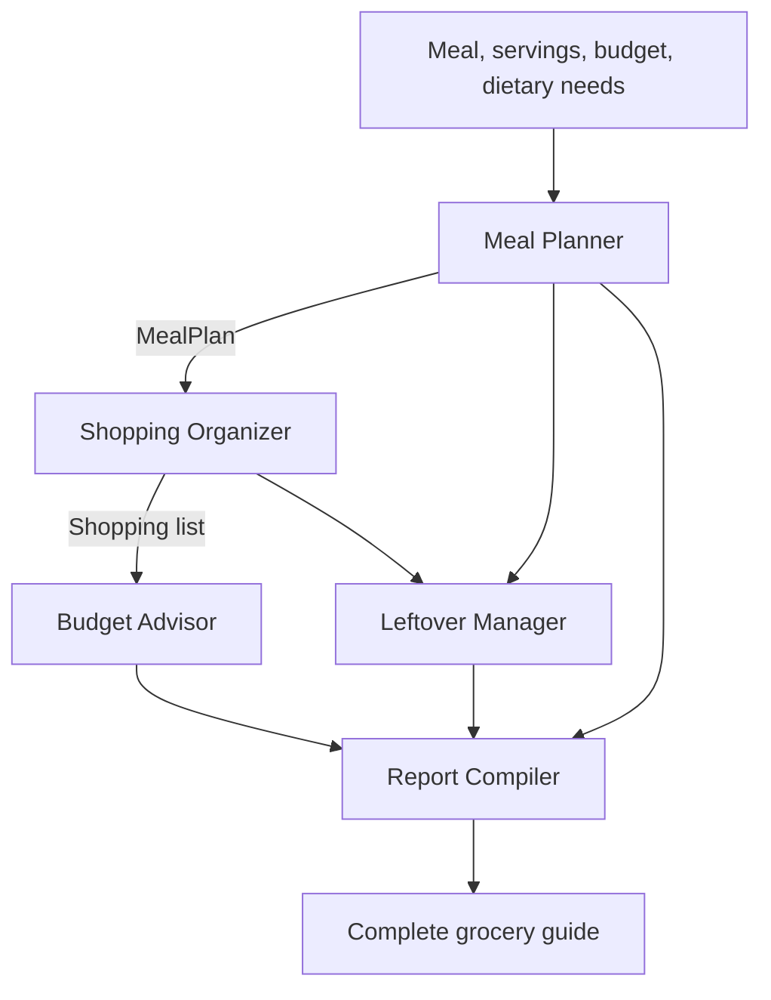

# 45. Building Multi-Agent Systems with CrewAI

> Five agents. One shopping list. And hopefully, no one buys twelve kilos of onions.

A multi-agent application becomes useful when specialists produce work that another specialist can actually use. The hard part is not creating agent personas. It is designing the handoffs, limiting unnecessary tool access, and making failures visible.

In Chapter 44, we covered CrewAI's core components and configuration. Here, we'll use them to build a practical **meal-planning and grocery workflow**: research a recipe, organize ingredients, check the budget, manage leftovers, and compile a final guide.

## 1. Design the crew around the work

The workflow needs five responsibilities:

| Specialist | Responsibility | Main output |
|---|---|---|
| Meal Planner | Research recipes for the requested meal and constraints | Structured meal plan |
| Shopping Organizer | Group ingredients and estimate quantities | Shopping list |
| Budget Advisor | Review costs and suggest savings | Budget guidance |
| Leftover Manager | Identify reuse opportunities | Leftover suggestions |
| Report Compiler | Combine the specialist outputs | Final meal guide |

This is the five-agent pattern used in the example below. Each specialist has a reason to exist: the Shopping Organizer does not need web search, while the Budget Advisor does.



The diagram shows the logical information dependencies. The implementation below runs the tasks sequentially, so later tasks can use earlier task outputs as context.

**Design rule:** add an agent only when it owns a distinct responsibility, needs different tools, or produces an independently useful result. Splitting one simple task across several agents adds latency and cost without guaranteeing better quality.

## 2. Task delegation and agent collaboration

There are two different ways to distribute work in CrewAI:

- **Explicit task assignment:** you decide which agent owns each task. This is best when the workflow is known in advance.
- **Dynamic delegation:** an agent can ask a coworker to perform a piece of work or answer a question. Enable this with `allow_delegation=True`.

For the grocery planner, explicit assignment is the sensible default: recipe research comes first, shopping organization follows, and the budget and leftover reviews use the earlier results.

Dynamic delegation is useful when the next action depends on what an agent discovers. For example, a Meal Planner might need a dietary specialist to investigate an unfamiliar restriction. A lead agent can delegate that focused question rather than giving every agent every responsibility.

```python
lead_agent = Agent(
    role="Meal Planning Lead",
    goal="Coordinate recipe research and resolve specialist questions.",
    backstory="You delegate only when specialist knowledge is needed.",
    allow_delegation=True
)
```

When delegation is enabled, CrewAI equips the agent with coworker delegation and question tools. Keep the coworker list small, describe the expected result, and avoid circular handoffs. Delegation is not a substitute for defining the main workflow.

## 3. Give agents the tools they actually need

The example uses web search for current recipe and price research. Other agents can work from the structured results without browsing.

```python
from crewai import Agent, Task, Crew, Process
from crewai_tools import SerperDevTool
from crewai.tools import tool

search_tool = SerperDevTool()  # Configure SERPER_API_KEY outside the source code.

@tool("Calculate remaining grocery budget")
def remaining_budget(budget: float, estimated_total: float) -> str:
    """Calculate the budget remaining after estimated grocery costs."""
    if budget < 0 or estimated_total < 0:
        return "Invalid input: values cannot be negative."

    remaining = budget - estimated_total
    if remaining < 0:
        return f"Over budget by {abs(remaining):.2f}."

    return f"Budget remaining: {remaining:.2f}."

meal_planner = Agent(
    role="Meal Planner & Recipe Researcher",
    goal="Find a suitable recipe that respects the user's budget and dietary needs.",
    backstory="A practical recipe researcher who checks ingredients and quantities.",
    tools=[search_tool],
    verbose=True
)

shopping_organizer = Agent(
    role="Shopping Organizer",
    goal="Turn meal ingredients into a clear, store-section shopping list.",
    backstory="An experienced organizer who checks quantities and dietary constraints.",
    tools=[],
    verbose=True
)

budget_advisor = Agent(
    role="Budget Advisor",
    goal="Review estimated grocery costs and suggest realistic savings.",
    backstory="A budget-conscious planner who explains assumptions behind estimates.",
    tools=[search_tool, remaining_budget],
    verbose=True
)

leftover_manager = Agent(
    role="Leftover Manager",
    goal="Suggest safe, practical ways to use likely leftover ingredients.",
    backstory="A resourceful planner focused on reducing avoidable food waste.",
    tools=[],
    verbose=True
)

report_compiler = Agent(
    role="Report Compiler",
    goal="Combine the team's findings into one useful meal and shopping guide.",
    backstory="A clear technical writer who preserves details and flags uncertainty.",
    tools=[],
    verbose=True
)
```

The `remaining_budget` tool is attached to the Budget Advisor alongside web search. It performs a deterministic calculation, while search supplies current price information. Keep custom tools narrow and predictable. Validate inputs, set timeouts for external calls, protect credentials, and give each agent only the capabilities required for its task. Treat a tool as application code with real permissions—not as an innocent prompt extension.

## 4. Build the multi-agent workflow

The tasks below pass results forward using `context`. The `MealPlan` and `GroceryShoppingPlan` Pydantic models are assumed to be defined in `schemas.py`; Chapter 44 covers structured-output configuration, so we will use those contracts rather than repeat their design here.

```python
from schemas import MealPlan, GroceryShoppingPlan
from crewai import TaskOutput

def check_shopping_list(output: TaskOutput):
    text = output.raw.strip()
    if not text:
        return (False, "Shopping list is empty. Return the ingredient list.")
    if "quantity" not in text.lower():
        return (False, "Include quantities for the listed ingredients.")
    return (True, text)

meal_task = Task(
    description=(
        "Research a '{meal_name}' recipe for {servings} people. "
        "Respect the budget {budget}, dietary restrictions "
        "{dietary_restrictions}, and cooking skill {cooking_skill}. "
        "Return ingredients with quantities and cooking instructions."
    ),
    expected_output="A researched meal plan with ingredients and quantities.",
    agent=meal_planner,
    output_pydantic=MealPlan,
    output_file="meal.json"
)

shopping_task = Task(
    description=(
        "Organize the researched ingredients by store section. "
        "Check quantities for {servings} people and respect the budget "
        "and dietary restrictions."
    ),
    expected_output="A categorized shopping list with quantities and estimates.",
    agent=shopping_organizer,
    context=[meal_task],
    output_pydantic=GroceryShoppingPlan,
    output_file="shopping_list.json",
    guardrail=check_shopping_list,
    guardrail_max_retries=2
)

budget_task = Task(
    description=(
        "Review the meal plan and shopping list against {budget}. "
        "Explain cost assumptions and suggest practical substitutions if needed."
    ),
    expected_output="Budget assessment, cost assumptions, and savings suggestions.",
    agent=budget_advisor,
    context=[meal_task, shopping_task],
    output_file="budget_guide.md"
)

leftover_task = Task(
    description=(
        "Use the meal plan and shopping list to identify likely leftovers. "
        "Suggest practical ways to reuse them without inventing quantities."
    ),
    expected_output="A short list of leftover ideas based on the supplied ingredients.",
    agent=leftover_manager,
    context=[meal_task, shopping_task],
    output_file="leftover_ideas.md"
)

summary_task = Task(
    description=(
        "Compile the meal plan, shopping list, budget review, and leftover ideas "
        "into one clear guide. Preserve constraints and flag uncertain estimates."
    ),
    expected_output="A complete meal and grocery guide with clear sections.",
    agent=report_compiler,
    context=[meal_task, shopping_task, budget_task, leftover_task],
    output_file="complete_grocery_guide.md"
)
```

Assemble and run the crew:

```python
grocery_crew = Crew(
    agents=[
        meal_planner, shopping_organizer, budget_advisor,
        leftover_manager, report_compiler
    ],
    tasks=[
        meal_task, shopping_task, budget_task,
        leftover_task, summary_task
    ],
    process=Process.sequential,
    verbose=True
)

result = grocery_crew.kickoff(inputs={
    "meal_name": "Chicken Stir Fry",
    "servings": 4,
    "budget": "$25",
    "dietary_restrictions": ["no nuts", "low sodium"],
    "cooking_skill": "beginner"
})

print(result.raw)           # Final compiled guide
print(result.tasks_output)  # Inspect each specialist's output
print(result.token_usage)   # Review model usage
```

The important part is the data flow: the Shopping Organizer consumes the meal plan; the Budget Advisor consumes the plan and shopping list; the Report Compiler receives all specialist outputs. If an intermediate result is poor, inspect that task rather than debugging only the final document.

## 5. Error handling and execution control

The sample workflow is not production-ready just because `kickoff()` returns a result. Search APIs can fail, estimates can be incomplete, and an agent can return a plausible-looking answer that violates a business rule.

Use layered controls:

### Limit retries and execution time

CrewAI agents support controls such as `max_iter`, `max_retry_limit`, and `max_execution_time`. These bound agent iterations, retries after execution errors, and task duration.

```python
meal_planner = Agent(
    role="Meal Planner",
    goal="Research a suitable recipe and return a structured meal plan.",
    backstory="A careful researcher who reports missing information.",
    tools=[search_tool],
    max_iter=8,
    max_retry_limit=2,
    max_execution_time=120
)
```

Set limits according to task complexity and service latency. More retries can help with transient failures, but they can also increase cost and delay.

### Validate important outputs

Task guardrails can reject an output and return actionable feedback for another attempt. Keep checks objective wherever possible:

The `check_shopping_list` function is attached to `shopping_task` when that task is created in the previous section. A guardrail returns `(True, validated_output)` when the result passes, or `(False, actionable_feedback)` when it fails. CrewAI can give that feedback to the agent and retry within `guardrail_max_retries`.

Keep checks objective wherever possible. A format check does not prove that prices are current or dietary advice is safe; those require trusted sources and domain-specific validation.

### Handle application-level failures

```python
# meal_request is the validated input dictionary; logger is the app logger.
try:
    result = grocery_crew.kickoff(inputs=meal_request)
    print(result.raw)

except TimeoutError:
    logger.exception("Grocery crew timed out")
    return {"status": "temporarily_unavailable",
            "message": "The request timed out. Please try again."}

except Exception:
    logger.exception("Grocery crew execution failed")
    return {"status": "failed",
            "message": "We could not complete the request."}
```

Log the failure with a correlation ID and a useful error category. Do not turn a failed search into an empty search result: “no matching recipe found” and “search provider unavailable” need different handling. At the application boundary, return a controlled message or route the request for human review.

For operational visibility, track task duration, tool failures, retry counts, guardrail rejections, token usage, and final crew status. Never log API keys or unnecessary personal data.

## Key takeaways

- Model the real work before deciding how many agents to create.
- Use explicit task assignment for predictable pipelines; enable dynamic delegation only when it adds value.
- Pass useful task outputs through `context`.
- Give agents narrow tools and least-privilege access.
- Inspect intermediate results, not only the final answer.
- Combine bounded execution, validation, exception handling, and telemetry.

## Further reading

- [CrewAI Agents](https://docs.crewai.com/en/concepts/agents)
- [CrewAI Collaboration](https://docs.crewai.com/en/concepts/collaboration)
- [CrewAI Tasks and Guardrails](https://docs.crewai.com/en/concepts/tasks)
- [CrewAI Tools](https://docs.crewai.com/en/concepts/tools)

## What comes next?

This chapter used CrewAI's task-oriented team model: specialists own defined assignments and pass results through a controlled workflow. Next, we'll explore **AutoGen / AG2**, where collaboration is more conversation-centred, with agents exchanging messages, managing turns, and coordinating through chat patterns.

## 🧭 Chapter Navigation

⬅️ **Previous:** [44. CrewAI Architecture & Core Concepts](44-crewai-architecture-and-core-concepts-optimised-v2.md)

📚 **Part:** [AI Engineering Frameworks & Tooling](index.md)

➡️ **Next:** [46. CrewAI Advanced Engineering](46-autogen-ag2-architecture-and-core-concepts.md)


---

> **Enterprise AI Engineering Handbook**
>
> *Building Production-Grade Enterprise AI Systems — One Chapter at a Time.*

---
