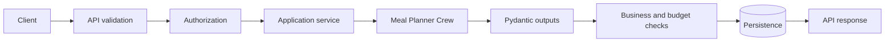

# 46. CrewAI Advanced Engineering

> Your agents have produced a meal plan, shopping list, and budget estimate. Your application needs validated quantities, prices, and totals—not three paragraphs and a hopeful regex.

That is the shift from *getting agents to work* to *engineering a dependable CrewAI application*.

Chapter 44 introduced CrewAI's building blocks. Chapter 45 used them to build a five-agent Meal & Grocery Planner. This chapter takes that same workflow further: reliable data contracts, configuration, lifecycle management, controlled tools, and application integration.

The examples below focus on the engineering layer. The full agent responsibilities and task sequence remain in Chapter 45; we will strengthen selected parts rather than rebuild the workflow.

## 1. Turn agent output into a data contract

Free-form text is useful for people, but unreliable as an interface between software components. Define the structure your application expects with Pydantic:

```python
from pydantic import BaseModel, Field


class GroceryItem(BaseModel):
    name: str
    quantity: float = Field(gt=0)
    unit: str
    estimated_price: float = Field(ge=0)


class GroceryShoppingPlan(BaseModel):
    items: list[GroceryItem]
    estimated_total: float = Field(ge=0)
    budget_remaining: float
    notes: list[str] = []
```

Attach the schema to the task responsible for producing the shopping plan:

```python
shopping_task = Task(
    description=(
        "Create a shopping list for the approved meal plan. "
        "Use the supplied budget and servings. Return item quantities "
        "and estimated prices in the required structure."
    ),
    expected_output="A validated grocery shopping plan.",
    agent=shopping_organizer,
    output_pydantic=GroceryShoppingPlan,
)
```

After kickoff, consume the typed result:

```python
result = crew.kickoff(
    inputs={
        "meal_name": "Vegetarian weekday plan",
        "servings": 4,
        "budget": 2500,
        "dietary_restrictions": "No eggs",
        "cooking_skill": "Beginner",
    }
)

shopping_plan = result.tasks_output[1].pydantic
if shopping_plan is None:
    raise ValueError("Expected a validated grocery shopping plan")

payload = shopping_plan.model_dump(mode="json")
```

The task-output index is illustrative: use the actual task ordering in your crew, or identify the output by task rather than assuming a fixed index.

Use `output_pydantic` when downstream code needs a model instance; use `output_json` when a JSON-style result is more convenient. Schema validation checks shape and types. It does not prove that prices are current, quantities are sensible, or a recommendation is safe. Apply business rules and evidence checks separately.

## 2. Keep changeable instructions in YAML

Agent roles, goals, backstories, and task descriptions often change more frequently than application code. In a classic YAML-based CrewAI project, keep them in `config/agents.yaml` and `config/tasks.yaml`.

`agents.yaml`:

```yaml
shopping_organizer:
  role: >
    Grocery Shopping Organizer
  goal: >
    Convert the approved meal plan into a practical shopping list
    that stays within the supplied budget.
  backstory: >
    You organize ingredients, quantities, and estimated prices
    into a clear and economical shopping plan.
  allow_delegation: false
  verbose: false
```

`tasks.yaml`:

```yaml
shopping_task:
  description: >
    Prepare a grocery list for {servings} servings based on the
    approved meal plan. Respect the budget of {budget}, dietary
    restrictions ({dietary_restrictions}), and cooking skill
    ({cooking_skill}). Include quantities and estimated prices.
  expected_output: >
    A structured shopping plan with item quantities, estimated
    prices, total cost, and remaining budget.
  agent: shopping_organizer
```

The YAML keys must match the names used by the Python crew class. Runtime placeholders such as `{budget}` are populated through `kickoff(inputs={...})`.

**Project-layout note:** current CrewAI project generation is JSON-first. The YAML and decorator examples in this chapter describe the classic project layout. Use `crewai create crew <name> --classic` when intentionally creating that layout; existing classic YAML projects remain supported. Avoid mixing the two layouts without a deliberate migration plan.

## 3. Use CrewBase to organise the workflow

`@CrewBase` groups agent and task factory methods and lets CrewAI collect the decorated components. A compact classic project layout could look like this:

```text
meal_planner/
├── config/
│   ├── agents.yaml
│   └── tasks.yaml
├── schemas.py
├── meal_planner_crew.py
└── service.py
```

In `meal_planner_crew.py`:

```python
from crewai import Agent, Crew, Process, Task
from crewai.project import CrewBase, agent, task, crew
from .schemas import GroceryShoppingPlan


@CrewBase
class MealPlannerCrew:
    agents_config = "config/agents.yaml"
    tasks_config = "config/tasks.yaml"

    @agent
    def shopping_organizer(self) -> Agent:
        return Agent(config=self.agents_config["shopping_organizer"])

    @task
    def shopping_task(self) -> Task:
        return Task(
            config=self.tasks_config["shopping_task"],
            output_pydantic=GroceryShoppingPlan,
        )

    @crew
    def crew(self) -> Crew:
        return Crew(
            agents=self.agents,
            tasks=self.tasks,
            process=Process.sequential,
            verbose=False,
        )
```

The complete workflow has more agents and tasks, as defined in Chapter 45. Add corresponding factory methods and preserve their intended declaration order. Keep the CrewBase class in a regular Python module; its configuration discovery relies on the class's file location, so a notebook is not a dependable home for this project structure.

## 4. Add lifecycle hooks around kickoff

A crew often needs a small amount of work immediately before or after execution. CrewAI provides two optional decorators for this boundary:

- `@before_kickoff` receives the input dictionary before tasks begin. It can validate or enrich inputs and must return the dictionary that should continue into the crew.
- `@after_kickoff` receives the completed crew result. It can inspect or transform the result and must return the result to the caller.

Add these methods to the `MealPlannerCrew` class:

```python
from crewai.project import before_kickoff, after_kickoff


@CrewBase
class MealPlannerCrew:
    # Keep the agents_config, tasks_config, agent, task,
    # and crew methods from the previous example.

    @before_kickoff
    def validate_inputs(self, inputs: dict) -> dict:
        budget = inputs.get("budget")
        servings = inputs.get("servings")

        if budget is None or budget <= 0:
            raise ValueError("budget must be greater than zero")
        if servings is None or servings <= 0:
            raise ValueError("servings must be greater than zero")

        inputs["dietary_restrictions"] = (
            inputs.get("dietary_restrictions") or "None"
        )
        return inputs

    @after_kickoff
    def inspect_result(self, result):
        # Record safe operational metadata here.
        # Avoid logging prompts, secrets, or unnecessary personal data.
        print("Meal planning crew completed")
        return result
```

In a real file, merge these methods into the existing class rather than defining a second class with the same name.

These hooks are useful for input normalisation, lightweight validation, correlation metadata, and post-execution observation. They are not substitutes for API authentication, authorization, transaction management, or durable persistence. Keep those responsibilities in the application layer.

## 5. Assign tools at the right level

CrewAI supports two useful tool-assignment patterns:

| Pattern | What happens | Trade-off |
|---|---|---|
| Agent-centric | An agent receives a toolbox and chooses which tool to call | Flexible, but selection can be less predictable |
| Task-centric | A task receives the tools required for that assignment | More controlled and easier to audit |

For example, a price lookup tool can be restricted to the shopping task:

```python
shopping_task = Task(
    description="Estimate prices for the required grocery items.",
    expected_output="A priced grocery list.",
    agent=shopping_organizer,
    tools=[approved_price_lookup],
    output_pydantic=GroceryShoppingPlan,
)
```

Use agent-level tools when a specialist needs the same capabilities across several tasks. Use task-level tools when a capability should be limited to a specific assignment. In CrewAI, task-level tools take precedence for that task; do not assume the agent's entire toolbox remains available.

## 6. Build custom tools with explicit contracts

A custom tool is application code exposed to an agent—not a magic extension of its reasoning. Keep its purpose narrow and its behaviour predictable:

```python
from crewai.tools import tool


@tool("Calculate grocery budget")
def remaining_budget(budget: float, estimated_total: float) -> float:
    """Return the remaining amount after estimated grocery costs."""
    if budget < 0 or estimated_total < 0:
        raise ValueError("Budget values cannot be negative")

    return round(budget - estimated_total, 2)
```

For tools that call databases or external APIs, add authentication, authorization, timeouts, response limits, input validation, and safe error handling. For more complex inputs, implement `BaseTool` with a dedicated Pydantic `args_schema`.

The tool should calculate or retrieve facts deterministically wherever possible. Do not ask an LLM to perform arithmetic that ordinary application code can perform reliably.

## 7. Put the crew behind an application boundary

The Crew should coordinate AI work. The application should own the request lifecycle, access control, persistence, and external response contract.



A service function might look like this:

```python
def create_meal_plan(request: dict) -> dict:
    validate_request(request)

    result = MealPlannerCrew().crew().kickoff(inputs=request)

    shopping_plan = find_shopping_plan_output(result)
    if shopping_plan is None:
        raise RuntimeError("Structured shopping output was not produced")

    payload = shopping_plan.model_dump(mode="json")
    validate_budget_rules(payload, request["budget"])
    repository.save(payload)

    return payload
```

`find_shopping_plan_output`, `validate_request`, `validate_budget_rules`, and `repository` represent application-specific code; implement them for your task definitions and persistence technology. Do not rely on a hard-coded task-output index in production.

Before exposing this function, add caller authentication, authorization, request IDs, bounded execution time, retry rules, and idempotency for retried requests. Record task duration, tool failures, token usage, and final status without logging secrets or unnecessary personal data. For long-running workflows, enqueue the request and return a job identifier instead of holding an HTTP connection open.

For workflows with branching state or several crews, consider a CrewAI Flow or an external orchestrator to manage the larger process. Keep each Crew focused on the unit of work it is good at.

## Key takeaways

- Pydantic turns agent output into a typed application contract.
- YAML separates frequently edited instructions from executable Python in classic projects.
- `@CrewBase` organises reusable agent and task definitions.
- Kickoff hooks provide explicit pre-execution and post-execution extension points.
- Agent-centric tools offer flexibility; task-centric tools offer tighter control.
- Production integration requires an application boundary around the Crew.
- Reusing the Meal & Grocery Planner across Chapters 45 and 46 connects workflow construction with production engineering.

## Further reading

- [CrewAI Tasks and structured outputs](https://docs.crewai.com/en/concepts/tasks)
- [CrewAI Crews and configuration](https://docs.crewai.com/en/concepts/crews)
- [CrewAI annotations](https://docs.crewai.com/en/learn/using-annotations)
- [CrewAI before and after kickoff hooks](https://docs.crewai.com/en/learn/before-and-after-kickoff-hooks)

## What comes next?

We've taken the Meal & Grocery Planner from a coordinated multi-agent workflow to a more maintainable application component—with structured contracts, lifecycle hooks, controlled tools, and clear integration boundaries. Next, we'll switch frameworks and explore **AutoGen / AG2 Architecture & Core Concepts**, where the focus moves from configured crews and tasks to conversational agent interaction, message exchange, and turn-taking.

## 🧭 Chapter Navigation

⬅️ **Previous:** [45. Building Multi-Agent Systems with CrewAI](45-building-multi-agent-systems-with-crewai-optimised.md)

📚 **Part:** [AI Engineering Frameworks & Tooling](index.md)

➡️ **Next:** [47. AutoGen / AG2 Architecture & Core Concepts](47-autogen-ag2-architecture-and-core-concepts.md)


---

> **Enterprise AI Engineering Handbook**
>
> *Building Production-Grade Enterprise AI Systems — One Chapter at a Time.*

---
