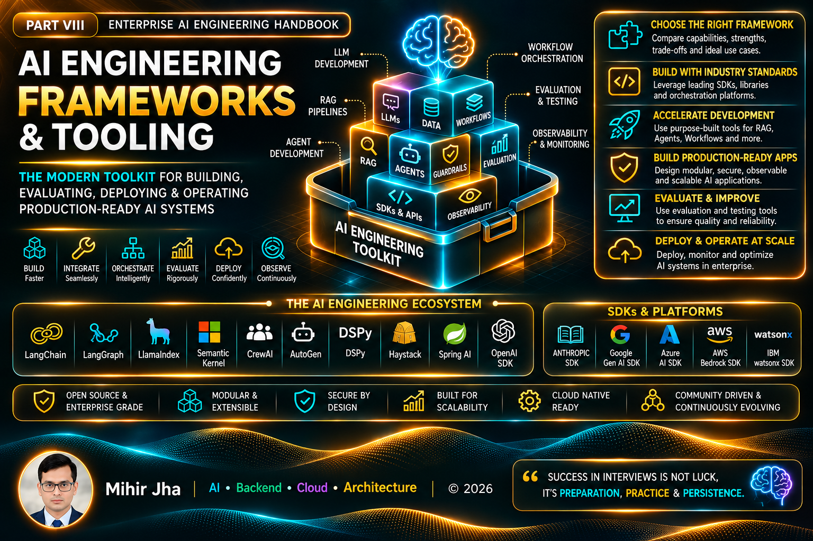
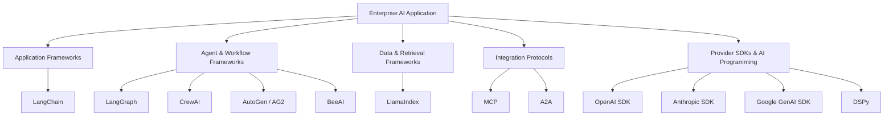
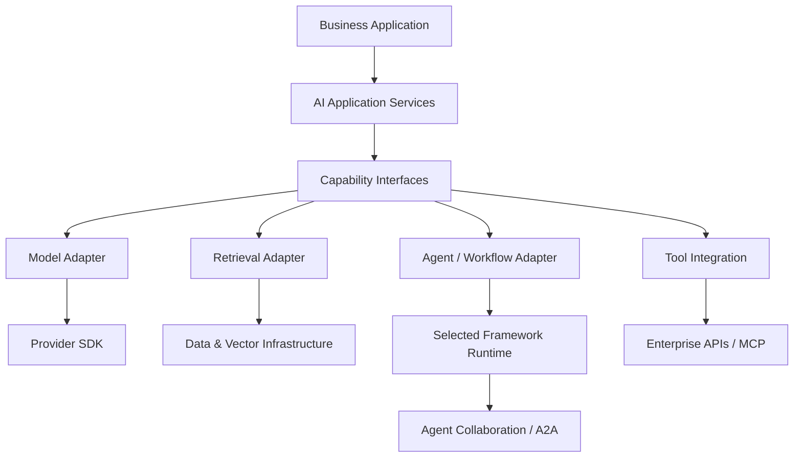
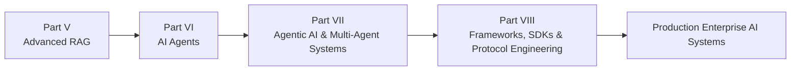

# Part VIII — AI Engineering Frameworks & Tooling

> Learn how to turn AI architectures into working software using frameworks, agent runtimes, integration protocols and provider SDKs. The emphasis is on engineering decisions: how the pieces fit, where abstractions help, and what it takes to operate them reliably.

---

## 📖 Overview

A model API call is only one small part of an enterprise AI application. Real systems also need retrieval, tool integration, workflow control, state management, external-system connectivity, testing and operational visibility.

Part VIII is the implementation-focused part of the handbook. It builds on the concepts introduced earlier and explores the frameworks and protocols engineers use to put those ideas into practice.

The chapters are organised around distinct engineering responsibilities:

- **Application and retrieval frameworks** help connect models to prompts, enterprise data and application components.
- **Agent and workflow frameworks** provide abstractions for tool-using agents, stateful execution and multi-agent collaboration.
- **Integration protocols** standardise how AI applications access external capabilities and communicate with other agents.
- **Provider SDKs and programming tools** offer direct access to model capabilities and ways to optimise AI application behaviour.
- **Framework comparison** brings the implementation choices together from an enterprise architecture perspective.

The goal is not to use the largest possible framework stack. It is to understand the available abstractions, choose the ones that fit the workload, and keep business logic and operational responsibilities clear.

## 🎯 What you'll be able to do

By working through this part, you will learn to:

- Understand the architecture and core abstractions of major AI engineering frameworks.
- Build LLM, RAG, agent and multi-agent applications using practical framework APIs.
- Model stateful workflows and control agent execution.
- Integrate tools, enterprise services and external agents.
- Work with MCP and A2A as complementary integration protocols.
- Evaluate framework boundaries, trade-offs and operational complexity.
- Decide when a framework is useful and when a provider SDK is sufficient.
- Design modular applications without spreading framework-specific types through business logic.
- Assess production concerns such as testing, failure handling, observability, security and deployment.

---

## 🧭 The framework and tooling landscape

The ecosystem is easier to understand by responsibility, rather than as one long list of competing products.

Categories overlap: LangGraph is both an agent framework and a workflow runtime, while LangChain integrations support several application styles. The diagram shows primary roles, not rigid boundaries.

---

## 1. LangChain

> Build LLM-powered applications with reusable abstractions for models, prompts, messages, tools, retrieval and agents.

**Status:** Completed · 8 chapters

| Chapter | Topic |
|---|---|
| 01 | [LangChain Fundamentals](langchain/01-langchain-fundamentals.md) |
| 02 | [LangChain Models & Prompts](langchain/02-langchain-models-and-prompts.md) |
| 03 | [LangChain Tools & Function Calling](langchain/03-langchain-tools-and-function-calling.md) |
| 04 | [LangChain Retrieval & RAG](langchain/04-langchain-retrieval-and-rag.md) |
| 05 | [LangChain Memory & State](langchain/05-langchain-memory-and-state.md) |
| 06 | [LangChain Agents](langchain/06-langchain-agents.md) |
| 07 | [LangChain Production Patterns](langchain/07-langchain-production-patterns.md) |
| 08 | [LangChain Limitations & Trade-offs](langchain/08-langchain-limitations-and-tradeoffs.md) |

This section moves from core abstractions to practical application patterns, then examines the trade-offs that matter when adopting LangChain in a production codebase.

## 2. LlamaIndex

> Build data-centric AI applications with document ingestion, indexing, retrieval, RAG, agents and workflows.

**Status:** Completed · 8 chapters

| Chapter | Topic |
|---|---|
| 01 | [LlamaIndex Fundamentals](llamaindex/01-llamaindex-fundamentals.md) |
| 02 | [Data & Document Ingestion](llamaindex/02-llamaindex-data-and-document-ingestion.md) |
| 03 | [Indexes & Retrieval](llamaindex/03-llamaindex-indexes-and-retrieval.md) |
| 04 | [RAG Pipelines](llamaindex/04-llamaindex-rag-pipelines.md) |
| 05 | [Agents & Tools](llamaindex/05-llamaindex-agents-and-tools.md) |
| 06 | [Workflows](llamaindex/06-llamaindex-workflows.md) |
| 07 | [Production Patterns](llamaindex/07-llamaindex-production-patterns.md) |
| 08 | [Limitations & Trade-offs](llamaindex/08-llamaindex-limitations-and-tradeoffs.md) |

The emphasis here is the data path: connecting enterprise sources, preparing content, building indexes, retrieving useful context and incorporating retrieval into AI applications.

## 3. LangGraph

> Design stateful agent and application workflows with explicit state, nodes, edges, routing and checkpointing.

**Status:** Completed · 10 chapters

| Chapter | Topic |
|---|---|
| 01 | [LangGraph Fundamentals](langgraph/01-langgraph-fundamentals.md) |
| 02 | [Graph-Based Agent Architecture](langgraph/02-graph-based-agent-architecture.md) |
| 03 | [State & Checkpointing](langgraph/03-langgraph-state-and-checkpointing.md) |
| 04 | [Nodes, Edges & Routing](langgraph/04-langgraph-nodes-edges-and-routing.md) |
| 05 | [Human-in-the-Loop](langgraph/05-langgraph-human-in-the-loop.md) |
| 06 | [Tool Execution](langgraph/06-langgraph-tool-execution.md) |
| 07 | [Agent Workflows](langgraph/07-langgraph-agent-workflows.md) |
| 08 | [Memory & Persistence](langgraph/08-langgraph-memory-and-persistence.md) |
| 09 | [Production Patterns](langgraph/09-langgraph-production-patterns.md) |
| 10 | [Limitations & Trade-offs](langgraph/10-langgraph-limitations-and-tradeoffs.md) |

This section focuses on explicit workflow control: representing execution as a graph, managing state across steps, introducing human decisions and designing workflows that can be inspected and resumed.

## 4. MCP Engineering

> Implement the Model Context Protocol in real applications: build servers and clients, connect multiple servers, integrate frameworks and engineer secure deployments.

**Status:** Completed · 10 chapters

| Chapter | Topic |
|---|---|
| 01 | [MCP Engineering Fundamentals](mcp-engineering/01-mcp-engineering-fundamentals.md) |
| 02 | [Building MCP Servers](mcp-engineering/02-building-mcp-servers.md) |
| 03 | [Building MCP Clients](mcp-engineering/03-building-mcp-clients.md) |
| 04 | [MCP Multi-Server Integration](mcp-engineering/04-mcp-multi-server-integration.md) |
| 05 | [Advanced MCP Capabilities](mcp-engineering/05-advanced-mcp-capabilities.md) |
| 06 | [MCP Integration with RAG Systems](mcp-engineering/06-mcp-integration-with-rag-systems.md) |
| 07 | [MCP Integration with AI Frameworks](mcp-engineering/07-mcp-integration-with-ai-frameworks.md) |
| 08 | [MCP Security & Production Engineering](mcp-engineering/08-mcp-security-production-engineering.md) |
| 09 | [MCP Testing, Debugging & Observability](mcp-engineering/09-mcp-testing-debugging-observability.md) |
| 10 | [Enterprise MCP Architecture & Design Patterns](mcp-engineering/10-enterprise-mcp-architecture-design-patterns.md) |

MCP is treated here as an engineering technology. Its broader role in agentic architectures belongs to the conceptual discussion in Part VII; this section concentrates on implementation and integration.

## 5. A2A Protocol Engineering

> Connect independently built agents through discovery, messages, tasks and interoperable execution.

**Status:** Completed · 7 chapters

| Chapter | Topic |
|---|---|
| 01 | [A2A Protocol Engineering Fundamentals](a2a-engineering/01-a2a-protocol-engineering-fundamentals.md) |
| 02 | [Agent Cards, Discovery & Interoperability](a2a-engineering/02-a2a-agent-cards-discovery-interoperability.md) |
| 03 | [Building A2A Agents & Clients](a2a-engineering/03-building-a2a-agents-and-clients.md) |
| 04 | [Messages, Tasks & Execution Lifecycle](a2a-engineering/04-a2a-messages-tasks-and-execution-lifecycle.md) |
| 05 | [Streaming & Asynchronous Communication](a2a-engineering/05-a2a-streaming-and-asynchronous-communication.md) |
| 06 | [Security, Testing & Production Operations](a2a-engineering/06-a2a-security-testing-production-operations.md) |
| 07 | [Enterprise A2A Architecture & Design Patterns](a2a-engineering/07-enterprise-a2a-architecture-and-design-patterns.md) |

MCP and A2A solve different integration problems: MCP connects an application or agent to tools and contextual capabilities; A2A enables communication and task interaction between agents. The implementation chapters keep those responsibilities distinct.

## 6. CrewAI Engineering

> Build role-oriented agent teams and combine collaborative tasks with structured application workflows.

**Status:** Completed · 3 chapters

| Chapter | Topic |
|---|---|
| 01 | [CrewAI Architecture & Core Concepts](crewai-engineering/01-crewai-architecture-and-core-concepts.md) |
| 02 | [Building Multi-Agent Systems with CrewAI](crewai-engineering/02-building-multi-agent-systems-with-crewai.md) |
| 03 | [CrewAI Advanced Engineering](crewai-engineering/03-crewai-advanced-engineering.md) |

## 7. AutoGen / AG2 Engineering

> Explore conversational multi-agent systems, coordination patterns, tool integration and production-oriented implementation.

**Status:** Completed · 4 chapters

| Chapter | Topic |
|---|---|
| 01 | [AutoGen / AG2 Architecture & Core Concepts](autogen-engineering/01-autogen-ag2-architecture-and-core-concepts.md) |
| 02 | [Building Conversational Multi-Agent Systems](autogen-engineering/02-building-conversational-multi-agent-systems.md) |
| 03 | [Advanced Agent Orchestration & Workflow Design](autogen-engineering/03-advanced-agent-orchestration-and-workflow-design.md) |
| 04 | [AG2 Tools, Structured Outputs & Production Engineering](autogen-engineering/04-ag2-tools-structured-outputs-and-production-engineering.md) |

The AG2 material follows the API generation documented in its chapters. Check compatibility and migration guidance before treating newer AG2 releases as drop-in replacements for older Classic-style examples.

## 8. BeeAI Engineering

> Build provider-flexible agents with tools, execution requirements, multi-agent handoffs and production runtime capabilities.

**Status:** Completed · 3 chapters

| Chapter | Topic |
|---|---|
| 01 | [BeeAI Architecture & Agent Development](beeai-engineering/01-beeai-architecture-agent-development.md) |
| 02 | [BeeAI Agent Control, Tools & Multi-Agent Integration](beeai-engineering/02-beeai-agent-control-tools-multi-agent-integration.md) |
| 03 | [BeeAI Production Engineering, Runtime & Deployment](beeai-engineering/03-beeai-production-engineering-runtime-deployment.md) |

## 9. Enterprise AI Framework Comparison

> Step back from individual APIs and compare the execution models, architectural trade-offs and enterprise fit of the frameworks covered in this part.

**Status:** Chapter 54 · Available

[01. Enterprise AI Framework Comparison](01-enterprise-ai-framework-comparison.md)

The comparison covers:

- LangChain vs LangGraph
- LangGraph vs CrewAI
- CrewAI vs AutoGen / AG2
- BeeAI vs other agent frameworks
- Framework abstraction models
- Workflow and agent orchestration
- State and memory management
- Tool integration and protocol support
- Production readiness
- Enterprise framework selection

The goal is not to crown a winner, but to identify which abstraction fits a workload, what trade-offs it introduces and what to validate before adoption.

---

## 🔭 Planned additions

The current framework and protocol sections above reflect the repository structure. The following areas remain candidates for future expansion:

| Area | Planned focus |
|---|---|
| **Microsoft Semantic Kernel** | Kernel architecture, plugins, orchestration and enterprise integration |
| **DSPy** | Declarative AI programming, signatures, modules and evaluation-driven optimisation |
| **Haystack** | Pipelines, retrieval, components and production RAG architectures |
| **OpenAI SDK** | Responses API, tools, structured outputs, streaming and agent capabilities |
| **Anthropic SDK** | Messages API, tool use, structured outputs and provider-specific features |
| **Google GenAI SDK** | Gemini APIs, multimodal capabilities, tools and application integration |

These are planned additions, not completed chapters. Their placement and chapter numbering can be finalised when the corresponding engineering sections are ready.

---

## 🏢 The enterprise architecture perspective

Frameworks should make an architecture easier to implement—not dictate the architecture by default.

A maintainable application keeps business rules and domain models separate from framework-specific objects. Where portability matters, define small capability interfaces around the dependencies that genuinely need to be replaceable.

This is an option, not a requirement to wrap every framework class. Add an abstraction when it protects a boundary or creates a useful testing or replacement seam—not when it merely renames an API.

## 🧪 What production-focused chapters should address

Framework-specific implementation details differ, but the engineering questions are familiar:

- **Architecture:** What runs in-process, what is external, and where are the boundaries?
- **Execution:** How are steps, tool calls, retries, cancellation and timeouts controlled?
- **State:** What is transient context, what is persisted, and who owns durable business data?
- **Integration:** How are models, tools, retrieval systems and protocols connected?
- **Testing:** Can core behaviour be tested with deterministic fixtures as well as live providers?
- **Evaluation:** Are task quality, groundedness and regression behaviour measured?
- **Operations:** Can teams trace failures, manage capacity and deploy compatible versions safely?
- **Security:** Are identity, permissions, secrets and tenant boundaries enforced by the application?

Address these concerns where relevant; avoid repeating the same generic checklist in every chapter.

## 🔗 How Part VIII fits into the handbook

The earlier parts establish the concepts and architecture; Part VIII focuses on implementation.

- **Part V** explains how to retrieve and ground knowledge.
- **Part VI** focuses on engineering individual AI agents.
- **Part VII** explores autonomous systems, collaboration, orchestration and protocol architecture.
- **Part VIII** implements those ideas using frameworks, SDKs and integration protocols.

In short: earlier parts establish the **what** and **why**; this part concentrates on the **how**.

## 🚀 Where to begin

If you are new to this part, start with [LangChain Fundamentals](langchain/01-langchain-fundamentals.md), then explore the sections according to the system you want to build:

- Working with enterprise data and retrieval? Start with **LlamaIndex**.
- Need explicit, stateful workflow control? Explore **LangGraph**.
- Connecting applications to external tools? Explore **MCP Engineering**.
- Connecting independently deployed agents? Explore **A2A Engineering**.
- Building specialist agent teams? Explore **CrewAI** or **AutoGen / AG2**.
- Looking for provider-flexible agents with execution requirements? Explore **BeeAI**.
- Comparing the architectural trade-offs? Read [Enterprise AI Framework Comparison](01-enterprise-ai-framework-comparison.md).

Follow the path that answers a real engineering question, not necessarily the one with the most frameworks.

---

> **Enterprise AI Engineering Handbook**
>
> *Building Production-Grade Enterprise AI Systems — One Chapter at a Time.*

---