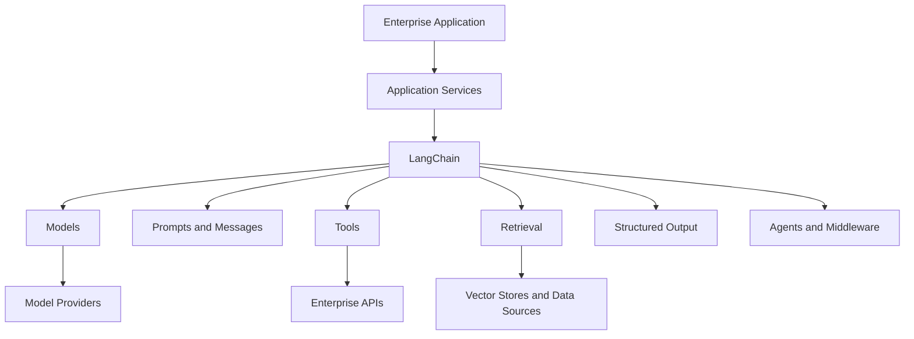
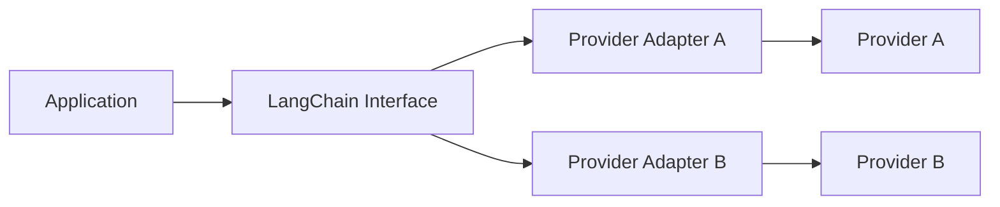
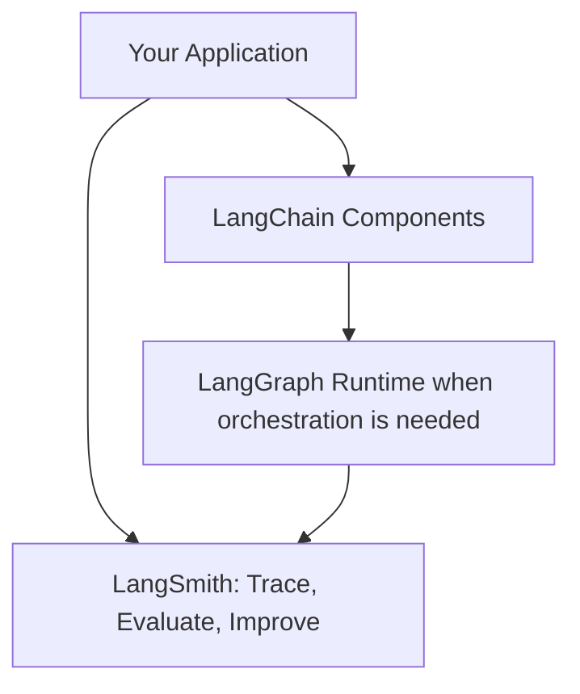

# 01 — LangChain Fundamentals

> Understand LangChain's role in the modern AI application stack, its core abstractions, and where it belongs in an enterprise architecture.

## 📖 Overview

A support assistant starts as one model call. Then the team asks it to search policy documents, check an order, return a validated JSON object and remember the conversation. The challenge is no longer calling a model; it is connecting the moving parts without turning the application into a pile of custom glue code. That is where LangChain can help.



The framework is not the model, provider, database, or business application. It is an application-development layer that connects them.

## 🎯 Learning Objectives

- Explain LangChain's purpose and boundaries.
- Distinguish a framework from a provider SDK.
- Recognize the major LangChain building blocks.
- Understand the relationship between LangChain, LangGraph, and LangSmith.
- Decide when a framework abstraction is useful.

## 1. What Is LangChain?

LangChain is an open-source framework for developing LLM-powered applications and agents. It offers common interfaces for models, messages, prompts, tools, retrieval, structured outputs, and agent construction.

A simplified request path is:

```text
Application → LangChain abstraction → Provider integration → Model API
```

LangChain does not perform the model's reasoning itself. The model generates responses; application code and the runtime decide how to validate inputs, execute tools, manage state, and handle failures.

## 2. Why Use an AI Framework?

A direct provider call is often ideal for a small feature:

```python
response = client.responses.create(
    model="provider-model",
    input="Explain event-driven architecture."
)
```

As requirements grow, applications independently implement provider adapters, prompt construction, tool schemas, retries, retrieval, parsing, and tracing. Repeated implementations become difficult to maintain.

A framework can standardize common patterns and reduce integration code. This is a trade-off, not a universal requirement: an additional abstraction also adds dependencies and behavior that engineers must understand.

## 3. Framework vs Provider SDK

| Provider SDK | LangChain |
|---|---|
| Direct access to a provider's API | Higher-level application abstractions |
| Exposes provider-specific features quickly | Offers common interfaces across integrations |
| Usually fewer abstraction layers | Convenient composition of models, tools and retrieval |
| Provider-specific implementation | Potentially easier integration replacement |



A common interface does **not** make providers identical. Context limits, tool semantics, structured-output support, multimodal capabilities, pricing, latency, and rate limits still differ. Keep provider-specific options behind a deliberate adapter or configuration boundary.

## 4. The Package Landscape

LangChain is modular. Most applications use a small subset of its packages:

- `langchain-core` contains foundational interfaces and abstractions such as messages, prompts, documents and runnables.
- `langchain` provides higher-level application patterns, including agents.
- Provider packages (for example, `langchain-openai` or `langchain-ibm`) connect those abstractions to specific model providers.
- Community and integration packages connect loaders, vector stores and other external systems.

Install only the integrations your application needs, and pin compatible versions in a lockfile.

## 5. Core Building Blocks

| Building block | Responsibility |
|---|---|
| Chat models | Accept messages and produce AI messages |
| Prompts and messages | Represent instructions, user input and conversation turns |
| Tools | Expose typed operations that a model may request |
| Structured output | Constrain or parse model responses into a schema |
| Retrieval | Find relevant documents from external data |
| Agents | Let a model choose tools and iterate toward a goal |
| Middleware | Intercept or modify agent execution at defined points |
| State and persistence | Preserve conversation/task information |
| Observability | Trace, inspect and evaluate execution |

These concepts are explored in depth in the following chapters. This chapter establishes the vocabulary rather than repeating their full implementation details.

## 6. A Minimal LangChain Application

The current model interface supports a simple invocation pattern. Install the provider integration that matches the model you use; package names and model identifiers are provider-specific.

```bash
pip install langchain langchain-openai
```

```python
from langchain.chat_models import init_chat_model

model = init_chat_model(
    "openai:<model-name>",
    temperature=0
)

response = model.invoke("Explain bounded contexts in DDD.")
print(response.content)
```

Replace `<model-name>` with a model identifier supported by the selected provider. Keep credentials in environment variables or a secret manager; never hard-code API keys.

## 7. From Invocation to Application

A typical application grows in controlled stages:

```text
User request
   ↓
Application service (authentication, validation, business rules)
   ↓
Prompt + model
   ↓
Optional retrieval / tools
   ↓
Output validation
   ↓
Response + trace + audit event
```

Do not place every concern inside an agent. Authentication, authorization, tenant isolation, transaction management, and critical business rules belong in trusted application services. A model may propose an action; the application must decide whether it is allowed.

## 8. LangChain, LangGraph and LangSmith

These products are related but have different responsibilities:

- **LangChain** provides components and a high-level way to build model-powered applications and agents.
- **LangGraph** provides lower-level orchestration for stateful, controllable, long-running workflows and agents, including persistence and human-in-the-loop patterns.
- **LangSmith** supports tracing, evaluation, testing and operational visibility for LLM applications.



You do not need to use all three. Choose the layer that solves the actual problem.

## 9. Common Design Mistakes

- Treating LangChain as an LLM or vector database.
- Assuming provider abstraction guarantees identical model behavior.
- Putting authorization or business-critical decisions in prompts.
- Introducing an agent where a deterministic function or workflow is sufficient.
- Hiding all application logic inside one large chain or agent.
- Upgrading framework packages without testing integration behavior.

## Key Takeaways

- LangChain is an application framework, not a model or infrastructure service.
- Its value comes from reusable abstractions and integrations.
- Provider portability has limits; capabilities and behavior still vary.
- Keep business rules, security and data ownership in the application boundary.
- Use LangGraph for more explicit stateful orchestration and LangSmith for observability and evaluation.

## 🧭 Chapter Navigation

⬅️ **Previous:** [AI Engineering Frameworks & Tooling](../../07-agentic-ai/index.md)

📚 **Part:** [AI Engineering Frameworks & Tooling](../index.md)

➡️ **Next:** [02. LangChain Models & Prompts](02-langchain-models-and-prompts.md)

---

> **Enterprise AI Engineering Handbook**
>
> *Building Production-Grade Enterprise AI Systems — One Chapter at a Time.*

---
