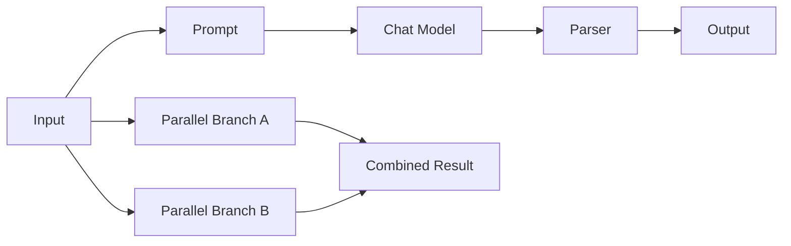

# 02 — LangChain Models & Prompts

> Learn how LangChain represents chat interactions, configures models, builds reusable prompts, and supports streaming, batching and provider-aware application design.

## 📖 Overview

Imagine a claims assistant that must answer in a consistent tone, use the right policy context and return fields that a downstream service can consume. The model matters, but so do the messages, prompt structure, output contract and execution path. This chapter connects those pieces.


## 🎯 Learning Objectives

- Initialize and invoke chat models.
- Understand message roles and prompt templates.
- Compose prompts and models.
- Configure generation behavior.
- Use streaming, asynchronous calls and batching appropriately.
- Design for provider differences and operational controls.

## 1. Chat Models and Provider Abstraction

A chat model consumes messages rather than just a raw string. The common interface reduces provider-specific code, but it does not erase differences in context windows, supported modalities, tool calling, structured output, tokenization, pricing or rate limits.

```python
from langchain.chat_models import init_chat_model

model = init_chat_model(
    "openai:<model-name>",
    temperature=0,
    timeout=30,
    max_retries=2,
)
```

Install the provider package required by your integration. Keep model names and provider options in environment-specific configuration rather than scattering them through business code.

## 2. Messages: The Conversation Contract

The main message types are:

| Message | Meaning |
|---|---|
| `SystemMessage` | Instructions and behavioral context |
| `HumanMessage` | User or application-provided input |
| `AIMessage` | Model output; may include tool calls and metadata |
| `ToolMessage` | Result returned by a tool execution |

```python
from langchain_core.messages import (
    SystemMessage, HumanMessage
)

messages = [
    SystemMessage(content="You are a concise enterprise architect."),
    HumanMessage(content="Explain event-driven architecture.")
]

result = model.invoke(messages)
print(result.content)
```

A conversation is a sequence of messages. Preserve roles and tool-call relationships; flattening everything into one string can lose important structure.

## 3. Prompt Templates

A prompt template separates reusable instructions from runtime values. This improves consistency and makes prompts easier to test and version.

```python
from langchain_core.prompts import ChatPromptTemplate

prompt = ChatPromptTemplate.from_messages([
    ("system", "You are an enterprise {role}. Be precise."),
    ("human", "Explain {topic} for a {audience} audience.")
])

messages = prompt.invoke({
    "role": "architect",
    "topic": "event-driven architecture",
    "audience": "backend engineering"
})
```

Templates should make variable boundaries explicit. Treat retrieved documents and user-supplied text as untrusted data, not as instructions that override system policy.

## 4. Compose Prompt and Model

LangChain's Runnable composition uses the pipe operator to connect compatible stages.

```python
from langchain_core.output_parsers import StrOutputParser

chain = prompt | model | StrOutputParser()

answer = chain.invoke({
    "role": "architect",
    "topic": "event-driven architecture",
    "audience": "backend engineering"
})
print(answer)
```

Conceptually:

```text
Input dictionary → PromptValue/messages → Model → Output parser → String
```

Each stage has a defined input and output. This composability makes it easier to replace a prompt, model or parser independently.

## 5. LCEL and Runnable Composition

LangChain Expression Language (LCEL) composes compatible components with the pipe operator. Each stage receives the previous stage's output. The prompt → model → parser chain from the previous section is a `RunnableSequence`: a readable sequence of transformations.

A parallel runnable sends the same input to independent branches and returns a dictionary of results:

```python
from langchain_core.runnables import RunnableParallel

analysis = RunnableParallel(
    summary=prompt | model | StrOutputParser(),
    raw_question=lambda data: data["topic"]
)
result = analysis.invoke({
    "role": "architect",
    "topic": "CQRS",
    "audience": "backend engineering"
})
```

LCEL can coerce a sequence into a runnable, a dictionary into parallel execution, and a function into a `RunnableLambda`. `RunnablePassthrough` is useful when a branch must preserve its input unchanged; `RunnableLambda` wraps a custom transformation. Parallel branches should be independent; they are not a substitute for workflow dependencies.



## 6. Model Parameters

| Parameter | Purpose | Engineering consideration |
|---|---|---|
| `temperature` | Sampling variability | Lower values are often useful for constrained tasks; not a factuality guarantee |
| `max_tokens` / provider equivalent | Output limit | Exact parameter name and semantics can vary by provider |
| `timeout` | Bound request duration | Set against the service's latency budget |
| `max_retries` | Retry selected failures | Avoid retrying non-retryable errors or multiplying retries across layers |
| `stop` | Stop sequences, if supported | Provider-specific behavior may differ |

Temperature is not a quality slider. A low value does not guarantee correctness, and a high value does not automatically mean creativity is useful. Choose settings based on task behavior and evaluate them.

## 7. Streaming, Async and Batching

Use the execution mode that matches the application:

- `invoke()` for a single synchronous request.
- `ainvoke()` in asynchronous services.
- `stream()` to consume incremental output.
- `astream()` for asynchronous streaming.
- `batch()` for multiple independent inputs, subject to provider limits.

```python
# Synchronous streaming
for chunk in chain.stream({
    "role": "architect",
    "topic": "CQRS",
    "audience": "backend engineers"
}):
    print(chunk, end="", flush=True)
```

Streaming improves perceived responsiveness but complicates cancellation, partial-output handling, moderation and client disconnects. Do not treat a partial stream as a validated final answer.

## 8. Token Usage and Operational Controls

Model responses may include provider metadata and usage information. Capture it when available to understand:

- Input and output token consumption.
- Cost by model, tenant, feature and request.
- Latency and retry rates.
- Truncation or context-window failures.

Use a token budget for the complete request: system instructions, history, retrieved context, tool results and expected output all consume context. Trim or summarize history and retrieve only relevant material rather than sending everything.

## 9. Few-Shot Examples and Structured Output

Few-shot prompts include examples that show the model the expected input/output pattern. Example selectors can choose relevant examples dynamically—for instance, by semantic similarity or maximum marginal relevance—rather than inserting the same examples into every prompt.

```python
from langchain_core.prompts import FewShotPromptTemplate, PromptTemplate

examples = [
    {"term": "RTO", "meaning": "Recovery Time Objective"},
    {"term": "RPO", "meaning": "Recovery Point Objective"},
]
example_prompt = PromptTemplate.from_template(
    "Term: {term}\nMeaning: {meaning}"
)

prompt = FewShotPromptTemplate(
    examples=examples,
    example_prompt=example_prompt,
    suffix="Term: {question}\nMeaning:",
    input_variables=["question"]
)
```

When an application needs machine-readable output, prefer a schema-backed response where the model/provider supports it, then validate the result in application code. Output parsers can convert model output into JSON, XML, CSV, lists or tabular structures. Prefer schema-backed output when supported, and validate the result in application code: parsing success does not prove the content is correct.

```python
from pydantic import BaseModel, Field

class IncidentSummary(BaseModel):
    severity: str = Field(description="Incident severity")
    impact: str
    next_action: str

structured_model = model.with_structured_output(IncidentSummary)
summary = structured_model.invoke("Summarize the incident: API latency is 4s...")
```

## 10. Recognizing Earlier Chain APIs

Existing codebases may contain `LLMChain` and `SequentialChain`. They express useful ideas—a prompt/model call and a sequence of dependent steps—but modern examples generally compose Runnables with LCEL. Keep the older names in mind when reading legacy applications; avoid introducing them into new examples without a specific compatibility reason.

## 11. Provider Portability: Practical Limits

A shared interface helps with common operations, but a provider migration still requires testing:

1. Confirm the target model supports required features.
2. Compare tool-call and structured-output behavior.
3. Validate multimodal input/output requirements.
4. Re-test prompts and quality on representative cases.
5. Recalculate latency, token cost and rate limits.
6. Review provider-specific options and error handling.

Use a model factory or configuration boundary so routing decisions do not leak into domain logic.

## Common Mistakes

- Treating every message as interchangeable text.
- Assuming prompt templates sanitize untrusted content.
- Hard-coding provider-specific model names throughout the codebase.
- Using retries without timeouts, backoff or an overall deadline.
- Streaming output before considering validation and safety.
- Assuming provider-independent APIs imply provider-independent behavior.

## Key Takeaways

Messages are the conversation contract; prompt templates make instructions reusable; Runnable composition connects application stages. Production model design also requires explicit configuration, token budgeting, observability and provider capability testing.

## 🧭 Chapter Navigation

⬅️ **Previous:** [01. LangChain Fundamentals](01-langchain-fundamentals.md)

📚 **Part:** [AI Engineering Frameworks & Tooling](../index.md)

➡️ **Next:** [03. LangChain Tools & Function Calling](03-langchain-tools-and-function-calling.md)

---

> **Enterprise AI Engineering Handbook**
>
> *Building Production-Grade Enterprise AI Systems — One Chapter at a Time.*

---
