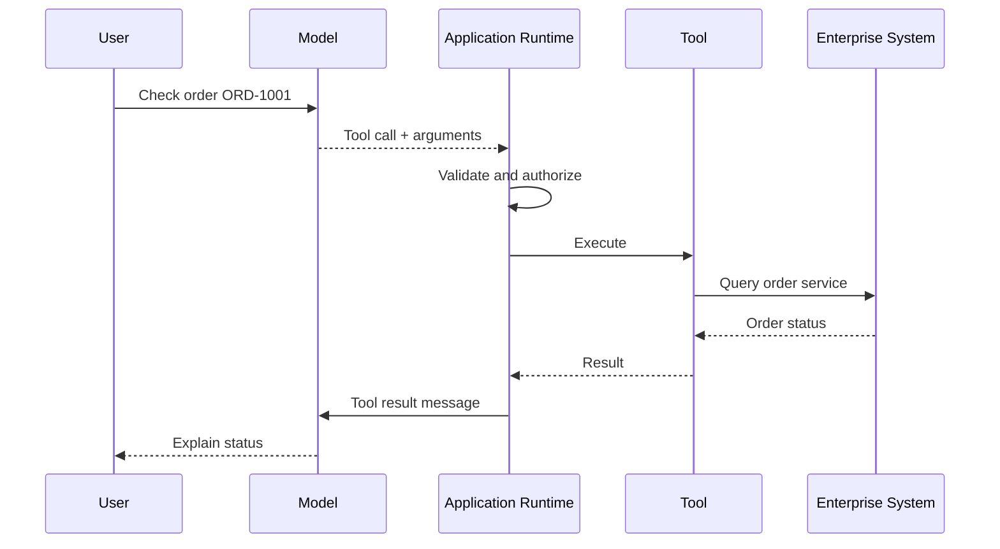
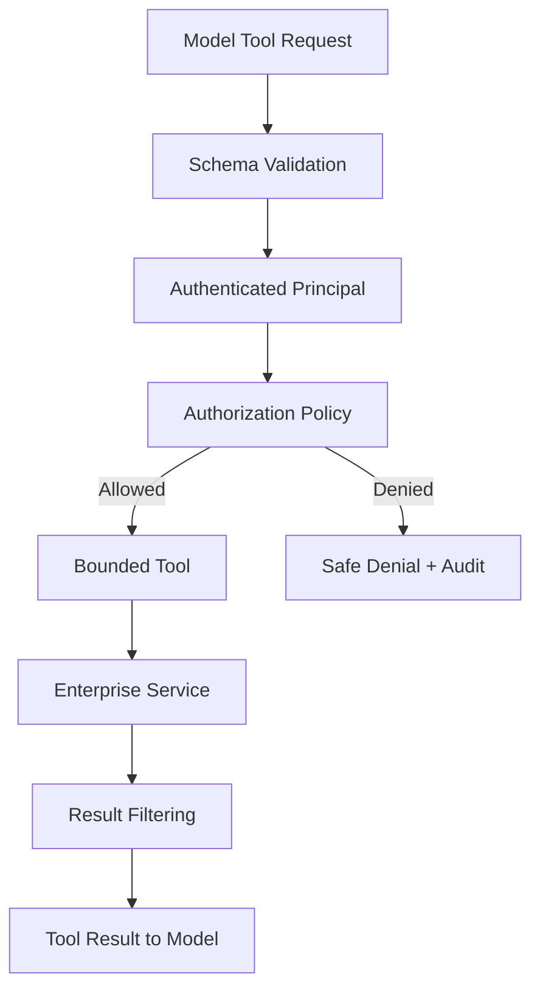

# 03 — LangChain Tools & Function Calling

> Understand how models request external operations, how LangChain defines and executes tools, and how to secure tool-enabled enterprise applications.

## 📖 Overview

A model can explain an order-tracking process. It cannot know whether order ORD-1001 shipped five minutes ago unless the application gives it a way to ask the order service. A LangChain tool is that controlled doorway: a named operation with a clear input contract and bounded behavior.

**Tool calling is a request, not execution.** The model proposes a tool name and arguments; the application/runtime validates and executes the operation.



## 🎯 Learning Objectives

- Define tools with schemas and descriptions.
- Bind tools to chat models and inspect tool calls.
- Understand runtime execution and tool messages.
- Handle multiple calls and errors.
- Design secure, reliable enterprise tools.

## 1. What Is a LangChain Tool?

A tool is a callable function with a name, description, input schema and execution logic. Type hints define the expected input shape; a useful docstring helps the model select the tool correctly.

```python
from langchain.tools import tool

@tool
def get_order_status(order_id: str) -> str:
    """Return the current delivery status for a known order ID."""
    # Replace with an authenticated service call.
    return f"Order {order_id}: in transit"
```

A tool should do one well-defined job, such as `get_order_status(order_id)`, rather than exposing generic SQL or arbitrary HTTP access. Its schema is part of the model-facing interface, not a security boundary.

## 2. Descriptions and Schemas Matter

Weak tool descriptions create ambiguous selection:

```python
@tool
def search(query: str) -> str:
    """Search."""
    ...
```

Prefer descriptions that explain purpose, input meaning, scope and limitations:

```python
@tool
def search_policy(question: str, country: str) -> str:
    """Search approved HR policy documents for a country.
    Use for policy questions; do not use for customer orders."""
    ...
```

Use precise parameter names, types, constraints and return values. Do not expose internal implementation details or secrets in tool descriptions.

## 3. Binding Tools to a Model

```python
from langchain.chat_models import init_chat_model
from langchain.tools import tool

@tool
def calculate_tax(amount: float, rate: float) -> float:
    """Calculate tax for a taxable amount and decimal tax rate."""
    return amount * rate

model = init_chat_model("openai:<model-name>", temperature=0)
model_with_tools = model.bind_tools([calculate_tax])

response = model_with_tools.invoke(
    "Calculate tax on 1200 at 18 percent."
)
print(response.tool_calls)
```

The model may return one or more tool calls in the `AIMessage`. The model has not necessarily run them. The application must inspect and execute approved calls, then send corresponding tool results back into the conversation—or use a higher-level agent runtime to manage the loop.

## 4. Tool Call Lifecycle

```text
AIMessage(tool_calls=[...])
        ↓
Runtime validates tool name and arguments
        ↓
Authorization / policy checks
        ↓
Tool function executes
        ↓
ToolMessage(tool_call_id, content)
        ↓
Model receives result and continues
```

A `tool_call_id` correlates a result with the request that produced it. Preserve this relationship, especially when multiple calls are pending or run concurrently.

## 5. Multiple and Parallel Tool Calls

A model may request several independent operations in one response. Parallel execution can reduce latency when operations are independent, but it is not automatically safe.

- Run independent read-only calls concurrently when appropriate.
- Sequence dependent operations (for example, create an order, then fetch its status).
- Bound concurrency and apply per-tool timeouts.
- Preserve call IDs and result ordering.
- Avoid parallelizing writes unless idempotency and transaction semantics are designed.

## 6. Tool Error Handling

Return controlled, useful errors rather than raw stack traces or secrets. Distinguish:

| Failure | Typical handling |
|---|---|
| Invalid arguments | Reject; do not blindly retry |
| Unauthorized | Deny and audit |
| Not found | Return a safe domain result |
| Rate limited / transient network failure | Bounded retry with backoff |
| Downstream unavailable | Fail gracefully or use an approved fallback |
| Partial write / unknown outcome | Reconcile using idempotency key or operation status |

A retry can repeat a side effect. Write tools should use idempotency keys, deduplication or explicit operation state.

## 7. Enterprise Tool Security

Never rely on the model to enforce permissions. Authorization must be performed by trusted application code using the authenticated principal and tenant context.



Apply these controls:

- **Least privilege:** expose narrow operations, not unrestricted database or shell access.
- **Tenant isolation:** derive tenant identity from trusted authentication context, never from model-generated arguments alone.
- **Input validation:** validate identifiers, ranges, formats and business constraints.
- **Output minimization:** return only fields needed for the task.
- **Human approval:** require confirmation for payments, deletion, account changes or other high-impact actions.
- **Auditability:** record actor, tenant, tool, arguments (redacted), outcome and correlation ID.
- **Prompt-injection resistance:** treat tool output and retrieved content as untrusted data.

## 8. Read and Write Operations

Read tools retrieve information; write tools change external state. A write operation needs stronger authorization and a defined outcome when the caller times out or retries. Use idempotency keys or operation-status checks to prevent duplicate side effects. Keep high-impact actions behind explicit approval where required.

## 9. Tool Gateway Pattern

In larger systems, tools can call an application-owned gateway rather than directly accessing every backend. The gateway centralizes authentication propagation, authorization, rate limits, schema validation, retries, audit and downstream routing.

This keeps the model-facing interface stable while enterprise services evolve.

## Common Mistakes

- Assuming a tool call from a model is already executed.
- Treating a schema as authorization.
- Giving agents broad database, filesystem or shell access.
- Returning excessive sensitive data to the model.
- Retrying non-idempotent writes.
- Using vague descriptions or overlapping tool names.
- Running dependent operations in parallel.

## Key Takeaways

Tools bridge model decisions and external capabilities. The runtime—not the model—owns validation, authorization and execution. Narrow tools, deterministic business logic, least privilege, idempotency and audit trails are essential for production use.

## 🧭 Chapter Navigation

⬅️ **Previous:** [02. LangChain Models & Prompts](02-langchain-models-and-prompts.md)

📚 **Part:** [AI Engineering Frameworks & Tooling](../index.md)

➡️ **Next:** [04. LangChain Retrieval & RAG](04-langchain-retrieval-and-rag.md)

---

> **Enterprise AI Engineering Handbook**
>
> *Building Production-Grade Enterprise AI Systems — One Chapter at a Time.*

---
