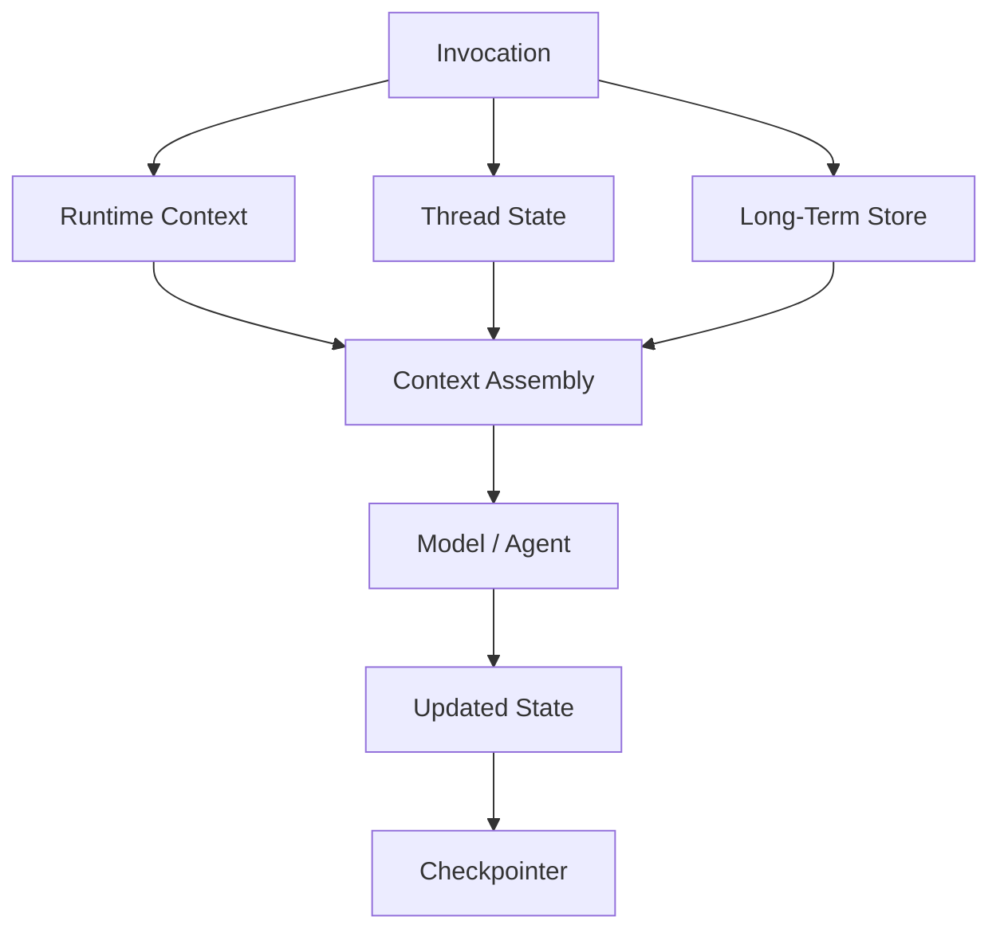

# 05 — LangChain Memory & State

> Understand how modern LangChain applications preserve conversation state, retrieve long-term information, and control what enters the model context.

## 📖 Overview

A customer tells an assistant their project is Atlas. Ten minutes later, they ask, “What did we call the project?” The model will not know unless the application restores the relevant conversation state or retrieves an approved long-term memory. The engineering challenge is deciding what to keep, where to keep it and what is safe to send back to the model.



## 🎯 Learning Objectives

- Distinguish runtime context, state, short-term memory and long-term memory.
- Understand threads and checkpointers.
- Manage conversation history and context windows.
- Design long-term memory retrieval and lifecycle policies.
- Secure and evaluate memory in multi-tenant applications.

## 1. Four Different Concepts

| Concept | Scope | Typical contents |
|---|---|---|
| Runtime context | One invocation | Authenticated user, tenant, permissions, service clients, request metadata |
| State / short-term memory | One thread | Messages, task progress, tool results, temporary values |
| Long-term memory / store | Across threads | User preferences or durable facts approved for reuse |
| Model context | One model call | The selected instructions, messages, retrieved memories and evidence sent now |

Do not confuse stored information with model context. Persisting a large history does not mean sending the entire history to the model on every call.

## 2. Threads and Checkpointers

A thread identifies a continuing conversation or task. A checkpointer saves state snapshots so execution can resume across invocations.

```python
from langgraph.checkpoint.memory import InMemorySaver
from langchain.agents import create_agent

checkpointer = InMemorySaver()

agent = create_agent(
    model="openai:<model-name>",
    tools=[],
    checkpointer=checkpointer
)

config = {"configurable": {"thread_id": "conversation-123"}}

agent.invoke(
    {"messages": [{"role": "user", "content": "My project is Atlas."}]},
    config=config
)

result = agent.invoke(
    {"messages": [{"role": "user", "content": "What is my project called?"}]},
    config=config
)
```

This demonstrates the thread concept using an in-memory checkpointer. In-memory persistence is suitable for local experiments, not durable multi-instance production deployments. Use a supported persistent checkpointer and secure its storage.

A different `thread_id` should represent a different conversation. Derive and validate thread ownership in the application; never allow a caller to access another user's thread merely by guessing its identifier.

## 3. State vs Runtime Context

State changes as the workflow runs: messages are appended, task status changes, and tool results are recorded. Runtime context supplies invocation-scoped dependencies and trusted identity information.

Keep secrets, database connections and authorization decisions out of model-visible message history. Pass trusted runtime dependencies through the supported runtime/context mechanism for the framework version in use.

## 4. Managing Long Conversations

Conversation history grows until it exceeds practical token budgets or becomes noisy. Common strategies:

- **Trim:** retain recent or relevant messages.
- **Summarize:** compress older turns into a concise, verified summary.
- **Delete:** remove obsolete or sensitive messages according to policy.
- **Retrieve selectively:** fetch only memories relevant to the current task.

```text
Full conversation history
        ↓
Selection / trimming / summarization
        ↓
Relevant context within token budget
        ↓
Model
```

Summaries are lossy. Preserve critical facts, decisions, identifiers and unresolved tasks explicitly; do not assume a summary is a perfect replacement for the source conversation.

## 5. Long-Term Memory

A long-term store holds information beyond one thread. A typical organization uses a namespace to partition memory and a key to identify an item.

```text
Store
 └── namespace: ["tenant-a", "user-42"]
      ├── preferred_language
      └── response_style
```

Use a store for durable, reusable facts—not as a dumping ground for every conversation. Memory candidates should be evaluated for usefulness, confidence, sensitivity, freshness and user consent/policy.

Example conceptual lifecycle:

```text
Conversation → Candidate extraction → Validation / policy
             → Store or discard → Retrieve when relevant
             → Update / expire / delete
```

## 6. Recognizing Older Memory APIs

Older LangChain applications may use `ChatMessageHistory`, `ConversationBufferMemory` or conversation-chain abstractions to read and write chat history. These names remain useful when maintaining existing code, but they should not be confused with the modern state model used by current agent runtimes. For new stateful agent applications, use thread state and a checkpointer; use a separate store for cross-thread memories.

Avoid treating a growing conversation log as a memory strategy. Persist what is needed, then select or summarize only the context relevant to the next call.

## 7. Memory vs RAG

| Memory | RAG |
|---|---|
| Personal or application-specific continuity | Evidence from a knowledge corpus |
| Often user/thread scoped | Often document/collection scoped |
| Stores selected facts or preferences | Retrieves passages relevant to a query |
| Requires lifecycle and privacy controls | Requires ingestion, indexing and source authorization |

They can work together. A support assistant might retrieve a return policy through RAG and separately remember the user's preferred language. Both must be selected and authorized before entering the model context.

## 8. Security and Privacy

Memory can create serious privacy and isolation risks. Apply:

- Tenant- and user-scoped namespaces.
- Authorization checks on every read and write.
- Data minimization; store only useful information.
- Encryption and secret management for persisted data.
- Retention, expiry, correction and deletion workflows.
- Audit records for access and mutation.
- Protection against prompt injection in stored content.
- Clear separation between user-provided claims and verified application facts.

Do not store credentials, payment secrets or unnecessary sensitive information as conversational memory. A model-generated memory candidate is not automatically trustworthy.

## 9. Distributed and Production Memory

In a horizontally scaled service, process-local memory is insufficient. Use durable shared persistence, stable thread identity, concurrency controls and checkpoint compatibility across deployments.

Consider:

- Checkpoint storage availability and retention.
- Concurrent invocations on the same thread.
- Schema/version migration for state.
- Tenant isolation and backup deletion requirements.
- Memory read/write latency and cost.
- Failure behavior when the store is unavailable.

Observability should record memory operations and selected context metadata without indiscriminately logging private message content.

## 10. Testing Memory Behavior

Test more than whether a conversation appears to remember something:

1. **Continuity:** a later turn can use relevant earlier information.
2. **Isolation:** one thread or tenant cannot read another's state.
3. **Selection:** irrelevant memories are not injected.
4. **Freshness:** updated facts replace stale values.
5. **Deletion:** expired or deleted information is no longer retrievable.
6. **Failure:** unavailable persistence produces a controlled outcome.
7. **Context budget:** selected history fits the model's input budget.

## Common Mistakes

- Using the same thread ID for unrelated users.
- Treating runtime context as durable memory.
- Sending the complete store or history to every model call.
- Persisting every model-generated statement without validation.
- Using process-local memory in a distributed deployment.
- Forgetting retention, correction and deletion requirements.

## Key Takeaways

State preserves the current thread; a checkpointer persists that state; a store supports cross-thread information; runtime context supplies invocation-scoped dependencies; model context is the carefully selected subset sent to the model. Design each scope explicitly.

## 🧭 Chapter Navigation

⬅️ **Previous:** [04. LangChain Retrieval & RAG](04-langchain-retrieval-and-rag.md)

📚 **Part:** [AI Engineering Frameworks & Tooling](../index.md)

➡️ **Next:** [06. LangChain Agents](06-langchain-agents.md)

---

> **Enterprise AI Engineering Handbook**
>
> *Building Production-Grade Enterprise AI Systems — One Chapter at a Time.*

---
