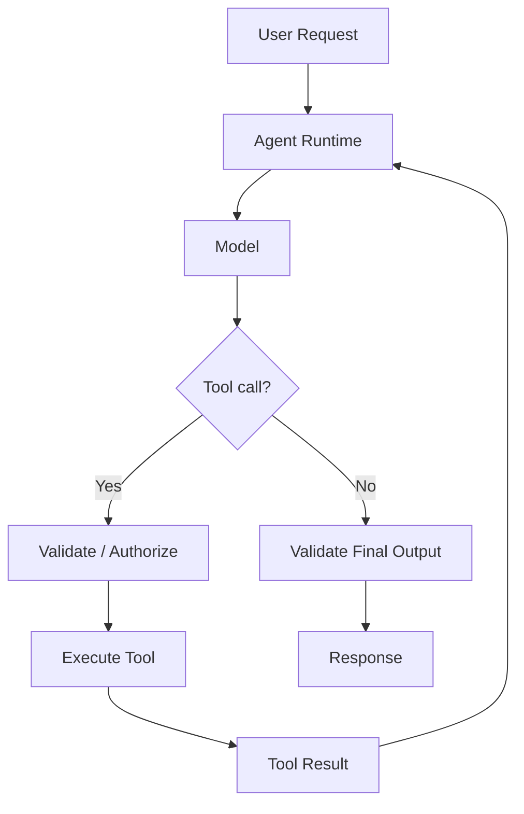
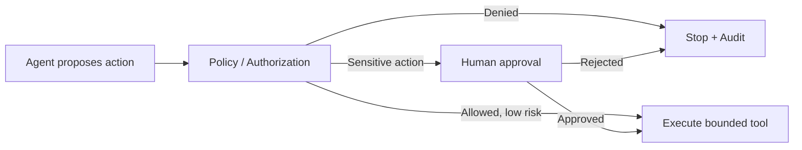

# 06 — LangChain Agents

> Learn how LangChain agents combine chat models and tools to complete tasks through controlled, iterative execution—and how to keep that autonomy bounded.

## 📖 Overview

A workflow might always validate a claim, fetch the policy and calculate the allowed amount—in that order. An agent is useful when the next step depends on what it discovers: it may search a policy, inspect a claim and then decide whether another tool is needed. That flexibility is useful, but it must stay inside boundaries the application controls.



The agent loop is flexible, but each extra model/tool round adds latency, cost and failure opportunities.

## 🎯 Learning Objectives

- Distinguish chains, workflows and agents.
- Create and invoke a tool-using agent.
- Understand state, middleware and structured output.
- Bound execution and handle errors.
- Secure, observe and evaluate agent behavior.

## 1. Chain vs Workflow vs Agent

| Pattern | Control flow | Best suited to |
|---|---|---|
| Chain | Composed sequence of steps | Straightforward transformations |
| Workflow | Application-defined branches and transitions | Predictable business processes |
| Agent | Model chooses actions within an allowed set | Tasks whose next step depends on intermediate results |

Prefer deterministic workflows for payments, approvals and compliance rules. Use an agent where dynamic tool selection provides real value. A hybrid design often works best: deterministic outer workflow, bounded agent for a narrow reasoning task.

## 2. Creating an Agent

LangChain's high-level agent API can connect a chat model with tools:

```python
from langchain.agents import create_agent
from langchain.tools import tool

@tool
def get_order_status(order_id: str) -> str:
    """Get the current status of an order by its ID."""
    # Call an authenticated order service in a real application.
    return f"{order_id} is in transit"

agent = create_agent(
    model="openai:<model-name>",
    tools=[get_order_status],
    system_prompt=(
        "Help users check order status. "
        "Use tools for current order information."
    )
)

result = agent.invoke({
    "messages": [
        {"role": "user", "content": "Where is order ORD-1001?"}
    ]
})
```

Install the appropriate provider integration and replace the placeholder model identifier. The example demonstrates the API shape; production tools must call real services and enforce authorization outside the model.

## 3. Agent Execution

At a high level, the runtime:

1. Receives input and loads trusted runtime context.
2. Loads thread state when persistence is configured.
3. Calls the model with instructions, messages and available tools.
4. Inspects the model response.
5. Validates and executes permitted tool calls.
6. Adds tool results to state and calls the model again.
7. Stops when the model returns a final response or a runtime limit is reached.

The model proposes the next action; the runtime controls what can actually execute. Specialized data-analysis agents can translate natural-language questions into DataFrame operations, but generated code execution is a high-risk capability. Prefer narrow, typed analytics tools; if code execution is unavoidable, isolate it in a sandbox with read-only data, resource limits and explicit permissions.

## 4. State, Memory and Retrieval

An agent can use thread-scoped state and a checkpointer to continue work across turns. Long-term memory and RAG are separate capabilities that may be supplied when relevant. Their data models, lifecycle and security controls are covered in Chapter 05 (memory) and Chapter 04 (retrieval); do not load entire histories or knowledge bases into every agent call.

## 5. Middleware and Structured Output

Middleware provides controlled hooks around agent execution for concerns such as request/response processing, policy checks, model selection, retries or summarization, depending on the middleware supported by the installed version.

Structured output is useful when downstream code expects a schema rather than free text. Validate the result before acting on it; schema validity does not prove factual correctness or authorization.

## 6. Bound the Agent

A production agent needs explicit limits:

- Maximum model/tool iterations.
- Per-tool timeout and overall request deadline.
- Maximum input/output tokens and tool result size.
- Allowed tool list and argument validation.
- Concurrency limits and cancellation behavior.
- Retry policy by error class.
- Human approval for high-impact writes.

An agent that repeatedly calls a tool may be stuck in a loop. Detect repeated calls, enforce budgets and return a controlled incomplete result when limits are reached.

## 7. Give the Agent a Small Action Space

The agent's available tools define what it can attempt. Keep that set small, use distinct descriptions and separate read operations from side-effecting writes. Detailed schema design, authorization and execution contracts belong in Chapter 03; the agent runtime should never become a shortcut around those controls.

## 8. Security and Human Approval

Never let the agent decide its own permissions. The application should authenticate the user, derive tenant identity from trusted credentials, authorize each operation and audit the outcome.



Treat user input, retrieved documents and tool results as untrusted. Prompt-injection defenses should be layered with tool restrictions, output validation and external policy enforcement.

## 9. Evaluate Agent Decisions

Do not score an agent only on whether its final paragraph sounds convincing. Evaluate whether it selected the right tool, supplied valid arguments, used evidence correctly, stopped at the right time and completed the task within policy. Include ambiguous requests, tool failures and adversarial instructions in the test set.

Detailed tracing, deployment and operational monitoring belong in Chapter 07.

## 10. Production Architecture

Keep the agent behind an application service. The service owns authentication, authorization, business rules, rate limits, persistence and response contracts. The agent receives only bounded capabilities.

```text
Client → API / Identity → Application Service
                         ↓
                    Agent Runtime
                   ↙      ↓      ↘
                Model   State   Tools
                                  ↓
                         Enterprise Services
```

For distributed deployments, use shared durable state rather than process-local memory. Version prompts, models, tools and state schemas; test upgrades before rollout.

## Common Mistakes

- Using an agent for a fixed, predictable workflow.
- Giving the agent too many tools or excessive permissions.
- Trusting model-generated arguments without validation.
- Omitting iteration limits and deadlines.
- Retrying side-effecting operations without idempotency.
- Evaluating only final-answer fluency.
- Treating a LangChain agent as a complete enterprise application.

## Key Takeaways

An agent is a model-driven decision loop operating within a runtime. Its autonomy is bounded by the tools, state, middleware, policies and execution limits designed by the application team. Use agents selectively and measure task success, safety, latency and cost.

## 🧭 Chapter Navigation

⬅️ **Previous:** [05. LangChain Memory & State](05-langchain-memory-and-state.md)

📚 **Part:** [AI Engineering Frameworks & Tooling](../index.md)

➡️ **Next:** [07. LangChain Production Patterns](07-langchain-production-patterns.md)

---

> **Enterprise AI Engineering Handbook**
>
> *Building Production-Grade Enterprise AI Systems — One Chapter at a Time.*

---
