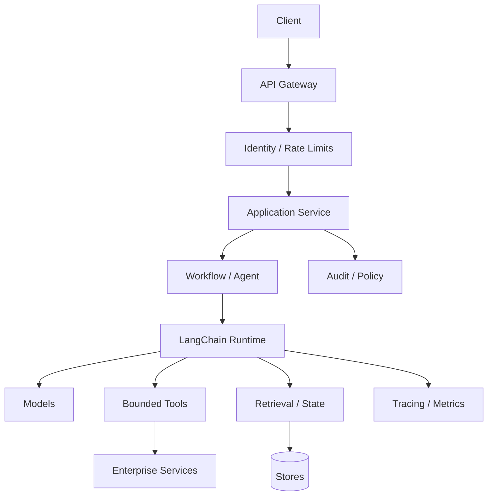
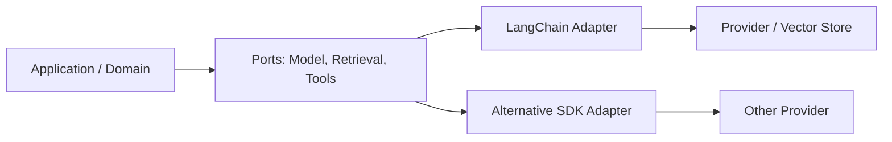

# 07 — LangChain Production Patterns

> Move beyond a working prototype and design LangChain applications that are secure, resilient, observable, scalable and maintainable.

## 📖 Overview

A demo can look impressive while quietly depending on one process, one API key and a happy-path request. Production changes the questions: what happens when a provider times out, two users share a cache, a worker restarts or an agent tries an unauthorized action? This chapter covers the engineering controls around the LangChain runtime.



## 🎯 Learning Objectives

- Separate application, agent and infrastructure responsibilities.
- Apply ports-and-adapters and tool gateway patterns.
- Design resilience, state, scaling and caching.
- Implement observability, cost controls and multi-tenancy.
- Version, test and deploy safely.

## 1. Keep the Application Boundary

Do not make an agent responsible for the whole application.

**Avoid:** API → Agent → authentication, authorization, database, business rules and response.

**Prefer:** API → Application service → workflow/agent → bounded tools → enterprise services.

The application service owns identity, tenant context, business invariants, transaction boundaries and API contracts. The agent handles a bounded reasoning task.

## 2. Ports and Adapters

Keep domain logic independent of LangChain and provider SDKs. Define application-owned interfaces for model access, retrieval and enterprise operations; implement adapters using LangChain integrations.



This reduces framework coupling and makes unit testing and migration easier. Do not create abstractions without a real need; keep the boundary as small as practical.

## 3. Configuration and Integration Boundaries

Keep model identifiers, provider options, timeouts and routing in configuration. Keep tools behind application services or a gateway. The detailed tool schema and execution lifecycle are covered in Chapter 03; this chapter focuses on how those integrations are operated consistently across environments.

Keep model identifiers, temperature, timeouts, retry policy and routing in configuration. Use a model factory or adapter so domain code does not depend on provider-specific construction details.

Tools should call application services or a tool gateway—not arbitrary infrastructure. The gateway can centralize authentication propagation, authorization, validation, quotas, audit and downstream routing.

## 4. Reliability: Deadlines, Retries and Fallbacks

Use an overall request deadline and smaller per-dependency timeouts. Retry only transient failures, with bounded exponential backoff and jitter. Do not retry validation or authorization failures. Avoid retry multiplication across API, agent, SDK and gateway layers.

```text
Request deadline
  ├── Model call timeout
  ├── Tool timeout
  └── Retrieval timeout
```

Use circuit breakers or concurrency limits to protect unhealthy dependencies. Fallbacks must preserve correctness: a stale cache or smaller model is not always an acceptable substitute. Return a clear partial or unavailable result when safe completion is impossible.

## 5. State and Horizontal Scaling

The memory chapter defines what belongs in thread state and long-term stores. The production concern is making that state durable and safe across workers: use shared persistence, stable thread identity, tenant ownership checks, concurrency controls and checkpoint schema versioning.

A stateless API/agent worker can scale horizontally when conversation state is stored in a shared durable backend. Use stable thread identifiers, tenant ownership checks, concurrency control and checkpoint schema versioning.

Avoid process-local memory for production continuity. Plan for worker restarts, duplicate delivery, concurrent requests and persistence outages.

## 6. Caching

Cache only when semantics allow it. Potential candidates include deterministic retrieval results, embeddings, stable reference data and carefully scoped model responses.

A cache key may need tenant, authorization scope, model/version, prompt version, locale, retrieval index version and normalized input. Incorrect cache scoping can leak cross-tenant data. Define TTL, invalidation and privacy rules.

## 7. Multi-Tenant Isolation

Isolation must cover more than the database:

- Authentication and tenant derivation.
- Tool authorization and downstream credentials.
- Vector search filters and document permissions.
- Thread IDs, checkpoints and long-term memory namespaces.
- Cache keys, logs, traces and quotas.
- File/object storage and deletion workflows.

Never trust a tenant identifier generated by the model or supplied without validation.

## 8. Observability

Capture traces across API, model, retrieval and tool calls. Useful metrics include:

| Layer | Metrics |
|---|---|
| Application | Request rate, errors, latency |
| Model | Tokens, cost, latency, retries, provider errors |
| Agent | Iterations, tool calls, termination reason |
| Retrieval | Query latency, result count, relevance/evaluation |
| Tools | Success rate, timeout rate, downstream latency |
| Platform | Queue depth, concurrency, saturation |

Log correlation IDs and redacted operational metadata. Avoid logging secrets, full prompts, raw documents or personal data unless justified, protected and governed. Use tracing/evaluation tooling such as LangSmith where appropriate.

## 9. Cost and Performance

Control cost through token budgets, model routing, prompt/context minimization, bounded agent iterations, caching and tool-call reduction. Measure cost per feature and tenant, not only total provider spend.

Parallelize independent reads when safe. Bound concurrency to avoid rate-limit spikes and downstream overload. Use queues and asynchronous workers for long-running tasks; expose task status rather than holding an HTTP connection indefinitely.

## 10. Versioning and Configuration

Version and test together:

- Prompt templates and system instructions.
- Model/provider configuration.
- Tool schemas and behavior.
- Agent/workflow definitions.
- Retrieval indexes and embedding models.
- State/checkpoint schemas.

Keep secrets in a secret manager, separate development/staging/production configuration, and use feature flags for controlled rollout.

## 11. Deployment and Release Safety

Common deployment patterns include a single service for simple workloads, a dedicated agent service for independent scaling, and queue-backed workers for long-running tasks.

Use CI/CD gates for unit tests, integration tests, security tests and evaluation datasets. Canary or blue-green releases reduce blast radius. Keep rollback capability and a kill switch for unsafe agent/tool behavior.

Health checks should distinguish process liveness from readiness to serve traffic. Dependency health should be monitored without making every transient downstream issue restart the service.

## 12. Testing Strategy

Keep tests aligned to failure boundaries: unit-test application logic and tool adapters, integration-test persistence and provider connections, evaluate model-dependent behavior with curated datasets, and load-test the complete service. The agent chapter covers task-level decision evaluation; here the focus is release confidence across the system.

- **Unit tests:** domain services, tool validation and output parsers.
- **Integration tests:** model adapters, retrieval, persistence and enterprise APIs.
- **Agent evaluations:** tool selection, arguments, task completion and safe stopping.
- **Security tests:** tenant isolation, authorization, prompt injection and data leakage.
- **Load tests:** latency, throughput, rate limits and concurrency.
- **Resilience tests:** timeouts, provider outages, retries and persistence failures.

Use deterministic mocks for most unit tests and a curated evaluation set for model-dependent behavior.

## Production Readiness Checklist

- [ ] Authentication and authorization enforced outside the model.
- [ ] Tools are narrow, validated, least-privilege and audited.
- [ ] Tenant isolation covers state, retrieval, caches and logs.
- [ ] Deadlines, timeouts, bounded retries and iteration limits exist.
- [ ] Durable state and concurrency behavior are defined.
- [ ] Token, latency and cost budgets are monitored.
- [ ] Traces and redacted logs support debugging.
- [ ] Prompts, models, tools and state schemas are versioned.
- [ ] Evaluation and security tests run before release.
- [ ] Rollback, feature flags and kill switch are available.

## Key Takeaways

Production readiness comes from the surrounding software architecture, not from the framework alone. Keep the agent bounded, enforce policy in trusted services, persist state durably, instrument every layer and release changes through evaluation and controlled deployment.

## 🧭 Chapter Navigation

⬅️ **Previous:** [06. LangChain Agents](06-langchain-agents.md)

📚 **Part:** [AI Engineering Frameworks & Tooling](../index.md)

➡️ **Next:** [08. LangChain Limitations & Trade-offs](08-langchain-limitations-and-tradeoffs.md)

---

> **Enterprise AI Engineering Handbook**
>
> *Building Production-Grade Enterprise AI Systems — One Chapter at a Time.*

---
