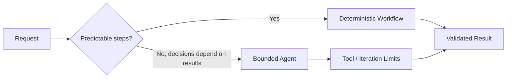
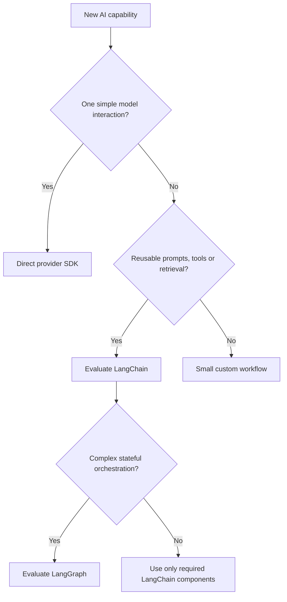

# 08 — LangChain Limitations & Trade-offs

> Evaluate where LangChain adds value, where it introduces complexity, and how to choose the right abstraction level for enterprise AI systems.

## 📖 Overview

LangChain can save weeks of integration work—or add a layer your application did not need. The difference is the workload. A single model call may be simpler with a provider SDK; a system with several models, tools and retrieval paths may benefit from shared abstractions. Choose based on the shape of the problem, not framework popularity.

## 🎯 Learning Objectives

- Identify the main framework trade-offs.
- Compare direct SDKs, LangChain and custom workflows.
- Recognize abstraction leakage, coupling and operational costs.
- Select an appropriate architecture for a workload.

## 1. The Abstraction Trade-off

```text
Higher-level framework
   → reusable integrations and faster composition
   → additional dependencies and runtime behavior
   → possible debugging, performance and migration costs
```

The right question is not whether LangChain can build an application. It is whether its abstractions provide enough value to justify their cost for that application.

## 2. Direct SDK vs LangChain

| Situation | Likely fit |
|---|---|
| One provider, one simple model call | Direct provider SDK |
| Multiple models, prompts, tools and retrieval | LangChain may help |
| Strictly deterministic business process | Application workflow / ordinary code |
| Stateful, branching agent with durable execution | LangGraph may be appropriate |
| Specialized retrieval or orchestration needs | Evaluate a focused library |

A simple feature does not automatically benefit from a full framework. Conversely, a complex application may benefit from common interfaces and integrations.

## 3. Main Limitations

### Abstraction overhead and leakage

The framework adds layers between application code and the provider. When a provider exposes a new feature before the abstraction supports it, the application may need provider-specific escape hatches. This is abstraction leakage.

**Mitigation:** isolate framework use behind adapters, keep provider-specific features explicit and benchmark latency-sensitive paths.

### Learning and conceptual complexity

Developers must understand both LLM concepts and framework abstractions: messages, runnables, tools, agents, state, middleware, persistence and tracing.

**Mitigation:** adopt only the components the use case needs; establish internal examples and conventions.

### Version and dependency coupling

Rapidly evolving packages can change APIs, dependency constraints and behavior. A framework upgrade may affect integrations, serialization, prompts or state.

**Mitigation:** pin compatible versions, use lockfiles, review release notes, run integration/evaluation tests and upgrade deliberately.

### Debugging and observability complexity

A single user request may involve multiple model calls, tool calls, retries, state transitions and retrieval steps. The final answer alone does not explain a failure.

**Mitigation:** trace the full execution path, capture correlation IDs and safe metadata, and inspect intermediate inputs/outputs with appropriate redaction.

### Agent non-determinism

Model-selected actions can vary between runs. Agents may choose different tools, make unnecessary calls or fail to stop.

**Mitigation:** use deterministic workflows for critical paths, constrain tool sets, define execution limits and evaluate behavior across representative cases.

### Testing complexity

Traditional unit tests cannot fully establish agent quality. Tool choice, argument quality, grounding and task completion need evaluation datasets and scenario tests.

**Mitigation:** combine deterministic unit/integration tests with model-based evaluations, adversarial tests and production monitoring.

### Performance and cost variability

Agent loops multiply model calls and tool latency. Context growth, retries and large outputs increase cost.

**Mitigation:** measure end-to-end latency and cost, bound iterations and tokens, use suitable model routing, trim context and parallelize only independent operations.

### Tool and context growth

Too many overlapping tools make selection harder. Excessive history or retrieved content consumes context and can reduce answer quality.

**Mitigation:** expose narrow, well-described tools; group capabilities; retrieve selectively; summarize or trim history; enforce context budgets.

### State and persistence complexity

Durable threads, concurrent requests, checkpoint schemas and multi-tenant isolation add operational work.

**Mitigation:** define state ownership and lifecycle, use shared durable persistence, control concurrency and test migration and recovery.

### Framework lock-in

Framework-specific objects and orchestration logic can spread through domain code, making migration expensive.

**Mitigation:** keep domain models and business services framework-agnostic; use small ports/adapters and avoid leaking framework types into public contracts.

### Provider abstraction limits

A common interface cannot normalize every provider feature, error, tool-call behavior or multimodal capability.

**Mitigation:** maintain a capability matrix, test target models and expose provider-specific options deliberately.

### Security and governance burden

Tools increase the impact of prompt injection, confused-deputy errors and excessive permissions. Framework abstractions do not replace enterprise security controls.

**Mitigation:** authorize every operation in trusted application code, enforce least privilege, isolate tenants, validate outputs, require approval for high-impact actions and audit execution.

## 4. Deterministic Workflow vs Agent



Do not use an agent merely because the task involves an LLM. If the sequence is known—validate, retrieve, generate, validate—an explicit workflow is usually easier to test and operate. A hybrid can reserve agent autonomy for a narrow subtask.

## 5. Framework Selection Matrix

| Criterion | Direct SDK | LangChain | Custom workflow |
|---|---|---|---|
| Simple model call | Strong fit | Often unnecessary | Possible |
| Common integrations | More manual | Strong fit | Build/compose |
| Provider-specific features | Direct access | May need escape hatch | Direct access |
| Tool/RAG composition | Manual | Convenient abstractions | Explicit control |
| Deterministic business logic | Strong | Not its main advantage | Strong |
| Framework dependency | Low | Higher | Depends on design |

LangGraph is worth evaluating when orchestration requires explicit state transitions, durable execution, human-in-the-loop control or complex branching. It is not a mandatory dependency for every LangChain application.

## 6. Total Cost of Ownership

Evaluate more than initial development speed:

- Engineering time to build and maintain integrations.
- Dependency and upgrade effort.
- Runtime latency and infrastructure cost.
- Debugging and incident response.
- Evaluation and governance effort.
- Migration cost and provider-specific work.
- Team familiarity and operational maturity.

Benchmark representative workloads rather than assuming the framework is always faster or slower.

## 7. A Practical Architecture Decision

Before adopting LangChain, answer four questions:

1. **How many moving parts?** One model call rarely needs a framework; several integrations and reusable pipelines may justify one.
2. **How much control is required?** Provider-specific features, strict latency budgets or unusual streaming behavior may favor a direct SDK or a thin adapter.
3. **Who owns orchestration?** Predictable business steps belong in application workflows; model-selected actions may justify a bounded agent.
4. **Can the team operate it?** Consider upgrade discipline, tracing, evaluation, incident response and framework expertise—not just initial coding speed.



## 8. Recommended Enterprise Strategy

1. Start with the smallest abstraction that solves the problem.
2. Keep business logic and security outside the framework.
3. Isolate LangChain and provider dependencies behind adapters.
4. Use deterministic workflows for high-assurance business operations.
5. Introduce agents only where dynamic decisions justify them.
6. Version and evaluate prompts, models, tools and state.
7. Measure latency, cost, reliability and task quality.
8. Reassess the architecture as requirements evolve.

## Key Takeaways

LangChain's strengths—integrations, abstractions and composition—are valuable when an application needs them. Its costs—complexity, coupling, abstraction leakage and operational overhead—must be managed deliberately. The best architecture is the simplest one that meets the application's reliability, security and evolution requirements.

## 🧭 Chapter Navigation

⬅️ **Previous:** [07. LangChain Production Patterns](07-langchain-production-patterns.md)

📚 **Part:** [AI Engineering Frameworks & Tooling](../index.md)

➡️ **Next:** [LlamaIndex Fundamentals](../llamaindex/01-llamaindex-fundamentals.md)

---

> **Enterprise AI Engineering Handbook**
>
> *Building Production-Grade Enterprise AI Systems — One Chapter at a Time.*

---
