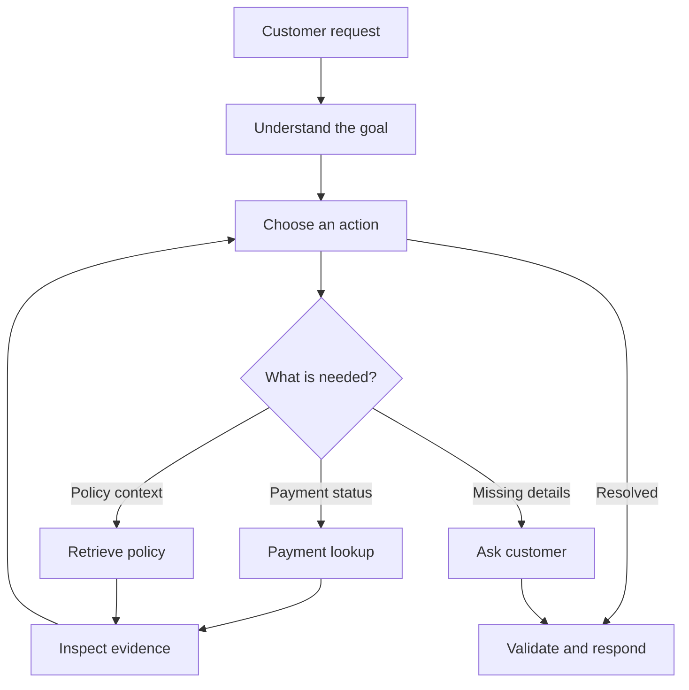
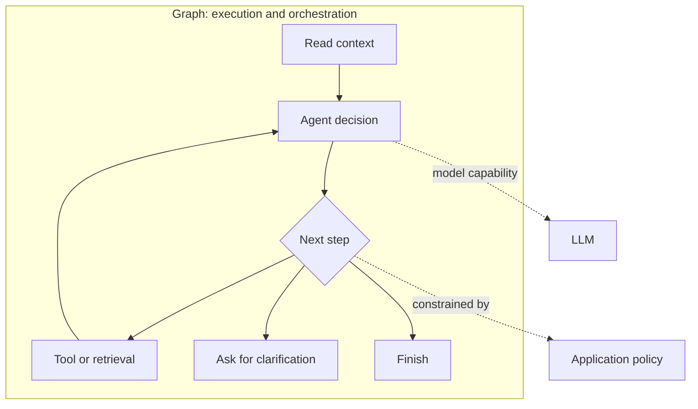
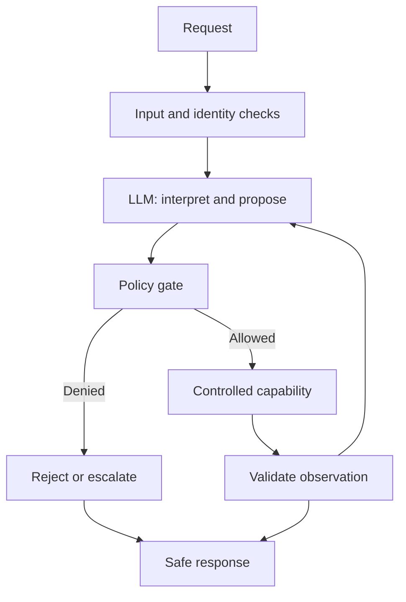
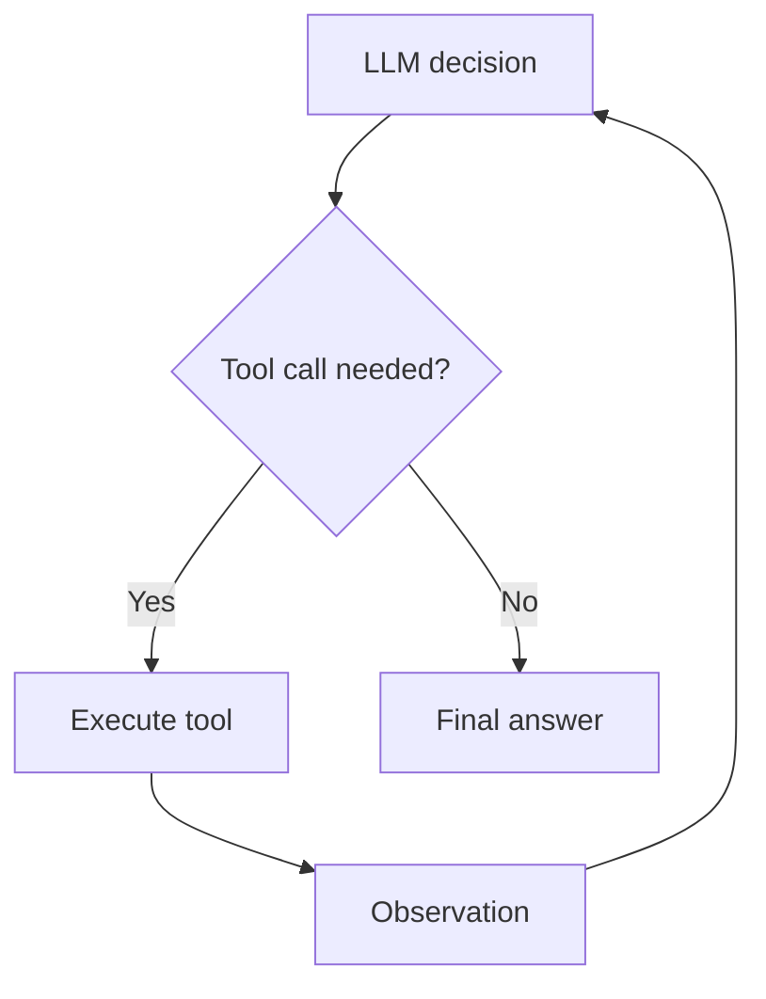
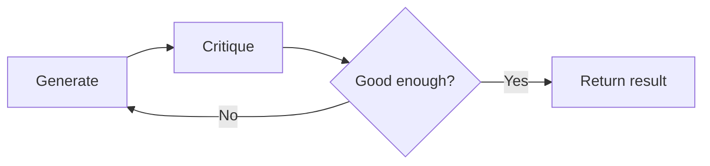
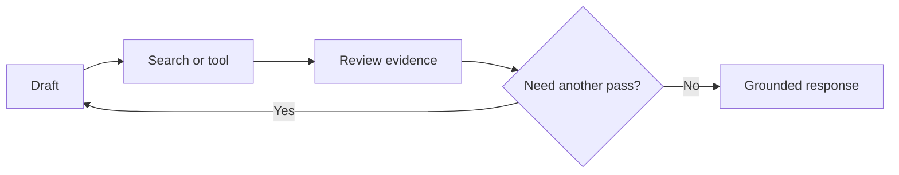
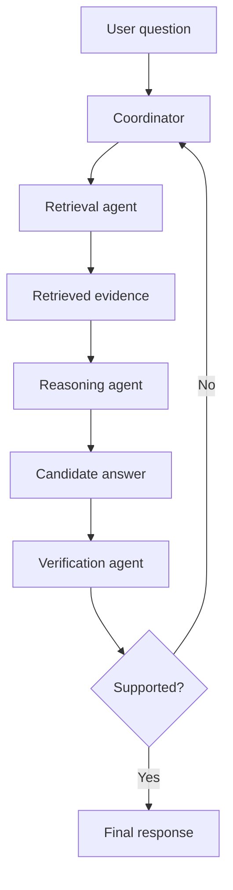
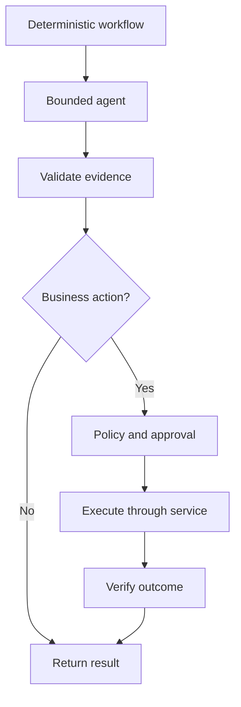

# 18 — Graph-Based Agent Architecture

> **A model can suggest the next move. Your architecture decides whether it gets to make it.**

In [LangGraph Fundamentals](17-langgraph-fundamentals.md), we built a small LangGraph workflow and learned its basic vocabulary: state, nodes, edges, conditional routing and loops. That was the engine room.

Imagine a customer tells a banking support agent:

> “My account was debited, but the merchant never received the payment. Please fix it.”

A basic chatbot can explain what a failed payment means. An agent may investigate the transaction, check settlement status, search the support policy, create a case and decide whether the issue needs a human. Those steps depend on one another, and new evidence can change the next step.

That is the architectural problem this chapter addresses: **how do we give an agent room to make decisions without giving it the keys to the entire bank?**

We will connect graph orchestration to three agent patterns from the course—ReAct, Reflection and Reflexion—and then look at how specialised agents can collaborate. Detailed implementation of state, routing, approvals, tools and persistence belongs in the chapters that follow.

## 1. From a chatbot to an agent system

A conventional request-response application is often straightforward:

```text
User → Prompt → LLM → Response
```

An agentic system has a feedback loop:

```text
Goal → Decide → Act → Observe → Decide again
```

The difference is not simply “more LLM calls”. The system can use the result of an action to choose what to do next.

For the payment case, a first lookup may return `PENDING`. That is not the same as `FAILED`, so the agent should not confidently tell the customer that the money is lost. It may check another permitted source, wait for a settlement update, or escalate the case.



The graph makes transitions visible and gives the application a place to enforce rules and decide whether execution should continue.

## 2. Agent behaviour and graph orchestration are different things

An **agent** is the decision-making capability: it interprets a goal, selects possible actions and adapts to observations.

A **graph** is an execution structure: it connects steps, defines permitted transitions and controls where the workflow branches, loops, pauses or ends.

A graph can contain ordinary functions, model calls, tools, retrieval steps, human review—or even other agents. Not every node is an agent, and not every graph is an agent. A fixed invoice-processing graph can be a deterministic workflow with no LLM at all.



Let the model interpret ambiguity and propose a step. Let application code decide whether it is allowed.

## 3. The enterprise design: intelligence inside controlled execution

A practical architecture separates two responsibilities, though not necessarily into separate services.

| Intelligence: model-assisted | Control: deterministic |
|---|---|
| Interpret a request | Authenticate the caller |
| Classify intent | Authorize the requested action |
| Propose a plan | Enforce business rules |
| Select a candidate capability | Validate arguments and data |
| Summarise observations | Apply limits, timeouts and approval rules |



Consider a refund request. A prompt that says “never refund more than ₹10,000” is not a security control. The model may still propose a larger refund. A deterministic policy must check the amount, caller permissions and approval requirements before any transaction is submitted.

**The model proposes. The application authorizes. The service executes.**

## 4. Three agent patterns from the course

The course introduces three patterns that use feedback in different ways. They are not three names for the same loop.

| Pattern | What happens | Feedback comes from |
|---|---|---|
| **ReAct** | The agent reasons, chooses a tool, observes its result and decides what to do next | Tool or environment observations |
| **Reflection** | A generator creates an answer; a reflector critiques it; the generator revises | The model's own critique |
| **Reflexion** | The agent drafts, gathers external evidence, then revises against that evidence | Search results, tools or other external information |

### ReAct: reason, act, observe

ReAct is useful when the next action depends on what the previous action returned. The course demonstrates a weather agent that first searches for the weather, then uses the result to make a clothing recommendation.



The course describes the interaction as Thought → Action → Action Input → Observation → Final Answer. In an implementation, the model's tool call is represented as structured data; the application routes it to the appropriate tool and returns the result to the model.

### Reflection: critique the draft

A reflection agent uses a generator and a reflector. The reflector reviews the first output and suggests improvements. The generator then produces a better attempt.



This can improve clarity, completeness or style. But if both generator and reflector rely on the same model and the same information, they can confidently agree on the same mistake. Reflection adds another opinion, not independent evidence.

### Reflexion: bring evidence into the review

Reflexion adds external grounding. The agent drafts an answer, uses a search or another tool to gather evidence, and then revises the draft using that evidence.



This is more useful for fact-checking and research, but it also adds latency, tool cost and another source of failure. A search result is not automatically trustworthy; evidence still needs to be relevant and evaluated.

The key distinction is the source of feedback—not simply the number of nodes.

## 5. A small LangGraph architecture example

The following small architecture skeleton shows the boundary: a decision node proposes an operation, a deterministic policy node checks it, and only then can the capability execute.

The mocked decision and payment lookup keep the example focused on orchestration. In a real application, replace the decision stub with your model call and the lookup with an authenticated service client.

```python
from typing import TypedDict
from langgraph.graph import StateGraph, START, END

class AgentState(TypedDict):
    request: str
    action: str
    allowed: bool
    observation: str
    answer: str

# In production, this node would call an LLM and
# return a structured action proposal.
def decide(state: AgentState):
    return {"action": "read_payment_status"}

# This is application policy, not an LLM judgement.
def authorize(state: AgentState):
    allowed_actions = {"read_payment_status"}
    return {"allowed": state["action"] in allowed_actions}

def route(state: AgentState):
    return "execute" if state["allowed"] else "deny"

def execute(state: AgentState):
    # Mock a read-only enterprise capability.
    return {"observation": "Payment status: PENDING"}

def deny(state: AgentState):
    return {"answer": "This action is not permitted."}

def respond(state: AgentState):
    return {
        "answer": f"Investigation result: {state['observation']}"
    }

builder = StateGraph(AgentState)
builder.add_node("decide", decide)
builder.add_node("authorize", authorize)
builder.add_node("execute", execute)
builder.add_node("deny", deny)
builder.add_node("respond", respond)

builder.add_edge(START, "decide")
builder.add_edge("decide", "authorize")
builder.add_conditional_edges(
    "authorize", route,
    {"execute": "execute", "deny": "deny"}
)
builder.add_edge("execute", "respond")
builder.add_edge("deny", END)
builder.add_edge("respond", END)

agent = builder.compile()

result = agent.invoke({
    "request": "Check my recent payment",
    "action": "",
    "allowed": False,
    "observation": "",
    "answer": ""
})

print(result["answer"])
```

The model never calls the payment API directly. It proposes a capability; policy decides whether it can run. This is an architectural illustration, not complete security: production authorization must also check identity, tenant, resource ownership and service-side permissions.

## 6. From one agent to a team of specialists

The transcript's multi-agent module introduces a useful idea: organise agents around specialised responsibilities. Think of a kitchen. The pastry chef does not suddenly take over the grill because both happen to work in the same restaurant.

In an AI system, a retrieval agent should retrieve; a summarisation agent should summarise; a verifier should check whether the result is supported. A coordinator assigns work and manages hand-offs.



The course's Agentic RAG example follows this retrieval → reasoning → verification shape. The coordinator can send work back when the evidence is insufficient.

Keep collaboration manageable with:

- **Capability boundaries:** each agent has a focused responsibility.
- **Structured hand-offs:** define clear inputs and outputs, ideally with schemas.
- **Shared context with ownership:** decide what information is passed between agents and who may update it.
- **Explicit coordination:** define who delegates, who aggregates and when the task is complete.

More agents do not automatically mean better results. They introduce communication overhead, more model calls, additional failure paths and harder evaluation. Start with one agent and add specialists only when the separation provides a measurable benefit.

## 7. When to use which shape?

| Problem | A sensible starting point |
|---|---|
| Fixed, predictable sequence | Deterministic workflow |
| Decide which action to take from new observations | ReAct-style agent |
| Improve a draft's quality or clarity | Reflection |
| Check a response against external evidence | Reflexion |
| Divide a task into distinct areas of expertise | Multi-agent workflow |

Patterns can be combined: a retrieval agent may use ReAct, a verifier may check evidence, and a deterministic workflow may enforce approval.

Do not add autonomy just because the framework makes it easy. If a normal function or service can solve the problem reliably, use it.

## 8. The production boundary: controlled autonomy

A graph-based agent should have a clear stopping point and a safe response when it cannot complete the task. At minimum, define limits for iterations, tool calls, execution time and cost. Side-effecting actions need idempotency and auditability; high-impact actions may require human approval.



This resembles a microservice platform: narrow capabilities, explicit contracts and trusted policy boundaries. An LLM can help choose the next step, but it does not replace those controls.

Next Chapters cover state, routing, human approval, tools and production operations in detail.

## Key takeaways

- A graph is an orchestration structure; an agent is a decision-making capability.
- ReAct uses tool observations, Reflection uses internal critique, and Reflexion adds external evidence.
- Multi-agent systems work best when agents have clear specialisations and structured hand-offs.
- The LLM may propose an action, but deterministic application logic must authorize it.
- Use bounded autonomy inside workflows that retain control of business-critical steps.
- More nodes and more agents are not automatically better architecture.

---

## 🧭 Chapter Navigation

⬅️ **Previous:** [17. LangGraph Fundamentals](17-langgraph-fundamentals.md)

📚 **Part VIII Index:** [AI Engineering Frameworks & Tooling](index.md)

➡️ **Next:** [19. LangGraph State and Checkpointing](19-langgraph-state-and-checkpointing.md)

---

> **Enterprise AI Engineering Handbook**
>
> *Building Production-Grade Enterprise AI Systems — One Chapter at a Time.*