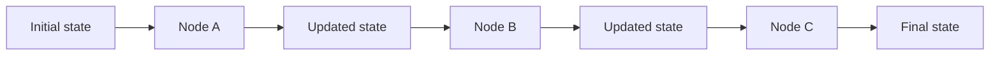
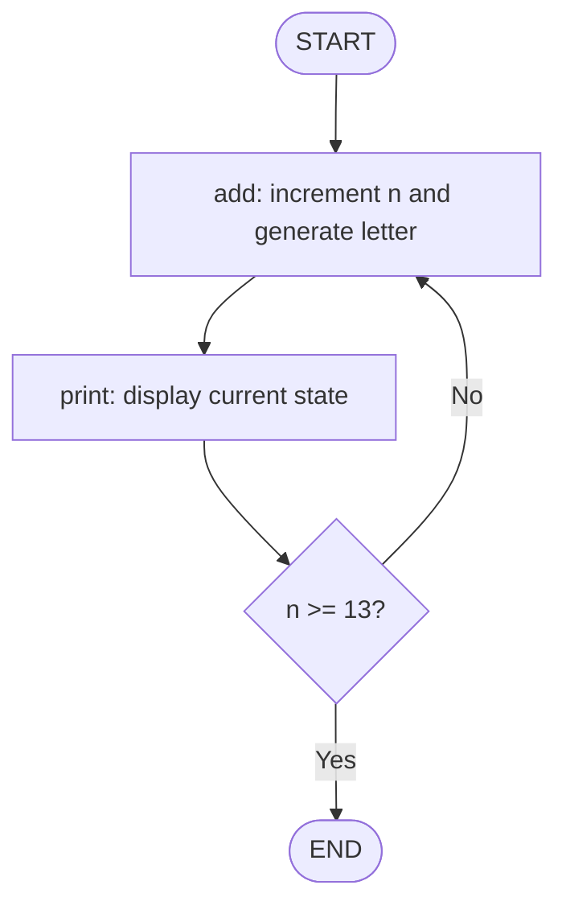
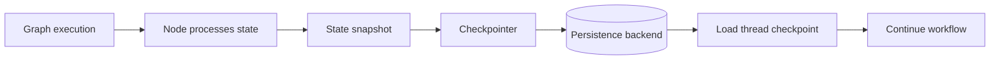
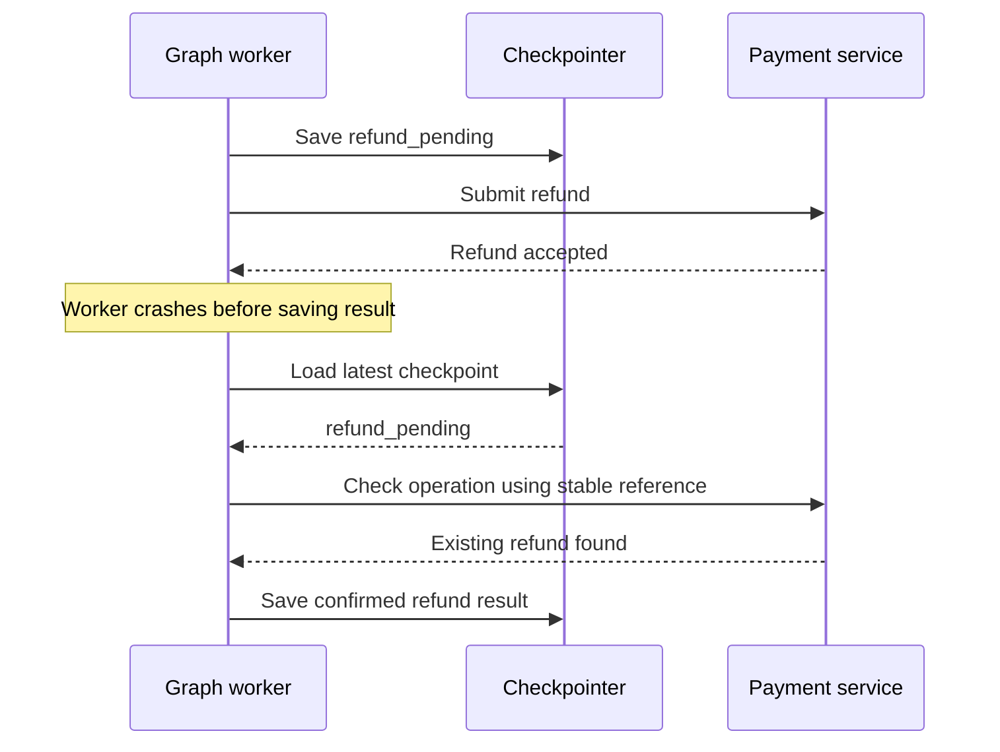

# 19 — LangGraph State and Checkpointing

> Your agent has done six steps, called two tools and collected the evidence. The worker restarts. Does the workflow remember where it was—or confidently start all over again?

That question takes us to the heart of LangGraph: **state**.

In [LangGraph Fundamentals](17-langgraph-fundamentals.md) , we built a graph and learned how nodes and edges work. [Graph-Based Agent Architecture](18-graph-based-agent-architecture.md)  explored how agent behaviour fits inside a controlled graph. Here we focus on the information that travels through that graph, how it changes, and how execution progress can be saved.

We'll start with the small counter lab from the course transcript. It looks almost too simple to matter. Stay with it: the same mechanics appear later in payment investigations, document processing and long-running enterprise workflows.

## 1. State is the information travelling through the graph

A node needs context to do its job. A retrieval node needs the query; a validation node needs the answer and evidence; a later node may need the result of a tool call. LangGraph carries that shared context in **state**.

The course describes state as an evolving structure containing inputs, intermediate values and outputs. It is commonly defined with `TypedDict`, but can also use lists, nested structures or message sequences.

```python
from typing import TypedDict

class WorkflowState(TypedDict):
    user_query: str
    summary: str
    step_count: int
```

Think of state as the workflow's working notebook. Each node reads the information it needs and returns an update. The state evolves as the graph runs.



Do not confuse the state with the graph itself:

- **State** is the data being processed.
- **StateGraph** is the blueprint that defines nodes, connections and execution flow.

One changes as the workflow runs. The other describes how that work is organised.

## 2. The course lab: a counter, a random letter and a loop

The transcript's LangGraph 101 exercise starts with `n = 1` and an empty `letter`. One node increments the counter and generates a random lowercase letter. Another prints the current values. A conditional edge checks whether the counter has reached 13: if not, the graph loops; otherwise, it ends.

Let's build that workflow using the current `StateGraph` API.

### Define the state and nodes

```python
import random
import string
from typing import TypedDict

class CounterState(TypedDict):
    n: int
    letter: str

def add(state: CounterState) -> dict:
    return {
        "n": state["n"] + 1,
        "letter": random.choice(string.ascii_lowercase),
    }

def print_state(state: CounterState) -> CounterState:
    print(f"n = {state['n']}, letter = {state['letter']}")
    return state
```

The `add` node returns only the fields it changes. LangGraph applies those updates to the shared state. The `print_state` node performs a side effect—printing—but does not change the data, so it returns the state unchanged, matching the course lab.

That second node is worth noticing. **Not every node exists to change data.** Some nodes perform side effects, such as logging or emitting a metric. Keep those effects deliberate; a print statement is fine for a lab, while production observability should use structured logging and tracing.

### Define the loop condition and graph

```python
from typing import Literal
from langgraph.graph import StateGraph, START, END

def stop_condition(state: CounterState) -> Literal["stop", "continue"]:
    return "stop" if state["n"] >= 13 else "continue"

builder = StateGraph(CounterState)

builder.add_node("add", add)
builder.add_node("print", print_state)

builder.add_edge(START, "add")
builder.add_edge("add", "print")

builder.add_conditional_edges(
    "print",
    stop_condition,
    {
        "stop": END,
        "continue": "add",
    },
)

app = builder.compile()

result = app.invoke({"n": 1, "letter": ""})
print("Final state:", result)
```

The graph's behaviour is easier to see than to describe:



The final state contains the last counter value and letter. The letter changes on each pass; the counter gives the graph a deterministic stopping condition.

### What the lab actually teaches

| Course concept | What happens in the example |
|---|---|
| State schema | `CounterState` defines `n` and `letter` |
| Initial state | `invoke()` receives `{"n": 1, "letter": ""}` |
| Node update | `add()` returns changed values |
| Side-effect node | `print_state()` prints without changing state |
| Normal edge | `add` always flows to `print` |
| Conditional edge | `stop_condition()` chooses `END` or `add` |
| Compilation | `builder.compile()` creates the runnable graph |
| Invocation | `app.invoke()` runs it and returns the final state |

The transcript also points out that node names are graph identifiers; they do not have to match the Python function names. It demonstrates workflow visualisation as a way to inspect graph structure and state progression. The exact visualisation method depends on the installed LangGraph environment.

## 3. State updates: return what changed

The counter example illustrates a central rule: a node does not need to rebuild the entire state every time it runs. It can return a partial update.

For example, imagine a document workflow:

```python
def retrieve(state: dict) -> dict:
    documents = search_documents(state["query"])
    return {"documents": documents}

def draft_answer(state: dict) -> dict:
    answer = generate_answer(
        state["query"],
        state["documents"],
    )
    return {"answer": answer}
```

The first node contributes `documents`; the second contributes `answer`. Other fields remain part of the workflow state.

The transcript's lab also shows a node returning an updated state by unpacking the original dictionary and replacing selected values. The important point is not that every node must use one return style: it is that the keys and values returned must follow the state-update rules of the graph type being used. Check the relevant API when moving between graph abstractions.

Avoid hidden in-place mutation such as:

```python
state["attempts"] += 1
```

Prefer an explicit update:

```python
return {"attempts": state["attempts"] + 1}
```

Explicit updates make node behaviour easier to test and reason about.

## 4. Reducers: what happens when updates meet?

So far, each node has updated a different field. But what if two branches contribute to the same field?

Imagine two retrieval branches finding different documents. Should the second result replace the first, or should both be kept? That is a state-design decision.

A **reducer** defines how an incoming update is combined with the existing value. For message histories, LangGraph provides `add_messages`:

```python
from typing import Annotated
from typing_extensions import TypedDict
from langchain_core.messages import AnyMessage
from langgraph.graph.message import add_messages

class ConversationState(TypedDict):
    messages: Annotated[list[AnyMessage], add_messages]
```

Here, the reducer applies message-aware merge behaviour rather than treating every update as a simple replacement.

Do not choose a reducer just because append sounds convenient. A status field, for example, may need one authoritative writer rather than a list of competing values. When parallel branches update shared state, define the merge semantics deliberately.

**Transcript boundary:** the counter lab teaches state updates and graph execution, but it does not teach reducer implementation. Reducers are an additional engineering concept included here because they become important when state is shared across more complex workflows.

## 5. From in-memory state to checkpointed execution

The counter lab runs from start to finish in one invocation. Real workflows are less polite.

A payment investigation may retrieve transaction details, wait for a compliance check, request human review and resume hours later. A worker can restart while the workflow is waiting. Ordinary Python variables will not preserve the execution context across that process boundary.

LangGraph supports persistence through a **checkpointer**. A checkpointer saves graph execution snapshots. A `thread_id` identifies the thread whose checkpointed state should be loaded.

```python
from langgraph.checkpoint.memory import InMemorySaver

checkpointer = InMemorySaver()

app = builder.compile(
    checkpointer=checkpointer
)

config = {
    "configurable": {
        "thread_id": "payment-case-8841"
    }
}

result = app.invoke(initial_state, config=config)
```

This example shows the integration points: compile with a checkpointer, then invoke with a stable thread identity. `InMemorySaver` is useful for local experiments and tests; it is not durable across process loss. For production, choose a supported persistent checkpointer and backend suited to your deployment.



A thread is not simply a random label. In a multi-user application, authenticate the caller and authorise access to the requested thread before loading or resuming it. Enforce tenant boundaries in the application and persistence layer. An unguessable thread ID is not a substitute for access control.

## 6. The production problem: a checkpoint cannot undo a payment

Checkpointing helps a workflow recover its own progress. It does not make a transaction in another system atomic.

Consider this sequence:

1. The agent prepares a refund.
2. The payment service accepts the refund.
3. The worker crashes before the next checkpoint is saved.
4. The workflow restarts and loads a checkpoint that still says `refund_pending`.

If the graph blindly calls the refund service again, the customer could receive two refunds.



The recovery step is **reconciliation**: check the authoritative payment service using a stable operation reference or idempotency key, then update graph state to reflect what actually happened.

Keep these responsibilities distinct:

- **Checkpointing** preserves the graph's execution progress.
- **Retry policy** decides whether a failed operation should be attempted again.
- **Idempotency and reconciliation** protect external business operations from duplicate effects.

This distinction is essential in banking, payments, order processing and any workflow that changes external business data.

## 7. Keep persisted state useful—and safe

State design becomes more important once state is persisted.

- Keep large documents and full API payloads in external storage; store references in graph state.
- Avoid storing secrets, live connections or objects that cannot be serialised.
- Separate graph execution state from long-term memory and authoritative business records.
- Set retention, deletion, encryption, backup and access-control policies for checkpoint data.
- Plan for schema evolution: a workflow deployed today may need to resume a checkpoint created by an older version.
- Monitor checkpoint write failures, size, latency and recovery behaviour.

A checkpoint is a snapshot of workflow execution, not proof that every fact inside it is still true. Revalidate important business facts against their source systems before consequential actions.

## Key takeaways

- State is the evolving data shared across graph nodes; `StateGraph` defines how that data moves.
- `TypedDict` provides an explicit schema, while state can also contain nested structures and message sequences.
- Nodes return updates; some nodes may perform side effects without changing state.
- Normal edges define fixed transitions; conditional edges route based on the current state.
- Reducers define how updates to shared fields are combined.
- Checkpointers persist graph execution snapshots, while `thread_id` identifies a workflow thread.
- Checkpointing supports recovery, but external side effects still need idempotency and reconciliation.
- Persist only the state needed to continue safely, and protect it as operational data.

---

## 🧭 Chapter Navigation

⬅️ **Previous:** [18. Graph-Based Agent Architecture](18-graph-based-agent-architecture.md)

📚 **Part VIII Index:** [AI Engineering Frameworks & Tooling](index.md)

➡️ **Next:** [20. LangGraph Nodes Edges And Routing](20-langgraph-nodes-edges-and-routing.md)

---

> **Enterprise AI Engineering Handbook**
>
> *Building Production-Grade Enterprise AI Systems — One Chapter at a Time.*