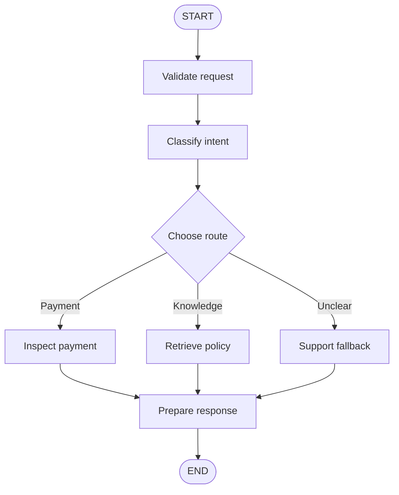
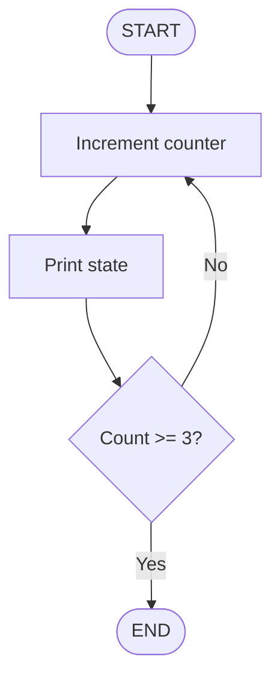
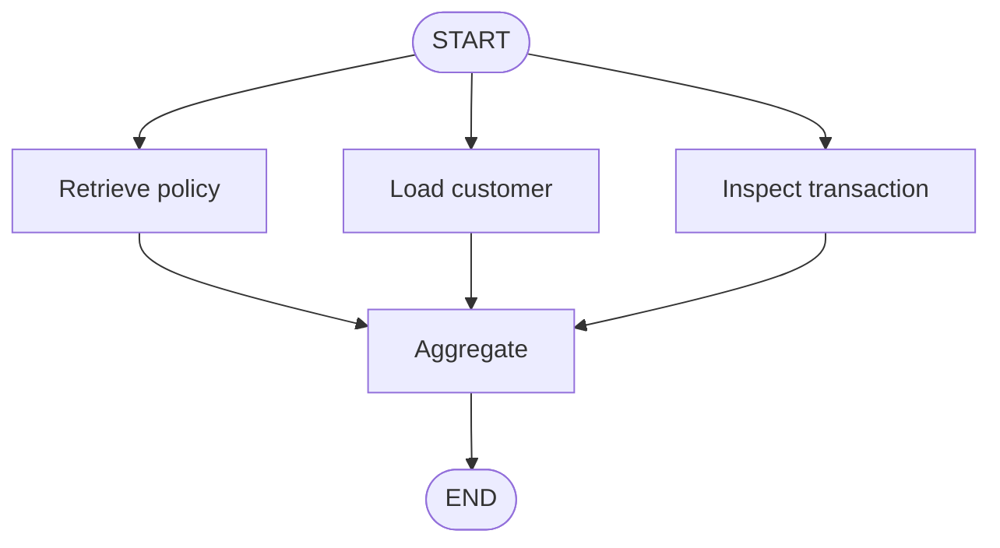

# 20 — LangGraph Nodes, Edges and Routing

## From a sequence of functions to a controlled workflow

A customer asks your banking assistant:

> “My card was charged, but the payment failed. Can you reverse it?”

That single sentence may trigger several operations: classify the request, retrieve policy, inspect a transaction, verify authorization and possibly request approval. What happens if the request is unclear or a service is unavailable?

A few function calls can handle the happy path. The harder problem is controlling what happens next—and what must never happen.

LangGraph makes that control flow explicit:

- **Nodes do the work.**
- **Edges connect the work.**
- **Conditional edges choose the next path.**

This chapter builds on Chapter 19: state carries information, nodes update it, and edges control execution.

## 1. The execution model

| Building block | Responsibility | Example |
|---|---|---|
| Node | Performs a task and returns a state update | Classify a request |
| Edge | Defines a fixed transition | Retrieve → prepare response |
| Conditional edge | Selects a destination from state | Payment → payment handler |



The value is not the boxes themselves. It is that the allowed paths are visible, reviewable and testable.

## 2. Nodes: give each operation a job

A node is usually a Python function or compatible runnable. It receives the current state and returns only the fields it updates.

```python
from typing import TypedDict

class SupportState(TypedDict):
    query: str
    intent: str
    response: str

def classify_request(state: SupportState) -> dict:
    query = state["query"].lower()
    if "charged" in query or "payment" in query:
        return {"intent": "payment"}
    if "policy" in query or "limit" in query:
        return {"intent": "knowledge"}
    return {"intent": "unknown"}
```

The keyword checks are deliberately simple; a real classifier may use an LLM or a dedicated model. Either way, keep its output structured so downstream nodes receive predictable values. For an LLM-based classifier, a schema can constrain the result:

```python
from pydantic import BaseModel
from typing import Literal

class RouteDecision(BaseModel):
    route: Literal["payment", "knowledge", "unknown"]

# Assume route_chain uses llm.with_structured_output(RouteDecision).
def classify_with_llm(state: SupportState) -> dict:
    decision = route_chain.invoke({"query": state["query"]})
    return {"intent": decision.route}
```

A node can also wrap an existing chain or tool. For example, assuming `answer_chain` is configured:

```python
def generate_answer(state: SupportState) -> dict:
    answer = answer_chain.invoke({"question": state["query"]})
    return {"response": answer}
```

### Choosing node boundaries

Avoid both extremes:

- **One giant node** that validates, reads databases, checks authorization, executes payments and writes the response. It is difficult to test and recover when one step fails.
- **Dozens of tiny nodes** for trivial transformations. They add graph complexity without useful control.

Give an operation its own node when it deserves independent testing, monitoring, security, retry or failure handling. Keep side effects especially clear: reading a transaction is not the same as initiating a refund.

## 3. Edges: define the path

A normal edge is a fixed transition:

```python
builder.add_edge("retrieve_policy", "prepare_response")
```

Use it when the next step is known. `START` and `END` identify the graph's entry and terminal points. A typical build lifecycle is:

1. Define the state schema.
2. Create a `StateGraph`.
3. Register nodes.
4. Connect edges.
5. Compile and invoke the graph.

## 4. Conditional edges: let state choose

A support assistant needs different paths for payment, knowledge and unclear requests. The routing function reads state and returns a route key; the mapping connects that key to a registered node.

```python
from langgraph.graph import StateGraph, START, END


def inspect_payment(state: SupportState) -> dict:
    # Illustrative read-only lookup; no refund is issued.
    return {"response": "Let's inspect the failed payment first."}


def retrieve_policy(state: SupportState) -> dict:
    return {"response": "I'll retrieve the relevant payment policy."}


def support_fallback(state: SupportState) -> dict:
    return {"response": "A support specialist should review this request."}


def route_request(state: SupportState) -> str:
    return state["intent"]


builder = StateGraph(SupportState)
builder.add_node("classify", classify_request)
builder.add_node("inspect_payment", inspect_payment)
builder.add_node("retrieve_policy", retrieve_policy)
builder.add_node("support_fallback", support_fallback)
builder.add_edge(START, "classify")
builder.add_conditional_edges(
    "classify", route_request,
    {
        "payment": "inspect_payment",
        "knowledge": "retrieve_policy",
        "unknown": "support_fallback",
    },
)
for node in ("inspect_payment", "retrieve_policy", "support_fallback"):
    builder.add_edge(node, END)

app = builder.compile()
result = app.invoke({
    "query": "My card was charged but the payment failed",
    "intent": "",
    "response": "",
})
print(result["response"])
```

The handlers are placeholders, not live integrations. The fallback returns a message; it does not pause for human input. Human approval and resumable workflows are covered in Chapter 21.

### Routing safely

An LLM can classify varied language, but it should propose a route—not invent executable destinations. Validate its structured output against an allowlist:

```python
ALLOWED_ROUTES = {"payment", "knowledge", "human"}

def validate_route(state: dict) -> str:
    proposed = state.get("proposed_route", "")
    return proposed if proposed in ALLOWED_ROUTES else "human"
```

**The model proposes; application code disposes.** A selected route is not authorization. Before a sensitive operation, verify identity, ownership, policy and approval at the service boundary. An LLM decision must never replace access control.

## 5. Loops: repeat work, but know when to stop

A loop sends execution back to an earlier node. The course's counter example makes the mechanism easy to see:



```python
from typing import TypedDict
from langgraph.graph import StateGraph, START, END

class CounterState(TypedDict):
    count: int

def increment(state: CounterState) -> dict:
    return {"count": state["count"] + 1}

def show_count(state: CounterState) -> dict:
    print(f"Count: {state['count']}")
    return {}

def continue_or_stop(state: CounterState) -> str:
    return "stop" if state["count"] >= 3 else "again"

counter = StateGraph(CounterState)
counter.add_node("increment", increment)
counter.add_node("show_count", show_count)
counter.add_edge(START, "increment")
counter.add_edge("increment", "show_count")
counter.add_conditional_edges(
    "show_count", continue_or_stop,
    {"again": "increment", "stop": END},
)
app = counter.compile()
app.invoke({"count": 0})
```

Expected counts: `1`, `2`, `3`. The counter changes state; the display node observes it; the router decides whether to repeat. In production, define a business-level stopping condition and a maximum number of attempts.

Do not confuse retries with correction. A temporary timeout may justify a retry with backoff. Invalid input needs correction or rejection. Authorization failure should not be retried. For external writes, use idempotency and reconcile uncertain outcomes before retrying; a timeout does not prove that a payment failed.

## 6. Parallel execution: fan-out and fan-in

If policy retrieval, customer lookup and transaction inspection are independent, they need not run one after another. A graph can fan out to branches and join them before aggregation:



In LangGraph, connect the independent branches from their common predecessor and use a multi-source edge for the join:

```python
builder.add_edge(START, "retrieve_policy")
builder.add_edge(START, "load_customer")
builder.add_edge(START, "inspect_transaction")
builder.add_edge(
    ["retrieve_policy", "load_customer", "inspect_transaction"],
    "aggregate",
)
```

Each branch should write to its own state fields unless you have deliberately configured a reducer for shared updates. The aggregator should handle missing or failed results explicitly. Parallelism is useful only when the work is genuinely independent; it also adds coordination and error-handling complexity.

## 7. Inspect and observe the graph

A graph diagram is useful during design and debugging. In a notebook, you can render the compiled graph:

```python
from IPython.display import Image, display

display(Image(app.get_graph().draw_mermaid_png()))
```

For runtime behavior, inspect node updates as the graph executes:

```python
for update in app.stream(input_state, stream_mode="updates"):
    print(update)
```

A diagram shows possible paths; runtime traces show the path actually taken. In production, record route decisions, node duration, retries, errors and external-operation outcomes—without logging secrets or unnecessary personal data.

## Key takeaways

- Nodes should own focused, observable units of work.
- Use normal edges for fixed transitions and conditional edges for decisions.
- Keep routing separate from business operations and authorization.
- Bound loops, distinguish retries from correction, and make external writes idempotent.
- Use parallel branches only for independent work, with deliberate state aggregation.
- Compile, visualize and inspect runtime updates; test failure paths as well as the happy path.

## Scope and next chapter

This chapter focuses on LangGraph's building blocks and control flow. Orchestrator–worker and evaluator–optimizer are reserved for Chapter 23, **Agentic Workflow Design Patterns**, where they can be compared as reusable architectures. Individual-agent reflection and self-correction belong in Part VI. Human approval and resumable execution continue in Chapter 21.

---

## 🧭 Chapter Navigation

⬅️ **Previous:** [19. LangGraph State and Checkpointing](19-langgraph-state-and-checkpointing.md)

📚 **Part VIII Index:** [AI Engineering Frameworks & Tooling](index.md)

➡️ **Next:** [21. LangGraph Human In The Loop](21-langgraph-human-in-the-loop.md)

---

> **Enterprise AI Engineering Handbook**
>
> *Building Production-Grade Enterprise AI Systems — One Chapter at a Time.*