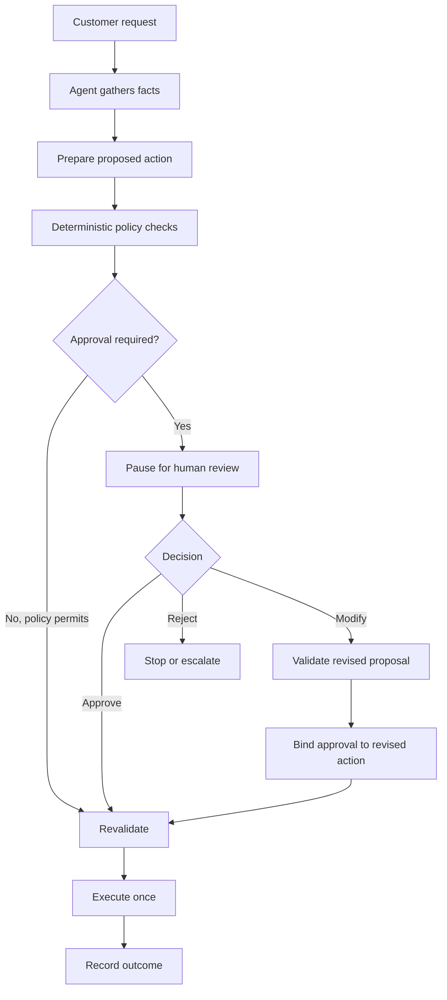
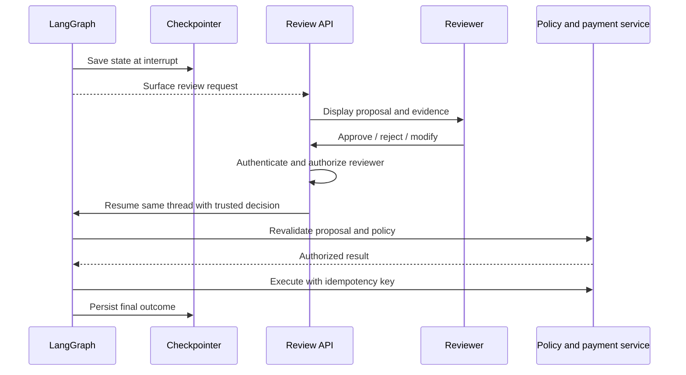

# 21 — LangGraph Human-in-the-Loop

> **A good agent knows when to stop, show its work and ask a person.**

Imagine a support agent that detects a duplicate payment. It finds the transaction, calculates a proposed refund of ₹7,500 and is ready to call the payment API.

The technical question is easy: *Can the agent issue the refund?* The enterprise question is harder: *Should it—and who is allowed to say yes?*

Human-in-the-Loop (HITL) puts a deliberate decision point between an agent's proposal and a consequential action. LangGraph provides the pause-and-resume mechanics. Your application still owns reviewer identity, authorization, policy and the actual business operation.

## 1. Put the human at the right boundary

HITL is not about asking a person to approve every model response. That would turn an agent into a very expensive form-filling application.

Use human review where the impact, uncertainty or regulatory requirement justifies it:

- **Low impact:** search an approved knowledge base or draft an internal summary.
- **Moderate impact:** update a reversible customer preference, perhaps with sampling or policy checks.
- **High impact:** issue a refund, change account ownership, delete data or send a sensitive external communication.

A review does not always mean a binary yes/no. A person may approve, reject, edit a draft, correct extracted data, provide missing information or escalate the case to a specialist. The graph should represent the outcomes the business process actually needs.

The key boundary is between *proposing* and *doing*:



A useful rule: **the agent may prepare the refund; an authorized business process decides whether it can be issued.**

## 2. Separate the responsibilities

Three actors have different jobs. Do not blur them just because they appear in one graph.

| Actor | Responsibility |
|---|---|
| Agent | Gather evidence, interpret the request and prepare a proposal |
| Human reviewer | Approve, reject, edit, clarify or escalate within their role |
| Application and policy services | Authenticate, authorize, validate, enforce limits and execute |

**Approval is not authorization.** A click on Approve does not prove that the person has permission to approve this refund, nor that the refund is still valid. The application must verify identity, role, tenant and action scope independently of the model.

Human input is untrusted input. Validate its schema and business meaning just as you would validate a request received from an external API.

## 3. Model the decision explicitly

Keep the proposal and the review outcome in graph state. For a refund workflow, that might look like this:

```python
from typing import Literal, TypedDict

class RefundState(TypedDict):
    request_id: str
    proposed_amount: int       # smallest currency unit, e.g. paise
    approved_amount: int
    decision: Literal["pending", "approved", "modified", "rejected", "invalid"]
    reviewer_id: str
    validation_error: str
```

Store only what the graph needs to continue. Avoid putting unnecessary customer secrets or full payment credentials into checkpoints. Apply the same access, encryption and retention controls to persisted graph state as you would to other sensitive application data.

## 4. Pause and resume with LangGraph

The mechanics are straightforward:

1. Compile the graph with a checkpointer.
2. Give the run a stable `thread_id`.
3. Call `interrupt()` in the review node with the information the reviewer needs.
4. The application presents that request in its review interface.
5. After authenticating and authorizing the reviewer, the application resumes the same thread with `Command(resume=...)`.

Here is a compact Python example. The payment integration is deliberately left as a stub; the important part is the control flow.

```python
from typing import Literal, TypedDict
from langgraph.graph import StateGraph, START, END
from langgraph.types import interrupt, Command
from langgraph.checkpoint.memory import InMemorySaver

class RefundState(TypedDict):
    request_id: str
    proposed_amount: int
    approved_amount: int
    decision: str
    reviewer_id: str
    validation_error: str

def review(state: RefundState):
    # No external side effects before interrupt().
    response = interrupt({
        "request_id": state["request_id"],
        "proposed_amount": state["proposed_amount"],
        "question": "Approve, reject or modify this refund?"
    })

    # The review API must authenticate the reviewer first and
    # construct this resume payload server-side.
    if not isinstance(response, dict):
        return {"decision": "invalid", "reviewer_id": ""}

    decision = response.get("decision")
    if decision not in {"approved", "modified", "rejected"}:
        decision = "invalid"

    amount = response.get("amount", state["proposed_amount"])
    return {
        "decision": decision,
        "reviewer_id": response.get("reviewer_id", ""),
        "approved_amount": amount,
    }

def route_review(state: RefundState) -> str:
    if state["decision"] == "rejected":
        return "reject"
    if state["decision"] in {"approved", "modified"} and state["reviewer_id"]:
        return "validate"
    return "needs_attention"

def validate(state: RefundState):
    amount = state["approved_amount"]
    if type(amount) is not int or not (1 <= amount <= state["proposed_amount"]):
        return {"validation_error": "Amount is outside the permitted range"}
    return {"validation_error": ""}

def route_validation(state: RefundState) -> str:
    return "execute" if not state["validation_error"] else "needs_attention"

def execute(state: RefundState):
    # Re-fetch current transaction and policy; verify approval binding.
    # Call payment provider with a stable idempotency key.
    return {}

def stop(state: RefundState):
    return {}

builder = StateGraph(RefundState)
builder.add_node("review", review)
builder.add_node("validate", validate)
builder.add_node("execute", execute)
builder.add_node("reject", stop)
builder.add_node("needs_attention", stop)
builder.add_edge(START, "review")
builder.add_conditional_edges("review", route_review, {
    "validate": "validate", "reject": "reject",
    "needs_attention": "needs_attention"
})
builder.add_conditional_edges("validate", route_validation, {
    "execute": "execute", "needs_attention": "needs_attention"
})
builder.add_edge("execute", END)
builder.add_edge("reject", END)
builder.add_edge("needs_attention", END)

app = builder.compile(checkpointer=InMemorySaver())
config = {"configurable": {"thread_id": "refund-1042"}}

# First invocation pauses at interrupt().
app.invoke({
    "request_id": "refund-1042", "proposed_amount": 7500,
    "approved_amount": 7500, "decision": "pending",
    "reviewer_id": "", "validation_error": ""
}, config=config)

# In production, the authenticated review service constructs this payload.
resume_payload = {
    "decision": "approved", "reviewer_id": "reviewer-17"
}
app.invoke(Command(resume=resume_payload), config=config)
```

`InMemorySaver` is useful for a local example, not a durable multi-instance deployment. Use a persistent checkpointer suitable for your environment. The `execute`, `reject` and `needs_attention` functions are intentionally minimal; production code must persist outcomes and return meaningful status.

**A subtle but important detail:** when an interrupted node resumes, LangGraph re-runs that node from its beginning. Code before `interrupt()` can run again. Do not send an email, charge a card or mutate a database before the interrupt and assume it will run only once. Put consequential side effects in a later node.

## 5. Make approval safe after the pause

A reviewer may respond minutes or days later. In the meantime, the transaction may change, the approval may expire or the reviewer may lose access. Treat the decision as permission to *attempt* an action—not as a guarantee that the action is still valid.

Before execution:

- **Authenticate and authorize:** derive reviewer identity from the trusted application session, not from model output or a client-supplied name.
- **Bind the decision:** attach approval to the exact proposal ID/version and, for sensitive actions, a canonical action hash. A changed proposal needs a new decision.
- **Revalidate:** fetch current business data and re-run policy checks immediately before the side effect.
- **Validate modifications:** check amount limits, account ownership, currency and any business constraints deterministically.
- **Prevent duplicates:** use an idempotency key at the external service. A retried graph run must not issue the refund twice.
- **Handle silence:** define expiry, reassignment, escalation or safe cancellation. A timeout must never silently become approval.
- **Audit:** record the proposal, reviewer, decision, timestamp, policy result and execution outcome.



The review queue, notifications, reviewer assignment and user interface are application responsibilities—not features that appear automatically when you add `interrupt()`. LangGraph coordinates the workflow; your application supplies the surrounding operational controls.

For sensitive operations, route reviews using least-privilege roles and tenant boundaries. High-value actions may need multiple approvals or separation of duties—for example, the person who creates a payment must not be the only person who approves it. Define review SLAs and escalation paths, then monitor queue depth, oldest pending item, turnaround time, rejection/edit rates and execution failures. A high approval rate is not automatically success: it may indicate clear proposals, or it may indicate reviewer fatigue and rubber-stamping. Human corrections can also become useful evaluation data, provided they are reviewed and labeled before being used to improve the system.

## 6. Choose the right oversight model

| Pattern | What it means | Example |
|---|---|---|
| Human-in-the-loop | Workflow pauses until a person acts | Approve a high-value refund |
| Human-on-the-loop | Workflow runs while a person monitors and can intervene | Monitor automated low-risk case handling |
| Human-out-of-the-loop | No routine human intervention | Approved read-only retrieval task |

Use deterministic policy rules for hard limits. A model-generated risk score can help prioritize review, but it should not be the authority that grants permission to perform a regulated or irreversible action.

## Production checklist

- [ ] Pause before the consequential side effect.
- [ ] Use a stable thread ID and durable checkpointer.
- [ ] Authenticate reviewers outside the LLM.
- [ ] Validate every decision and every modification.
- [ ] Bind approval to the exact action/version.
- [ ] Revalidate current state and policy before execution.
- [ ] Make external actions idempotent.
- [ ] Define timeout, reassignment and escalation behaviour.
- [ ] Audit decisions and outcomes; monitor queue depth and review latency.

## Key takeaways

HITL is a control boundary, not a confirmation button. LangGraph gives you the interrupt, checkpoint and resume mechanism. Your application must make the decision trustworthy. The safest pattern is simple: **prepare, pause, authenticate, validate, re-check, then execute.**

## Practical exercise

Extend the refund workflow to support approval, rejection and modification. Add a maximum-refund policy, reviewer-role checks, approval expiry and an idempotency key. Test a restart while waiting, a modified amount above the limit, an unauthorized reviewer and a duplicate resume request. For each test, prove that no unauthorized or duplicate payment is issued.

## Interview questions

1. How do `interrupt()`, a checkpointer and `Command(resume=...)` work together?
2. Why can code before `interrupt()` execute again after resumption?
3. Why is approval different from authorization?
4. How do you prevent stale and duplicate approvals?
5. Which parts of an HITL workflow belong to LangGraph, and which belong to the application?

## References

- [LangGraph — Interrupts](https://docs.langchain.com/oss/python/langgraph/interrupts)
- [LangGraph — Persistence](https://docs.langchain.com/oss/python/langgraph/persistence)

---

## 🧭 Chapter Navigation

⬅️ **Previous:** [20. LangGraph Nodes, Edges and Routing](20-langgraph-nodes-edges-and-routing.md)

📚 **Part VIII Index:** [AI Engineering Frameworks & Tooling](index.md)

➡️ **Next:** [22. LangGraph Tool Execution](22-langgraph-tool-execution.md)

---

> **Enterprise AI Engineering Handbook**
>
> *Building Production-Grade Enterprise AI Systems — One Chapter at a Time.*